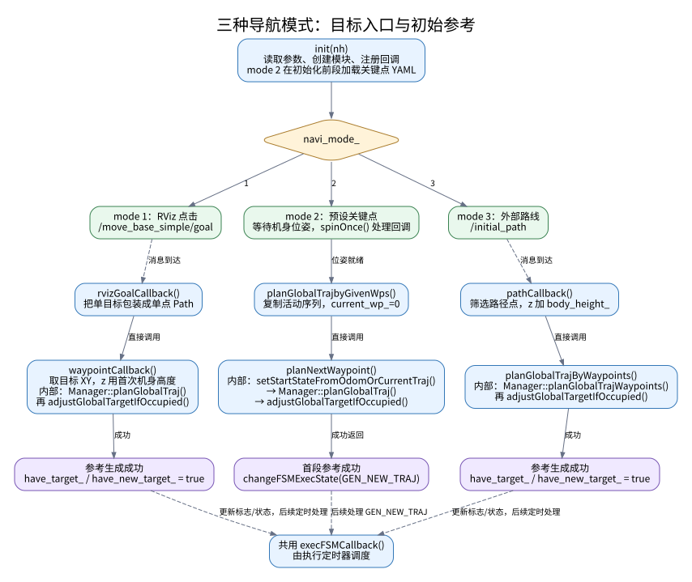
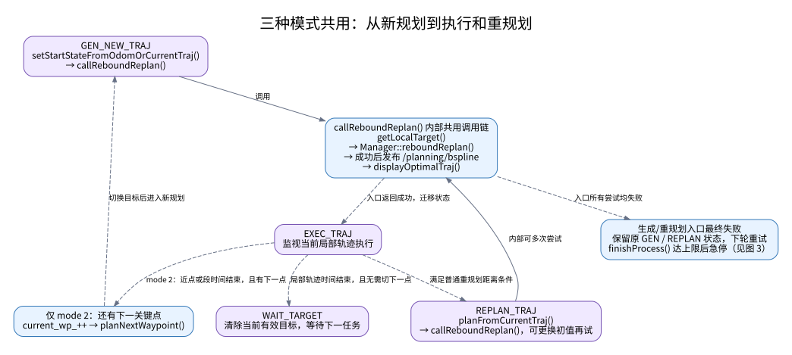
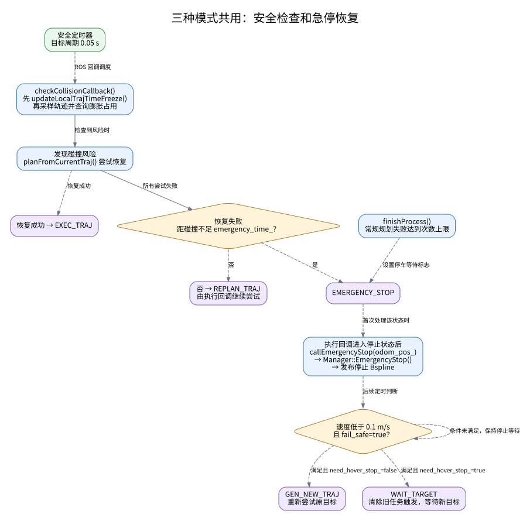

<div align="center">
  <h1>SCAN-Planner</h1>
  <h2>Spatial Collision-Aware Local Planning for Route-Guided<br/>Long-Range Quadruped Navigation</h2>
  <p align="center">
    Han Zheng,
    Zhe Chen,
    Yiwen Fu,
    Ming Yang,
    Tong Qin<sup>*</sup>
  </p>
  <a href="https://arxiv.org/abs/2606.19555" target="_blank"></a>
  <a href="https://www.bilibili.com/video/BV15a7P6UEXb/" target="_blank"></a>
  <a href="https://wuyi2121.github.io/SCAN-Planner/" target="_blank"></a>
  <br/>
</div>

<p align="center">
  
</p>

<p align="justify">
  SCAN-Planner is a spatial collision-aware local planner, providing a <strong>robust low-level planning foundation</strong> for various upper-level tasks, such as autonomous exploration and vision-language navigation.
</p>

## 🧭 System Overview

<p align="center">
  
</p>

## 📢 News
- **[Jul. 29, 2026]**: CAD files for our [sensor layout](https://github.com/zhechen003/GO2-EDU-sensor_layout) are now available.
- **[Jul. 13, 2026]**: ROS2 support is now available from community! Thanks to [xiaoqi371317](https://github.com/xiaoqi371317) for contributing the ROS2 interface. Check out the [ros2-community](https://github.com/wuyi2121/SCAN-Planner/tree/ros2-community) branch.
- **[Jul. 9, 2026]**:  Release the main algorithm of **SCAN-Planner**.

## 🤖 Demonstrations

<table>
  <tr>
    <td align="center" width="50%">
      
    </td>
    <td align="center" width="50%">
      
    </td>
  </tr>
  <tr>
    <td align="center" width="50%">
      
    </td>
    <td align="center" width="50%">
      
    </td>
  </tr>
</table>

More videos and interactive demonstrations are available on the
<a href="https://wuyi2121.github.io/SCAN-Planner/" target="_blank">project page</a>.

## 🛠️ Installation

> Tested on Ubuntu 20.04 with ROS Noetic

**Step 1**. Install [Armadillo](http://arma.sourceforge.net/), which is required by **simulator**.
```
sudo apt-get install libarmadillo-dev
``` 

**Step 2**. Clone our repository and compile. 
```
git clone https://github.com/wuyi2121/SCAN-Planner.git
cd SCAN-Planner
catkin_make
```

## 🚀 Quick Start

Launch RViz in one terminal:
```
source devel/setup.bash && roslaunch scan_planner rviz.launch
```

Launch the algorithm in another terminal:
```
source devel/setup.bash && roslaunch scan_planner run.launch
```

## 🔧 Important Functions

The main launch options are defined in [`run.launch`](src/planner/plan_manage/launch/run.launch):

- `is_real_world`: set to `true` when running with real robot topics (body_pose_topic and sensor_pose_topic), and `false` when testing with the simulator.
- `navi_mode`: selects the navigation interface:
  - `1`: interactive 2D Nav Goal mode
  - `2`: keypoint-based multi-floor navigation; see [`tools/README.md`](tools/README.md)
  - `3`: reference-path tracking with local obstacle avoidance; see [`TravExplorer`](https://github.com/wuyi2121/TravExplorer)

  **Note: If the robot cannot climb stairs, increase the z height of body, keypoints or initial path.**
- `sensor_type`: select the sensing input. Use `lidar` for point-cloud sensors such as MID360, and `depth` for depth cameras such as RealSense D435.

Other algorithm-related parameters are listed in [`advanced_param.xml`](src/planner/plan_manage/launch/advanced_param.xml). The default settings are tuned for Unitree Go2 and should be adjusted when using a different robot platform.

## ⚙️ Optional
**local_sensing** provides CPU and GPU implementations: `pcl_render_node` and `opengl_render_node`.
The CPU version is built by default for better compatibility. To build the GPU backend, first install the dependencies:

```bash
sudo apt-get install libglew-dev libglfw3-dev libgl1-mesa-dev libglu1-mesa-dev
```

Then enable the GPU build option and compile:

```bash
catkin_make -DUSE_GPU=ON
```

The `use_gpu` option in [`simulator.xml`](src/planner/plan_manage/launch/simulator.xml) selects which sensing node to launch.

## 中文源码学习索引：从启动命令展开文件树

本节以本仓库 ROS1 `main` 的实际代码为依据，按“启动命令 → launch 包含关系 → 参数和资源 → 可执行节点 → 源文件 → 回调和算法”的顺序阅读。树中的文件路径均相对于 **SCAN-Planner 仓库根目录**；`ros1_ws` 是本次复现使用的外层工作空间。

树表示文件关联和调用入口；不同 ROS 节点由话题连接，树的上下顺序不表示节点的执行先后。`[默认]` 表示默认启动配置，`[条件]` 表示满足条件才启动，`[库]` 表示链接进进程而非独立启动的节点。所有频率均为配置的定时器目标频率，实际运行还受计算耗时和回调调度影响。

本节对应的源码注释采用以下约定，方便沿树逐层追踪：

- **使用处**说明当前成员/调用在本项目中负责什么、接收什么、影响哪里，不展开复制被调用类型或库函数的原始定义。
- **字段定义处**说明值的来源、正常启动配置、单位、更新位置与消费位置；类型及所有权规则留在所属类型的定义处。
- **默认配置与缺参回退分开**：例如 FSM 的 `planning_horizon_` 正常启动为 `3.5 m`，`nh.param()` 的 `-1.0` 是缺参时的回退，不能当成正常值。
- **运行状态不编造固定值**：位置、速度、执行时间和控制点来自观测/轨迹/求解过程，注释标明生产者与有效条件。
- **保留字段明确标记**：未被当前路径维护、仅写未读或仅有声明的量，不描述成已生效功能，也不擅自删除。
- **读取处随读可查**：源码的参数读取行附近写明项目用途、配置所在命名空间、当前启动树中的默认值及缺参回退；不用先记住头文件中全部字段。
- **运行连接单独说明**：订阅/发布行说明数据来自谁、交给谁，消息队列容量与定时器频率分开解释。

阅读入口：

- [上次阅读位置与继续顺序](#scan-study-bookmark)
- [启动前：工作空间和包名](#scan-study-start)
- [入口一：RViz 启动树](#scan-study-rviz)
- [入口二：仿真和规划启动树](#scan-study-launch)
- [沿着目标点进入规划器](#scan-study-planner)
- [三种导航模式的函数调用图](#scan-study-mode-flow)
- [沿着点云进入局部地图](#scan-study-map)
- [沿着轨迹进入控制和仿真](#scan-study-control)
- [追踪参数从哪里来](#scan-study-params)
- [展开其他启动分支](#scan-study-modes)
- [用运行命令核对文件树](#scan-study-runtime)
- [对应日志与逐步学习任务](#scan-study-exercises)
- [结合论文沿启动树继续阅读](#scan-study-paper)
- [论文全部 15 个公式与源码逐项对照](docs/paper_formula_code_map.md)
- [结合本项目系统学习 C++：路线与独立练习](docs/cpp_study_guide.md)

<a id="scan-study-bookmark"></a>
### 阅读进度书签（2026-11-05）

按此前对话恢复进度：已详细讨论节点入口、FSM、管理器流程和多项式变量分类。当前在 polynomial_traj.cpp 的 minSnapTraj() 中，正在理解构造 R 时的 Eigen 转置、求逆和相关矩阵接口，尚未确认矩阵推导已读完。

继续按启动树，在同一规划节点的源码分支中前进：

| 顺序 | 阅读位置 | 进度或下一步 |
|---|---|---|
| 已经过 | launch → scan_planner_node.cpp → scan_replan_fsm.h/.cpp | 节点、状态机和回调已有较详细讲解；后续需要时回查 |
| 上一文件 | [planner_manager.cpp](src/planner/plan_manage/src/planner_manager.cpp#L758) 的 reparamBspline() | 已解释拉伸时间后重采样和重新求控制点的用途 |
| 当前断点 | [polynomial_traj.cpp 的 R 构造](src/planner/traj_utils/src/polynomial_traj.cpp#L201) | 当前重点为 transpose().inverse()、block()/segment() 等库接口 |
| 先继续 | minSnapTraj() 的 Pos/Time、每段六项端点状态、A 映射；可对照 [one_segment_traj_gen()](src/planner/traj_utils/src/polynomial_traj.cpp#L283) 的单段方程 | 先抓住“给定边界状态求系数”，再逐块展开 Ct、Q、R |
| 随用随查 | [plan_container.hpp](src/planner/plan_manage/include/plan_manage/plan_container.hpp) | 已查过部分字段，作为数据组织索引；未确认整份逐行读完 |

这是一份依据提问记录的书签。后续按当前函数和最新问题更新断点；增加注释后行号可能变化。继续沿原启动树阅读，C++ 练习文档保留为查阅资料。

<a id="scan-study-start"></a>
### 1. 启动前：工作空间、包名和可执行文件

本次复现的目录关系：

```text
~/24_LC/ros1_ws/                         ← catkin 工作空间，编译命令在这里执行
├── src/
│   ├── CMakeLists.txt                   ← catkin 初始化时生成的顶层入口
│   └── SCAN-Planner/                    ← Git 仓库，本 README 所在位置
│       ├── src/planner/                 ← 规划相关 ROS 包
│       ├── src/simulator/               ← 感知、地图和可视化相关 ROS 包
│       └── tools/                      ← 关键点录制工具
├── build/                              ← CMake 和 make 的中间产物
└── devel/
    ├── setup.bash                      ← 加载当前工作空间环境
    ├── lib/scan_planner/                ← scan_planner 包的可执行文件
    ├── lib/libplan_env.so               ← 建图库
    ├── lib/libpath_searching.so         ← A* 搜索库
    ├── lib/libbspline_opt.so            ← B 样条及优化库
    └── lib/libtraj_utils.so             ← 多项式轨迹和可视化库
```

首次构建，或修改 C++ 源码之后：

```bash
cd ~/24_LC/ros1_ws
source /opt/ros/noetic/setup.bash
catkin_make -j4 -l4 -DCMAKE_BUILD_TYPE=Release -DUSE_GPU=OFF
```

两个启动终端都要加载当前工作空间。若 `.bashrc` 已加载系统 ROS 环境和其他工作空间，也仍需确认当前的 `ros1_ws` 已被加载：

```bash
source ~/24_LC/ros1_ws/devel/setup.bash
rospack find scan_planner
```

本工作空间中，查询结果应指向 `src/SCAN-Planner/src/planner/plan_manage`。包名来自该目录的 [package.xml](src/planner/plan_manage/package.xml)，不是由目录名推断；可执行文件来自 [CMakeLists.txt](src/planner/plan_manage/CMakeLists.txt) 中的 `add_executable(...)`。

```text
ROS 包名                 仓库内目录                                构建/使用形式
scan_planner             src/planner/plan_manage                   5 个可执行文件、自定义消息
plan_env                 src/planner/plan_env                      建图库
path_searching           src/planner/path_searching                A* 搜索库
bspline_opt              src/planner/bspline_opt                   B 样条及优化库
traj_utils               src/planner/traj_utils                    轨迹和可视化库
mockamap                 src/simulator/mockamap                    mockamap_node
map_generator            src/simulator/map_generator               map_pub
local_sensing_node       src/simulator/local_sensing               pcl_render_node；可选 GPU 节点
go2_description          src/simulator/Utils/go2_description        URDF 和模型资源
odom_visualization       src/simulator/Utils/odom_visualization     odom_visualization
pose_utils               src/simulator/Utils/pose_utils             位姿工具库
waypoint_generator       src/simulator/Utils/waypoint_generator     waypoint_generator，默认未启动
```

网络配置独立于包环境加载。若现有终端已经配置了可用的 `ROS_MASTER_URI` 和 `ROS_HOSTNAME`，可以直接沿用，无需为复现再添加 `ROS_IP`。多终端应使用一致且可达的地址；修改环境变量后需要重启受影响的进程。

<a id="scan-study-rviz"></a>
### 2. 入口一：`roslaunch scan_planner rviz.launch`

终端 A：

```bash
source ~/24_LC/ros1_ws/devel/setup.bash
roslaunch scan_planner rviz.launch
```

```text
roslaunch scan_planner rviz.launch
└── src/planner/plan_manage/launch/rviz.launch
    ├── ① launch 链式包含：无
    ├── ② 参数和资源
    │   └── src/planner/plan_manage/launch/default.rviz
    │       ├── Fixed Frame：world；当前视图跟随 sliding_map
    │       ├── sim_map → /map_generator/global_cloud
    │       ├── occ_map、inflate_map → /grid_map/occupancy、/grid_map/occupancy_inflate
    │       ├── optimal_traj、AStar → /scan_planner_node 下的 Marker 话题
    │       ├── his_path → /odom_visualization/path
    │       ├── go2_robot → robot_description 和 TF
    │       └── 2D Nav Goal 工具 → /move_base_simple/goal
    └── ③ 可执行节点（1 个，系统包）
        └── 包 rviz / 可执行文件 rviz / 节点名 scanplanner_rviz
            ├── args：-d $(find scan_planner)/launch/default.rviz
            └── required=true：该节点退出时，结束本次 rviz.launch 启动任务
```

打开 [rviz.launch](src/planner/plan_manage/launch/rviz.launch)，逐个对应 `pkg`、`type`、`name`、`args`。这条命令加载显示配置；地图、轨迹和机器人状态由下面的 `run.launch` 提供。两个 launch 连接同一个 ROS Master，`roslaunch` 会在需要时自动启动 Master。

<a id="scan-study-launch"></a>
### 3. 入口二：`roslaunch scan_planner run.launch`

终端 B：

```bash
source ~/24_LC/ros1_ws/devel/setup.bash
roslaunch scan_planner run.launch
```

以下树以默认 `is_real_world=false`、`navi_mode=1`、`sensor_type=lidar`、`controller_mode=closed_loop` 展开。`simulator.xml` 内部默认 `use_pcd_map=false`、`use_gpu=false`。

```text
roslaunch scan_planner run.launch
└── src/planner/plan_manage/launch/run.launch
    ├── ① launch 链式包含（2 个；相互没有包含关系）
    │   ├── src/planner/plan_manage/launch/advanced_param.xml
    │   │   ├── ① 下级 launch 包含：无
    │   │   ├── ② 参数：直接写在 XML 中，默认不加载外部 YAML
    │   │   │   ├── fsm/*：导航模式、局部规划距离、重规划阈值、急停阈值
    │   │   │   ├── grid_map/*：地图、传感器、占用概率、碰撞几何参数
    │   │   │   ├── manager/*：轨迹速度、加速度、控制点间距等参数
    │   │   │   ├── optimization/*：优化权重、避障距离、可行性容差
    │   │   │   ├── remap：内部传感器话题 → run.launch 选择的实际话题
    │   │   │   └── /closed_loop_controller/*：写入控制器的参数命名空间
    │   │   └── ③ 可执行节点（1 个）
    │   │       └── scan_planner / scan_planner_node
    │   │           ├── src/planner/plan_manage/src/scan_planner_node.cpp       ← main()
    │   │           ├── src/planner/plan_manage/src/scan_replan_fsm.cpp         ← 状态机、ROS 回调
    │   │           ├── src/planner/plan_manage/src/planner_manager.cpp         ← 组织轨迹生成与优化
    │   │           ├── src/planner/plan_manage/include/plan_manage/scan_replan_fsm.h
    │   │           ├── src/planner/plan_manage/include/plan_manage/planner_manager.h
    │   │           ├── src/planner/plan_manage/include/plan_manage/plan_container.hpp
    │   │           └── [链接库，含传递依赖] 以下算法在本节点进程内使用，不单独启动 ROS 节点
    │   │               ├── [库] traj_utils：多项式轨迹与规划显示
    │   │               │   ├── src/planner/traj_utils/CMakeLists.txt          ← add_library(traj_utils ...)
    │   │               │   ├── src/planner/traj_utils/src/polynomial_traj.cpp
    │   │               │   │   └── one_segment_traj_gen()、minSnapTraj()：求单段/分段多项式系数
    │   │               │   ├── src/planner/traj_utils/include/traj_utils/polynomial_traj.h
    │   │               │   │   └── 保存多项式；evaluate()/evaluateVel()/evaluateAcc() 求位置及导数
    │   │               │   ├── src/planner/traj_utils/src/planning_visualization.cpp
    │   │               │   │   └── 发布目标、候选曲线、A* 引导、全局参考和优化结果的 Marker
    │   │               │   └── src/planner/traj_utils/include/traj_utils/planning_visualization.h
    │   │               ├── [库] bspline_opt：B 样条表示与轨迹优化
    │   │               │   ├── src/planner/bspline_opt/CMakeLists.txt         ← add_library(bspline_opt ...)
    │   │               │   ├── src/planner/bspline_opt/src/uniform_bspline.cpp
    │   │               │   │   └── 控制点参数化、de Boor 求值、导数、可行性检查、节点时间拉伸
    │   │               │   ├── src/planner/bspline_opt/include/bspline_opt/uniform_bspline.h
    │   │               │   │   └── 类接口；evaluateDeBoorT() 在头文件中实现
    │   │               │   ├── src/planner/bspline_opt/src/bspline_optimizer.cpp
    │   │               │   │   └── 碰撞分段、A* 引导转推离方向、代价与梯度、Rebound/Refine 优化
    │   │               │   ├── src/planner/bspline_opt/include/bspline_opt/bspline_optimizer.h
    │   │               │   ├── src/planner/bspline_opt/include/bspline_opt/lbfgs.hpp
    │   │               │   │   └── [头文件实现] 主优化路径使用的 L-BFGS 数值求解器
    │   │               │   ├── src/planner/bspline_opt/src/gradient_descent_optimizer.cpp
    │   │               │   │   └── 编译进库的备用梯度下降实现，当前主 Rebound/Refine 使用 L-BFGS
    │   │               │   └── src/planner/bspline_opt/include/bspline_opt/gradient_descent_optimizer.h
    │   │               ├── [库] path_searching：局部绕障引导搜索
    │   │               │   ├── src/planner/path_searching/CMakeLists.txt     ← add_library(path_searching ...)
    │   │               │   ├── src/planner/path_searching/src/dyn_a_star.cpp
    │   │               │   │   └── AstarSearch()：投影高度、XY 邻居扩展、朝向碰撞查询和路径回溯
    │   │               │   └── src/planner/path_searching/include/path_searching/dyn_a_star.h
    │   │               │       └── 搜索节点、开放集、启发函数及搜索池坐标转换
    │   │               └── [库] plan_env：三维滑动占用地图
    │   │                   ├── src/planner/plan_env/CMakeLists.txt           ← add_library(plan_env ...)
    │   │                   ├── src/planner/plan_env/src/grid_map.cpp
    │   │                   │   └── 点云/深度融合、概率占用、增量膨胀、滑动窗口与地图显示
    │   │                   ├── src/planner/plan_env/include/plan_env/grid_map.h
    │   │                   │   └── 地图状态与接口；双圆柱 getInflateOccupancy(pos,yaw) 在头文件中实现
    │   │                   ├── src/planner/plan_env/src/raycast.cpp
    │   │                   │   └── 射线遍历体素，供地图更新命中/穿过区域
    │   │                   └── src/planner/plan_env/include/plan_env/raycast.h
    │   └── src/planner/plan_manage/launch/simulator.xml
    │       ├── ① 下级 launch 包含：无
    │       ├── ② 参数和资源
    │       │   ├── 初始位置：[默认 mode 1] (-19.0, 1.0, 0.25)
    │       │   ├── 地图范围：40 × 40 × 5 m
    │       │   ├── 随机地图：seed=127、type=2、障碍物数量=500
    │       │   ├── 感知节点私有参数：/pcl_render_node/sensor_type 等
    │       │   └── [条件 PCD] src/simulator/map_generator/resource/building.pcd
    │       │       └── 这是默认路径，需自行准备文件；默认随机地图不读取它
    │       └── ③ 可执行节点（默认 3 个，另有 2 个替代分支）
    │           ├── [默认] mockamap / mockamap_node：生成并发布仿真环境的障碍点云
    │           │   ├── src/simulator/mockamap/src/mockamap.cpp                 ← 地图发布程序自己的 main() 入口
    │           │   │   └── 读取尺寸/种子/类型 → 生成一次场景 → 默认以 0.5 Hz 重复发布同一份点云
    │           │   ├── src/simulator/mockamap/src/maps.cpp                     ← 实际生成场景几何的函数实现
    │           │   │   └── Maps::generate(type) 分派；默认 type=2 → randomMapGenerate() 随机生成箱体障碍表面点云
    │           │   └── /mock_map 被 remap 为 /map_generator/global_cloud → 模拟传感器观测与 RViz 显示
    │           ├── [条件 use_pcd_map=true，替代 mockamap] map_generator / map_pub
    │           │   └── src/simulator/map_generator/src/map_publisher.cpp       ← 读取、降采样并发布 PCD
    │           ├── [默认] local_sensing_node / pcl_render_node
    │           │   ├── src/simulator/local_sensing/src/pointcloud_render_node.cpp
    │           │   ├── src/simulator/local_sensing/include/ikd-Tree/ikd_Tree.cpp
    │           │   ├── src/simulator/local_sensing/include/FOV_Checker/FOV_Checker.cpp
    │           │   └── 读取全局点云和机身位姿，模拟局部雷达点云及传感器位姿
    │           ├── [条件 use_gpu=true，替代 CPU 感知] local_sensing_node / opengl_render_node
    │           │   └── src/simulator/local_sensing/src/opengl_render_node.cpp
    │           │       └── 编译时还需 USE_GPU=ON；运行节点名仍是 pcl_render_node
    │           └── [默认，也会在真机模式启动] odom_visualization / odom_visualization
    │               ├── src/simulator/Utils/odom_visualization/src/odom_visualization.cpp
    │               ├── 订阅 /body_pose_topic 指向的机身位姿
    │               └── 发布历史路径、显示 Marker，以及 world → base 等 TF
    ├── ② run.launch 本层参数和资源
    │   ├── /body_pose_topic：[仿真] /quad_0/body_pose；[真机] /LIO/odom_vehicle
    │   └── /robot_description
    │       └── src/simulator/Utils/go2_description/urdf/go2_description.urdf
    │           └── src/simulator/Utils/go2_description/dae/                    ← 模型网格资源
    └── ③ run.launch 本层可执行节点（默认 4 个，另有 1 个替代分支）
        ├── [默认 closed_loop] scan_planner / closed_loop_controller
        │   └── src/planner/plan_manage/src/closed_loop_controller.cpp
        │       └── 轨迹 + 实际位姿 → /cmd_vel；大朝向误差时冻结轨迹进度
        ├── [默认 closed_loop 且仿真] scan_planner / go2_kinematic_sim
        │   └── src/planner/plan_manage/src/go2_kinematic_sim.cpp
        │       └── /cmd_vel → 平面运动学积分 → /quad_0/body_pose
        ├── [条件 open_loop，替代以上两个节点] scan_planner / open_loop_controller
        │   └── src/planner/plan_manage/src/open_loop_controller.cpp
        │       └── 对轨迹直接采样，发布包括 z 在内的机身位姿
        ├── robot_state_publisher / robot_state_publisher                    ← 系统包
        │   └── 节点名 go2_robot_state_publisher；URDF + /joint_states → 关节 TF
        └── scan_planner / go2_gait_publisher
            └── src/planner/plan_manage/src/go2_gait_publisher.cpp
                └── 机身速度 → 显示用 /joint_states，默认目标发布频率 60 Hz
```

默认 `run.launch` 一共启动 **8 个应用节点**，另一个 `rviz.launch` 启动 **1 个 RViz 节点**。自动启动的 Master、`rosout` 不计入这 8 个。`go2_gait_publisher` 提供模型步态动画；`go2_kinematic_sim` 做速度积分，当前默认仿真没有运行四足接触动力学或 Gazebo。

规划节点下面的“链接库”分支展开的是构建与源码关系，并非额外的 launch 包含。`plan_manage/CMakeLists.txt` 将节点的三个入口/管理源文件组成可执行程序，再通过 catkin 导出的库依赖链接算法实现。例如 `polynomial_traj.cpp` 编译进 `traj_utils`，由 `planner_manager.cpp` 调用；它没有独立 `main()`，因此不会作为一个 launch 节点出现。树中同时列出实际承载求值/碰撞逻辑的头文件；它们与库的 `.cpp` 一起构成算法阅读入口。

树中的 `main()` 指各个可执行程序自己的入口。这个 ROS 工程由多个程序协作，不只运行一个 C++ 主函数：`mockamap.cpp::main()` 对应地图生成/发布程序，`scan_planner_node.cpp::main()` 对应规划程序，控制器也有自己的入口；`roslaunch` 根据配置分别启动它们。上面的 `maps.cpp` 与 `mockamap.cpp` 编译进同一个 `mockamap_node`，由其 main() 调用场景生成函数，而不是再单独启动一个 maps 节点。

入口文件：[run.launch](src/planner/plan_manage/launch/run.launch)、[advanced_param.xml](src/planner/plan_manage/launch/advanced_param.xml)、[simulator.xml](src/planner/plan_manage/launch/simulator.xml)。先把三者与终端的 `PARAMETERS`、`NODES` 输出逐项对应，再向下读源码。

#### 3.1 当前默认仿真验证到了哪一层

当前工作区的默认启动链可称为“基于三维点云环境的规划与运动学闭环仿真”。它具有地图、模拟观测、在线规划、机身速度跟踪与状态反馈，并由 RViz 提供三维显示。运动执行由 go2_kinematic_sim 数值积分 XY/yaw，Z 固定；没有在此链路中启动 Gazebo 等接触动力学引擎。

| 层次 | 当前实现 | 可观察/验证的内容 |
|---|---|---|
| 场景 | mockamap 或 PCD 发布环境点云 | 不同障碍几何下的规划表现 |
| 观测 | local_sensing 由场景和位姿生成局部点云/深度 | 感知话题、局部建图、可见范围等数据链 |
| 规划 | 滑动地图、A* 引导、B 样条优化与检查 | 几何碰撞模型、轨迹生成、重规划、失败恢复流程 |
| 机身跟踪 | 前馈加位置 P 反馈输出 /cmd_vel，运动学模型积分并反馈里程计 | 简化模型上的跟踪误差、转向冻结、接口与时序 |
| 显示 | RViz、URDF、TF、go2_gait_publisher | 三维模型、轨迹与腿部动画 |
| 四足动力学 | 默认链路未集成 | 不能据此验证足地接触、打滑/跌倒、力矩约束和真实步态稳定性 |

仿真器按 `x += vx_world*dt`、`y += vy_world*dt`、`yaw += wz*dt` 更新机身，并未求解脚接触地面的力、机身动力学或障碍物反作用。避障依靠规划器的地图查询；若规划/跟踪失效，点云障碍不会像配置了刚体碰撞的物理仿真那样产生接触力来挡住模型。腿部动画由经验相位与正弦关系生成，不能看作足端落点或电机控制仿真。open_loop 分支虽可直接显示包含 Z 的三维轨迹，也仍属于运动学演示。

判断仿真类型应看执行模型和传感器/碰撞模型，而不是只看有没有独立三维窗口：RViz 能显示三维场景，显示本身不计算接触动力学；物理仿真也可以关闭图形界面运行。本默认配置可用于规划算法与 ROS 流程复现，不能直接等同于四足机器人动力学验证。

Gazebo 本身支持刚体动力学，通过物理引擎计算质量/惯量、重力、关节约束、接触与摩擦，详见 [Gazebo Classic 官方物理参数说明](https://classic.gazebosim.org/tutorials?cat=physics&tut=physics_params)。动力学仿真同样采用数值计算；与直接按速度更新位姿的区别，在于是否求解力/力矩及约束引起的运动。实际用了多少动力学能力，还取决于机器人惯性、碰撞体、接触参数和控制插件；通过插件直接设置位姿的演示也不能自动当作完整动力学验证。当前项目默认启动链没有接入这套 Gazebo 物理求解。

论文 VI-D 另有 Go2 真机实验；该证据与当前默认开源复现链的验证范围应分开说明。仓库引用/适配 MARSIM 的感知组件，也不意味着这个 launch 已运行外部仿真系统的所有物理模块。若以后要做接触动力学复现，还需另行接入机器人动力学、地形碰撞、传感器和运动控制接口，建立相应闭环。

#### 3.2 点云不是从 RViz 窗口扫描出来的，能否接入 Gazebo

当前数据先由节点产生，再交给 RViz 显示：

```text
mockamap / PCD 发布器 → 全局环境点云 /map_generator/global_cloud
                          ├── RViz：显示环境
                          └── local_sensing + 机身位姿 → 模拟局部点云 /pcl_render_node/cloud
                                                         ├── GridMap：融合为规划占用地图
                                                         └── RViz：显示传感器观测
```

因此环境数据不来自 RViz 窗口。不开 RViz 时地图生成、传感器模拟和规划节点仍能运行，目标可通过其他 ROS 输入提供。

SCAN-Planner 的地图接口接收 PointCloud2 与相应位姿，不要求观测一定由当前 local_sensing 产生。Gazebo 传感器及其 ROS 桥接/转换节点可提供类似输入，见 [Gazebo Classic 官方 ROS 插件说明](https://classic.gazebosim.org/tutorials?tut=ros_gzplugins)。一个可能的完整接入链为：

```text
Gazebo 世界几何 → 仿真传感器 / ROS 转换 → PointCloud2 → GridMap → 局部规划
Gazebo 机身状态 / 定位模块              → Odometry 与传感器位姿 → 规划和跟踪反馈
轨迹 → closed_loop_controller → /cmd_vel → 四足运动控制器及 Gazebo 执行接口 → 机器人模型
RViz 继续订阅以上数据，用于显示和设置目标
```

这是接入方案，当前默认 launch 尚未完成这条 Gazebo 链。实现时应停用被替换的 mockamap/local_sensing/go2_kinematic_sim，避免同一话题有多套仿真源；匹配点云所在坐标系、传感器安装外参、时间戳及话题重映射。Gazebo 中的 Go2 还需要匹配的四足运动控制器，不能仅加载外观模型就让 /cmd_vel 自动驱动腿部。

也可以先只让 Gazebo 替换机身运动学仿真，保留当前点云渲染器，但 Gazebo 碰撞环境与渲染器的场景点云必须一致。只在 Gazebo 中显示一份点云，不会自动将所有点转换成可接触的实体障碍；应由一致的几何源建立世界碰撞体和观测环境。

<a id="scan-study-planner"></a>
### 4. 沿着目标点进入 `scan_planner_node`

先读 [scan_planner_node.cpp](src/planner/plan_manage/src/scan_planner_node.cpp)，再读 [scan_replan_fsm.cpp](src/planner/plan_manage/src/scan_replan_fsm.cpp)。节点入口很短，实际运行由订阅回调和定时器驱动：

```text
src/planner/plan_manage/src/scan_planner_node.cpp :: main()
├── ros::init(...)；ros::NodeHandle nh("~")
│   └── 私有参数前缀为 /scan_planner_node，例如 ~fsm/navi_mode
├── SCANReplanFSM::init(nh)                          ← scan_replan_fsm.cpp
│   ├── 读取参数、初始化标志和状态 INIT
│   ├── PlanningVisualization(nh)                  ← traj_utils 库，发布规划 Marker
│   ├── SCANPlannerManager::initPlanModules()       ← planner_manager.cpp
│   │   ├── GridMap::initMap()                     ← 创建局部地图及其订阅、定时器
│   │   ├── BsplineOptimizer::setParam()/setEnvironment()
│   │   └── AStar::initGridMap()                    ← 搜索节点池 100 × 100 × 100
│   ├── ① 状态更新定时器：0.01 s → execFSMCallback()
│   ├── ② 安全检查定时器：0.05 s → checkCollisionCallback()
│   ├── ③ 机身位姿订阅 → odometryCallback()
│   │   └── 保存位置、速度和姿态；首次位姿确定 mode 1 的目标 z
│   ├── ④ /planning/go2_execution_frozen → go2ExecutionFrozenCallback()
│   └── ⑤ 按 navi_mode 选择目标入口
│       ├── 1：/move_base_simple/goal → rvizGoalCallback()
│       ├── 2：运行时读取 tools/keypoint.yaml → planGlobalTrajbyGivenWps()
│       └── 3：/initial_path → pathCallback()
└── ros::spin()                                    ← 在本进程中调度 ROS 回调
```

`0.01 s` 是状态机回调周期，不代表每秒必定生成 100 条新轨迹。入口使用 `ros::spin()`；规划计算和这些普通回调的调度关系，需要结合回调实际耗时理解。

默认模式下，从 RViz 的一次点击继续向下追：

```text
RViz 2D Nav Goal → /move_base_simple/goal [geometry_msgs/PoseStamped]
└── SCANReplanFSM::rvizGoalCallback()                 ← scan_replan_fsm.cpp
    └── waypointCallback()                         ← 此处是内部函数调用，没有另开路径订阅
        ├── 设置 trigger_、end_pt_，目标 z 使用首次机身位姿的高度
        ├── SCANPlannerManager::planGlobalTraj()    ← planner_manager.cpp
        │   └── PolynomialTraj 生成全局参考轨迹
        │       └── src/planner/traj_utils/src/polynomial_traj.cpp
        ├── adjustGlobalTargetIfOccupied()         ← 目标被占用时沿参考轨迹向后找可用点
        └── 设置 have_target_、have_new_target_，由状态机进入生成/重规划

SCANReplanFSM::execFSMCallback()
├── INIT → WAIT_TARGET → GEN_NEW_TRAJ → EXEC_TRAJ
│   └── INIT 同时等待机身位姿和 trigger_；刚启动停在 INIT、打印 wait for goal 可正常
├── GEN_NEW_TRAJ / REPLAN_TRAJ
│   ├── 确定起点位置、速度和加速度
│   └── callReboundReplan()
│       ├── getLocalTarget()                       ← 沿全局参考选局部目标，默认距离 3.5 m
│       │   └── 局部目标不可用时，在参考轨迹上向前/向后寻找可用点
│       ├── SCANPlannerManager::reboundReplan()    ← 下面继续展开
│       └── 成功后发布 /planning/bspline [scan_planner/Bspline]
│           └── src/planner/plan_manage/msg/Bspline.msg
│               └── order、traj_id、start_time、pos_pts、knots 等字段
├── EXEC_TRAJ → REPLAN_TRAJ                        ← 离开起点阈值且未接近终点时重规划
│   └── planFromCurrentTraj()：默认模式从 odom 更新起点，失败时尝试随机初始化
├── 轨迹执行时间结束 → WAIT_TARGET                 ← mode 2 还可能切换到下一关键点
└── EMERGENCY_STOP
    └── callEmergencyStop() → SCANPlannerManager::EmergencyStop()
        └── 构造固定位置的停止轨迹，并根据状态决定重新规划或等待新目标
```

`planGlobalTraj()` 先生成用于引导的多项式参考，并没有在该函数内完成全局障碍物搜索。真正的局部避障与轨迹优化继续看 [planner_manager.cpp](src/planner/plan_manage/src/planner_manager.cpp)：

这里存在两个规划层次：`planGlobalTraj()` 先把全局多项式参考保存到 `global_data_`，并可通过 Marker 显示；之后状态机才根据它选择局部目标，调用 `reboundReplan()` 生成 `local_data_` 中的局部 B 样条，成功后发布 `/planning/bspline` 供控制器执行。`have_target_=true` 表示目标和参考就绪；`have_new_target_=true` 表示参考刚更新、下一次局部优化需要重建初值。“第一次局部规划尝试”不等于“此前还没有生成任何参考轨迹”。

```text
SCANPlannerManager::reboundReplan()
├── ① 初始化局部轨迹
│   ├── 多项式初始化，或沿用上一条轨迹；失败恢复时可加入随机中间点
│   ├── applyLinearZReference()：按 XY 累积弧长在起终点高度间插值
│   └── UniformBspline::parameterizeToBspline()：采样点和边界导数 → 控制点
│       └── src/planner/bspline_opt/src/uniform_bspline.cpp
├── ② 构造碰撞段的绕行引导
│   └── BsplineOptimizer::initControlPoints()
│       └── src/planner/bspline_opt/src/bspline_optimizer.cpp
│           ├── 调用 GridMap::getInflateOccupancy(pos, yaw) 检测碰撞段
│           ├── AStar::AstarSearch() 为碰撞段搜索绕行路径
│           │   └── src/planner/path_searching/src/dyn_a_star.cpp
│           └── 从绕行路径构造控制点的避障基点和方向
├── ③ B 样条优化
│   └── BsplineOptimizeTrajRebound() → rebound_optimize()
│       ├── lbfgs::lbfgs_optimize()
│       │   └── src/planner/bspline_opt/include/bspline_opt/lbfgs.hpp
│       ├── combineCostRebound()
│       │   ├── calcSmoothnessCost()：平滑性代价
│       │   ├── calcDistanceCostRebound()：避障距离代价
│       │   └── calcFeasibilityCost()：速度和加速度可行性代价
│       └── 检查优化轨迹靠近当前时刻的前 2/3 部分；有碰撞则继续构造引导并优化
├── ④ 时间与可行性检查
│   ├── UniformBspline::checkFeasibility()：需要时调整时间分配
│   ├── refineTrajAlgo() → BsplineOptimizeTrajRefine()
│   │   └── combineCostRefine()：平滑性 + 参考贴合 + 可行性
│   └── checkDynamicFeasibility()：采样检查速度、加速度；这里不是碰撞检测函数
└── ⑤ updateTrajInfo()
    ├── 保存位置 B 样条，并通过求导得到速度、加速度 B 样条
    ├── 更新 traj_id、start_time、duration
    └── 返回 FSM，由 callReboundReplan() 序列化并发布轨迹
```

继续读算法时，把以下边界与实现对应：

- [dyn_a_star.cpp](src/planner/path_searching/src/dyn_a_star.cpp) 的邻居扩展遍历 `dx/dy`，z 由起终点参考关系插值；节点状态没有独立的时间维度，文件名中的 `dyn` 不能作为“预测动态障碍物”的依据。
- [bspline_optimizer.cpp](src/planner/bspline_opt/src/bspline_optimizer.cpp) 的两种组合梯度都执行 `grad_3D.row(2).setZero()`。当前代码使用三维地图检查碰撞，但高度由参考关系约束，不能直接描述成任意三维自由避障。
- 主优化路径调用的是 L-BFGS。`gradient_descent_optimizer.cpp` 虽参与库编译，不能据此把主求解器称为普通梯度下降。
- [plan_container.hpp](src/planner/plan_manage/include/plan_manage/plan_container.hpp) 保存全局参考和局部轨迹数据；它是数据结构，不是 ROS 节点。

安全检查是另一条定时回调入口：

```text
SCANReplanFSM::checkCollisionCallback()              ← 默认目标频率 20 Hz
├── 沿当前轨迹采样位置，并由相邻位置估计 yaw
├── GridMap::getInflateOccupancy(pos, yaw)
└── 发现碰撞风险
    ├── 先调用 planFromCurrentTraj() 尝试恢复
    └── 恢复失败
        ├── 预计碰撞时间小于 emergency_time_ → EMERGENCY_STOP
        └── 否则 → REPLAN_TRAJ
```

检查范围遵循代码中的前 `2/3` 策略：当前时间还在前 `2/3` 时，只检查到该边界；进入后段后，检查余下轨迹。它不是对所有未来环境和整段运动的安全证明。

<a id="scan-study-mode-flow"></a>
#### 4.1 三种导航模式的函数调用图

以下按当前 [scan_replan_fsm.cpp](src/planner/plan_manage/src/scan_replan_fsm.cpp) 绘制，建议依次看“目标入口 → 共用循环 → 安全恢复”。蓝框是函数或处理步骤，紫框是执行状态或任务标志，绿框是输入，菱形是选择条件。实线表示框内处理的先后或直接调用，虚线表示消息/定时器调度、状态迁移或后续反馈；虚线不表示在当前调用栈里立即执行目标函数。

框中 `Manager::` 是 `SCANPlannerManager` 的缩写，表示调用其他文件的实现，图中不继续展开其内部算法。发布 `/planning/bspline` 后由外部控制器执行，机身位姿再回到本文件；`EXEC_TRAJ` 在这里负责监视执行和决定重规划。

**图 1：三种模式各自如何准备导航任务。** 图中展示输入合法、参考生成成功的主路径；空消息、无位姿、文件加载失败或参考生成失败会按对应函数的检查提前返回、打印日志或关闭节点，不能继续按成功路径理解。



[打开 SVG 大图](docs/navigation_flow/01-mode-entry.svg) · [Mermaid 源码](docs/navigation_flow/01-mode-entry.mmd) · [Graphviz 源码](docs/navigation_flow/01-mode-entry.dot)

| 模式 | 当前文件的主要入口顺序 | 初始参考来源和高度处理 |
|---|---|---|
| `1` 手动目标 | `rvizGoalCallback()` → `waypointCallback()` → 调用管理器 → `adjustGlobalTargetIfOccupied()` | 输入点击目标 XY，Z 使用首次机身位姿记录的 `rviz_goal_height_` |
| `2` 预设序列 | `init()` 加载 YAML 并等位姿 → `planGlobalTrajbyGivenWps()` → `planNextWaypoint()` | 每次只为当前关键点生成一段参考，XYZ 来自配置列表 |
| `3` 外部路线 | `pathCallback()` → `planGlobalTrajByWaypoints()` → 调用管理器 → `adjustGlobalTargetIfOccupied()` | 路径筛点后生成多点参考，首点作为参考起点，各点 Z 加 `body_height_` |

`waypointCallback()` 当前由 mode 1 内部直接调用，并不是 mode 2 的切点入口。`planGlobalTrajbyGivenWps()` 与 `planGlobalTrajByWaypoints()` 名称接近，分别属于 mode 2 和 mode 3，阅读时注意大小写和单词差异。

图 1 的末端也不是三个回调都立即调用 `execFSMCallback()`：

- mode 1/3 入口成功时更新任务标志。如果当前在 `INIT`，后续定时回调依次处理 `INIT → WAIT_TARGET → GEN_NEW_TRAJ`；在 `WAIT_TARGET` 收到目标会切到新规划；执行中更新目标会切到 `REPLAN_TRAJ`。
- mode 2 的首段 `planNextWaypoint()` 成功后，`planGlobalTrajbyGivenWps()` 直接设置 `GEN_NEW_TRAJ`，随后由定时器处理。
- `changeFSMExecState()` 只修改状态和统计信息，不会在其内部立即执行新状态对应的算法。

**图 2：任务准备好后，共用的局部规划和执行循环。** 从进入 `GEN_NEW_TRAJ` 开始看；所有紫色状态都由 `execFSMCallback()` 按目标周期 `0.01 s` 分次调度，每轮先执行 `updateLocalTrajTimeFreeze()`。



[打开 SVG 大图](docs/navigation_flow/02-shared-cycle.svg) · [Mermaid 源码](docs/navigation_flow/02-shared-cycle.mmd) · [Graphviz 源码](docs/navigation_flow/02-shared-cycle.dot)

共用的核心发布链是：`callReboundReplan()` → `getLocalTarget()` → 调用管理器的 `reboundReplan()` → 成功后填写 Bspline、`bspline_pub_.publish()` → `displayOptimalTraj()`。成功会返回调用者，再由调用者设置 `EXEC_TRAJ`。图 2 将重规划的多级初值尝试折叠成一个入口，具体区别如下：

| `planFromCurrentTraj()` 内部步骤 | mode 1 / mode 2 | mode 3 |
|---|---|---|
| 起始状态 | 位置取实际 odom，导数取当前轨迹；导数背离目标时清零 | 位置、速度、加速度都取当前轨迹采样 |
| 全局参考 | 调用管理器 `planGlobalTraj()` 刷新当前起点到本段目标的参考，再检查/调整目标 | 保留外部路径建立的参考，不在这个分支重新生成全局参考 |
| 局部重规划尝试 | `callReboundReplan(true,false)`，失败再试 `(true,true)` | 依次尝试 `(false,false)`、失败后 `(true,false)`、再失败后 `(true,true)` |

上述实参分别选择是否使用多项式初始化、是否使用随机初始化；`callReboundReplan()` 还会将 `have_new_target_` 与多项式标志合并，因此新目标也能强制重建初值。某一次尝试失败不一定表示整个入口失败；图 2 的失败支路表示入口完成本轮恢复尝试后仍返回失败。

mode 2 独有的切点条件由 `isWaypointSequenceMode()` 判断：还有下一点，且实际位置距当前段目标小于 `0.5 m`，或者当前局部轨迹时间结束，就推进 `current_wp_` 并调用 `planNextWaypoint()`。当前代码在切点参考失败后也会累计失败并进入 `GEN_NEW_TRAJ`，图中没有将它画成成功保证。

最后一个点或其他模式的局部轨迹时间结束后会回到 `WAIT_TARGET`；这是本文件的阶段结束判断，实际到点误差和停车仍需结合控制器与机身位姿检查。

**图 3：共用安全检查与急停恢复。** `checkCollisionCallback()` 由另一个目标周期 `0.05 s` 的定时器触发，与普通执行分支分别进入同一状态机对象；入口使用 `ros::spin()`，不应把两路回调画成两个独立的并行算法线程。



[打开 SVG 大图](docs/navigation_flow/03-feedback-safety.svg) · [Mermaid 源码](docs/navigation_flow/03-feedback-safety.mmd) · [Graphviz 源码](docs/navigation_flow/03-feedback-safety.dot)

没有有效局部轨迹、处于等待目标等跳过条件下，安全回调会提前返回；没有发现风险时保持当前状态。风险检查仍遵循前文所述的前 `2/3` 采样范围策略。

安全恢复成功后，新轨迹已由 `callReboundReplan()` 发布，安全回调设置 `EXEC_TRAJ`。恢复失败时按碰撞剩余时间选择 `REPLAN_TRAJ` 或 `EMERGENCY_STOP`。普通规划失败达到计数上限则由 `finishProcess()` 设置停车等待标志；它与安全回调的“碰撞迫近”触发来源不同。

三种模式始终共用的观测和辅助入口还有：

| 函数 | 在主流程中的位置 |
|---|---|
| `odometryCallback()` | 接收机身位置、速度、姿态，设置 `have_odom_`；mode 1 首次记录目标高度，随后刷新机身几何 Marker |
| `go2ExecutionFrozenCallback()` | 接收闭环控制器的冻结标志；由后续 `updateLocalTrajTimeFreeze()` 暂停规划端参考进度 |
| `setStartStateFromOdomOrCurrentTraj()` | 首次新规划和 mode 2 切点时组织起始边界；重规划的专门分支见上表 |
| `getLocalTarget()` | 将当前全局参考转为本轮局部目标位置/速度，必要时沿参考寻找可用目标 |
| `adjustGlobalTargetIfOccupied()` | 初始参考建立后或 mode 1/2 刷新参考后，对已占用终点尝试回退 |
| `changeFSMExecState()` / `finishProcess()` | 分别记录状态迁移、检查普通规划失败次数上限 |
| `callEmergencyStop()` | 通过管理器建立停止轨迹，并复用 Bspline 话题发布 |

沿源码阅读时可以先完整追一条 mode 1 成功链，再比较 mode 2 的切点入口和 mode 3 的参考保持分支，最后看失败重试与安全恢复，避免把一次 ROS 回调误当成整段导航都已执行完。

<a id="scan-study-map"></a>
### 5. 沿着点云进入局部地图

先区分“仿真的真实环境点云”和“规划器根据传感器观测建立的局部地图”。打开 [pointcloud_render_node.cpp](src/simulator/local_sensing/src/pointcloud_render_node.cpp)，再打开 [grid_map.cpp](src/planner/plan_env/src/grid_map.cpp)：

```text
mockamap_node → /map_generator/global_cloud          ← 仿真环境点云
└── pcl_render_node :: rcvGlobalPointCloudCallBack()
    ├── 点云转换、降采样、KD-tree、法线及空间索引
    ├── rcvOdometryCallback() ← /quad_0/body_pose
    │   └── 机身姿态结合传感器外参，得到并发布所选传感器位姿
    │       ├── [lidar] /quad_0/lidar_pose
    │       └── [depth] /quad_0/camera_pose
    └── renderSensedPoints()                        ← 默认 sensing_rate=10 Hz
        ├── [lidar] /pcl_render_node/cloud          ← 世界坐标下的模拟观测点云
        └── [depth] /pcl_render_node/depth

scan_planner_node 进程内部的 GridMap                ← [库] plan_env
├── [lidar] sensorPoseCallback()                    ← /quad_0/lidar_pose
│   └── 保存射线原点和姿态；need_extrinsic=true 时再使用配置外参
├── [lidar] cloudCallback()                         ← /pcl_render_node/cloud
│   ├── 仿真 cloud_is_world=true：XYZ 已在世界坐标系
│   ├── 真机 cloud_is_world=false：按传感器位姿变换到世界坐标系
│   └── 筛选观测，准备地图更新标志
├── [depth] depthPoseCallback()                     ← 深度图和位姿的近似时间同步
├── updateOccupancyCallback()                       ← 0.05 s，有待融合观测时才更新
│   ├── [depth] projectDepthImage()：深度图 → 三维观测点
│   └── raycastProcess()
│       ├── src/planner/plan_env/src/raycast.cpp    ← 射线经过的体素
│       ├── 命中端点与射线经过区域提供 hit/miss 证据
│       ├── applyOccupancyUpdate()：更新并截断 log-odds
│       └── updateInflation()：更新障碍膨胀及计数
├── updateSlidingMap()
│   ├── 局部窗口随传感器位置移动，默认 10 × 10 × 5 m
│   ├── 体素索引取模映射到固定大小缓冲区
│   └── 清理移出窗口的数据；大跨度移动时重置窗口数据
├── GridMap::getInflateOccupancy(pos, yaw)           ← 搜索、优化、安全检查共用查询
│   └── src/planner/plan_env/include/plan_env/grid_map.h
│       ├── 用 yaw 计算前后两个中心：pos ± offset × heading
│       ├── 两个中心分别查询已经膨胀的占用缓冲区
│       └── 任一中心不可用，就返回相应占用/越界结果
└── visCallback()                                   ← 默认目标频率 20 Hz
    ├── 发布 occupancy、occupancy_inflate、sliding_map_bbox 等显示信息
    └── publishSlidingMapFrame()：发布 world → sliding_map 的 TF，供 RViz 视图跟随
```

双圆柱的水平半径被编码到障碍物膨胀中，查询时再按 yaw 放置前后两个中心。继续看 [grid_map.h](src/planner/plan_env/include/plan_env/grid_map.h) 的 `getInflateOccupancy()` 与 [grid_map.cpp](src/planner/plan_env/src/grid_map.cpp) 的 `rebuildInflationOffsets()`，将“机器人形状”与“障碍物膨胀后的查询”对应起来。

占用查询中的 `0`、`1`、地图范围外的 `-1` 需要结合调用方判断，不能直接把所有非占用结果理解为空闲。窗口外和窗口内未观测体素也不是同一个概念；阅读 `occupancy_buffer_` 初始化、`getOccupancy()`、`getInflateOccupancyFromBuffer()` 时分别核对。

#### 5.1 为什么使用三维滑动窗口

本项目需要在长距离导航中持续检查机身与附近三维障碍的碰撞，同时保留较细的体素分辨率。固定尺寸的滑动地图让存储规模由“窗口大小与分辨率”决定，而不是随走过的整片环境一直增长；全局参考或上层粗路线提供远处方向，精细窗口服务于当前局部搜索、轨迹优化和安全检查。对应论文第 5 页 V-A、Fig. 5。

体素数量约为 `ceil(Lx/r) × ceil(Ly/r) × ceil(Lz/r)`。以当前 0.05 m 分辨率比较：

| 假设存为稠密体素图的范围 | 体素数量 | 仅一个 double 占用数组 |
|---|---:|---:|
| 当前窗口 10 × 10 × 5 m | 200 × 200 × 100 = 400 万 | 约 32 MB |
| 整片 40 × 40 × 5 m 场景 | 800 × 800 × 100 = 6400 万 | 约 512 MB |

这只是一个数组的理论比较，实际还有膨胀、计数、射线等数据；仿真节点保存的全局点云也不是上表这张稠密体素图。滑动窗口允许在机器人附近保持细分辨率，避免为了覆盖越来越大的环境而不断扩容，或被迫将全部地图降到很粗的精度。

正常平移时，旧窗口和新窗口可分为：

```text
旧窗口：[ 移出 A | 重叠 B ]
新窗口：         [ 重叠 B | 新进 C ]
```

保留 B 的已有占用数据；清理 A 及其膨胀贡献，把这些缓冲地址复用于 C，并将 C 重置为未观测状态，再由新观测更新。环形缓冲用全局体素索引取模寻址，重叠区域不需要整块搬移。大跨度位移超过窗口尺寸时则会重置整窗，不能一律说只更新薄边界；当前实现也会初始化窗口大小的临时掩码，“免拷贝”不意味着总更新时间恒定。

源码入口为 [grid_map.cpp](src/planner/plan_env/src/grid_map.cpp) 的 `initMap()`、`updateSlidingMap()`，以及 [grid_map.h](src/planner/plan_env/include/plan_env/grid_map.h) 的 `toAddress()/getLocalIndex()`。当前活动窗口按传感器射线原点更新；默认移动阈值为 0.2 m，按各轴体素位移最大值判断，不是每个微小位姿变化都搬窗。窗口外的旧局部数据会被遗忘，回到该区域时需要重新观测或由上层地图另行提供信息。

窗口尺寸体现实时性与绕行空间的折中：需结合局部前视距离（默认 3.5 m）、机器人几何和必要的制动/观测余量配置。窗口过小会限制可用候选与绕行范围，过大则增加存储和更新开销。对动态障碍的适应主要依赖连续观测和占用更新，滑动窗口本身主要解决空间范围与内存复用。

<a id="scan-study-control"></a>
### 6. 沿着轨迹进入控制、仿真和显示

打开 [closed_loop_controller.cpp](src/planner/plan_manage/src/closed_loop_controller.cpp)，从 `main()` 的订阅追到两个数据回调及控制定时器：

```text
/planning/bspline [scan_planner/Bspline]
└── closed_loop_controller :: bsplineCallback()
    ├── 控制点 + 阶数 + knots → 重建 UniformBspline
    ├── 求导得到速度和加速度样条
    └── 重置控制器 exec_time

/quad_0/body_pose [nav_msgs/Odometry]
└── closed_loop_controller :: odomCallback()
    └── 保存实际位置与 yaw

closed_loop_controller :: cmdCallback()             ← 0.01 s
├── 未收到轨迹或位姿 → 发布停止指令
├── 由前视轨迹方向估计目标 yaw，计算并归一化朝向误差
├── 朝向误差大于阈值 → 原地转向，冻结 exec_time
│   └── /planning/go2_execution_frozen=true
│       └── FSM::updateLocalTrajTimeFreeze() 推迟规划端轨迹 start_time
│           └── 让规划端的轨迹时间也暂停推进
└── 朝向满足阈值 → exec_time 推进
    ├── 世界系速度 = 轨迹速度前馈 + kp_pos × 位置误差
    ├── 将世界系水平速度旋转到机身坐标系并限幅
    └── /cmd_vel [geometry_msgs/Twist]
        ├── linear.x / linear.y：机身水平速度
        └── angular.z：转向角速度

/cmd_vel
└── go2_kinematic_sim :: cmdCallback()               ← go2_kinematic_sim.cpp
    └── simCallback()                               ← 默认 sim_rate=100 Hz
        ├── 超过 cmd_timeout 未收到新指令 → 按零速度处理
        ├── 机身速度转到世界系，积分 x、y、yaw；z 保持初始值
        └── publishOdom() → /quad_0/body_pose
            ├── 返回规划器、控制器和感知节点，构成闭环
            ├── go2_gait_publisher → /joint_states → robot_state_publisher
            └── odom_visualization → 历史路径、Marker 和模型相关 TF
```

注意区分规划的 `start_time` 与闭环控制器的 `exec_time`：闭环跟踪从收到轨迹后重置的执行时间推进；开环分支使用消息中的 `start_time` 计算经过时间。`Bspline.msg` 虽定义了 `yaw_pts`，当前闭环控制器的朝向主要由位置轨迹前视方向计算。

两种结束判断也不同：FSM 根据局部轨迹执行时间等条件回到 `WAIT_TARGET`；闭环控制器在轨迹时间结束且水平位置误差小于 `finish_dist` 时发布零指令。因此，看到 `WAIT_TARGET` 还需结合真实位姿检查终点误差。

#### 6.1 规划目标函数与 MPC、轨迹跟踪控制的关系

论文式 (6) 的三项加权目标用于轨迹规划：优化变量是 B 样条内部控制点，代价衡量碰撞、平滑和运动限值超限，结果是可按时间求位置/速度/加速度的局部轨迹。实现位于 bspline_optimizer.cpp 的 combineCostRebound() 和 rebound_optimize()，由 L-BFGS 调整控制点。规划前视和滚动更新与 MPC 有相似思想，具体功能仍需看优化变量、预测模型及输出。

典型跟踪 MPC 将系统预测模型（如 x_(k+1)=f(x_k,u_k)）、初始实际状态、输入/状态约束与跟踪/控制代价共同放入有限时域优化，执行当前一步控制后再次根据反馈求解；可对照 [OSQP 官方 MPC 示例](https://osqp.org/docs/examples/mpc.html)。MPC 也可使用不同参数化与非线性目标，因此不能仅凭“用了某种求解器或有目标函数”判定它是否属于 MPC。

当前默认执行链为：

    B 样条规划与发布 /planning/bspline
      → closed_loop_controller 重建位置样条及导数样条
      → 取参考位置 p_d、参考速度 v_d，与机身实际位姿比较
      → 速度前馈 + 位置比例反馈，另做 yaw 比例反馈
      → 转到机身坐标系并限幅 → /cmd_vel
      → 仿真时由 go2_kinematic_sim 积分 x/y/yaw
      → /quad_0/body_pose 反馈给控制器、规划器和感知节点

跟踪控制器 cmdCallback() 的主要计算为：

    e_p = p_d,xy - p_actual,xy
    v_world_raw = v_d,xy + kp_pos * e_p
    omega_raw = kp_yaw * wrap(yaw_des - yaw_actual)
    v_body = Rz(yaw_actual)^T * v_world

实际代码对世界系合速度、机身各轴速度和角速度分别限幅。朝向来自前视参考位置的方向，误差较大时先原地旋转、冻结轨迹进度；到达末端且水平误差小于阈值时输出零速度。这一层可称为“速度前馈加位置 P 反馈的机身轨迹跟踪”，没有误差积分、误差微分或在线 MPC 控制求解。

例如忽略限幅、机身朝向为零，参考 X=1.0 m、实际 X=0.8 m、参考速度=0.5 m/s、kp_pos=0.8 1/s，则 X 方向指令为 0.5+0.8*(1.0-0.8)=0.66 m/s：在参考速度上增加追赶误差的修正。

需要区分论文真机执行与当前默认演示：论文 Fig. 2 将轨迹控制器和四足运动模块分层表示，但没有据此公开 Go2 最低层具体采用 MPC、WBC 还是学习策略的完整实现。当前 run.launch 的真机分支需要外部系统提供位姿和执行机身速度的接口；本启动链没有启动 Go2 SDK 桥接。默认仿真是平面运动学积分，go2_gait_publisher 只生成显示动画，不能当作真实足端/关节电机控制器。

默认 TF 来源也可以按树核对：

```text
world
├── base                         ← odom_visualization，依据机身位姿
│   ├── 机器人各关节/链接          ← robot_state_publisher，依据 URDF 和 joint_states
│   └── laser、vision、height     ← odom_visualization 的显示用坐标系
└── sliding_map                  ← GridMap，跟随机身平移，姿态设为单位旋转
```

`go2_kinematic_sim` 的 `publish_tf` 默认是 `false`；当前默认链路的 `world → base` 由可视化节点发布。感知节点发布的 `lidar_pose/camera_pose` 是 `nav_msgs/Odometry` 消息，不能仅由话题名推断 TF 树里必有同名坐标系。

<a id="scan-study-params"></a>
### 7. 追踪参数从哪里来、由谁读取

```text
run.launch 的 <arg>                                ← 启动时的选择和下游透传
└── advanced_param.xml 的 <param>                   ← 写入 ROS 参数服务器
    ├── <node name="scan_planner_node"> 内部
    │   └── /scan_planner_node/{fsm,grid_map,manager,optimization}/...
    │       └── 通过私有 NodeHandle("~") 读取
    └── <node> 外部的 closed_loop_controller/...
        └── /closed_loop_controller/... → 控制器的私有参数

simulator.xml 的 <param>
├── /init_x、/init_y、/init_z                         ← 开/闭环仿真的初始位置
├── /mockamap_node/...                              ← 地图生成节点的私有参数
└── /pcl_render_node/...                            ← 感知节点的私有参数
```

先挑一个参数，沿“声明 → 写入 → 读取 → 使用位置”走完整条链，再读下一个：

| 参数/声明位置 | 默认值 | 读取和使用入口 | 学习时核对什么 |
|---|---|---|---|
| `run.launch: navi_mode` | `1` | `SCANReplanFSM::init()` | 选哪个目标输入入口 |
| `advanced_param.xml: planning_horizon` | `3.5 m` | `getLocalTarget()` 等 | 全局参考与局部规划的区别 |
| `fsm/thresh_replan`、`thresh_no_replan` | `1.0 / 0.1 m` | `execFSMCallback()` | 相对轨迹起点、终点的距离阈值，不是时间周期 |
| `fsm/emergency_time_` | `1.0 s` | `checkCollisionCallback()` | 重试失败后何时切换急停 |
| `grid_map/resolution` | `0.05 m` | `GridMap::initMap()` | 地图精度、内存和搜索开销的联系 |
| `grid_map/sliding_map_size_*` | `10 / 10 / 5 m` | `updateSlidingMap()` | 固定窗口为何支持长距离移动 |
| `double_cylinder_radius / offset` | `0.25 / 0.18 m` | 膨胀偏移构造、`getInflateOccupancy()` | yaw 如何影响前后中心位置 |
| `obstacles_inflation_z_up/down` | 各 `0.1 m` | `rebuildInflationOffsets()` | 垂直方向的碰撞裕量 |
| `grid_map/body_height` | `0.4 m` | FSM 的 `pathCallback()` | mode 3 给输入路径高度加的偏移，不等同于膨胀半径 |
| `manager/max_vel / max_acc` | `0.75 m/s / 0.5 m/s²` | 规划管理器、样条可行性检查 | 优化软惩罚、检查容差、控制限幅分别在哪里 |
| `optimization/vel_tolerance / acc_tolerance` | 各 `1.0`，按对应物理量加到限值上 | `checkDynamicFeasibility()` | 最终检查不是仅按名义 max_vel/max_acc 判定 |
| `optimization/lambda_*` | 见 XML | `combineCostRebound()/combineCostRefine()` | 两阶段使用的代价项不同 |
| `closed_loop_controller/time_forward` | `0.8 s` | `estimateDesiredYaw()` | 朝向前视，不是局部规划距离 |
| `closed_loop_controller/heading_error_threshold` | `0.8 rad` | `cmdCallback()` | 何时原地转向并冻结进度 |
| `closed_loop_controller/finish_dist` | `0.15 m` | `cmdCallback()` | 控制器停车的位置误差阈值 |

`<arg>` 不会自动变成 ROS 参数；只有写入 `<param>`，或被传给后续 launch、程序参数时才发生对应作用。同样，XML 中出现的参数也应继续检查代码是否真正读取、参与计算。

<a id="scan-study-modes"></a>
### 8. 展开其他启动分支

默认链路理解清楚后，再切换分支；下面是静态源码入口说明，不代表这些分支均已完成运行验收。

```text
run.launch 的公开选择
├── navi_mode=2：预设关键点序列
│   ├── tools/keypoint_recorder.py                   ← 单独手动运行的工具
│   │   └── 录制机身位置并生成 tools/keypoint.yaml
│   ├── SCANReplanFSM::init() 用 rosparam load 运行时加载 YAML
│   │   └── 加载到本节点命名空间；不是 launch 中的静态 <rosparam file=...>
│   ├── planGlobalTrajbyGivenWps() → planNextWaypoint()
│   └── execFSMCallback() 推进 current_wp_，依次处理关键点
├── navi_mode=3：参考路径输入
│   ├── 外部节点发布 /initial_path [nav_msgs/Path]
│   ├── pathCallback()：筛选路径点，z 加 body_height_
│   └── planGlobalTrajByWaypoints() → 后续局部重规划
├── sensor_type=depth：深度相机
│   ├── 模拟感知输出 depth 和 camera_pose
│   └── GridMap::depthPoseCallback() → projectDepthImage() → raycastProcess()
├── controller_mode=open_loop：直接轨迹采样的仿真
│   ├── 启动 open_loop_controller，关闭 closed_loop_controller 和 go2_kinematic_sim
│   └── 直接发布三维位置/速度；与平面闭环仿真的能力和误差模型不同
└── is_real_world=true：接入外部真实数据
    ├── 机身位姿：/LIO/odom_vehicle
    ├── 传感器位姿：/LIO/odom_imu；激光点云：/LIO/clouds_lidar
    ├── 默认深度话题：/camera/aligned_depth_to_color/image_raw
    ├── 关闭模拟地图、模拟感知和 go2_kinematic_sim
    └── 仍启动规划器、所选控制器、模型及 odom_visualization
        └── 本 launch 没有启动定位算法或 Go2 SDK 驱动，外部系统需提供对应接口
```

例如切换模拟深度相机：

```bash
roslaunch scan_planner run.launch sensor_type:=depth
```

关键点工具在当前外层工作空间中的运行路径为：

```bash
cd ~/24_LC/ros1_ws
source devel/setup.bash
python3 src/SCAN-Planner/tools/keypoint_recorder.py --odom /quad_0/body_pose
```

工具操作及 YAML 格式见 [tools/README.md](tools/README.md)。准备文件后可使用 `navi_mode:=2`；多楼层轨迹采样可选择 `controller_mode:=open_loop`，但地图、关键点及其高度仍需与场景匹配。

还有两项选择定义在 **simulator.xml 内部**：

```text
src/planner/plan_manage/launch/simulator.xml
├── use_pcd_map：false → mockamap_node；true → map_pub
│   └── pcd_map_file：传给 PCD 加载节点/相关感知分支
└── use_gpu：false → pcl_render_node；true → opengl_render_node
    └── 构建开关 USE_GPU 控制是否生成 GPU 可执行文件
```

当前 `run.launch` 没有声明并透传这两个参数，不能直接照搬其他分支的 `run.launch use_gpu:=true` 或 `use_pcd_map:=true` 命令。若要从主入口切换，应先在主 launch 中增加对应 `<arg>` 并传给 `<include>`，或修改被包含文件中的默认值。编译出 GPU 节点也不会自动将启动分支切换到 GPU。

仓库内的 `waypoint_generator`、`tools/keypoint_recorder.py`、`local_sensing/params/camera.yaml` 都不能仅因文件存在就视为默认启动链路的一部分；当前默认 launch 没有启动前两者，也没有加载该 YAML。

<a id="scan-study-runtime"></a>
### 9. 用运行命令核对文件树

在加载相同工作空间和网络环境的另一个终端执行。`--nodes` 只展开 launch 配置，不启动节点；`rosnode` 和 `rostopic` 查询当前运行系统：

```bash
# 定位包及静态启动列表
rospack find scan_planner
roslaunch --nodes scan_planner run.launch
roslaunch --nodes scan_planner rviz.launch

# 对照实际节点和连接
rosnode list
rosnode info /scan_planner_node
rostopic info /quad_0/body_pose
rostopic info /planning/bspline

# 一次读取一条消息；无数据时等待，可用 Ctrl-C 退出
rostopic echo -n 1 /quad_0/body_pose/pose/pose/position
rostopic echo -n 1 /cmd_vel
rosmsg show scan_planner/Bspline

# 参数名称与命名空间核对
rosparam get /scan_planner_node/fsm/planning_horizon
rosparam get /scan_planner_node/grid_map/resolution
rosparam get /closed_loop_controller/kp_pos

# 检查消息到达频率，观察后 Ctrl-C 退出
rostopic hz /quad_0/body_pose
rostopic hz /pcl_render_node/cloud
```

数据连接可逐条与上面的源码树配对：

| 话题（默认配置） | 发布者 → 订阅者 | 消息类型 |
|---|---|---|
| `/map_generator/global_cloud` | mockamap → 模拟感知、RViz | `sensor_msgs/PointCloud2` |
| `/quad_0/body_pose` | 运动学仿真 → 规划器、控制器、感知、动画、可视化 | `nav_msgs/Odometry` |
| `/quad_0/lidar_pose` | 模拟感知 → 规划器内的 GridMap | `nav_msgs/Odometry` |
| `/pcl_render_node/cloud` | 模拟感知 → GridMap、RViz | `sensor_msgs/PointCloud2` |
| `/move_base_simple/goal` | RViz → FSM | `geometry_msgs/PoseStamped` |
| `/planning/bspline` | FSM → 轨迹控制器 | `scan_planner/Bspline` |
| `/cmd_vel` | 闭环控制器 → 运动学仿真 | `geometry_msgs/Twist` |
| `/planning/go2_execution_frozen` | 闭环控制器 → FSM | `std_msgs/Bool` |
| `/grid_map/occupancy_inflate` | GridMap → RViz | `sensor_msgs/PointCloud2` |
| `/joint_states` | 步态动画 → robot_state_publisher | `sensor_msgs/JointState` |

感知节点可看到仿真全局地图，规划器的局部占用地图来自模拟传感器观测。阅读时分别确认两者的订阅，避免把“仿真拥有全局场景”理解为“规划器直接知道全部障碍”。

<a id="scan-study-exercises"></a>
### 10. 对应日志与逐步学习任务

先定位日志的打印函数，再检查返回值由谁处理：

| 日志 | 源码定位 | 阅读重点 |
|---|---|---|
| `ready.`、`received bspline` | 控制器、运动学仿真中的 `ROS_WARN` | 正常状态也用了 WARN 级别，不等同于故障 |
| `Global Pointcloud received`、`Normal compute finished` | 感知节点 `rcvGlobalPointCloudCallBack()` | 全局地图收到并完成预处理 |
| `Failed to find match for field 'intensity'` | 地图 `PointXYZ` → 感知 `PointXYZI` 转换 | 缺少强度字段；当前 GridMap 使用 XYZ，后续可规范转换 |
| KDL 根链接惯性警告 | `go2_description.urdf` 的 `base` | 根链接惯性与 KDL 支持限制；当前默认运行的是运动学仿真 |
| `INIT / wait for goal` | FSM 的 `execFSMCallback()` | 没有目标时等待；若同时有 `no odom`，再追位姿链路 |
| `Local target in collision, adjusted...` | FSM 的 `getLocalTarget()` | 局部参考目标经过占用检查后调整，不一定是用户最终点击点 |
| `a star error, force return!` | 优化器的 `initControlPoints()` | 搜索子步骤失败，返回已有路径；继续追调用方是否重试和最终检查 |
| `first_optimize_step_success=0` | 管理器的 `reboundReplan()` | 某次优化失败；跟踪 `planFromCurrentTraj()` 的恢复策略 |
| `Need to reallocate time` | 管理器、`UniformBspline::checkFeasibility()` | 轨迹时间分配与速度/加速度限值 |
| `WAIT_TARGET` | FSM 的 `EXEC_TRAJ` 分支 | 轨迹阶段结束；结合 odom 检查最终位置与是否停车 |

建议每次只沿树完成一项，并用函数和运行数据回答问题：

1. **启动入口**：读两个 launch 及其 include，用 `--nodes` 对照默认 8 个节点，找到每个可执行文件的 CMake 定义。
2. **目标入口**：点击一次 2D Nav Goal，追 `rvizGoalCallback()` → `waypointCallback()` → 状态切换。解释目标 z 从哪里来。
3. **参考与局部轨迹**：追 `planGlobalTraj()` → `getLocalTarget()` → `reboundReplan()`。找到哪些函数真正查询障碍物。
4. **地图入口**：追全局环境点云 → 模拟雷达观测 → GridMap；解释 hit/miss、滑动窗口和前后双中心查询。
5. **优化入口**：先读 `initControlPoints()` 的碰撞段和 A*，再读两个 `combineCost*()`，逐项核对代价及梯度。
6. **轨迹表示**：在 `uniform_bspline.cpp` 中读 `evaluateDeBoor()`、`getDerivative()`、`parameterizeToBspline()` 和时间检查；区分控制点与轨迹采样点。
7. **执行入口**：追 Bspline → 速度前馈与误差反馈 → 坐标变换 → `/cmd_vel` → 位姿积分；用原地转向观察冻结话题。
8. **失败恢复**：针对一次 A* 失败追返回值、初始化重试、安全定时器和急停分支，记录恢复时间与实际位置变化。
9. **扩展分支**：依次读 depth、open_loop、mode 2、mode 3，逐项说明输入、输出和默认链路发生的变化，再选择需要的场景复现。

本索引提供可逐段追踪的源码入口。学习进度应以“已读函数、运行现象、测量结果和仍待验证的问题”记录；参考树列出的分支或项目名称本身不代表已验证其运行能力。

<a id="scan-study-paper"></a>
### 11. 结合论文沿启动树继续阅读

本节对照仓库中的 [SCAN-Planner 论文](<Zheng 等 - 2026 - SCAN-Planner Spatial Collision-Aware Local Planning for Route-Guided Long-Range Quadruped Navigatio.pdf>)（8 页，以下页码按 PDF 页面计），以及当前工作区源码。论文解释设计动机与数学模型，启动树定位实际节点和调用入口，代码用于确认当前实现；三个来源分别保留，避免把论文描述、显示效果和已验证的运行能力混为一谈。

已经读过 FSM 后，可将它当作后续查阅的流程目录。接下来以一个机制为一次阅读单位：先说明要解决的问题，再读对应图/公式和最少的函数，最后用一个数值例子或仿真观测检查理解。一次会话可安排约 10 分钟读图、20～30 分钟追代码、10～20 分钟手算或观测；时间仅用于控制范围，不代表读完就已掌握。

#### 11.1 阅读顺序与源码入口

| 顺序 | 这一次要回答的问题 | 论文位置 | 沿启动树定位的代码 |
|---|---|---|---|
| 1 | 点云、位姿、目标分别进入哪里，谁输出轨迹，谁输出速度？ | 第 3 页 Fig. 2、III | `run.launch` → `scan_planner_node.cpp` → FSM/Manager；点云分支进入 `GridMap`，轨迹分支进入控制器 |
| 2 | 全局参考、局部目标、候选初值和最终局部 B 样条有什么区别？ | 第 3 页 III、IV-A；第 4 页 IV-C.1 | `planGlobalTraj*()` → `getLocalTarget()` → `reboundReplan()`；再查 `parameterizeToBspline()`、`getDerivative()`、`evaluateDeBoorT()` |
| 3 | 为什么用两个圆柱？改变 yaw 后，到底查询哪两个位置？ | 第 3～4 页 IV-B、Fig. 3、式 (2)～(5) | `GridMap::rebuildInflationOffsets()` → `getInflateOccupancy(pos,yaw)`；`estimateControlPointYaw()` 提供控制点朝向，FSM 的 Marker 函数用于核对显示 |
| 4 | 为什么先约束高度，再主要沿水平方向绕障？ | 第 4 页 Fig. 4、式 (7)～(8)；第 5 页 V-B、式 (14)～(15) | `applyLinearZReference()` → `AStar::AstarSearch()` 中高度投影 → `combineCostRebound/Refine()` 中 Z 梯度置零；三者作用阶段不同 |
| 5 | A* 给了优化器什么？控制点为什么会被推离障碍？ | 第 4 页 IV-C、式 (6)、(9)～(13) | `initControlPoints()` → `AstarSearch()` → `calcDistanceCostRebound()`；再读 `calcSmoothnessCost()`、`calcFeasibilityCost()`、`combineCostRebound()` |
| 6 | 机器人走远后，地图如何保留附近数据并复用内存？ | 第 5 页 V-A、Fig. 5 | `GridMap::cloudCallback()` / `raycastProcess()` → 占用更新；`updateSlidingMap()` → 环形缓冲索引、移出/移入体素及膨胀计数 |
| 7 | 新轨迹怎样变成运动？跟踪期间谁负责重规划与安全检查？ | 第 3 页 Fig. 2、III；第 4 页 IV-C 末尾 | FSM `callReboundReplan()` → `/planning/bspline` → `closed_loop_controller.cpp` → `/cmd_vel` → `go2_kinematic_sim.cpp`；反馈回到 FSM 和安全回调 |
| 8 | 哪些长程恢复能力能在当前版本中找到和复现？ | 第 5 页 V-C、Fig. 6；VI 实验 | 从 A* 失败返回值追到优化器、FSM 初始化重试和急停；虚拟边界层恢复单独核对，未定位的能力保留为待验证 |

路径简写对应：Manager 在 `src/planner/plan_manage/src/planner_manager.cpp`；B 样条和代价函数在 `src/planner/bspline_opt/`；地图在 `src/planner/plan_env/`；A* 在 `src/planner/path_searching/`。继续沿第 3～6 节的启动树展开即可，无需重新从仓库第一个文件读起。

#### 11.2 每次阅读的完成标准

每次只留下一个能解释的机制、一小段调用链和一份证据：

1. 用自己的话说明“为什么需要它”；读函数前先写下它应接收和返回什么。
2. 标记本次真正需要的量：类型、物理含义、单位、来源、使用位置。遇到外部函数先明确其接口作用，再决定是否展开实现。
3. 将公式符号映射到代码，例如 `Q_i` 对应样条控制点，`d_off` 对应双圆柱中心偏移；控制点、轨迹采样点和实际机身位置分别记录。
4. 先手算或预测一次结果，再观测。碰撞模型可先手算同一位置、不同 yaw 的前后中心；初始化可计算几个点的高度；优化可先判断某控制点应朝哪个方向移动。
5. 能回答“去掉这一步会影响什么、失败结果交给谁处理”，再继续下一项。标准库底层实现、L-BFGS 求解器内部和完整矩阵推导可以在相关问题明确后再展开。

运行实验先使用已经复现过的默认 mode 1、闭环、点云配置，保持同一场景和起终点，每次只改变一个因素。记录改变前的预测、实际行为和解释；尚未做的实验写为计划。多数参数在初始化时读取并缓存，实验修改配置后需要重启相应节点，不能仅凭 `rosparam set` 就认定运行算法已经更新。

#### 11.3 论文与当前实现需要分别核对的事项

- **机器人高度参数的设计依据**：论文第 3 页 IV-B 说明，上方范围应覆盖机身和载荷并留余量，下方范围还考虑名义机身中心高度与可跨越台阶高度；它们并非直接复制整机站立高度。当前 launch 的默认上下值均为 0.1 m，只能确认是配置值，不能据此推断已针对本机标定。显示圆柱和障碍膨胀之间的非对称方向关系也需核对。
- **速度与加速度限制**：论文式 (13) 采用向量范数描述；当前 `calcFeasibilityCost()` 按各轴分量构造超限惩罚，另有 `checkDynamicFeasibility()` 的范数采样检查。代价项、检查与最终约束效果应分别理解。
- **死胡同恢复**：论文 V-C 描述地图外一层虚拟自由空间用于假设路径，并将真实边界体素作为恢复目标。当前已核对的 A* 占用入口直接调用 `getInflateOccupancy()`，地图越界返回 -1 并被拒绝；尚未在这份主调用链定位到完整虚拟层与恢复目标替换流程，不能用普通随机重试或急停分支代替这一论文机制。
- **仿真范围**：论文报告了仿真与真机实验；当前默认启动树中的闭环仿真使用平面运动学积分与模型动画。复现默认路径跟踪并不等同于复现四足接触动力学、上下楼或论文全部实验。

#### 11.4 主要方法的源码位置

以下是算法实现入口；配套头文件用于查类型、成员和接口，部分求值函数直接实现在头文件中。

| 方法或职责 | 源文件 | 建议先找的函数 |
|---|---|---|
| 串联全局参考、局部初始化、优化与时间精修 | [planner_manager.cpp](src/planner/plan_manage/src/planner_manager.cpp) | `planGlobalTraj()`、`planGlobalTrajWaypoints()`、`reboundReplan()`、`refineTrajAlgo()`、`reparamBspline()` |
| 生成单段/分段多项式，求多项式系数 | [polynomial_traj.cpp](src/planner/traj_utils/src/polynomial_traj.cpp) | `one_segment_traj_gen()`、`minSnapTraj()`；注意后者的当前 Q 矩阵使用三阶导数平方积分，不能只凭函数名认定是四阶 snap 代价 |
| 保存多项式段、按时刻求位置/速度/加速度 | [polynomial_traj.h](src/planner/traj_utils/include/traj_utils/polynomial_traj.h) | `addSegment()`、`evaluate()`、`evaluateVel()`、`evaluateAcc()` |
| B 样条表示、求值、导数、由采样点求控制点和时间检查 | [uniform_bspline.cpp](src/planner/bspline_opt/src/uniform_bspline.cpp)、[uniform_bspline.h](src/planner/bspline_opt/include/bspline_opt/uniform_bspline.h) | `evaluateDeBoor()`、`evaluateDeBoorT()`、`getDerivativeControlPoints()`、`getDerivative()`、`parameterizeToBspline()`、`checkFeasibility()`、`lengthenTime()` |
| 投影 A* 搜索与离散绕障引导 | [dyn_a_star.cpp](src/planner/path_searching/src/dyn_a_star.cpp)、[dyn_a_star.h](src/planner/path_searching/include/path_searching/dyn_a_star.h) | `AstarSearch()`、内部高度插值、`getHeu()`、`retrievePath()`、`getPath()`；搜索结果用于引导，不直接作为机器人执行轨迹 |
| 碰撞分段、引导转为推离方向、B 样条代价与梯度、求解器调用 | [bspline_optimizer.cpp](src/planner/bspline_opt/src/bspline_optimizer.cpp)、[bspline_optimizer.h](src/planner/bspline_opt/include/bspline_opt/bspline_optimizer.h) | `initControlPoints()`、`calcDistanceCostRebound()`、`calcSmoothnessCost()`、`calcFeasibilityCost()`、`combineCostRebound()`、`rebound_optimize()` |
| 三维占用地图、障碍膨胀、双圆柱查询、滑动内存 | [grid_map.cpp](src/planner/plan_env/src/grid_map.cpp)、[grid_map.h](src/planner/plan_env/include/plan_env/grid_map.h) | `rebuildInflationOffsets()`、`getInflateOccupancy(pos,yaw)`、`raycastProcess()`、`updateSlidingMap()` |
| 保存全局/局部轨迹数据与参数，供模块间访问 | [plan_container.hpp](src/planner/plan_manage/include/plan_manage/plan_container.hpp) | `GlobalTrajData`、`LocalTrajData`、`PlanParameters`、`setGlobalTraj()`、`getPosition()`；它负责数据组织，不是主要搜索/优化算法实现 |

多项式同时用于全局参考和局部候选初始化；A* 在局部碰撞区段提供绕障引导；最终局部执行轨迹是优化后的 B 样条。这三者按用途串联，不能分别等同于“全局算法、局部算法、执行算法”三层互不相关的方法。

#### 11.5 按论文公式查实现

论文共有 **15 个编号公式**，下面按式号逐个定位。完整数学表达、代码语句、符号对应和实现差异见 [论文公式与源码逐项对照](docs/paper_formula_code_map.md)。源码已添加“论文式 (编号)”注释，可直接搜索；后续行号变化时优先按函数名和式号定位。

| 公式 | 含义 | 关键代码入口 | 实现关系 |
|---|---|---|---|
| [(1)](docs/paper_formula_code_map.md#eq-1) | 速度、加速度、jerk 控制点 | [uniform_bspline.cpp:113](src/planner/bspline_opt/src/uniform_bspline.cpp#L113)；`getDerivativeControlPoints()/getDerivative()` | 均匀节点下化简对应 |
| [(2)](docs/paper_formula_code_map.md#eq-2) | 控制点切向诱导 yaw | [bspline_optimizer.cpp:80](src/planner/bspline_opt/src/bspline_optimizer.cpp#L80)；`estimateControlPointYaw()/estimateSegmentYaw()` | 增加边界及退化处理 |
| [(3)](docs/paper_formula_code_map.md#eq-3) | 机身系的两个圆柱中心 | [grid_map.h:446](src/planner/plan_env/include/plan_env/grid_map.h#L446)；`getInflateOccupancy(pos,yaw)` | 隐含在正负 offset 中 |
| [(4)](docs/paper_formula_code_map.md#eq-4) | 圆柱中心到世界系的变换 | [grid_map.h:450](src/planner/plan_env/include/plan_env/grid_map.h#L450)；`getInflateOccupancy(pos,yaw)` | 矩阵乘法化简为正负 heading 偏移 |
| [(5)](docs/paper_formula_code_map.md#eq-5) | 两中心占用取 max | [grid_map.h:454](src/planner/plan_env/include/plan_env/grid_map.h#L454)；`getInflateOccupancy()/getInflateOccupancyFromBuffer()` | 地图内二值等价，另有越界 -1 |
| [(6)](docs/paper_formula_code_map.md#eq-6) | 三项加权总目标 | [bspline_optimizer.cpp:1220](src/planner/bspline_opt/src/bspline_optimizer.cpp#L1220)；`combineCostRebound()/rebound_optimize()` | 三项对应，实际更新另抑制 Z 梯度 |
| [(7)](docs/paper_formula_code_map.md#eq-7) | 水平累计弧长 | [planner_manager.cpp:41](src/planner/plan_manage/src/planner_manager.cpp#L41)；`applyLinearZReference()` | 直接对应候选采样点累计长度 |
| [(8)](docs/paper_formula_code_map.md#eq-8) | 按水平进度插值高度 | [planner_manager.cpp:57](src/planner/plan_manage/src/planner_manager.cpp#L57)；`applyLinearZReference()` | 增加近零阈值及空/单点处理 |
| [(9)](docs/paper_formula_code_map.md#eq-9) | 障碍投影距离 | [bspline_optimizer.cpp:466](src/planner/bspline_opt/src/bspline_optimizer.cpp#L466)；`calcDistanceCostRebound()` | 直接对应基点差与方向的点积 |
| [(10)](docs/paper_formula_code_map.md#eq-10) | 碰撞惩罚累加 | [bspline_optimizer.cpp:468](src/planner/bspline_opt/src/bspline_optimizer.cpp#L468)；`calcDistanceCostRebound()` | 代码给出 rho 的具体分段式 |
| [(11)](docs/paper_formula_code_map.md#eq-11) | 碰撞惩罚梯度 | [bspline_optimizer.cpp:479](src/planner/bspline_opt/src/bspline_optimizer.cpp#L479)；`calcDistanceCostRebound()` | 对应不同区间的 rho 导数 |
| [(12)](docs/paper_formula_code_map.md#eq-12) | jerk 平滑项 | [bspline_optimizer.cpp:537](src/planner/bspline_opt/src/bspline_optimizer.cpp#L537)；`calcSmoothnessCost()` | 使用三阶差分，省略时间缩放 |
| [(13)](docs/paper_formula_code_map.md#eq-13) | 速度、加速度超限惩罚 | [bspline_optimizer.cpp:570](src/planner/bspline_opt/src/bspline_optimizer.cpp#L570)；`calcFeasibilityCost()` | 逐轴实现，速度项另乘时间缩放 |
| [(14)](docs/paper_formula_code_map.md#eq-14) | A* 水平位置的投影比例 | [dyn_a_star.cpp:186](src/planner/path_searching/src/dyn_a_star.cpp#L186)；`AstarSearch() 内 interpolateZIndexOnSearchPlane` | 投影比例及区间截断对应 |
| [(15)](docs/paper_formula_code_map.md#eq-15) | A* 搜索面的高度插值 | [dyn_a_star.cpp:190](src/planner/path_searching/src/dyn_a_star.cpp#L190)；`同一高度投影辅助函数` | 高度插值后转离散 Z 索引 |

式 (12) 的时间尺度、式 (13) 的逐轴惩罚、式 (5) 的越界语义需要单独理解，不能将这些实现直接记为与论文数值完全相同。正文未编号的时长、投影算子、控制点范围，以及没有编号公式的滑动地图/死胡同恢复，也在完整对照文档中注明。

论文介绍多项式作为候选初始化来源，但没有展开本仓库单段系数矩阵的每一步推导。阅读 one_segment_traj_gen() 时可另写出五次多项式及首尾位置、速度、加速度六个条件，再对应 C、Bx/By/Bz 和 solve()。控制点参数化、de Boor 求值等基础不必强行绑定到某个编号公式。

#### 11.6 从已经读过的管理器继续展开

仍沿启动树确定调用关系：`run.launch` → `scan_planner_node.cpp` → FSM → `planner_manager.cpp`。若已读过 FSM 和管理器，下一轮按它的调用顺序展开：

1. `one_segment_traj_gen()` → `evaluate()`：先掌握一段多项式如何生成和采样，再读分段求解。
2. `parameterizeToBspline()` → `getDerivative()` → `evaluateDeBoorT()`：区分采样点、控制点和按时刻求得的状态，对照 IV-A。
3. `getInflateOccupancy(pos,yaw)`：对照 Fig. 3，手算同一位置不同 yaw 的两个圆柱中心，再理解碰撞分段。
4. `initControlPoints()` 中的 A* 调用 → `AstarSearch()`：对照式 (14)～(15)，解释搜索路径怎样转为推离方向。
5. `combineCostRebound()` → 三项代价 → `rebound_optimize()`：对照式 (6)、(9)～(13)，先解释每项的作用和梯度方向，再看求解过程。
6. 返回管理器的 REFINE 阶段：读 `checkFeasibility()`、`reparamBspline()` 与 `checkDynamicFeasibility()`，理解空间曲线与执行时间如何共同影响运动。

滑动地图细节和闭环执行随后沿启动树对应分支展开；`plan_container.hpp` 可作为上述过程的数据字段索引，按使用需要查阅，无需先把整份数据容器读完再进入算法。

#### 11.7 面试问题：终点位于障碍物内，后退一个点仍不可用

当前代码入口为 `scan_replan_fsm.cpp::adjustGlobalTargetIfOccupied()`。终点被判为占用后，沿全局参考时间从末端向起点逐个检查候选；一个候选不通过就继续，不限于只后退一次。采样间隔上限为 0.05 s 的参考时间，并不是固定后退 5 cm。找到未被膨胀障碍占用的候选后，更新终点并截短参考有效时间；是否能生成通往它的避障轨迹，仍需后续局部规划判断。

若该参考上的离散候选均不通过，当前函数返回 false。特别是 mode 1 的目标回调，失败分支只打印日志，未自动切急停、未实现目标邻域多方向搜索，也没有完整回滚本次已修改的目标/参考；安全检查另有回调，不能把它们直接说成此失败分支已完成安全停车。该函数对终点越界 -1 还存在直接放行的现有语义，见源码注释。

可以提出的工程改进（与现有实现分开说明）：先明确任务是否允许调整目标；允许时在最大调整距离/到达容差内选取满足机器人几何与运动约束的候选，结合 A* 或轨迹规划确认可达性。沿原参考无法得到合适候选时，可在目标邻域多方向搜索或请求上层重新规划路线；若要求精确原目标，或仍无可达替代，则报告目标不可用并按当前运动状态安排安全停止。替代点不能仅因空闲就当作到达原目标，也应避免退到起点附近却没有有效任务进展。

## 🔩 Hardware

To support the robotics community and enhance the reproducibility of our work, we provide CAD files for our [sensor layout](https://github.com/zhechen003/GO2-EDU-sensor_layout), available in ".SLDPRT" and ".STL" formats. These files can be opened and edited using Solidworks.

## 🤓 Acknowledgements
We would like to express our gratitude to the following projects, which have provided significant support and inspiration for our work:

- Our planner supports various high-level tasks, such as a cross-floor embodied exploration project [TravExplorer](https://github.com/wuyi2121/TravExplorer).

- Our localization module is based on [Elevator-LIO](https://github.com/xiaofan4122/Elevator-LIO), a robust multi-floor extension of [FAST-LIO2](https://github.com/hku-mars/FAST_LIO).

- Our framework builds on [EGO-Planner](https://github.com/ZJU-FAST-Lab/ego-planner), which achieves impressive performance in quadrotor local planning.

- Our map representation is inspired by [ROG-Map](https://github.com/hku-mars/ROG-Map), a high-performance robot-centric mapping framework.

- Our simulator is adapted from [MARSIM](https://github.com/hku-mars/MARSIM), with map generation from [Mockamap](https://github.com/HKUST-Aerial-Robotics/mockamap) and trotting motion from [Leg-KILO](https://github.com/ouguangjun/Leg-KILO).


## 📚 Citation

```bibtex
@article{zheng2026scan,
  title={SCAN-Planner: Spatial Collision-Aware Local Planning for Route-Guided Long-Range Quadruped Navigation},
  author={Zheng, Han and Chen, Zhe and Fu, Yiwen and Yang, Ming and Qin, Tong},
  journal={arXiv preprint arXiv:2606.19555},
  year={2026}
}
```

## ⚖️ License

This project is licensed under the Apache License 2.0. See [LICENSE](LICENSE) for details.
