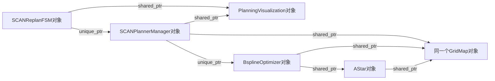

# C++相关知识

本手册按 C++14 和本项目实际写法复习：先讲语义，再对应代码，最后准备白板题。**项目确实使用的机制与通用面试扩展区分**，不把类继承、std::thread 等示例冒充当前规划器已有架构。原来从零解释指针、lambda、Eigen 的内容保留在附录。

## C00-复习导航

优先级：对象/指针/引用/const → RAII 与所有权 → 类与生命周期 → STL/模板/lambda → ROS 回调与线程 → 数值库与构建。时间不足先看 [速答问题库](#c13-速答问题库)，再按问题回查原理，不必从附录第一行重读。

- [对象与内存](#c01-对象与内存)
- [类型与表达式](#c02-类型与表达式)
- [类与复制移动](#c03-类与复制移动)
- [所有权与智能指针](#c04-所有权与智能指针)
- [模板与容器](#c05-模板与容器)
- [lambda与回调](#c06-lambda与回调)
- [多态与接口设计](#c07-多态与接口设计)
- [并发与线程安全](#c08-并发与线程安全)
- [Eigen与数值计算](#c09-eigen与数值计算)
- [ROS与工程构建](#c10-ros与工程构建)
- [异常调试与代码审查](#c11-异常调试与代码审查)
- [综合小例子](#c12-综合小例子)
- [速答问题库](#c13-速答问题库)
- [原有详细讲解](#从零讲解与项目查阅附录)

## C01-对象与内存

### 指针不是被指对象

```cpp
int value = 10;      // 整数对象。
int* p = &value;     // 指针对象，保存地址；只是借用，不能 delete p。
int& ref = value;    // 引用，绑定现有对象，不能重新绑定。
*p = 20;            // 修改 value。
```

自动存储期的 value 随作用域销毁；`new T(...)` 产生动态对象和指针值，保存该地址的裸指针消失不自动销毁动态对象。`delete p` 销毁其指向的适配动态对象，p 自身不会自动置空；其他别名更不会一起清空。不能 delete 自动对象、重复 delete，或混用 new[]/delete、malloc/delete。

| 概念 | 必须会说清楚 |
|---|---|
| 存储期 | 自动、静态、线程、动态等；不要把所有局部变量简单说成同一种寿命 |
| 作用域 | 名字在哪里可见，与对象活多久不同 |
| 所有权 | 谁负责释放资源；不是访问权限，也不排斥借用者 |
| 对象生命周期 | 构造完成/析构与存储管理有关；有一块地址不代表里面已有合法对象 |
| 野指针/悬空指针 | 未初始化地址或指向已失效对象；置空一个别名不能修复所有别名 |

`T* p;` 未初始化不等于 nullptr；Eigen 默认固定向量/动态矩阵确定尺寸也不等于填零。ROS Time 的默认零值来自其构造函数，不是所有结构体字段都自动清零。

### 引用与参数

T 按值拥有副本或移动接收的值；T& 可原地修改；const T& 只读借用，不自动保活任意被引用对象，也不阻止其他别名修改。小整数通常按值，大矩阵只读常用 const 引用，输出可用引用/返回对象表达。当前 init(nh) 借用句柄，applyLinearZReference(points&) 原地改点，reparamBspline 多个引用带回结果。

返回局部对象值可以正常复制/移动/消除；返回局部对象的指针/引用会悬空。对临时对象的生命周期延长有具体规则，不能一句“const 引用永远延长”概括保存到成员、函数返回或容器元素等情况。

## C02-类型与表达式

| 写法 | 含义/项目例子 |
|---|---|
| `ros::NodeHandle` | 命名空间里的类型；`::` 也用于类成员/别名查找 |
| `object.method()` / `ptr->method()` | 对象访问 / 通过对象指针访问；后者要求对象有效 |
| 声明的 `T*`、表达式的 `*p`、`&x` | 指针类型、解引用、取地址；不要只背同一个符号 |
| `T&` | 引用声明；与取得成员函数地址的 `&Class::method` 不同 |
| `std::vector<T>` | 模板实例化，T 是元素类型；Ptr/Vector3d 往往是别名 |
| `p(i)`、`M(r,c)` | Eigen 重载调用运算符进行元素访问，不是每个带括号名字都为普通函数 |
| `a ? b : c`、`&&`、`||` | 条件选择与短路；first=true 时可避免读取未赋值的 last_wp |

### const、constexpr、static和auto

`const T*` 不能通过该指针改 T；`T* const` 不能改指针指向；`const shared_ptr<T>` 仍可能改 T，`shared_ptr<const T>` 限制经其写对象。const 成员函数的 this 指向 const 对象，通常不能改普通成员；不自动保证线程安全。

constexpr 表达编译期常量/可常量求值的规则，不等于所有 const 都在编译期求值。当前 constexpr 采样步长仍只是常量，不能使运行时循环自动消失。

函数内 static 跨调用存在，动态初始化仅首次经过声明；常量初始化可提前完成。它不是每实例一份，也不是 const 或原子。命名空间 static 限制内部链接，类 static 数据/函数表达类级成员，静态成员函数没有隐含 this。static_cast 是另外一种转换语法，不用于延长生命周期。

auto 推导类型，不等于动态类型；通常按值推导会去掉顶层引用/const，`auto&`、`const auto&` 保留借用语义。decltype 根据表达式取得类型；模板依赖类型中的 typename 用来说明某个名字是类型，不是让对象变成运行时类型。

### 四类显式转换

| 转换 | 用途与边界 |
|---|---|
| static_cast | 明确可静态确定的转换，如 double→int；截断小数，自己不会 ceil，也不自动检查溢出/范围 |
| dynamic_cast | 在适当多态类型上做运行时向下/横向转换；指针失败返回空、引用失败抛异常 |
| const_cast | 调整 cv 限定；若原对象本来就是 const，去 const 后写它仍是未定义行为 |
| reinterpret_cast | 低层重解释，不验证真实类型、对齐或对象寿命；优化器 func_data 恢复类型必须与传入实例匹配 |

坐标转格子常需 floor；`static_cast<int>(-0.2)` 为 0，而 floor(-0.2) 为 -1。这会影响负坐标量化，不能把“+0.5 再转 int”当成对所有符号都对称的四舍五入。

std::to_string 把数值变字符串；字面量与 std::string 可通过重载 + 拼接，如 `"fsm/waypoint" + std::to_string(i) + "_x"`。两个裸字符串字面量不能直接用 + 当作同一套拼接，`s.c_str()` 也不是把字符串转成数值。

## C03-类与复制移动

### 构造、初始化和析构

`SCANReplanFSM scan_replan;` 创建对象；`scan_replan.init(nh)` 是另一个普通成员函数。对象存在不表示业务依赖已配置。Manager 默认构造体为空，initPlanModules 才建立地图/优化器；显示类则在带 NodeHandle 的构造函数中建发布器，属于不同设计选择。

成员按**类中声明顺序**构造，不按初始化列表书写顺序；先构造基类与成员，再执行构造体。析构时先执行当前析构体，再逆序销毁成员与基类。引用/const 成员等需初始化列表；在构造体赋值不是同一回事。构造失败时，已构造的子对象清理，但当前未完成构造对象的析构体不会完整执行。

### 拷贝、移动、深浅复制

默认拷贝通常逐成员复制。复制 raw pointer 只复制地址；若两对象都以为自己拥有资源，可能重复释放。vector/string 的值复制则管理各自元素，不可把所有默认拷贝都叫浅拷贝。

Rule of Zero：尽量让资源成员用 vector/string/智能指针等 RAII 类，交给默认特殊成员。直接管理裸资源时需要整体考虑析构、拷贝构造/赋值（Rule of Three）以及移动构造/赋值（Rule of Five），不是只补一个析构就完成。

用户声明析构或拷贝等特殊成员可能影响隐式移动生成；用 `=default` / `=delete` 明确请求默认实现或禁止某操作。含 unique_ptr 的类默认不能复制该所有权，不能看到类没手写拷贝函数就说“肯定可逐成员复制”。

移动转移资源或允许更经济的构造，不等于 std::move 自己搬数据。std::move 只是转换成允许移动选择的表达式；能否移动由类型决定。unique_ptr 移动后源空；不要把此规则推广成所有 moved-from 对象都为空，许多类型只保证有效但内容未指定。

noexcept 移动使 vector 扩容时更容易选择移动并维持异常保证，但“写了 noexcept 就一定更快”不成立；违反 noexcept 抛异常会终止程序。返回局部变量通常直接 return，让 NRVO/移动选择发挥作用，乱加 std::move 可能妨碍复制消除。C++14 的消除规则不同于 C++17 某些强制消除场景。

## C04-所有权与智能指针

| 对象关系 | 当前真实类型 | 为什么这样解释 |
|---|---|---|
| FSM→Manager | unique_ptr | 明确单一拥有者，init 创建，所有者析构/reset 自动结束对象 |
| Manager→BsplineOptimizer | unique_ptr | Manager 私有工作模块，反复使用，无当前共同保活需求 |
| FSM/Manager→Visualization | shared_ptr | 两处保存同一显示对象，不是复制一个显示对象 |
| Manager/Optimizer/AStar→GridMap | shared_ptr | 同一份地图由多个模块持有 |
| Optimizer→AStar | shared_ptr 别名 | 当前只见该成员显式持有；不能反推必须多方共享 |
| GridMap→TF broadcaster | shared_ptr | 在 init 创建、后续复用；当前未体现必须共享，也可另设计值/独占成员 |

Ptr 只是别名，先查定义；ROS1 生成消息 ConstPtr 常为 boost::shared_ptr，不要全说成 std::shared_ptr。

`new PlanningVisualization(nh)` 创建显示对象并产生其指针值，nh 只是构造参数；reset 接管的是显示对象，不是 nh。声明智能指针通常先为空，创建对象、接管所有权、完成业务初始化是不同步骤。

unique_ptr 不能复制，可以移动；shared_ptr 副本共享控制块，最后强所有者释放时销毁对象；weak_ptr 不强持有，lock 成功才得到临时 shared_ptr。控制块可因 weak_ptr 继续存在，不能把对象析构时刻和控制块释放时刻混为一谈。

| 接口 | 必须说清 |
|---|---|
| get | 借用裸地址，不转移释放责任；不能自行 delete 后还让所有者管理 |
| reset | 放弃当前所有权；shared 其他副本不自动清空；接收新地址时建立新管理关系 |
| release | unique_ptr 交出裸指针而不销毁对象，返回值若没人接管会泄漏；shared_ptr 没有它 |
| use_count | 观察当前强持有数，临时副本会影响；不应作为无锁同步/独占修改判断 |
| make_unique/make_shared | 表达创建并管理；make_unique 从 C++14 提供，make_shared 通常合并分配 |

不要对同一个裸指针建立两个独立 shared_ptr 控制块，也不要 `p.reset(p.get())`。两个对象用 shared_ptr 相互持有会成环，适合的反向观察改 weak_ptr；但不是所有关系都该 weak，需要先明确谁应保活。

shared_ptr 按值传参通常取得一份共享所有权；const 引用不复制参数，但函数保存进成员仍可增加所有者。本项目 setEnvironment(const GridMap::Ptr&) 随后赋值成员就是例子。只借用对象时可用 T&/const T&，不必为访问强行引入共享计数。

扩展题：enable_shared_from_this 支持从已正确纳入共享管理的对象取得同一控制关系；不能在对象尚未建立相应管理时随意调用 shared_from_this，也不能用 shared_ptr(this) 自建第二个控制块。当前核心代码并未据此自动保活回调中的 this。

## C05-模板与容器

### 模板、别名与泛型

`vector<Eigen::Vector3d>` 在编译期指定元素类型，不是运行时混合列表。using/typedef 给类型起别名，不创建实例。函数模板参与推导，重载、特化与继承是不同机制；头文件常要提供模板定义，调用处才能实例化。

`std::pair<int,State>` 固定两项，first/second 不是函数；tuple 可表示更多项。enum 常量不是状态字符串，enum class 限制隐式转换/名称泄漏；项目的普通 enum 与日志数组需要保持对应。

通用进阶：模板推导、重载选择与特化不同；SFINAE 在相应替换语境中可使候选退出匹配，enable_if 可用于条件化接口，不是所有模板错误都自动忽略。本项目重点是数值类型与容器模板，不能因此宣称实现了复杂元编程框架；C++20 concepts 也不是当前 C++14 接口。

### 容器与复杂度

| 容器/操作 | 常见复杂度与特征 | 项目联系 |
|---|---|---|
| vector | 连续元素，随机访问 O(1)，尾追加摊销 O(1)，中间插删 O(n) | 关键点、观测点、节点时间等 |
| deque | 分段存储，双端增删高效；不保证整个连续 | queue 的常见底层选择 |
| list | 链表，已知迭代器插删 O(1)，定位需遍历、缓存局部性差 | 不要只凭插删 O(1) 就替代数值数组 |
| map/set | 有序树，查找/插删通常 O(log n) | 与哈希平均复杂度区分 |
| unordered_map/set | 平均查找 O(1)，最坏可 O(n)，有哈希/碰撞与重哈希 | Eigen 整数键需要合适 hash/equality |
| priority_queue | top O(1)，push/pop O(log n)，默认大根堆 | A* 比较器用 > 实现小评分优先；无直接 decrease-key |
| queue/stack | 适配器，接口限制访问模式 | cache_voxel_ 缓存待融合格 |

vector 的 size 是实际元素数，capacity 是可容纳规模；reserve 不增元素，resize 改数量并构造/销毁所需元素，clear 不保证释放容量。越界 [] 是未定义行为风险，at 做范围检查；front/back 要求非空。

扩容重新分配使元素地址、引用和迭代器失效；erase 影响相应位置及之后的迭代器。不要跨 push_back 保存一个可能失效的引用再使用。unordered_map 的 rehash 使迭代器失效，与其元素引用的规则需区分；不熟规则时应回到标准契约核查，不能凭容器名字猜。

范围 `[begin,end)` 左闭右开；本项目 `begin()+1,end()` 跳过首点但保留末点。range-for 的 `const auto&` 避免复制且只读；`auto value` 可能复制整项，修改副本不更新原容器。

## C06-lambda与回调

lambda 表达式产生闭包对象，捕获成为其状态，operator() 负责调用。`auto Factorial=[](int x){...};` 的 Factorial 是对象变量，不是传统函数声明；空捕获不需要外层自动局部变量，参数 x 是调用时的输入。

| 捕获 | 含义与风险 |
|---|---|
| `[x]` | 捕获创建时的副本，后续原值变更不跟随 |
| `[&x]` | 借用原变量，必须确保其存活；返回/异步保存尤其注意 |
| `[=]` / `[&]` | 默认捕获规则，不是无条件深复制/复制全部局部状态 |
| `[this]` | 复制当前对象指针，不增加智能指针所有权 |
| `mutable` | 允许改按值捕获的副本，不因此修改原变量 |
| C++14 初始化捕获 | 如 `[p=std::move(owner)]`，可接管 move-only 资源；该闭包可能不能放入要求可复制目标的 C++14 std::function |

非静态成员函数必须指定对象：`&Class::method` 只指定方法，this 指定在哪个实例上执行。GridMap::initMap 的 this 始终是当前地图对象，即使它被当成 node_.subscribe 的实参，也不会变成 NodeHandle。

boost::bind(&GridMap::depthPoseCallback,this,_1,_2) 固定对象与方法，留下两参数；同步器配到 Image/Odometry 后调用。bind/registerCallback 不立刻执行，也不是再建一个定时器。std::bind、lambda、函数指针、std::function 是不同层次：绑定、可调用对象、地址类型、类型擦除包装不能混为一件事。

## C07-多态与接口设计

本项目核心是组合模块，以下是通用 C++ 面试扩展，不代表本项目已实现插件式类继承。

- 重载：同作用域同名不同参数，通常编译期选择。重写：派生类覆盖基类虚函数，应写 override 检查签名。派生类同名声明也可能隐藏基类其他重载，必要时 using 引入。
- virtual 动态分派需要通过相应基类指针/引用等使用；普通非虚函数不因此运行时改派。构造/析构期间的虚调用规则不能按“最派生类总能被调用”推断。
- 经 Base* 删除 Derived 且依赖多态析构时，基类析构应为 virtual；unique_ptr<Base> 默认删除器也不能魔法修复一个不适配的基类析构设计。shared_ptr 的删除器捕获方式又需具体分析，不用一句智能指针都会正确处理概括。
- 基类按值接收派生对象可能发生切片；用引用/指针保持多态时仍要考虑寿命。纯虚函数表达接口，抽象类不能直接实例化；final 可限制继承/重写。
- 优先让接口表达借用/所有权和成功/失败契约。若 init 分两阶段，应约束“已构造但未就绪”状态；不能仅因用了设计模式名字就声称接口安全。

## C08-并发与线程安全

### 当前项目是什么情况

规划节点普通 spin 与默认队列下，FSM 与安全回调串行，无自动安全抢占。多个 ROS 节点是多进程，不等于某个节点内部多线程。ROS 内部仍有通信/计时管理线程，CPU 模拟感知源码还有 OpenMP 并行并以 -fopenmp 构建；ikd-Tree 包含 pthread 后台重建实现，是否实际执行要看对象/分支，不凭文件里出现线程代码就说默认全启用。未看到规划主链为两个 Timer 用 std::thread 各建线程。

### 常用C++并发机制

| 机制 | 必须理解的点 |
|---|---|
| std::thread | 可 join/detach；析构时若仍 joinable 会终止程序；异常路径也要保证回收 |
| join | 等待线程结束并建立相关完成同步；不是仅“删除线程变量” |
| detach | 放弃 join，线程仍可运行；捕获局部引用/this 更需保证寿命，通常更难管理 |
| mutex + lock_guard | RAII 加解锁，异常/提前返回也释放锁；保护数据不变量，不是见到数据就随便各加一把锁 |
| unique_lock | 支持延迟/解锁/重锁等更灵活操作，condition_variable 等等待场景使用 |
| condition_variable | wait 解锁等待并在返回前重锁，使用谓词处理虚假唤醒与提前通知；共享条件仍受锁保护 |
| atomic | 对特定原子操作提供相应语义；复合不变量不因字段各自 atomic 自动正确 |
| async/future | 异步结果、等待和异常传递；默认策略可能允许延迟执行，不能看到 async 就断言已起独立后台线程 |

没有同步的冲突读写可形成 data race，C++ 中可能是未定义行为，不只是“偶尔少加一次”。volatile 不是线程同步工具。不同 shared_ptr 副本的控制块计数安全，不代表同一个 shared_ptr 变量随意并发 reset/read 安全，更不代表 T 的数据安全。

死锁看锁顺序、循环等待与回调重入；持锁进行长优化/等待其他线程可能拖慢系统。C++14 可用 std::lock 配合 RAII 处理多锁，不能照抄 C++17 scoped_lock 而忘了编译标准。优先减少共享可变状态、快照交换和明确队列所有权，再决定互斥粒度。

memory_order_relaxed 可用于不承担其他数据发布职责的独立计数；release/acquire 可用于配对发布/观察先前数据，不能把两条任意原子访问拼成协议。面试先会解释 happens-before、锁与数据竞争，再谈低层内存序；不在当前共享轨迹上凭感觉改成无锁。

## C09-Eigen与数值计算

Vector3d/Vector3i 是固定三个 double/int；MatrixXd 是动态矩阵，VectorXd 是动态列向量，Quaterniond 是几何类型。数据类型本身不说明单位和坐标系。3×N 控制点、N+p+1 节点、p=3 次数是三个不同维度。

| 操作 | 读法与注意事项 |
|---|---|
| Zero / Identity | 显式零/单位矩阵，不要假定普通尺寸构造已初始化 |
| col/row/block/segment/head | 取视图或表达式，赋值可改原对象，注意范围与别名 |
| norm/squaredNorm | 欧氏长度/平方长度；阈值也要对应平方单位 |
| dot/cross | 点积与三维叉积，归一化前检查近零范数 |
| transpose/inverse | 转置/逆，非原地也非逐项倒数；逆需要可逆等条件 |
| QR/LDLT 等 solve | 根据矩阵性质选分解，通常不为了求解线性系统先显式算逆 |
| resize/conservativeResize | 不能把 Eigen 的保值/初始化行为机械套成 std::vector 的规则 |

Eigen 使用表达式模板，`auto e=A+B` 可能保存延迟表达式而非独立矩阵；它依赖操作数寿命与后续修改。需要具体结果可用明确矩阵类型或 `.eval()`。`A=A.transpose()` 等存在别名问题，应按接口用 transposeInPlace/eval；noalias 只在确实无别名时使用，不能拿它掩盖错误。

默认 MatrixXd 按列存储。本优化器假设每列 XYZ 连续，用 data()+3*order_ 打包内部点；改布局或尺寸前提会破坏这种 memcpy 约定。对固定尺寸可向量化类型，旧标准/工具链还需注意对齐；EIGEN_MAKE_ALIGNED_OPERATOR_NEW、aligned_allocator/allocate_shared 的适用条件要按实际类型/Eigen 版本核查，不是所有 Vector3d 容器都必须加同一套宏。

矩阵能求出一个结果不等于数值稳定：检查维度、秩、极小时间、高次幂尺度、NaN/Inf 和残差。坐标/时间单位、升幂/降幂系数排列不一致，是多项式代码很常见的错误来源。

Eigen 的 `v << ...` 可启动逗号初始化，`cout << ...` 是流输出，含义看左侧对象类型。Quaterniond 的标量构造参数按 w/x/y/z，而 coeffs 的排列为 x/y/z/w，不能把它与 ROS 消息字段或 Vector4d 不经核对地整块互拷。

## C10-ROS与工程构建

### 编译与链接

预处理展开 include/宏 → 编译各 translation unit → 链接目标与依赖。头文件提供声明/定义，不自动运行；只有声明而没链接实现可能报 undefined reference，多处放不适当非 inline 定义可能重复定义。include guard 避免同一编译单元重复包含，不能解决所有跨文件 ODR 问题。

具名 namespace 组织名称，不带 public/private 权限；匿名 namespace 或命名空间作用域 static 可限制内部链接。头文件里 using namespace std 易污染下游名字查找。inline 不只是要求编译器内联，也涉及允许相应多处定义的规则；不要把优化是否展开与 ODR 混同。

当前 plan_manage CMake 同时写 -std=c++11 与 -std=c++14，通常最后一个有效；手册示例以 C++14 编译。不依赖 C++17 structured bindings/inline variables/scoped_lock 等未经说明的语法。消息由 message_generation 生成接口，add_dependencies 约束生成先于使用；target_link_libraries 与 include_directories 分别解决符号与头文件搜索问题。

### NodeHandle、消息与回调

ros::init 设置 ROS 客户端身份与重映射，再构造句柄。NodeHandle("~") 使用节点私有名称空间；根名 /scan_planner_node 下，相对 fsm/navi_mode 解析为 /scan_planner_node/fsm/navi_mode；普通句柄跟随节点所在名称空间，绝对名仍可能受 remap。remap 不转换坐标、单位或消息类型。

nh.param(key,out,default) 读取失败写默认并返回 false；合法 -1 坐标与失败回退 -1 的数值可能相同，须检查返回值。非法名称等异常不等同这条回退分支。Publisher/Subscriber/Timer 是接口句柄，不是消息内容；队列容量不是频率。

createTimer 默认自动开始计时，到期任务入队；spin/spinOnce 等处理队列才调用业务函数。main 的一次 sleep(1 s) 不设定控制周期，也不代替回调处理。Rate 配合循环尝试补本轮剩余时间；ROS 时间与 Wall/Steady 时间的用途不同，仿真 /clock 可暂停/回跳，需处理异常 dt。

消息 ConstPtr 表示只读共享消息的指针接口，不等于“指针永不变化”。`if(!msg)` 检查空指针，不检查消息的坐标是否为零。参数引用、const 消息和线程安全是不同维度，不能一概靠 const 解决时序问题。

## C11-异常调试与代码审查

异常安全常见层次：不抛、强保证（失败状态不变）、基本保证（不泄漏且不变量保持）、无保证。RAII 帮助清理，不自动使业务状态事务完整；当前目标回调先改 end_pt_/global_data 再失败，就是需要审查回滚的例子。析构函数通常不应传播异常，尤其栈展开时再次抛出可终止程序。

字符串的 c_str 返回供 C API 使用的以零结尾字符地址，不新建一个由调用方 delete 的数组；依赖字符串寿命和相关失效规则。`std::system(command.c_str())` 执行 Shell，必须区分 C++ 字面量转义与 Shell 解析；shellQuote 仅处理其传入参数，不能因此宣称整条拼接命令所有路径都已安全引用。

| 本项目审查例子 | C++ 知识点 |
|---|---|
| A* 堆内指针的 fScore 直接改 | 修改被指对象不会自动维护容器排序不变量 |
| AStar 多层 new 的数组 | 每层资源都需要配对释放，外层 shared_ptr 不清理遗漏的内部裸分配 |
| char 轮次标记与 int 比较 | 整数表示范围、转换与计数回绕 |
| `double q[variable_num_]` | 运行期长度数组不是标准 C++14，当前编译器可作为扩展接受；可考虑 vector 等标准容器 |
| getMeanVel 缺 return | 非 void 控制流必须提供适当返回；未调用不等于接口无问题 |
| 空容器 back/front、未初始化 Eigen 值 | 前置条件与未定义行为/无效数值 |
| `1 >> 20` 命名 inf | 运算符含义与名字无关，结果为 0，不是无穷 |

调试按证据：编译警告 → 日志/调用栈 → 最小复现 → AddressSanitizer/UBSan 等适当工具 → 必要时线程检测；不能为了“通过”盲目关警告。实时性能看延时分布和最坏路径，避免在高频回调里大量日志、分配和持锁阻塞；不要把 Release 下能跑当成没有未定义行为。

## C12-综合小例子

新增 [cpp_interview_examples.cpp](示例/cpp_interview_examples.cpp) 覆盖引用/值、多态、堆更新、lambda、线程同步、异常 RAII、Eigen 表达式。它是教学程序，不加入 ROS 构建，不改变项目线程或算法。

从 SCAN-Planner 根目录编译，程序放 /tmp：

```bash
g++ -std=c++14 -Wall -Wextra -Wpedantic -Werror -pthread \
  -I/usr/include/eigen3 'docs/面试/示例/cpp_interview_examples.cpp' \
  -o /tmp/scan_cpp_interview_examples
/tmp/scan_cpp_interview_examples all
```

也可单独运行 values、polymorphism、heap、lambda、threading、exception、eigen。先预测，再执行，最后解释为何成立。原有七个小例子与运行说明保留在附录；示例运行通过不等于真实 ROS 并发/所有异常路径已验证。

本轮验证：新增综合示例七组和原有七个独立程序均编译运行通过。综合示例另做 AddressSanitizer/UBSan 检查，通过；当前工具环境 LeakSanitizer 报不支持 ptrace，因此该次运行明确设置 detect_leaks=0，**未完成泄漏检测**，不宣称没有泄漏或已做 ThreadSanitizer。所有程序输出与文中预期一致，运行产物均在 /tmp。

## C13-速答问题库

| 问题 | 回答关键 |
|---|---|
| 1 指针和对象一样吗？ | 指针保存地址，对象另有生命周期；new 表达式构造后产生指针值 |
| 2 裸指针都要 delete 吗？ | 不；借用自动对象绝不能 delete，拥有动态对象也要匹配分配规则 |
| 3 引用是自动安全的吗？ | 不是，可悬空；const 引用也不普遍解决保存/异步寿命 |
| 4 为何用智能指针？ | 类型表达所有权、RAII 清理动态资源；能用值对象时不强制动态化 |
| 5 Ptr 一定共享吗？ | 不是，查 typedef/using；本项目 Manager/Optimizer 独占，地图/显示共享 |
| 6 unique_ptr 能复制吗？ | 不可复制，可移动；独占不阻止有效期内借用 |
| 7 shared_ptr 复制是否复制地图？ | 共享同一对象/控制块，深拷贝需另建对象 |
| 8 reset/get/release 有何不同？ | 放弃/更换所有权、借用地址、unique 交出责任不释放对象 |
| 9 为何两个 shared_ptr(raw) 危险？ | 两个独立控制块可能重复释放；应复制已有共享指针 |
| 10 weak_ptr 怎么用？ | 不保活，lock 后检查；打破适当反向强环 |
| 11 shared_ptr 线程安全吗？ | 分开讨论控制块、同一指针变量和 T 数据；后两者不自动安全 |
| 12 make_shared 是否总优？ | 常可合并分配，但对象/控制块寿命、对齐、删除器需求仍要考虑 |
| 13 new Display(nh) 接管 nh 吗？ | 创建 Display，nh 是输入依赖；reset 管理 Display，不是删除 nh |
| 14 构造函数体空就没初始化吗？ | 成员仍按规则构造；普通数值未必有效，业务 init 可能尚未完成 |
| 15 构造/析构顺序？ | 基类/成员先于构造体，成员按声明顺序；析构体后逆序销毁子对象 |
| 16 复制裸资源成员有什么风险？ | 复制地址不复制资源，若双方都释放会双删；Rule of Zero/Three/Five |
| 17 std::move 是否执行移动？ | 它是转换，移动构造/赋值等接收操作才决定行为 |
| 18 移动后对象一定为空？ | unique_ptr 是；其他类型按其契约，通常有效但内容未指定 |
| 19 为什么 noexcept 移动重要？ | 影响容器迁移策略和异常保证，违反不抛承诺会终止 |
| 20 const 与 constexpr？ | 只读限定不一定编译期已知；constexpr 有常量求值规则 |
| 21 static 的三种位置？ | 局部保留、类级成员、命名空间内部链接；不混同 static_cast |
| 22 局部 static 线程安全吗？ | 初始化保护不等于后续可变数据读写安全 |
| 23 匿名 namespace 为什么用？ | 内部链接辅助实现；具名 namespace 本身无 public/private 权限 |
| 24 include 是否运行 cpp？ | 预处理展开，不调度函数；实际编译链接形成程序 |
| 25 inline 是必须内联吗？ | 不是，优化与相应多处定义规则分开 |
| 26 模板为什么常放头文件？ | 调用处实例化通常需可见定义；显式实例化是另一种组织方案 |
| 27 auto 与动态类型？ | 编译期推导；引用/const 是否保留看写法，Eigen 还可能推导表达式类型 |
| 28 vector reserve/resize？ | 容量与实际数量不同；Eigen 点数建好也不等于坐标有值 |
| 29 vector 扩容后引用为何失效？ | 元素迁移到新存储，原地址失效；不能跨潜在重分配借用旧引用 |
| 30 map 与 unordered_map？ | 有序树复杂度与哈希平均/最坏情况、遍历/失效规则不同 |
| 31 priority_queue 如何做小根堆？ | 比较器按评分反向；修改堆内指针数据不等于 decrease-key |
| 32 lambda 是函数吗？ | 表达式产生闭包对象，通过调用运算符执行；捕获是它的状态 |
| 33 捕获引用有什么风险？ | 外部对象消失会悬空，异步/返回保存需特别检查 |
| 34 mutable 会改原值吗？ | 允许改按值捕获的副本，不因此改外部原变量 |
| 35 this 指向谁？ | 当前非静态成员函数的对象，传给 NodeHandle 调用也不改变其来源 |
| 36 bind 的 _1/_2？ | 留给将来调用的参数占位符，当前同步器对应图像/位姿 |
| 37 static 成员函数为什么不传隐含 this？ | 类级函数无当前实例，可显式用 func_data/对象参数 |
| 38 overload/override/hiding？ | 重载签名选择、虚函数覆盖、名字查找隐藏不同；override 检查错误签名 |
| 39 多态基类析构为什么 virtual？ | 经相应基类指针删除派生对象要正确析构，智能指针不替代接口契约 |
| 40 对象切片是什么？ | 派生对象按基类值复制只保留基类部分，动态类型信息不能照原样使用 |
| 41 thread 析构前必须怎么处理？ | joinable 时安排 join/detach/RAII 管理，异常路径也要覆盖 |
| 42 join 与 detach？ | 等完成同步与放弃 join 权责不同，detach 不能消除寿命风险 |
| 43 原子与互斥怎么选？ | 单个原子协议/计数与多字段不变量不同，不能只把每个字段变 atomic |
| 44 condition_variable 为何用谓词？ | 处理虚假唤醒/先通知，条件受锁保护，wait 释放再重获锁 |
| 45 两个 Timer 是否多线程？ | 默认同队列普通 spin 串行，OpenMP/多线程 spinner 是另外机制 |
| 46 日志 WARN 是否故障？ | 看当前调用含义；本项目正常 ready 也可能用 WARN，THROTTLE 是限打印频率 |
| 47 static_cast 是否向下取整？ | 浮点→整型截断，ceil/floor 是另外运算，负坐标要留意 |
| 48 reinterpret_cast 会检查类型吗？ | 不会；func_data 实际类型/寿命需由调用契约保证 |
| 49 Eigen 为什么很多类型？ | 形状、固定/动态尺寸、数值类型的别名组合，不是 ROS 消息 |
| 50 norm 与 squaredNorm？ | 长度与长度平方，阈值和单位必须匹配 |
| 51 transpose/inverse 谁提供？ | Eigen 接口，点号是 C++ 成员访问语法；inverse 不等于元素倒数 |
| 52 为什么用 solve 而非求逆？ | 根据矩阵结构分解求解通常更合适，仍要关注秩、条件数与残差 |
| 53 c_str 有什么生命周期？ | 地址依赖 string 的寿命/修改规则，不是调用者应 delete 的独立数组 |
| 54 正常返回0是否没有泄漏？ | 不能，仅说明控制流；资源、析构和错误路径需单独验证 |
| 55 你会怎么验证 C++ 修改？ | 对应触发条件的小例子/测试、警告与 sanitizer、适当并发检测；不靠“编译过了”概括全部 |

## 从零讲解与项目查阅附录

以下保留此前从最基本概念展开的内容与已验证小例子。遇到速答表中的概念不理解，跳到附录对应标题；不要求为了下一场面试重新逐行读完所有代码。


### 对象生命周期与引用

#### 项目中的问题

[scan_planner_node.cpp](../../src/planner/plan_manage/src/scan_planner_node.cpp) 中的 `SCANReplanFSM scan_replan;` 构造一个对象。`scan_replan.init(nh)` 是另一个普通成员函数调用，不是构造函数。

`main()` 中的对象在 `ros::spin()` 阻塞期间仍然存活。对象的生命周期由作用域等 C++ 规则决定，不由函数名字是否叫 `init` 决定。

#### 对象、指针和引用

```cpp
int value = 3;       // 对象：存放整数值。
int *pointer = &value; // 指针对象：存放 value 的地址，可以重新指向别处。
int &alias = value;  // 引用：现有对象的另一个访问名称，不能重新绑定。
alias = 5;          // 修改 value；不是把引用绑定到整数 5。
```

引用仍要求被引用对象有效；“不能重新绑定”不代表不会悬空。不要返回指向局部对象的指针/引用，也不要保存一个已结束生命周期对象的引用。

| 形参 | 是否复制这里的 vector | 是否可修改原容器 | 适合的语义 |
|---|---|---|---|
| `std::vector<double> v` | 从左值传入通常复制 | 不修改调用方容器 | 接收自己的副本 |
| `std::vector<double>& v` | 否 | 可以 | 原地修改/输出 |
| `const std::vector<double>& v` | 否 | 不能通过该引用修改 | 只读访问已有容器 |

`const T&` 的 const 不保证其他别名不能修改对象，也不自动解决并发访问。

#### 项目对应点

- `SCANReplanFSM::init(ros::NodeHandle &nh)`：使用调用方的句柄建立接口，没有复制一整个状态机。
- `applyLinearZReference(std::vector<Eigen::Vector3d>& points, ...)`：直接重写调用方采样点的 Z。按值传递则不能把修改返回给原容器。
- `reparamBspline(..., Eigen::MatrixXd &ctrl_pts, double &dt, double &time_inc)`：除修改样条外，通过引用带回控制点和时间信息；不能只看 `void` 就说“没有输出”。

相关源码：[planner_manager.cpp](../../src/planner/plan_manage/src/planner_manager.cpp)。

#### RAII 为何比“自动释放内存”更广

RAII 把资源的管理绑定到对象生命周期：构造/初始化时取得资源，析构时释放。资源可以是内存、文件、互斥锁或计时器句柄。

自动存储期对象离开作用域会析构，智能指针析构会释放相应所有权；异常展开正常进行时也会析构已构造的局部对象。进程被强制终止等情况不能假定所有析构都会执行。

局部对象和其成员的构造/析构顺序也重要：成员按**声明顺序**构造，而不是按构造函数初始化列表随意重排；销毁时逆序执行。

#### 最小示例

运行 [01_lifetime_reference.cpp](示例/01_lifetime_reference.cpp)。它先证明按值/引用的区别，再用成员构造、`init` 和析构的输出展示对象存活区间。

先预测：调用 `addCopy(points)` 后会改变原容器大小吗？`init()` 是否会再构造一次同一个对象？函数返回时为什么先打印析构函数体，再打印成员的析构？

#### 面试问答

**问：局部对象都是“放在栈上”吗？**

本项目这种非 static 局部对象具有自动存储期，工程上通常说栈对象。语言规则关心生命周期；优化后是否真的存在某块栈内存不是语义保证。vector 对象本身和它动态管理的元素存储也要分开。

**问：传引用是否总比传值好？**

不总是。简单数值按值很合适；引用用于共享访问和输出，需要考虑别名及生命周期。对于需保存所有权的对象，移动或按值传递也可能更清楚。

**问：类中已有构造函数，为什么还有 init？**

本项目把模块构造与依赖 ROS 参数/接口的配置分开。好处是初始化步骤集中，代价是对象可能处于“已构造、未配置”的中间状态，需要保证调用顺序。不能把这种设计当成所有 C++ 类必须遵循的模式。

#### 自测

- [ ] 将例子中的引用改为传值，预测并验证输出。
- [ ] 找出项目一个引用输出参数，并指出谁消费该结果。
- [ ] 能解释 RAII、悬空引用和析构顺序，而不仅是背“引用是别名”。

### static关键字

#### 先看当前FSM里的两个例子

static 的具体含义取决于声明位置。当前 [scan_replan_fsm.cpp](../../src/planner/plan_manage/src/scan_replan_fsm.cpp) 主要是**函数内的静态局部变量**，最先记住：变量不会随这次函数返回而销毁，值能跨调用保留；但它的名字仍只在所属局部作用域中可见。

```cpp
static int fsm_num = 0;
fsm_num++;
```

这不是每次回调都重新赋 0。初始化只有一次，后续调用继续使用上次留下的值，才能累计 100 次后打印状态。源码中的 `fsm_num = 0` 是达到 100 后主动重置，不是重新初始化变量。

如果写成普通局部 `int fsm_num = 0`，每次进入函数都新建一个 0，自增后只有 1，就无法以此统计跨回调次数。静态局部通常存活到程序正常结束；不是这一次函数调用的临时对象。

另一个例子是 `static string state_str[7] = {...};`。它提供状态名数组，避免每次调用都重新构造字符串数组；字符串名称仅用于日志，不控制状态迁移。changeFSMExecState 与 printFSMExecState 各自函数中的同名 state_str 是**两份不同的静态数组**。

#### 初始化一次不等于只能赋值一次

static 与 const 不同：static 主要涉及存储期等规则，const 限制修改。fsm_num 可以 ++，也可以主动归零；state_str 没有 const，也不能仅凭 static 就说数组永远不能修改。

精确地说，常量/零初始化可以在执行函数之前完成；需要动态初始化的函数内 static，在首次执行经过相应声明时初始化。对 fsm_num=0 不必把“首次调用时执行一遍赋值语句”当成所有实现的精确执行过程，关键是初始化不会每次回调重做。

#### 跨对象也可能共用，不是每个实例一份

若同一非模板成员函数中有局部 static，该变量不存储在每个 this 对象里，多个实例调用该函数仍使用同一份局部 static。当前通常只创建一个 FSM，所以 fsm_num 用来观察这个回调；若以后创建多个 FSM，它不会自动变成每个对象独立的计数器。需要每对象计数应考虑普通成员变量。

#### 一个可运行的对比

```cpp
#include <iostream>

int ordinary() {
  int count = 0;
  return ++count;
}
int retained() {
  static int count = 0;
  return ++count;
}
struct Counter {
  int own = 0;
  void tick() {
    static int shared = 0;
    ++own;
    ++shared;
    std::cout << "shared=" << shared << ", own=" << own << '\n';
  }
};

int main() {
  const int ordinary_first = ordinary();
  const int ordinary_second = ordinary();
  const int retained_first = retained();
  const int retained_second = retained();
  std::cout << "ordinary=" << ordinary_first << ',' << ordinary_second << '\n';
  std::cout << "retained=" << retained_first << ',' << retained_second << '\n';
  Counter a, b;
  a.tick();
  b.tick();
  a.tick();
}
```

预期普通局部输出 1,1，静态局部输出 1,2；两个对象的调用分别输出 shared/own=1/1、2/1、3/2。例子已按 C++14 编译运行：shared 在函数内共用，own 才是每个对象自己的字段。

#### 其他位置的static不要混为一谈

| 声明位置 | 主要含义 | 与当前代码的联系 |
|---|---|---|
| 函数内变量 `static int count` | 静态存储期，跨调用保留；作用域仍局部 | fsm_num、状态名数组、Factorial 闭包对象 |
| 类内数据成员 `static int total` | 类级共享数据，不是每个对象一份 | 理解跨实例数据与普通成员的区别 |
| 类内成员函数 `static ...` | 没有隐含 this，不依赖某个实例即可调用 | BsplineOptimizer::costFunctionRebound/Refine 等求解器适配函数 |
| 命名空间/文件作用域的普通变量或自由函数前 static | 内部链接，限制为当前编译单元实体 | 与 [匿名命名空间](#匿名命名空间与编译单元) 的内部实现组织相联系 |

本项目按 C++14 构建。比如类内写 `static int total;` 通常还要在一个 cpp 中提供 `int ClassName::total = 0;` 的定义；C++17 的 inline static 等规则不能不区分标准版本就套进来。

静态成员函数没有 this，不表示它不能操作任何对象；可以显式接收对象指针。项目的 costFunctionRebound 从 func_data 恢复 BsplineOptimizer*，再通过 opt 调用对象方法，就是这一模式；不能在静态成员函数中直接假设存在当前实例。

#### 面试常见误区

- static 局部只延长变量生命周期，不让函数自己循环，也不创建线程。
- C++11 起，静态局部的动态初始化具有并发初始化保护；后续 `count++` 不因此自动线程安全，多线程访问可变值仍需同步。
- static 与 static_cast 不是“同一关键字的两种调用”。static_cast 是显式类型转换语法，不负责让数据跨调用保留。
- static 与 const 可组合。Factorial 的 static 表示闭包对象跨函数调用存在，const 限制对它重新赋值；不是缓存每个阶乘结果。
- 同名静态局部变量是否同一个，先看是否属于同一个函数/实例化上下文，不能因为名字相同就当成同一块数据。

当前学习先能解释 fsm_num 为什么可累加、两个 state_str 为什么独立，再逐步展开类静态成员与链接规则。源码：[scan_replan_fsm.cpp](../../src/planner/plan_manage/src/scan_replan_fsm.cpp)、[polynomial_traj.cpp](../../src/planner/traj_utils/src/polynomial_traj.cpp) 的 Factorial、[bspline_optimizer.h](../../src/planner/bspline_opt/include/bspline_opt/bspline_optimizer.h) 的静态成员函数声明。

### 匿名命名空间与编译单元

#### 本项目在哪里用

[scan_replan_fsm.cpp](../../src/planner/plan_manage/src/scan_replan_fsm.cpp) 开头：

```cpp
namespace
{
  std::string shellQuote(const std::string &value)
  {
    // 为 Shell 参数生成引号包裹/转义后的字符串。
    // 此处只示意结构，具体返回逻辑见原函数。
  }
}
```

这段是结构节选，不是可直接编译的完整函数。namespace 后面没有名字，称为匿名（无名）命名空间。shellQuote 是普通自由函数，不是命名空间对象，也不是 SCANReplanFSM 类成员。

#### 为什么放在里面

shellQuote 仅服务本文件的内部实现，mode 2 的 init 分支用它处理 rosparam load 命令的目标名称空间。没有必要把这个工具当成供其他源文件链接调用的公共接口。

匿名命名空间使这类函数具有内部链接：即使另一个 cpp 也定义了同名 helper，两者属于各自编译单元的内部实体，不会因为名字相同就形成同一个外部符号或链接时的重复定义。

编译单元（translation unit）可理解为“一个 cpp 加上预处理后展开的头文件内容”。日常说“仅本 cpp 内部使用”是对当前写法的简化描述，更精确的范围是编译单元，而不是一个操作系统进程或整个仓库。

#### 可以怎样理解它的原理

概念上，编译器给每个编译单元中的匿名命名空间提供独特身份，并让所在作用域可以查找其中的名字。其他 cpp 无法通过声明一个同名普通外部函数，就链接到这个内部函数。

这不是运行时创建了一个隔离空间，也不会启动线程。函数实际执行仍然来自调用语句；当前 shellQuote 的调用在 init 的 mode 2 分支，而不是“从文件顶部看到 namespace 就自动执行函数体”。如果通过函数指针等方式显式把内部函数的调用能力传出去，其他代码仍可间接调用，因此内部链接也不是权限或安全沙箱。

#### 对比分析：为什么需要匿名而不直接放进scan_planner

先澄清先前注释中“公共接口”的含义：**具名命名空间本身没有 public/private 权限，它不会让所有内容自动变成设计上承诺的公共 API。** 匿名命名空间在这里明确的是“辅助函数采用内部链接、供当前实现使用”。“组织到哪个名字下面”与“允许怎样跨编译单元链接”是两件事。

以同一个 shellQuote 为例：

| 放置方式 | 它属于什么 | 一般链接/调用特点 | 对本项目是否必要 |
|---|---|---|---|
| cpp 顶层普通自由函数 | 全局命名空间 | 通常具有外部链接；同程序其他 cpp 给出匹配声明并链接定义后可调用 | 可以工作，但一个纯内部工具占用了外部名字 |
| `namespace scan_planner { ... }` 内普通自由函数 | scan_planner 模块命名空间 | 通常仍有外部链接；不会因为写在 cpp 就自动私有 | 能避免与别的模块的全局同名函数混淆，但仍未限制为本编译单元内部实现 |
| 当前 `namespace { ... }` 内的自由函数 | 当前编译单元的匿名命名空间 | 内部链接；其他 cpp 的普通同名外部声明不能链接到它 | 符合当前仅本文件使用的用途 |
| `scan_planner` 内再嵌套匿名 namespace | 模块内部的编译单元辅助实现 | 同样采用内部链接 | 也可以这样组织；Manager 的高度辅助函数就是例子 |
| SCANReplanFSM 的 private 成员/静态成员函数 | 状态机类 | 受类的访问控制约束，需在类定义中声明；不等于匿名命名空间的内部链接 | 可以设计，但会把纯字符串工具纳入状态机类的成员体系 |

这不是“非用匿名命名空间不可”。在没有冲突的情况下，不使用它也可能正常编译运行。选择它是为了更清晰地表达依赖边界、减少外部符号冲突；不是为了让程序运行更快，也不是为了阻止别人看到源码。

#### 为什么shellQuote更像文件内工具

当前调用关系为：

```text
scan_planner_node.cpp::main()
    └─ scan_replan.init(nh)          外部需要用的状态机入口
          └─ mode 2 加载关键点
                └─ shellQuote(...) 当前实现使用的字符串辅助函数
```

main 关心“配置这个状态机”，不需要关心内部怎样为 Shell 命令加引号。shellQuote 只依据传入的字符串产生新字符串，不读取状态机对象的成员，也不负责状态迁移，因此当前把它放成文件内自由函数很自然。

如果以后很多模块确实需要同样的引用处理，可以重新设计为共享工具：在合适头文件声明，在具名工具命名空间中提供实现，并明确契约与测试。那是需求变成跨文件复用之后的选择，不是现在必须提前把它变成通用接口。

#### 小例子：放在具名命名空间仍可跨文件调用

`provider.cpp`：

```cpp
namespace scan_planner {
  int helper() { return 42; }
}
```

`consumer.cpp`：

```cpp
namespace scan_planner {
  int helper(); // 匹配声明，使编译器知道这个函数；定义从链接的 provider.cpp 提供。
}
int main() {
  return scan_planner::helper() == 42 ? 0 : 1;
}
```

两文件一起编译链接可以通过，main 返回 0。即便 provider.cpp 没有为 helper 单独写头文件，函数也不因此自动获得内部链接。工程里有意共享的声明通常应统一放到头文件，避免手写重复声明不一致；这里手写是为了展示链接规则。

如果把 provider.cpp 改成：

```cpp
namespace scan_planner {
  namespace {
    int helper() { return 42; }
  }
  int runLocally() { return helper(); } // 本编译单元仍可调用内部 helper。
}
```

consumer.cpp 的 `scan_planner::helper()` 声明对应一个外部函数，不能绑定到 provider 内部的 helper，链接会报未定义引用。改为声明并调用 `scan_planner::runLocally()`，则可以通过，并由它间接调用内部 helper。

这三种情况均已用独立临时文件验证：具名函数跨文件调用成功、试图直接链接内部 helper 失败、经外部 runLocally 间接使用成功。项目实际 shellQuote 没有因此改成任何新写法。

#### 与其他概念区分

| 写法 | 主要作用 |
|---|---|
| `namespace scan_planner { ... }` | 给模块名字分组；多个文件可以共同定义这个具名命名空间的内容 |
| `namespace { ... }` | 为本编译单元组织内部实现，避免把辅助实体作为外部链接接口 |
| 文件/命名空间作用域的 `static void helper()` | 也可让这个自由函数具有内部链接；匿名命名空间还能组织辅助类型和其他实体 |
| `class A { private: ... };` | 类成员访问控制，与函数是否具有内部链接是两种规则 |

这里讨论的 static 是命名空间作用域函数的用法，不是函数内 static 局部变量或类的 static 成员。匿名命名空间通常用于 cpp 内部辅助实现；放在共享头文件里会让不同编译单元各有对应内部实体，不能误认为全程序共用一份。

#### 两个文件同名函数的小例子

分别保存以下三个文件后一起编译，helper 的定义互不冲突。

`a.cpp`：

```cpp
namespace {
  int helper() { return 10; }
}
int fromA() { return helper(); }
```

`b.cpp`：

```cpp
namespace {
  int helper() { return 20; }
}
int fromB() { return helper(); }
```

`main.cpp`：

```cpp
#include <iostream>
int fromA();
int fromB();
int main() {
  std::cout << fromA() << ' ' << fromB() << '\n';
}
```

```bash
g++ -std=c++14 -Wall -Wextra -Wpedantic -Werror \
  a.cpp b.cpp main.cpp -o /tmp/namespace_demo
/tmp/namespace_demo
```

预期输出 `10 20`，已按三个独立编译单元编译、链接并运行验证。这个例子保存在本节，不另增加 Markdown；运行验证的临时源码和程序放在 /tmp。main 使用公开的 fromA/fromB，由它们各自调用内部 helper。

#### 面试回答与项目联系

可以回答：匿名命名空间用于限制辅助实现的链接范围。本项目把 shellQuote 放在其中，表示它是当前编译单元的内部工具，避免和其他 cpp 的同名辅助函数发生外部符号冲突；它不是 ROS 名称空间，也不会自动执行。

另一个项目实例是 [planner_manager.cpp](../../src/planner/plan_manage/src/planner_manager.cpp) 中 `scan_planner` 内嵌匿名 namespace，包住 applyLinearZReference。外层负责模块命名，内层限制辅助实现的链接范围，二者可以组合。

自测：能否说明为什么 init 可以直接调用 shellQuote、为什么另一个 cpp 的同名 helper 不冲突、以及为什么它不属于 SCANReplanFSM 对象的成员函数。

### vector动态数组与resize

#### 与Python列表如何对应

使用方式上，std::vector 可以类比 Python 的 list：长度能在运行时变化，可以按下标访问，也可以向末尾追加元素。它与固定长度的内置数组不同。

本项目的声明是 `std::vector<Eigen::Vector3d> preset_waypoints_;`：容器长度可变，但每个元素的类型固定为 Eigen 三维向量；这里保存的是一串三维关键点，不是一个任意类型混放的列表。

`preset_waypoints_.resize(waypoint_num_);` 将实际元素个数改成 waypoint_num_。首次原容器为空，假设点数为 2，之后就有第 0 和第 1 个点对象，循环才能逐点通过下标写入 XYZ。

```text
resize(2) 前：[]
resize(2) 后：[第0个三维点对象, 第1个三维点对象]
读取参数后：[(x0,y0,z0), (x1,y1,z1)]
```

resize 不读取参数服务器。元素构造也不等于原始坐标已经有效；本项目的 Eigen 点不能未经赋值就假定 XYZ 全是零。这与 vector<int> 新增元素的初始化表现需要区分。

#### size与capacity的区别

##### 为什么不用再把每个点定义成三维向量

头文件的成员声明已经给出了两层类型：

```cpp
std::vector<Eigen::Vector3d> preset_waypoints_;
//          ^^^^^^^^^^^^^^^ 每个元素的类型：含 XYZ 三个 double 的数值向量
// ^^^^^^^^^^^^^^^^^^^^^^^^ 外层容器：可变数量的这种点
```

std::vector 是动态数组容器，Eigen::Vector3d 是数学上的三维数值向量；虽然名字中都有 vector，但职责不同。模板参数 `<Eigen::Vector3d>` 预先规定了外层每个元素的类型，不是 resize 时才根据参数值猜测维数。

成员声明放在类定义里；main 构造 SCANReplanFSM 对象时，preset_waypoints_ 作为其成员一并构造，开始时是空列表。resize(N) 再构造所需数量的三维点对象，因此 init 里不需要逐个重复声明 `Eigen::Vector3d point0, point1, ...`。

```text
preset_waypoints_             多个点的集合
├─ preset_waypoints_[0]       第0个 Eigen::Vector3d
│  ├─ (0) → X
│  ├─ (1) → Y
│  └─ (2) → Z
└─ preset_waypoints_[1]       第1个 Eigen::Vector3d，同样有 XYZ
```

| 表达式 | 含义 |
|---|---|
| `preset_waypoints_.size()` | 有几个关键点，来自外层容器当前长度 |
| `preset_waypoints_[i]` | 取第 i 个三维点对象 |
| `preset_waypoints_[i](0)` | 第 i 个点的 X 分量，类型为 double |
| `preset_waypoints_[i](1)` / `(2)` | 同一个点的 Y / Z 分量 |

所以 resize(3) 表示创建/保留三个点，每个点本来就是三维；不是“创建一个三维点”。若只写 `Eigen::Vector3d preset_waypoints_;`，则只保存一个点的三个分量，无法直接表示任意数量的关键点。

可运行的 Eigen 小例子（区别于下方纯标准库例子，需要 Eigen 头文件）：

```cpp
#include <Eigen/Core>
#include <iostream>
#include <vector>

int main() {
  std::vector<Eigen::Vector3d> points;
  points.resize(2);
  points[0] = Eigen::Vector3d(1.0, 2.0, 0.4);
  points[1] = Eigen::Vector3d(3.0, 4.0, 0.4);
  std::cout << "points=" << points.size() << '\n';
  std::cout << "coordinates per point=" << points[0].size() << '\n';
  std::cout << "point 1 Y=" << points[1](1) << '\n';
}
```

预期输出 points=2、coordinates per point=3、point 1 Y=4，已编译运行。先给每个点完整赋值后再读取坐标；不能因为示例有两个点，就把类型中的固定维数 3 也理解成容器长度。

##### resize与reserve对照

| 操作 | 改变什么 | 能否因此直接用新下标 |
|---|---|---|
| `resize(N)` | 将实际元素数量 size 改为 N；变大时构造新元素，变小时销毁末尾元素 | 可以访问 0..N-1，仍需确保点内数值有效 |
| `reserve(N)` | 需要时预留至少 N 个元素的存储容量，不增加实际元素数量 | 不可以访问 size 以外的下标 |
| `push_back(value)` | 在末尾追加一个实际元素，size 加 1 | 可访问刚追加的最后一项 |
| `size()` | 查询当前实际元素个数 | 不修改容器 |

本项目先知道点数再按索引填坐标，所以使用 resize；若只是 reserve 后直接访问 [0]，空容器仍没有第 0 个元素。另一种设计是构造完整点后逐个 push_back，但本轮不改变项目写法。

#### 最小可运行例子

```cpp
#include <iostream>
#include <vector>

int main() {
  std::vector<int> values;
  values.reserve(10);
  std::cout << "after reserve: " << values.size() << '\n';
  values.resize(2);
  values[0] = 10;
  values[1] = 20;
  std::cout << "after resize: " << values.size() << '\n';
  values.push_back(30);
  std::cout << "after append: " << values.size() << '\n';
  values.resize(1);
  std::cout << "after shrink: " << values.size() << ", first=" << values[0] << '\n';
}
```

输出实际元素数依次为 0、2、3、1，最后保留首元素 10。例子已编译运行；容量至少满足请求值，不应把 reserve(10) 一概背成容量必须恰好等于 10。

面试进一步追问：vector 元素连续存储；扩容发生重新分配时，原元素的指针、引用和迭代器会失效。resize 变小销毁末尾元素不等于必然缩减 capacity，size 和 capacity 必须分开理解。

源码：[scan_replan_fsm.h](../../src/planner/plan_manage/include/plan_manage/scan_replan_fsm.h) 的成员声明、[scan_replan_fsm.cpp](../../src/planner/plan_manage/src/scan_replan_fsm.cpp) 的 mode 2 参数读取循环。

### Eigen常用数据类型

#### Eigen是什么

Eigen 是 C++ 线性代数库，提供向量、矩阵、矩阵分解、旋转等计算工具；`Eigen::` 是库使用的 C++ 命名空间。它不是 C++ 内置关键字，也不是 ROS 专用消息类型。

本项目用它表示位置/速度、地图索引、旋转、控制点矩阵，以及多项式系数求解的线性系统。库主要通过头文件和模板提供接口，include 使编译器能使用相应类型与实现，不表示启动一个程序。

#### 为什么看起来有很多类型

主要是在组合三个维度：**向量还是矩阵、尺寸固定还是运行时确定、元素是 double 还是 int 等数值类型**。许多常用名称只是矩阵模板的别名，不是一套互不相关的新语法；Quaterniond 等几何类型则是另一类专门接口。

| 常见名称 | 形状与元素类型 | 在项目中的常见用途 |
|---|---|---|
| Vector2d | 固定 2×1，double | XY 平面向量 |
| Vector3d | 固定 3×1，double | XYZ 位置、速度、加速度或方向 |
| Vector3i | 固定 3×1，int | 体素索引、节点池尺寸 |
| Vector4d | 固定 4×1，double | 本项目显示接口中的 RGBA 等四项数据 |
| VectorXd | 动态 N×1，double | 节点时间向量、动态求解向量 |
| Matrix3d | 固定 3×3，double | 旋转矩阵等三行三列数据 |
| Matrix4d | 固定 4×4，double | 齐次变换矩阵等数据 |
| MatrixXd | 动态 R×C，double | 控制点矩阵、多项式的 A/Q/R 等矩阵 |
| Quaterniond | double 四元数几何类型 | 表示和处理三维姿态，不是 Vector4d 的另一个名字 |

名称里的 d 表示 double，i 表示 int；Vector3d 的 3 表示三个分量，X 表示动态尺寸，不是空间 X 坐标。MatrixXd 的行列均可在运行时确定；VectorXd 是长度动态变化的列向量。

#### 用模板写法看懂别名

```cpp
Eigen::Vector3d  // 常用别名，对应 Eigen::Matrix<double, 3, 1>
Eigen::VectorXd // 对应 Eigen::Matrix<double, Eigen::Dynamic, 1>
Eigen::MatrixXd // 对应 Eigen::Matrix<double, Eigen::Dynamic, Eigen::Dynamic>
```

以 Vector3d 为例，它本质上是三行一列的数值矩阵。这样为常用类型起名字，可以省去每次手写模板参数；第一遍先会读常用别名即可，不必背完所有 Eigen 类型。

#### 回到当前uniform_bspline.h

```cpp
Eigen::MatrixXd control_points_;
Eigen::VectorXd u_;
```

第一项保存整个控制点矩阵，位置样条通常为 3×N：每列一个 XYZ 控制点，N 是控制点数。第二项保存一串节点时间，长度由控制点数和次数决定。它们都使用 double，但组织的数据形状不同。

```text
control_points_：        u_：
┌ x0  x1  x2 ... ┐      [u0, u1, u2, ...] 的列向量
│ y0  y1  y2 ... │      每一项是一个标量时间参数
└ z0  z1  z2 ... ┘
```

同一个 UniformBspline 类还用于导数样条，因此控制点的物理含义可以变成速度或加速度。Eigen 类型本身不会自动指定单位、坐标系，也不会保证一个 Matrix3d 一定是合法旋转矩阵；这些由程序的构造与使用契约决定。

#### 与std::vector别混淆

Eigen::Vector3d 是一个三维数学向量，擅长数值运算；std::vector<T> 是保存一串 T 元素的动态数组容器。本项目 `std::vector<Eigen::Vector3d>` 就是一串三维点。Eigen 的动态向量 resize 是调整数值向量尺寸，也不能因此把所有接口都当成 std::vector 的同义写法。

`p(0)` 是 Eigen 对分量的访问，`matrix(row,col)` 访问矩阵元素，下标从 0 开始。`matrix.col(i)` 取得一整列，`.rows()`、`.cols()` 分别查询行列数。点差 `.norm()` 得到欧氏长度，而不是 ROS 的计算函数。

#### 一个可以直接运行的小例子

下面只演示数值类型，不是在构造一条完整的三次 B 样条。需要安装 Eigen，示例使用本机 `/usr/include/eigen3` 头文件：

```cpp
#include <Eigen/Core>
#include <iostream>
#include <type_traits>

int main() {
  static_assert(std::is_same<Eigen::Vector3d,
                            Eigen::Matrix<double, 3, 1>>::value,
                "Vector3d is a matrix type alias");
  Eigen::Vector3d p(1.0, 2.0, 0.4);
  Eigen::Vector3d q(4.0, 6.0, 0.4);
  Eigen::MatrixXd points(3, 2);
  points.col(0) = p;
  points.col(1) = q;
  Eigen::VectorXd times(3);
  times(0) = 0.0;
  times(1) = 0.2;
  times(2) = 0.4;
  std::cout << "p.z=" << p(2) << '\n';
  std::cout << "point matrix=" << points.rows() << 'x' << points.cols() << '\n';
  std::cout << "time count=" << times.size() << '\n';
  std::cout << "distance=" << (q - p).norm() << '\n';
}
```

预期输出 p.z=0.4、point matrix=3x2、time count=3、distance=5，已按 C++14 编译运行；静态断言也验证了 Vector3d 的矩阵别名关系。完整代码保存在本节，临时编译文件放 /tmp，不另建 Markdown。

注意：`Vector3d p;` 或 `MatrixXd m(3,2);` 的普通构造不能直接当成已填零。需要零值可显式使用 `Vector3d::Zero()` 或 `MatrixXd::Zero(3,2)`；示例在读取数据前已完整赋值。

源码：[uniform_bspline.h](../../src/planner/bspline_opt/include/bspline_opt/uniform_bspline.h)、[plan_container.hpp](../../src/planner/plan_manage/include/plan_manage/plan_container.hpp)。更早的多项式笔记中 transpose/inverse/solve 等也来自 Eigen，C++ 的点号和双冒号只是访问接口的语言语法。

### 智能指针与所有权

先读下面“从零理解”的部分，再回看项目的 Ptr 别名和所有权图。暂时不用同时记住控制块、线程安全等术语，先能区分**对象是什么、指针保存什么、对象由谁释放**。

#### 从零理解之一：对象和指针是两个东西

```cpp
int value = 10;     // 创建整数对象 value，保存数值 10。
int *p = &value;    // 创建指针变量 p，保存 value 的地址。
*p = 20;           // 沿 p 找到 value，把 value 改成 20。
```

可以想象成（地址只是示意，不是真实运行地址）：

```text
指针变量 p                         整数对象 value
┌──────────────────┐              ┌──────────────┐
│ 保存地址 0x1000   │ ──────────→  │ 保存数值 20  │
└──────────────────┘              └──────────────┘
```

`p` 不是整数 20，也不是把 value 复制到了自己里面；它保存的是去哪里找对象的信息。`&value` 取地址，`*p` 访问该地址上的对象。对于类对象，`p->method()` 用来通过指针调用对象的方法。

常见写法要逐一分清：

| 写法 | 创建/改变了什么 |
|---|---|
| `int value = 10;` | 创建一个保存 10 的整数对象 |
| `int *p = nullptr;` | 只创建空的指针变量，没有创建被指整数 |
| `p = &value;` | 让 p 指向已有对象，不新建对象 |
| `p = new int(10);` | 动态创建整数对象，再将它的地址赋给 p |
| `p = nullptr;` | 清空 p 保存的地址，不等于释放 p 原来指向的对象 |

这里的 `int *p` 是 C++ 内置指针类型，通常叫裸指针。“裸”表示它本身不附带自动负责释放所指对象的管理机制，不意味着它一定有错。

#### 从零理解之二：什么时候需要delete

对于普通自动存储期对象，生命周期由作用域管理：

```cpp
{
  int value = 10;
  int *p = &value; // p 借用 value，不负责释放 value。
  *p = 20;
} // value 自己随作用域结束；不能写 delete p 来释放它。
```

对于本例用普通 new 创建的动态对象，不能仅依靠保存地址的裸指针变量离开作用域来释放它：

```cpp
int *p = new int(10);
// 使用 *p ...
delete p;           // 销毁这个动态整数并释放对应存储。
p = nullptr;        // 清空本变量，防止继续误用旧地址。
```

需要区分“p 这个指针变量消失”和“new 出来的整数消失”。裸指针本身离开作用域，不会自动执行 delete；如果最后一个能找到动态对象的地址丢失，又没有其他释放机制，就会发生内存泄漏。

以上只讨论普通单对象 new 的配对；数组 `new T[n]` 配 `delete[]`，其他资源也可能需要不同的释放函数，不能看到任意地址都随意 delete。

#### 从零理解之三：复制裸指针不会复制对象

```cpp
int *p = new int(10);
int *q = p;
*q = 30; // 修改同一个整数，因此 *p 也是 30。
delete p;
p = nullptr;
// q 仍保存原来的地址，但该对象已销毁，q 现在是悬空指针。
q = nullptr; // 不能再读 *q，也不能再 delete q 所指的旧对象。
```

过程是：

```text
p ──┐
    ├──→ 同一个整数对象 30
q ──┘

delete p 后：对象已释放；p/q 并不会被系统一起自动清空。
```

`delete p` 中被销毁的是 p 指向的对象，不是指针变量 p 自身。`p = nullptr` 只修改 p，不能连带修正其他别名 q。重复释放、悬空访问和遗漏释放，都是手动管理时要处理的问题。

#### 从零理解之四：所有权就是释放责任

这里“谁拥有对象”主要回答：**谁负责在合适的时刻结束这个对象的生命周期、释放相应资源？** 它不是权限系统，也不表示只有所有者能读写对象。

同一个对象可以有很多借用者，但清理责任必须清楚。例如 FSM 可以拥有 Manager，某个函数只是借用 Manager 做一次规划；借用者不能因为自己用完了就把 Manager delete 掉。

裸指针 `T*` 的类型本身不能表达“这是要负责 delete 的所有者”还是“只是借用”。这个约定要由程序员另外维护。智能指针通过类的行为与类型，把特定的所有权规则表达出来。

#### 从零理解之五：unique_ptr帮一个所有者管理对象

先看一个完整对照。下面普通类 Item 的构造/析构输出，让你看到对象到底在哪一步创建、销毁；raw() 与 smart() 完成同样的工作：

```cpp
#include <iostream>
#include <memory>

struct Item {
  Item() { std::cout << "construct\n"; }
  ~Item() { std::cout << "destroy\n"; }
  void work() { std::cout << "work\n"; }
};

void raw() {
  Item *p = new Item; // 取得地址，释放责任由程序员安排。
  p->work();
  delete p;          // 这条语句是手动释放，不能漏掉。
}

void smart() {
  auto p = std::make_unique<Item>(); // p 接管创建的对象。
  p->work();
} // p 自己析构，内部用默认删除器释放 Item，不需再手写 delete。

int main() {
  std::cout << "raw:\n";
  raw();
  std::cout << "smart:\n";
  smart();
}
```

两段分别输出 construct、work、destroy。区别在于 raw 依赖写对 delete；smart 依赖 unique_ptr 的析构管理释放。如果 smart 内正常提前 return，或者发生可正常栈展开的异常，已经构造的局部 p 仍会析构。裸指针版本若在 delete 前直接返回/抛出异常而没有其他清理措施，就可能泄漏。

“智能指针”本身也是一个类对象：它保存被管理对象的地址等管理状态，析构函数负责按规则释放资源。并不是让 new 的对象突然具有了自动存储期，而是由这个管理对象替你执行必要的清理。这就是 RAII 在这里的用法。

##### 独占不是不许别人访问

```cpp
auto owner = std::make_unique<int>(10);
int *borrower = owner.get(); // 临时借用地址，不拥有对象。
*borrower = 20;              // owner 存活且对象有效时可以使用。
// borrower 不负责 delete；owner 释放对象后，borrower 就不能再用。
```

unique_ptr 不能复制出第二个所有者，但可以移动所有权：

```cpp
auto first = std::make_unique<int>(10);
// auto second = first; // 不允许：复制 unique_ptr 所有权会编译失败。
auto second = std::move(first); // 移动构造完成后，second 接管对象，first 为空。
```

移动没有再创建一个整数 10，也不是两个所有者一起拥有它。std::move 单独只是转换表达式，实际转移由接收方的移动构造/赋值完成。

#### 从零理解之六：shared_ptr让多个所有者共同管理

如果 A 和 B 都需要拥有同一个对象，就需要决定“哪一方用完时才能释放”。shared_ptr 的规则是：**最后一个强所有者放弃时才销毁对象**。

```cpp
#include <iostream>
#include <memory>

struct Item {
  int value = 10;
  Item() { std::cout << "construct\n"; }
  ~Item() { std::cout << "destroy\n"; }
};

int main() {
  auto a = std::make_shared<Item>();
  auto b = a; // 复制共享指针，得到同一对象的另一个所有者。
  b->value = 20;
  std::cout << "a sees " << a->value << '\n';
  std::cout << "owners=" << a.use_count() << '\n';
  a.reset(); // a 为空；b 还拥有对象，所以这里不销毁 Item。
  std::cout << "after a reset: b sees " << b->value << '\n';
  b.reset(); // 最后一个强所有者释放，这里输出 destroy。
  std::cout << "after b reset\n";
}
```

输出依次为 construct、a sees 20、owners=2、after a reset: b sees 20、destroy、after b reset。a 与 b 是两个指针对象，但它们指向同一个 Item；复制 shared_ptr 不等于复制 Item。

与前面裸指针复制的关键差别是：shared_ptr 的这些副本共用一份管理信息，知道还有多少强所有者；裸指针只复制地址，不提供这套自动管理。因此不要对 a.get() 再创建一个独立接管它的 shared_ptr，那会绕开原来的共享管理关系。

##### weak_ptr先只记住这一点

weak_ptr 用来观察由 shared_ptr 管理的对象，不算强所有者，不负责保活。需要使用时先 lock，成功才获得一份临时 shared_ptr；若对象已经销毁则得到空指针。循环引用的解释放在本节后面的进阶部分，第一遍不必先理解所有控制块细节。

#### 从零理解之七：先把四种写法放在一起

| 写法 | 对象怎么存在 | 谁负责结束对象生命周期 |
|---|---|---|
| `Item item;` | 这里是自动存储期的普通局部对象 | 随其作用域结束自动析构，不需要为了自动释放而强行改成智能指针 |
| `Item* p = new Item;` | Item 动态创建，p 保存地址 | 需要明确安排拥有者按正确规则释放；裸 p 自身析构不会代做 |
| `auto p = std::make_unique<Item>();` | 动态创建，并交给一个独占管理者 | p 析构/reset，或所有权转移后的新所有者负责 |
| `auto p = std::make_shared<Item>();` | 动态创建，并允许共享同一管理关系 | 最后一个强所有者释放时销毁 |

所以不能记成“裸指针一律手动 delete、智能指针一律更好”。如果裸指针只是 `&item` 的借用者，就不能 delete；能直接用普通对象的地方，也未必需要动态创建和智能指针。

#### 从零理解之八：回到项目的两行代码

```cpp
SCANPlannerManager::Ptr planner_manager_;
PlanningVisualization::Ptr visualization_;
```

先到定义处确认：第一项是 unique_ptr，第二项是 shared_ptr。类型别名只是简写，创建状态机时两个指针成员都为空，此时还没有创建它们指向的模块对象。

```text
状态机刚构造：
planner_manager_ = 空
visualization_   = 空

init 中创建对象后：
FSM.planner_manager_ ──独占──→ Manager
FSM.visualization_   ──共享──→ 显示对象
Manager.visualization_ ─共享─→ 同一个显示对象
```

`planner_manager_.reset(new SCANPlannerManager)` 是先 new 出管理器，再让独占指针接管。管理器用完后由其所有者自动释放；并不需要 FSM 另写一个 delete 去释放它。

`visualization_.reset(new PlanningVisualization(nh))` 创建显示对象；传给 Manager 并保存另一份共享指针后，两处共同拥有它。只清空 FSM 那份显示指针，Manager 仍持有，显示对象就不一定销毁。

这是当前代码的设计选择，不表示 Manager 不能按值作为成员，也不表示被两个地方使用的对象必须 shared_ptr。真正决定采用哪种方式的是所有权和生命周期约定。

##### 专门拆解new与构造参数：接管的是nh吗

```cpp
visualization_.reset(new PlanningVisualization(nh));
```

**被管理的是新创建的 PlanningVisualization 对象，nh 是构造它时传进去的参数。** 不要因为 nh 写在括号中，就认为 new 创建了 nh，或 reset 要销毁 nh。

| 名字/表达式 | 它是什么 | 本行中的作用 |
|---|---|---|
| `nh` | ros::NodeHandle 类型的已有对象；init 通过引用使用它 | 给显示对象提供 ROS 接口，作为构造函数实参 |
| `PlanningVisualization` | 本项目的显示类名 | 指定要创建哪种类型的对象 |
| `new PlanningVisualization(nh)` | new 表达式 | 分配并构造显示对象，返回 PlanningVisualization* |
| `visualization_` | std::shared_ptr<PlanningVisualization> 类型的成员 | 负责共享管理显示对象生命周期 |
| `.reset(...)` | 该智能指针的成员函数 | 接收上面的地址，建立/更换当前持有关系 |

这里按计算依赖可拆成两步帮助理解（不要求替换项目原语句）：

```cpp
PlanningVisualization *raw = new PlanningVisualization(nh);
visualization_.reset(raw);
```

第一步创建显示对象并取得它的地址，第二步把该地址交给共享指针管理。正常创建/接管完成后，不能再手动 delete raw；其后生命周期由共享持有关系决定。

##### PlanningVisualization星号是类型还是地址

`PlanningVisualization*` 是**指针类型的写法**，意思是“指向 PlanningVisualization 对象的指针”；它本身不是某一个具体地址。具体地址值在 new 表达式成功完成后产生，可以保存在该类型的变量里。

```cpp
PlanningVisualization *raw = new PlanningVisualization(nh);
// 类型                 变量名  创建对象，得到指向新对象的指针值
```

| 表达式 | 应该怎样读 |
|---|---|
| `PlanningVisualization` | 类名/对象类型 |
| `PlanningVisualization*` | 指向这种对象的裸指针类型 |
| `raw` | 指针变量；其中保存指向新对象的地址值 |
| `*raw` | 在表达式中解引用，访问 raw 指向的那个对象 |
| `new PlanningVisualization(nh)` | 分配存储并调用构造函数，成功时产生 PlanningVisualization* 类型的指针值 |

与 `int *p = new int(10)` 是同样的结构：int* 是类型，p 是变量，p 保存的地址指向一个数值为 10 的动态整数对象。星号在声明里用来组成指针类型，在表达式 `*raw` 中则表示解引用，不能不看上下文就当成同一个操作。

严格说，产生指针值的是整个 new 表达式；PlanningVisualization 的构造函数本身没有返回类型，也不是由构造函数写 return 返回地址。失败的普通 new 也不是保证返回有效地址，因此这里说的是创建成功的路径。

原语句没有单独写 raw 变量，而是直接把 new 产生的指针值传给 reset；共享智能指针随后管理的是它指向的显示对象。裸指针类型 PlanningVisualization* 与共享指针类型 PlanningVisualization::Ptr 也不是同一种类型。

##### nh从哪里来，构造函数为什么接收另一种类型

它最初在 main 中构造：

```cpp
ros::NodeHandle nh("~");
scan_replan.init(nh);
```

FSM::init(ros::NodeHandle& nh) 按引用访问这个已有句柄；之后创建显示对象，又将这个句柄传给显示构造函数。构造参数的类型不需要与正在创建的对象类型相同：它们可以是创建该对象所需要的配置或其他依赖。

例如构造函数声明 `PlanningVisualization(ros::NodeHandle &nh)` 的含义是“创建显示对象时，需要传入一个 ROS 句柄”，不是“创建 NodeHandle”。类名决定正在构造什么，参数列表决定构造时需要哪些输入。

##### 本项目实际怎样使用nh

对应的构造函数中确实有以下语句（节选）：

```cpp
PlanningVisualization::PlanningVisualization(ros::NodeHandle &nh)
{
  node = nh;
  goal_point_pub = nh.advertise<visualization_msgs::Marker>("goal_point", 2);
  // 其他显示发布器的注册见实际源码。
}
```

它有一个 ros::NodeHandle 类型的成员 node。`node = nh` 复制句柄管理状态，形成显示对象自己的句柄成员，复用同一节点资源；不是把调用方 nh 搬走或复制出一个新 ROS 节点。其后通过传入句柄的 advertise 建立 Marker 发布接口，才能在后续显示函数中发布目标和路径等信息。

关系可以画成：

```text
main 已有的 nh：ros::NodeHandle
       │ 作为引用参数传给构造函数，提供 ROS 接口
       ▼
new 创建的 PlanningVisualization 对象
       ├─ node：自己的 ROS 句柄成员，通过 node=nh 复制句柄
       └─ goal_point_pub 等：显示发布器成员
       ▲
       │ reset 接收的是这个显示对象的地址
visualization_：shared_ptr<PlanningVisualization>
```

显示对象最后销毁时，它自己的 node 和发布器成员按各自规则析构；共享指针不会因此 delete main 中原来的 nh。两种类的关系是“显示类使用/包含 ROS 句柄”，不是继承关系，也不是同一类型的两个名字。

源码定位：[节点入口](../../src/planner/plan_manage/src/scan_planner_node.cpp)、[FSM 创建语句](../../src/planner/plan_manage/src/scan_replan_fsm.cpp)、[显示类声明](../../src/planner/traj_utils/include/traj_utils/planning_visualization.h)、[显示构造函数实现](../../src/planner/traj_utils/src/planning_visualization.cpp)。

#### 第一遍自测与后续阅读

先口头回答下面五题，再读后面的项目持有关系和进阶问题：

- [ ] `int* p = &value` 创建了几个整数对象？为什么不能 delete p？
- [ ] `int* p = new int(10)` 里，p 和动态整数是同一个对象吗？
- [ ] p 变量离开作用域，为什么动态整数不自动释放？unique_ptr 多做了什么？
- [ ] `auto b = a` 复制 shared_ptr 后，复制了几份 Item？为什么 a.reset 后 b 仍可用？
- [ ] 本项目哪个对象独占，哪个对象共享？谁放弃所有权会导致它们销毁？

上面的两个完整程序是独立示例，要分别编译，不能把两个 main 链接到同一个程序。均已用 C++14 编译运行，创建、访问与销毁顺序符合文字说明。下方保留原有项目证据与面试追问，作为第二遍查阅内容。

#### 今日面试原题与学习目标

2026-11-09 面试涉及智能指针，具体追问原话尚未提供。本节以当前选中的两个成员为主线；以下补充问题是复习追问，不冒充面试官已经逐项问过。

```cpp
SCANPlannerManager::Ptr planner_manager_;
PlanningVisualization::Ptr visualization_;
```

先会回答四件事：它们管理什么对象、谁负责持有、何时销毁、复制或 reset 后发生什么。之后再看控制块、循环引用、线程安全等深入问题，不只背三个指针名字。

#### 先查项目类型，不能从 Ptr 猜

| 使用处 | 真正类型/定义位置 | 项目职责 |
|---|---|---|
| `SCANPlannerManager::Ptr` | `std::unique_ptr<SCANPlannerManager>`；[planner_manager.h](../../src/planner/plan_manage/include/plan_manage/planner_manager.h) | FSM 独占管理器 |
| `PlanningVisualization::Ptr` | `std::shared_ptr<PlanningVisualization>`；[planning_visualization.h](../../src/planner/traj_utils/include/traj_utils/planning_visualization.h) | FSM 和管理器共同持有显示对象 |
| `GridMap::Ptr` | `std::shared_ptr<GridMap>`；[grid_map.h](../../src/planner/plan_env/include/plan_env/grid_map.h) | 管理器、优化器和 A* 复用地图 |
| `BsplineOptimizer::Ptr` | `std::unique_ptr<BsplineOptimizer>`；[bspline_optimizer.h](../../src/planner/bspline_opt/include/bspline_opt/bspline_optimizer.h) | 管理器独占优化器 |
| `AStar::Ptr` | `std::shared_ptr<AStar>`；[dyn_a_star.h](../../src/planner/path_searching/include/path_searching/dyn_a_star.h) | 当前主链由优化器的 a_star_ 成员持有，未见另一个独立强所有者 |

`Ptr` 是作者定义的类型别名，不是 C++ 关键字，也不必然是共享指针。ROS1 的 `PoseStampedConstPtr` 等生成消息别名还会涉及 `boost::shared_ptr`，不能一律说成 `std::shared_ptr`。

#### 这两行创建的是指针对象，不是规划器对象

`SCANPlannerManager::Ptr` 中的 `::` 查找该类里公开定义的类型别名 Ptr，然后以这种类型声明成员 planner_manager_。visualization_ 同理，但它的别名代表另一种智能指针。

状态机对象构造时，这两个指针成员默认构造为空；不会因为声明了指针就自动创建 SCANPlannerManager 或 PlanningVisualization。init 中的 `reset(new ...)` 才创建被管理对象，并让指针取得所有权。空指针不能直接 `->` 访问对象成员。

智能指针是类对象，不是编译器自动修复所有内存问题的关键字。它把资源释放与指针对象的生命周期联系起来（RAII）；其中 weak_ptr 只观察共享对象，不拥有对象。

#### 本项目谁持有谁



这是成员持有关系，不是函数调用顺序。管理器由 FSM 独占；显示对象由 FSM 和 Manager 共同持有；地图对象由管理器、优化器和 A* 的成员共同持有。当前这些成员关系没有相互指回的强引用环；并不据此证明其他资源管理或未来修改不存在问题。

创建/保存位置：FSM::init() 创建显示和管理器并把显示指针传给 Manager；Manager::initPlanModules() 保存 `visualization_ = vis`，创建地图与优化器；优化器 setEnvironment() 和 A* initGridMap() 保存同一地图的共享指针。共享的是对象，而不是给每个模块复制一张地图。

这解释了当前代码的所有权安排，不代表架构上每一份访问都必须采用 shared_ptr；只借用且生命周期有保证时也可设计为引用/裸指针。选择类型要依据生命周期与所有权契约，不能因为“模块很多”就一律共享持有。

#### 为什么本项目用智能指针而不全写成普通对象或裸指针

两处 Ptr 的定义旁已补充当前持有关系、创建过程与释放原理，阅读时可直接对照 [planner_manager.h](../../src/planner/plan_manage/include/plan_manage/planner_manager.h) 和 [planning_visualization.h](../../src/planner/traj_utils/include/traj_utils/planning_visualization.h)。

| 方案 | 资源归属怎样表达 | 当前场景的取舍 |
|---|---|---|
| 按值对象成员 | 随包含它的对象构造/析构，由成员自身管理资源 | 可以设计；对象一开始就构造。不是所有类都必须通过指针创建 |
| 拥有资源的裸指针 | 仅凭指针类型看不出谁负责 delete，需另外约定并实现清理 | 当前显式 new 的方式若全靠手写清理，需覆盖正常退出、替换、异常等路径 |
| unique_ptr | 类型明确单一所有者，自动放弃/释放独占资源 | 与 FSM 拥有 Manager 的关系一致；可先为空，init 中再创建 |
| shared_ptr | 多份指针共同拥有同一个对象，寿命跟随最后一个强所有者 | 与 FSM/Manager 共同持有显示对象的当前接口一致 |
| 引用或借用型裸指针 | 不拥有资源，由外部保证对象活得足够久 | 仅需要使用对象时可考虑；不能靠借用本身延长对象生命 |

智能指针不是为了让 Planner 算得更快，也不是“需要调用对象方法”的必要语法。它主要解决当前动态创建对象的所有权表达和生命周期管理。管理器内部共享地图，不等于管理器外部也必须采用共享指针；显示对象被两处使用，也不从逻辑上强迫所有架构都选 shared_ptr。

具体到现有代码，先构造空指针成员，再在 init 里创建/接管对象；Manager 还要额外调用 initPlanModules 进行配置。把“对象创建、所有权接管、业务初始化”分开，才能解释为什么有 Ptr 声明后还会出现 new、reset 和 initPlanModules。

#### 为什么Manager独占BsplineOptimizer

当前成员 `BsplineOptimizer::Ptr bspline_optimizer_rebound_` 位于 Manager 的 private 区域，Ptr 的实际定义是 unique_ptr<BsplineOptimizer>。创建与配置发生在 Manager::initPlanModules()：

```cpp
bspline_optimizer_rebound_.reset(new BsplineOptimizer);
bspline_optimizer_rebound_->setParam(nh);
bspline_optimizer_rebound_->setEnvironment(grid_map_);
```

随后 Manager 反复调用它生成引导、执行 Rebound 和 Refine，并更新相关参考点。它不是每次调用一个优化函数就重新创建一次；优化器保存的控制点、参数、地图依赖等状态由这一份实例管理。

当前调用链没有把优化器指针复制给其他模块，让它们独立参与寿命管理，所以 unique_ptr 清晰表达“Manager 负责拥有和释放这一份优化器”。其他逻辑经 Manager 请求规划，也不等于它们必须成为优化器的共享所有者。

```text
Manager ──unique_ptr──→ BsplineOptimizer
   │                         │
   └──shared_ptr──→ GridMap ←─┘ shared_ptr
```

优化器自己共享使用地图，与“谁拥有优化器”是两种关系。Manager 销毁或清空独占指针时，优化器析构；它持有的共享地图指针随成员析构放弃所有权，但只要其他模块还持有地图，地图对象就继续存在。

改用 shared_ptr 也可以设计，但目前没有体现共同拥有优化器的需求；unique_ptr 不需要这套共享引用计数管理。独占不是说整个程序只能有一个 BsplineOptimizer，也不是线程安全保证；可以为不同 Manager 创建各自独立的优化器，借用或并发访问仍需明确约定。

源码：[planner_manager.h](../../src/planner/plan_manage/include/plan_manage/planner_manager.h) 的私有成员、[planner_manager.cpp](../../src/planner/plan_manage/src/planner_manager.cpp) 的 initPlanModules/reboundReplan/refineTrajAlgo、[bspline_optimizer.h](../../src/planner/bspline_opt/include/bspline_opt/bspline_optimizer.h) 的 Ptr 定义。

#### AStar用了共享指针是否表示必须共享

当前声明 `AStar::Ptr a_star_` 使用 `std::shared_ptr<AStar>`。Manager 初始化代码是：

```cpp
bspline_optimizer_rebound_->a_star_.reset(new AStar);
bspline_optimizer_rebound_->a_star_->initGridMap(
    grid_map_, Eigen::Vector3i(100, 100, 100));
```

它先通过优化器指针找到优化器里的 a_star_ 成员，再让该成员接管新搜索器。Manager 没有因此在自身保存另一个 AStar 共享指针；“从 Manager 代码里访问到对象”和“Manager 成为该对象的另一份共享所有者”不是同一件事。

```text
Manager ─unique_ptr→ BsplineOptimizer
                         └─shared_ptr→ AStar
                                           └─shared_ptr→ GridMap
```

在已核查的当前主链里，显式保存该 AStar 指针的是优化器 a_star_ 成员，优化器在碰撞段上调用 AstarSearch/getPath，没有看到把搜索器指针复制给其他模块共同保活。因此可以解释其智能指针怎样自动管理对象寿命，**但不能声称“因为当前多模块都拥有 A*，所以必须 shared_ptr”**。

shared_ptr 允许复制并共享所有权，即使当前只有一份持有者也合法。源码没有明确说明这个别名选择的必要原因；可能的历史/复用设计不能当成已验证事实。单一拥有者关系也可以设计为 unique_ptr，但需联动类型/接口核查并编译验证，不在本轮注释任务中擅自改写。

尤其要分开：AStar::initGridMap 接收并保存共享地图指针，说明搜索器与其他模块共享地图，不说明搜索器本身也必须共享。getPath 返回的路径数据被显示或优化使用，同样不等于路径使用方持有搜索器。

生命周期上，最后一个 AStar 强所有者释放时执行 AStar 析构；类内部的资源是否清理完整，还需另看析构实现，智能指针不会自动修复被管理类内部的原始资源管理错误。当前仅说明所有权机制，没有宣称完整内存审计已完成。

面试回答可以说：AStar::Ptr 在原项目定义为 shared_ptr，支持自动释放和共同持有；但当前主链未体现多个强所有者，独占设计也能表达当前归属。要按实际调用/复制关系判断，不能从类型名反推作者一定有共享需求。

#### TF广播器为什么也使用智能指针

GridMap 里声明的是 `shared_ptr<tf::TransformBroadcaster> tf_broadcaster_;`（此处 shared_ptr 来自 std）。初始化时：

```cpp
tf_broadcaster_.reset(new tf::TransformBroadcaster);
```

和可视化对象的创建是同一类机制：new 创建广播器对象，产生 tf::TransformBroadcaster*；reset 接管这个地址。这里没有构造参数，也没有接管一个 TF 消息，创建的是能够发送 TF 的广播器。

当前使用顺序是：

```text
GridMap 构造：tf_broadcaster_ 为空
    ↓
initMap：创建广播器，成员指针持有它
    ↓ initMap 返回，GridMap 对象仍然存在
visCallback → publishSlidingMapFrame
    └─ tf_broadcaster_->sendTransform(...)，重复使用这个广播器
    ↓
持有关系结束：最后一个强所有者释放时销毁广播器
```

因此它解决了两个具体安排：在 initMap 阶段才创建；让成员保存的广播器供后续回调持续使用，同时自动处理动态对象释放。不要把 new 创建后可以继续使用的寿命，误认为 initMap 的局部变量只能活到函数结束；这里指针本身是 GridMap 成员，动态对象由其所有权关系管理。

**但是，TF 广播器并不要求必须用智能指针，更不要求必须用 shared_ptr。** 当前代码中显式保存此指针的是 GridMap 成员，未见把该指针复制传给其他模块，所以不能编造成“多个 ROS 节点必须共享一个 TF 广播器才这样写”。ROS 节点之间的通信和同一进程内的 C++ 对象共享，是不同层次。

| 设计方式 | 是否也可能满足这里的用途 | 需要考虑什么 |
|---|---|---|
| 当前 shared_ptr 成员 | 可以，自动管理动态对象，允许共同持有 | 当前并未展示对外共享广播器的必要性；还有控制块等管理成本 |
| unique_ptr 成员 | 单一拥有者时也可设计 | 明确由 GridMap 独占；改写时核对其他用法与初始化 |
| 普通对象成员 | 也可以设计，成员随 GridMap 构造/析构 | 构造时机提前到 GridMap 构造阶段，需完整类型和正确的 ROS 初始化顺序；访问语法改为点号 |
| 仅在 initMap 里声明普通局部广播器 | 不适合当前后续复用同一对象的调用方式 | 函数返回后局部对象已销毁，后续回调无法再使用它 |
| 拥有资源的裸指针成员 | 可以实现，但需手动维护释放责任 | 需处理正常析构、重新初始化及异常路径，不能漏删或重复删除 |

所以这里应回答“当前实现以智能指针管理在 initMap 创建、由后续回调复用的广播器”，而不是“广播器属于 ROS，所以必须智能指针”。当前广播器不负责执行窗口滑动，发送的 TF 也不是概率地图缓冲。

源码：[grid_map.h](../../src/planner/plan_env/include/plan_env/grid_map.h) 的成员声明、[grid_map.cpp](../../src/planner/plan_env/src/grid_map.cpp) 的 initMap/publishSlidingMapFrame。本机 TF 类声明在 `/opt/ros/noetic/include/tf/transform_broadcaster.h`，其中提供默认构造函数和 sendTransform 接口。

#### 从这句开始读

```cpp
planner_manager_.reset(new SCANPlannerManager);
```

1. `new SCANPlannerManager` 分配存储并调用构造函数，得到裸指针。
2. `reset(p)` 让当前 unique_ptr 接管这个对象，并释放原来独占的对象（如果有）。
3. 后面的 `planner_manager_->initPlanModules(...)` 再配置模块，不是上述构造语句已经完成的功能。

##### 为什么Manager构造时没有nh而显示对象有

并不是 Manager 不需要 ROS 句柄，而是这两个类把配置操作放在了不同位置：

```cpp
// 显示类：在带句柄参数的构造函数中建立发布接口。
visualization_.reset(new PlanningVisualization(nh));

// 管理器：先用无参构造创建对象，再通过普通成员函数传入句柄配置模块。
planner_manager_.reset(new SCANPlannerManager);
planner_manager_->initPlanModules(nh, visualization_);
```

| 类 | 构造阶段 | ROS 相关配置发生在哪里 |
|---|---|---|
| PlanningVisualization | 构造函数接收 ros::NodeHandle& | 构造函数内使用 nh.advertise 注册显示发布器 |
| SCANPlannerManager | 无参构造，函数体为空；成员仍按各自规则构造 | 后续 initPlanModules(nh, vis) 读取参数，创建/配置地图、优化器、A*，保存显示指针 |

本类的声明为 `SCANPlannerManager();`，所以这次 new 不需要传 nh；当前接口也没有定义接收 nh 的构造函数，不能直接擅自改为 `new SCANPlannerManager(nh)`。句柄实际上在下一条普通成员调用中已经传入。

这里的 `new SCANPlannerManager` 与 `new SCANPlannerManager()` 都会调用这个类已定义的无参构造函数；省略空括号不代表没有调用构造函数。这个说明针对当前类，不泛化到所有标量/聚合类型的初始化规则。

是否在构造时接收句柄，由类的接口设计决定，与管理它的是 unique_ptr 还是 shared_ptr 无关。也可以设计让 Manager 构造时接收 nh，或让显示类后续 init；本项目实际采用以上两种不同方式，不在注释任务中修改接口。

对管理器要分清三个阶段：创建了智能指针、创建了管理器对象、完成模块配置。只有经过所需的 initPlanModules 后，才能按初始化契约使用其地图与规划模块；构造函数体为空不表示所有成员数值都已经是有效业务状态。

现代 C++14 可以用 `std::make_unique<T>()` 表达创建独占对象，但这里只解释现有实现，不借补注释改写代码。

#### 三种指针分别管理什么

| 类型 | 能否复制所有权 | 放弃当前所有权 | 典型用途 |
|---|---|---|---|
| `unique_ptr<T>` | 不能复制，可以移动 | 释放唯一所有者时销毁对象 | 明确单一归属 |
| `shared_ptr<T>` | 可以，副本共享控制块 | 最后一个强所有者释放时销毁对象 | 确实需要共同持有 |
| `weak_ptr<T>` | 不增加强引用计数 | 不负责让对象继续存活 | 观察共享对象、打破强引用环 |

`std::move(p)` 本身只是把表达式转换为允许移动的形式；把它交给 unique_ptr 的移动构造/赋值后，才发生所有权转移。本例移动成功后源 unique_ptr 为空。

`shared_ptr` 除对象地址还关联控制块，记录强/弱引用和删除器等管理信息。对象在强计数归零时销毁；仍有 weak_ptr 时，相应控制块的生命周期可以继续。通常 `make_shared` 能把对象与控制块放在一次分配中，但不能据此说所有 shared_ptr 创建方式都只分配一次。

#### reset 的常见误解

```cpp
auto first = std::make_shared<int>(7);
auto second = first;
first.reset(); // first 为空，但 second 仍持有整数 7。
```

`reset()` 清空的是当前指针的所有权，不是“把所有指向该对象的智能指针都清空”。`get()` 返回借用的裸指针，不转移所有权；借用者不能自行 delete。

不要做以下操作：

```cpp
// 错误示意：同一个裸指针被两个独立控制块接管，可能重复释放。
// auto raw = new int(7);
// std::shared_ptr<int> a(raw);
// std::shared_ptr<int> b(raw);
// 需要共享时应复制 a，例如 auto b = a。
```

对于已有对象，`ptr.reset(ptr.get())` 同样不是安全的“刷新一下”，可能销毁对象并留下无效地址。

#### weak_ptr 和线程安全追问

两个对象若都用 shared_ptr 强持有对方，外部指针释放后也可能因环而无法销毁。可将合适的反向观察关系改为 weak_ptr，但要先确定真正的所有权关系。

访问 weak_ptr 时用 `lock()` 尝试获得 shared_ptr，并在非空时使用；不要先检查 expired 再假设后续必然还活着。

shared_ptr 的引用计数管理能支持不同 shared_ptr 实例在多线程中共享同一控制块，**不表示所指向的地图/轨迹对象自动线程安全**。同一个 shared_ptr 变量上的并发修改也需单独处理。项目若引入多线程 spinner，仍需审查地图和轨迹访问。

#### 用项目中的reset推演一次

```text
FSM.visualization_ ──┐
                    ├─ 同一个显示对象
Manager.visualization_ ┘
```

若只清空 FSM 的 visualization_，Manager 仍持有这个对象，它通常继续存在。反过来只清空 Manager 的显示指针，也不会连带清空 FSM 那一份。最后一个强所有者释放时才销毁对象；临时参数副本和其他持有者也算所有者，所以不要脱离具体时刻断言 use_count 一定固定为 2。

若清空 FSM 的 planner_manager_，其独占的管理器对象销毁，析构函数体运行后其成员继续析构，各自放弃地图、优化器和显示对象的所有权。共享资源是否此时销毁，还取决于有无其他强所有者；不能把“Manager 析构了”直接等同于“整个项目所有资源同时释放”。

#### 常用操作与参数传递

| 操作 | 所有权效果 | 容易出错之处 |
|---|---|---|
| `p->method()` / `*p` | 使用被指对象，不改变所有权 | 先保证非空、对象有效 |
| `p.get()` | 取得借用的裸指针 | 不能自行 delete 或交给新智能指针重复接管 |
| `p.reset()` | 当前指针变空并放弃所有权 | shared_ptr 的其他副本不自动清空 |
| `p.reset(new T)` | 接管新对象，并放弃旧对象的当前所有权 | 旧共享对象未必立即销毁 |
| `q = std::move(p)`，unique_ptr | 转移独占所有权 | move 表达式本身不代表复制了对象 |
| `q = p`，shared_ptr | 新持有者与 p 共享控制块 | 复制的是指针管理状态，不是深拷贝 T |
| `p.release()`，unique_ptr | 放弃所有权并返回裸指针，不销毁对象 | 丢弃返回值可能造成泄漏；shared_ptr 没有此接口 |
| `w.lock()`，weak_ptr | 尝试取得临时 shared_ptr，成功期间持有对象 | 锁失败返回空指针，需检查 |

函数参数也表达意图：`unique_ptr<T>` 按值传入通常表示接收所有权，调用方需要移动；`shared_ptr<T>` 按值接收一个共享持有者。以左值传入为例，shared_ptr 按值会增加一个强所有者，`const shared_ptr<T>&` 本身不增加参数副本，但函数内复制到成员仍会增加持有者。

本项目 setEnvironment(const GridMap::Ptr& env) 虽按引用接参，内部执行 `grid_map_ = env` 后仍会共享持有地图，不能看到 const 引用就断言“没有增加持有关系”。如果函数只需使用对象、无需参与所有权，可以考虑用 T& 或 const T& 表达借用。

#### 为什么不能用同一裸指针构造两个shared_ptr

下面仅说明错误，禁止运行这段释放路径：

```cpp
// T* raw = new T;
// std::shared_ptr<T> first(raw);
// std::shared_ptr<T> second(raw); // 新控制块！不知道 first 已经持有 raw。
```

这两个控制块分别认为自己负责销毁同一对象，可能重复释放。正确共享方式是从已有 shared_ptr 复制得到另一份，如 `auto second = first`。相似地，不要对 `first.get()` 再独立创建一个接管它的 shared_ptr。

#### 循环引用的小例子

假设 A 和 B 各以 shared_ptr 强持有对方，外部指针释放后两者仍各有一个强所有者，无法自动归零。应先确定真正归属，再把适合的反向观察改成 weak_ptr。当前项目没有因此自动引入 weak_ptr；下例用于解释通用原理。

```cpp
#include <iostream>
#include <memory>

int destroyed = 0;
struct Node {
  std::shared_ptr<Node> child; // 父持有子。
  std::weak_ptr<Node> parent;  // 子观察父，不强持有。
  ~Node() { ++destroyed; }
};

int main() {
  std::weak_ptr<Node> observer;
  {
    auto parent = std::make_shared<Node>();
    auto child = std::make_shared<Node>();
    parent->child = child;
    child->parent = parent;
    observer = parent;
  }
  std::cout << "destroyed=" << destroyed
            << ", expired=" << std::boolalpha << observer.expired() << '\n';
  return destroyed == 2 && observer.expired() ? 0 : 1;
}
```

预期 destroyed=2、expired=true，已编译运行。若把 parent 成员也改成 shared_ptr，就会形成上述强环；不要用“两个对象都离开局部作用域了”推断堆对象必然销毁。

#### 面试追问速查

| 问题 | 回答关键点 |
|---|---|
| 为什么不用裸指针？ | 明确自动释放的所有权，利用 RAII 简化正常退出/异常展开清理；借用型裸指针仍有适用场景 |
| unique_ptr 能复制吗？ | 不能复制所有权，可以移动；项目 Manager 由 FSM 独占 |
| shared_ptr 复制会复制对象吗？ | 不会，副本共享控制块和对象；深拷贝需显式构造新对象 |
| shared_ptr 怎么知道何时销毁？ | 控制块维护强所有权，最后一份强所有权释放时调用删除器销毁对象 |
| weak_ptr 有什么作用？ | 不保活的观察关系，lock 成功再使用；可用于打破适合的强引用环 |
| reset 与 release 一样吗？ | 不一样；reset 放弃当前所有权，release 仅 unique_ptr 提供，交出裸指针而不销毁对象 |
| make_shared 与 shared_ptr(new T) 呢？ | 通常前者可合并对象与控制块分配；对象析构和控制块内存释放时机仍需区分，不能一概说零开销 |
| 智能指针是否解决所有泄漏？ | 不解决强引用环、错误接管裸指针、release 后无人负责等错误 |
| shared_ptr 是否线程安全？ | 区分控制块计数、同一个指针变量和对象数据；后两者不因使用 shared_ptr 自动安全 |
| const shared_ptr<T> 能否改 T？ | 通常仍能；const 限制指针对象操作。shared_ptr<const T> 才限制通过该指针修改 T |
| 回调保存 this 是否保活？ | 裸 this 不增加智能指针所有权，需要另外保证对象生命周期 |

const 的两层含义还可以用 `const auto p = std::make_shared<int>(1); *p = 2;` 理解：p 自身不能被 reset/重新赋值，但当前 int 仍可改。`std::shared_ptr<const int> q = p;` 则不能通过 q 写这个 int，不过其他合法可写别名仍可能修改它。

#### 最小示例

运行 [02_ownership.cpp](示例/02_ownership.cpp)：观察独占对象的移动，共享对象在第一个 reset 后仍存活，在最后一个 reset 后销毁，weak_ptr 最终 lock 失败。

#### 面试 30 秒回答

本项目用 unique_ptr 表达 FSM 对 Manager、Manager 对优化器的独占关系；显示和地图需要多个模块复用，采用 shared_ptr。智能指针负责所有权释放，不自动解决对象使用时序、引用环或并发访问。类型别名 Ptr 要到定义处确认，不能仅凭名称判断。

进一步展开时，指出 FSM 的成员声明最初只是空指针，init 才创建对象；Manager 保存传入的显示共享指针，优化器与 A* 保存同一地图共享指针。再以一个 reset 或异常退出场景解释实际析构时机，比只背定义更能证明理解。

#### 自测

- [ ] 解释 `new`、`reset`、`get`、`release` 的差别；注意 `release()` 属于 unique_ptr，释放所有权但不销毁对象，通常应尽快交给明确的新所有者。
- [ ] 在例子中保留第二个共享持有者，预测析构发生在哪一行。
- [ ] 解释为什么回调保存的裸 `this` 不等于 shared_ptr 所有权。

### lambda表达式与捕获

#### 项目有两种典型用途

1. [polynomial_traj.cpp](../../src/planner/traj_utils/src/polynomial_traj.cpp) 的 `PolynomialTraj::minSnapTraj()`：`const static auto Factorial = [](int x) { ... };`，计算导数系数需要的阶乘。
2. [dyn_a_star.cpp](../../src/planner/path_searching/src/dyn_a_star.cpp) 的 `AStar::AstarSearch()`：`interpolateZIndexOnSearchPlane = [&](...) -> int { ... };`，使用当前搜索的起终点等局部数据计算候选高度索引。

这两处是 C++ lambda，不是 ROS 专用语法。

#### 一句声明拆成什么

```cpp
auto factorial = [](int x) -> int {
  int result = 1;
  for (int i = 2; i <= x; ++i) result *= i;
  return result;
};
```

| 部分 | 含义 |
|---|---|
| 整个 `[](int x) -> int { ... }` | lambda 表达式，产生闭包对象 |
| `factorial` | 保存该对象的变量名，不是普通函数声明的函数名 |
| `auto` | 编译器从初始化表达式推导闭包类型 |
| `=` | 初始化变量；不是在此处计算某个阶乘 |
| `[]` | 必需的捕获列表；空表示不捕获外层自动局部变量 |
| `(int x)` | 调用时传入的形参；不是捕获 |
| `-> int` | 显式返回类型，此例也可省略并推导 |
| `{ ... }` | 以后调用时执行的函数体 |
| `factorial(4)` | 调用对象的 `operator()`，此时才运行函数体 |

闭包对象可以近似理解为编译器生成的某个类的实例；类有调用运算符，捕获的数据成为其状态。这个理解用于解释原理，不要求手写一个与编译器内部布局完全相同的类。

#### 外层指谁，捕获又是什么

```cpp
int offset = 2;
auto by_value = [offset](int x) { return x + offset; };
auto by_reference = [&offset](int x) { return x + offset; };
offset = 5;
// by_value(3) 为 5，保存创建时的 offset 副本 2。
// by_reference(3) 为 8，访问同一个仍存活的 offset，当前为 5。
```

这里 offset 是包含 lambda 那个作用域中的变量，即“外层局部变量”。x 是调用时传入的参数，不需要捕获。

| 捕获写法 | 含义 | 需要检查的风险 |
|---|---|---|
| `[]` | 不捕获外层自动局部变量 | 仍可使用形参、自身局部量，以及按语言规则可访问的全局/static 对象 |
| `[offset]` | 按值捕获指定变量 | 副本与原值后续改变分开 |
| `[&offset]` | 按引用访问指定变量 | 原变量必须活得足够久 |
| `[=]` | 对需要捕获的外层变量默认按值捕获 | 在成员上下文中隐式涉及 this 时，不能当成深拷贝整个对象 |
| `[&]` | 对需要捕获的外层变量默认按引用捕获 | 不是把所有外层变量都复制到 lambda 里 |
| `[this]` | 捕获当前对象指针 | 不拥有对象，不延长对象生命周期 |

默认非 mutable lambda 的调用运算符是 const；按值捕获的数据不能在普通函数体中随意改。`mutable` 可允许修改捕获的副本，但不会因此修改原变量。通过捕获的指针/引用修改外部对象是另一回事。

#### 项目中为什么这样写

Factorial 只依赖参数 x 和自己的局部变量，无需捕获 minSnapTraj 中的段数等数据。`static` 让局部闭包对象在首次执行到声明时初始化并跨调用存在；并不是缓存了所有阶乘计算结果。当前实现使用 int，适用于这里的小阶次，不能推广成任意大整数阶乘算法。

A* 的 lambda 会读取当前搜索的起终点和投影数据，且调用发生在当前 `AstarSearch()` 执行期间。它没有作为异步任务返回保存，因而不能把“此处 `[&]` 可用”推广为“所有回调都适合按引用捕获”。其中成员访问依赖当前 this，而 this 捕获仍不提供所有权。

#### 生命周期追问

```cpp
// 错误示意，禁止照此使用返回的 lambda：
// auto makeBad() {
//   int local = 3;
//   return [&local] { return local; };
// } // local 已销毁，返回对象仍保存其引用。
```

需要在返回后使用的值，可考虑按值捕获；捕获一个裸指针仍只是复制地址，不保证其指向对象继续存活。

#### 最小示例与自测

运行 [03_lambda.cpp](示例/03_lambda.cpp)。先预测值/引用捕获差异、mutable 副本修改、以及安全返回的按值捕获结果。

- [ ] 解释 `[]`、`()`、`{}` 各负责什么。
- [ ] 将引用捕获改成值捕获，预测外部变量改变后的结果。
- [ ] 解释 Factorial 的 static 与“函数结果缓存”的区别。
- [ ] 找出项目 A* lambda 读了哪些外层量，以及这些量何时结束生命周期。

### 成员函数回调与this

#### 项目里的一行

[scan_replan_fsm.cpp](../../src/planner/plan_manage/src/scan_replan_fsm.cpp) 的 `SCANReplanFSM::init()`：

```cpp
exec_timer_ = nh.createTimer(
    ros::Duration(0.01), &SCANReplanFSM::execFSMCallback, this);
```

| 实参 | 含义 |
|---|---|
| `Duration(0.01)` | 定时器的目标周期，单位 s |
| `&SCANReplanFSM::execFSMCallback` | 指定将来调用哪个非静态成员函数 |
| `this` | 指定在当前哪个状态机对象上调用 |

非静态成员函数可以访问某个对象的状态，单有函数信息还不够，还需要对象。`this` 是执行当前成员函数的对象指针，此处指向 `main()` 中的 `scan_replan`，不是 nh。

`execFSMCallback(const ros::TimerEvent &e)` 中 e 由 ROS 调度时传入。创建定时器时并没有立刻提供 event 并执行函数体。

#### GridMap中的this为什么到处都有

this 是 C++ 关键字：在非静态成员函数中，表示**当前正在执行该函数的对象的指针**。它不是 ROS 专用变量，也不是固定指向某个全局对象。

它也可直接用于普通成员访问，例如在当前类成员函数中用 this->md_ 访问自己的地图数据；并不只在订阅、定时器或回调绑定中才有意义。

例如 Manager 调用 `grid_map_->initMap(nh)`，进入 GridMap::initMap 后，this 指向 grid_map_ 所管理的那个 GridMap 对象，可理解为此时的 `grid_map_.get()`。而在 SCANReplanFSM::init 里，this 指向 main 中的状态机对象。判断 this 指向谁，要先看当前处于哪个对象的成员函数。

即使写成 `node_.subscribe(..., this)`，括号里的 this 仍属于外层 GridMap::initMap 的执行上下文，不会因为它出现在 node_ 的函数实参里，就突然改成指向 NodeHandle。

为什么绑定回调要传它？同一个 GridMap 类可以创建不同地图对象，类成员函数的名字只指定处理方法，尚未指定修改哪一张地图的 md_/mp_。回调保存“成员函数 + 对象地址”，触发时才能访问对应实例的状态。

| 本项目写法 | 什么时候触发 | this 在其中的作用 |
|---|---|---|
| `node_.subscribe(..., &GridMap::cloudCallback, this)` | 相应点云消息就绪 | 在当前地图对象上调用 cloudCallback |
| `node_.createTimer(..., &GridMap::visCallback, this)` | 定时事件就绪 | 在同一个地图对象上调用 visCallback |
| `boost::bind(&GridMap::depthPoseCallback, this, _1, _2)` | 保存的可调用对象被同步器调用时 | 将这个成员函数固定到当前地图对象上，另外两个参数以后再传入 |

##### registerCallback与boost_bind这一行在做什么

当前深度分支先订阅 Image 和 Odometry，建立 ApproximateTime<sensor_msgs::Image, nav_msgs::Odometry> 同步器，再执行：

```cpp
sync_image_pose_->registerCallback(
    boost::bind(&GridMap::depthPoseCallback, this, _1, _2));
```

可以按由内到外理解：

1. `&GridMap::depthPoseCallback` 指定要调用的成员函数。
2. this 指定当前地图实例，固定下来；它不是函数的第一个显式图像参数。
3. `_1`、`_2` 是 Boost 参数占位符，表示调用这个可调用对象时收到的第一、第二个参数。
4. boost::bind 创建一个保存以上绑定关系的可调用对象，并未立即执行 depthPoseCallback。
5. registerCallback 将它交给同步器保存；同步器按近似时间策略配到图像和位姿后，再传入这两个消息。

在本项目的同步策略/输入顺序下，_1 是深度图，_2 是位姿。可以概念性理解为在当前地图对象上执行 `this->depthPoseCallback(image, pose)`。占位符不是消息数组下标，不是导航模式，也不是创建定时周期。

消息数据仍由 ROS 与 message_filters 提供；登记回调不会自己生成图像/位姿，也不等于又订阅了第三个话题。同步器通过已订阅的两路输入取得消息后，调用配对处理函数。

##### 一个不依赖ROS的双参数绑定例子

下面用两个整数代替两条消息，只演示 this 与占位符，不实现图像/位姿的时间同步。两个对象共享同一成员函数定义，但绑定到不同对象，更新的计数也不同：

```cpp
#include <boost/bind/bind.hpp>
#include <iostream>

struct Receiver {
  int received = 0;
  void onPair(int image, int pose) {
    ++received;
    std::cout << "image=" << image << ", pose=" << pose << '\n';
  }
  auto bindPair() {
    using boost::placeholders::_1;
    using boost::placeholders::_2;
    return boost::bind(&Receiver::onPair, this, _1, _2);
  }
};

int main() {
  Receiver a, b;
  auto callback_a = a.bindPair(); // 此时 bindPair 里的 this 指向 a。
  auto callback_b = b.bindPair(); // 此时 this 指向 b。
  callback_a(10, 20);
  callback_b(30, 40);
  callback_a(11, 21);
  std::cout << "a=" << a.received << ", b=" << b.received << '\n';
  return a.received == 2 && b.received == 1 ? 0 : 1;
}
```

输出的参数配对依次为 (10,20)、(30,40)、(11,21)，最后 a=2、b=1；已用 C++14 编译运行，Boost Bind 在此为头文件接口，无需另链 Boost 库。a 和 b 在所有回调调用期间都存活；裸 this 绑定不会自动保活对象，也不会自动创建线程。

#### :: 和 & 不要只背符号

`SCANReplanFSM::execFSMCallback` 用作用域解析指定类成员；前面的 `&` 取得成员函数指针。它不同于普通函数指针，也不同于形参 `T&` 中的引用。

```cpp
struct Counter {
  int value = 0;
  void tick(int delta) { value += delta; }
};

Counter counter;
void (Counter::*method)(int) = &Counter::tick;
(counter.*method)(2); // 用对象调用成员函数指针。
Counter *pointer = &counter;
(pointer->*method)(3); // 用对象指针调用；最终 value 为 5。
```

ROS 的成员函数回调重载帮忙绑定对象与成员函数并处理事件；上面的 `.*` / `->*` 仅用于展示底层调用语义，不是在复刻 ROS 定时器实现。

#### 对象、句柄与事件的生命周期

对象必须在回调执行时仍存活。传裸 this 的重载不会自动把它变成 shared_ptr。当前入口让状态机在 `spin()` 期间继续存活；不能把保存裸指针当成所有权机制。

Timer 句柄保存在状态机成员中，用于维持和控制定时任务。句柄复制共享底层定时器资源；最后一个有效句柄销毁后停止相应定时器。注册周期也不等于算法能按该频率完成。

当前常规队列由单线程 spin 调度，两项定时器并不等于两个算法线程。若以后异步执行回调，还需在关闭/销毁时考虑正在运行的任务和共享数据访问。

#### 最小示例

运行 [04_callback.cpp](示例/04_callback.cpp)。它先演示成员函数指针，再把“函数 + 对象指针”存到 std::function；注册后不改变计数，手动调度才执行回调。

该例没有 ROS，也没有真实定时线程，只隔离展示 C++ 回调与所有权问题。例子用 weak_ptr 展示另一种可检测对象失效的绑定方式，不代表本项目已经采用它。

#### 面试追问

**问：把 this 传给回调以后，对象就不会销毁了吗？**

不会。这里传递的是地址，没有转移或增加所有权。必须由外部生命周期安排保证对象有效。

**问：静态成员函数回调是否也需要 this？**

静态成员函数没有隐含的 this，不能直接访问某个对象的非静态成员；可以使用适合其签名的普通函数式绑定。当前 FSM 回调需要访问各对象状态，采用非静态成员函数。

**问：可不可以换成捕获 this 的 lambda？**

可在接口签名支持时表达相同调用，但 `[this]` 仍只保存对象指针，不会解决生命周期问题。改变写法前还要核对 ROS 重载选择、返回类型和可调用对象要求。

### ROS1节点句柄与命名空间

#### 为什么是重点

这是 ROS1 C++ 开发的基础接口知识，同时涉及 C++ 的命名空间、类、构造函数和对象生命周期。它不是所有机器人软件统一使用的语法；ROS2 的节点接口另有设计，不能照搬 ROS1 NodeHandle 的行为。

理解目标是能解释“通过哪个接口创建通信、相对名称最终解析到哪里、配置为什么能被读到”，不是只背 `nh("~")` 这一行。

#### 一行里有两种不同的命名空间

```cpp
ros::NodeHandle nh("~");
```

| 部分 | 解释 |
|---|---|
| `ros::` | C++ 命名空间，用于定位 ROS 库中的类型 |
| `NodeHandle` | ROS1 roscpp 提供的类 |
| `nh` | 当前程序创建的对象名，可换成其他合法变量名 |
| `("~")` | 直接初始化该对象，调用匹配的构造函数；不是调用名为 nh 的函数 |
| `"~"` | 构造函数接收的字符串，ROS 用它选择当前节点的私有名称空间；不是 C++ 按位取反表达式 |

C++ 命名空间组织程序名字；ROS 名称空间组织话题、服务和参数等运行时资源名字，两者不能混淆。

#### NodeHandle 做什么

先执行 `ros::init(...)`，再构造 NodeHandle。通过句柄可调用 `param/getParam` 访问参数，调用 advertise/subscribe 创建发布订阅，调用 createTimer 注册定时任务，也可以创建服务接口。

句柄本身不是机器人、地图或参数的全集；创建句柄不等于自动读取所有参数，也不等于已经处理了回调。一个节点内可以有多个不同命名空间的句柄，不会因此创建多个 ROS 节点。NodeHandle 的复制复用底层节点资源，不是复制一个新进程。

#### 普通句柄与私有句柄的区别

假设节点完整名为 `/scan_planner_node`，位于根命名空间，且没有额外 remap：

| 创建方式与读取名称 | 最终解析名称 |
|---|---|
| `ros::NodeHandle nh;`，访问 `fsm/navi_mode` | `/fsm/navi_mode` |
| `ros::NodeHandle pnh("~");`，访问 `fsm/navi_mode` | `/scan_planner_node/fsm/navi_mode` |
| 上述任一句柄，访问 `/body_pose_topic` | `/body_pose_topic` |

普通句柄跟随节点所在的名称空间，不是所有情况下都指根目录。例如节点名为 `/robot1/scan_planner_node`，普通相对名称在 `/robot1/` 下解析，私有相对名称在 `/robot1/scan_planner_node/` 下解析。

以 `/` 开头的名称为绝对名称，不再拼接句柄前缀，但仍可能受显式 remap 影响。不要把“私有”理解成其他节点无权访问的权限隔离，它主要是名称归属。

#### 为什么本项目选择私有句柄

`advanced_param.xml` 在 `scan_planner_node` 的 node 元素内部写入 `fsm/navi_mode` 等相对参数，所以默认完整键是 `/scan_planner_node/fsm/navi_mode`。入口把私有句柄传给 FSM，随后：

```cpp
nh.param("fsm/navi_mode", navi_mode_, -1);
```

才会访问到对应位置。如果改成普通句柄而不调整配置和调用名称，可能读不到原参数而使用回退值。参数、话题和服务的相对名称都要关注解析规则，并非私有句柄仅影响参数。

#### 参数读取失败与回退值

项目读取第 i 个关键点的 X：

```cpp
nh.param("fsm/waypoint" + to_string(i) + "_x", preset_waypoints_[i](0), -1.0);
```

第三个实参 -1.0 是开发者指定的读取失败回退值。缺少参数键，或 getParam 无法按目标类型读取时，param 把该默认值写到第二个实参引用的变量，并返回 false；成功时写入读到的值，返回 true。本机 node_handle.h 的实现是先检查 hasParam/getParam，失败路径再执行 `param_val = default_val`，不是异常捕获代码。

| 参数服务器中的 X | X 分量结果 | param 返回值 |
|---|---|---|
| 合法数值 2.5 | 2.5 | true |
| 合法数值 -1.0 | -1.0，真实坐标就是负一 | true |
| 缺少这个键 | -1.0，使用回退值 | false |
| 不兼容类型，例如字符串 abc | -1.0，使用回退值 | false |

这句只修改 `preset_waypoints_[i](0)`，即第 i 个点的 X，不会顺带把 Y/Z 或其他点设成 -1。若真实参数为 (2,3,0.5) 但 X 键缺失，结果会是 (-1,3,0.5)。

不能把“读取失败回退”称为“任何异常都自动赋默认值”：例如不合法名称可抛出 InvalidNameException，param 没有在这里 catch 所有异常。

负坐标本身合法，因此不能用 `x == -1.0` 判断是否读成功。需要区分时应检查返回值，例如下面的改进示意（不修改项目执行逻辑）：

```cpp
double x;
const bool ok = nh.param("fsm/waypoint0_x", x, -1.0);
if (!ok) {
  ROS_ERROR("Cannot read waypoint0_x");
  // 再由业务决定拒绝本次任务或采用明确的恢复策略。
}
```

当前坐标读取循环没有接收这个 bool，回退值会继续留在点集中使用；不同于前面的 waypoint_num <= 0 会直接退出初始化。实际需要的安全策略与“库提供默认值”是两层设计，不应混为一谈。

#### 小代码示例

以下是独立 ROS1 示例，需要 ROS 头文件与 roscpp 链接环境；不属于前面七个纯标准 C++ 示例。可在正常 ROS 环境中打印名称来核对，不修改规划节点的执行代码：

```cpp
#include <iostream>
#include <ros/ros.h>

int main(int argc, char **argv)
{
  ros::init(argc, argv, "scan_planner_node");
  ros::NodeHandle nh;
  ros::NodeHandle pnh("~");
  std::cout << nh.resolveName("fsm/navi_mode") << '\n';
  std::cout << pnh.resolveName("fsm/navi_mode") << '\n';
  std::cout << pnh.resolveName("/body_pose_topic") << '\n';
}
```

在根名称空间且不额外重映射时，预期依次为 `/fsm/navi_mode`、`/scan_planner_node/fsm/navi_mode`、`/body_pose_topic`。更改节点名或名称空间后再预测结果，是比背写法更有效的自测。此处示例已做语法检查，未为它另外启动 ROS Master 做运行验证。

#### 面试追问

- 为什么先 ros::init，再构造 NodeHandle？初始化库的节点身份、重映射等状态后，句柄才能建立相应接口。
- `nh("~")` 的括号是什么 C++ 语法？创建类对象时的直接初始化，构造函数接收字符串参数。
- 换节点名会怎样？私有名称前缀随最终节点名变化；不能把参数路径写死后还假定其自动跟随。
- 创建定时器为什么还需 spin？前者注册任务，后者等入口负责调度回调；句柄不是独立执行线程。

项目源码：[scan_planner_node.cpp](../../src/planner/plan_manage/src/scan_planner_node.cpp)、[advanced_param.xml](../../src/planner/plan_manage/launch/advanced_param.xml)。本机接口声明可查 `/opt/ros/noetic/include/ros/node_handle.h` 的构造函数、getNamespace 和 resolveName。算法笔记中的 [节点入口](算法原理与面试问题.md#启动命令与节点入口) 记录它在整条启动链中的位置。

### 启动延时与循环周期

#### 本项目这一行只运行一次

```cpp
scan_replan.init(nh);
ros::Duration(1.0).sleep();
ros::spin();
```

main 是主函数，不等于自动重复执行的主循环。这里没有包住这些语句的 while/for，init 返回后等待一次，再进入 spin 的回调调度；正常运行期间不会每次回调都回到这行 sleep。

`ros::Duration(1.0)` 构造临时时长对象，随后调用它的 sleep 成员函数，等待指定的 ROS 时间。它不检查前面的初始化花了多久，更不会自动补齐到总共 1 s。

例如初始化用 0.2 s，之后仍额外等待约 1 s，约在 1.2 s 后进入 spin；不是只等 0.8 s。初始化用 2 s，也不是跳过这次延时。init 中需要分配模块资源，mode 2 还有等待位姿的路径，不能根据“只有两行”推断耗时一定小于 1 s。

#### 为什么选择 1 s

从入口能确认的是一次启动延时，源码没有在这里说明必须等待 1 s 的具体依赖，不能编造为某个传感器一定在这段时间内初始化完毕。该固定等待也不替代 have_odom_、have_target_ 等条件检查。

在未另行启动 spinner 的默认配置中，sleep 本身不执行普通订阅/定时回调，ROS 内部通信工作与“业务回调已处理”也要分开。mode 2 初始化期间自己的 spinOnce 等路径是另一回事，不是这句 sleep 提供的功能。

#### 四种写法区分清楚

| 写法 | 实际含义 |
|---|---|
| 循环外 `Duration(1.0).sleep()` | 额外等待一次 1 s ROS 时间 |
| 每轮工作后 `Duration(1.0).sleep()` | 每轮再等 1 s；周期还包含工作耗时 |
| `Rate(1.0)` 配合循环中的 `rate.sleep()` | 以 1 Hz 为目标，根据本轮已用时间尝试等待剩余部分 |
| `createTimer(Duration(0.01), callback, ...)` | 注册目标周期 0.01 s 的回调，仍需回调调度入口执行 |

在通常时钟和调度条件下，如果每轮工作用 0.2 s，再固定 sleep(1 s)，周期约 1.2 s；用 Rate(1 Hz) 则尝试等待剩余约 0.8 s。实际还受调度延迟、回调耗时、超期和时钟行为影响，不是硬实时保证。

#### 目标周期的小例子

这是与本项目事件驱动入口对比的独立 ROS1 示意，不是要求替换当前代码：

```cpp
#include <ros/ros.h>

int main(int argc, char **argv)
{
  ros::init(argc, argv, "rate_example");
  ros::NodeHandle nh;
  ros::Rate loop_rate(1.0); // 频率 1 Hz，目标周期 1 s。
  while (ros::ok()) {
    ros::spinOnce();
    // 此处可以执行一轮业务工作，它的耗时计入本轮。
    loop_rate.sleep();   // 尝试补足本轮剩余时间，不是固定再睡 1 s。
  }
}
```

该例只做语法检查，没有另启 ROS Master 运行。若工作已超过目标周期，Rate 无法把已经消耗的时间倒回，也不保证仍能达到 1 Hz。

#### 本项目的周期在哪里

- FSM 执行定时器：init 中设为 0.01 s，目标 100 Hz；并不每次都求解新轨迹。
- FSM 安全定时器：init 中设为 0.05 s，目标 20 Hz。
- closed_loop_controller 的速度输出回调：独立进程中设为 0.01 s，目标 100 Hz。

这些目标周期都不是 main 中 1 s 延时决定的。ROS Duration 采用 ROS 时间；启用仿真时间时还取决于 /clock 是否有效、是否推进，不能一律理解成墙上时钟精确过去一秒。需要独立于 ROS 仿真时钟的等待时，另有 WallDuration 等接口，此处不擅自替换。

#### exec_timer到底什么时候执行

先分开两个名字：exec_timer_ 是保存定时任务的 ros::Timer 句柄；真正执行一轮状态机的是 execFSMCallback() 的函数体。

```cpp
exec_timer_ = nh.createTimer(
    ros::Duration(0.01), &SCANReplanFSM::execFSMCallback, this);
```

这行登记的是“以 0.01 s 为目标周期，在当前状态机对象上调用这个成员函数”。默认 autostart=true，创建后开始计时；不是执行到这行就立刻跳进回调，也不是等 spin 才开始计时。

**是否在这一行等待 0.01 s 再调用 execFSMCallback？** 不会阻塞等待这个周期。createTimer 创建并启动计时后返回，程序继续执行后面的 safety_timer_ 创建等语句。到期后只是回调可以排队，真正执行还要等待 spin/spinOnce 等处理到这个任务；它与 `ros::Duration(0.01).sleep()` 暂停当前线程的行为不同。若你已经看到程序进入 execFSMCallback 的函数体，则该次回调已被调度，函数体从这里直接执行，不会在入口再自动等 0.01 s。

##### 定时器和spin分别负责哪一步

| 部分 | 职责 |
|---|---|
| ROS 定时管理 | 依据周期判断到期，将相应回调工作加入队列 |
| 回调队列 | 保存已经就绪、等待处理的工作；并非自己执行算法 |
| spin/spinOnce 等处理入口 | 处理队列，通过保存的绑定关系调用实际函数 |
| execFSMCallback | 执行一次状态机分支，完成后返回调度器 |

默认普通回调队列由主线程里的 spin 处理。概念流程为：

```text
createTimer：设定 0.01 s 周期并自动启动计时
       ↓ 到达预期时刻
ROS 将这个定时回调任务放入队列
       ↓ 队列得到处理
spin 内部调度 → 在 scan_replan 上执行 execFSMCallback(event)
       ↓ 本次函数体返回
spin 继续处理/等待其他就绪任务；定时任务继续按调度规则安排后续调用
```

“由 spin 调度”就是实际执行这一步。spin 不决定 exec_timer_ 的周期，也不随机挑一个 cpp 文件运行；周期来自 createTimer，目标函数/对象来自注册的函数指针与 this。

##### 两个定时器是不是两个并行线程

2026-11-10 补充：当前 exec_timer_ 和 safety_timer_ 是两个独立的定时任务，不是两条独立执行线程。线程负责执行代码；定时器只登记触发周期和回调，不能把定时器数量当作线程数量。

当前 scan_planner_node.cpp 使用普通 `ros::spin()`，两项任务都使用默认回调队列，未为它们配置不同队列或多线程 spinner。因此：

```text
执行定时器到期 ─┐
                ├─ 就绪回调队列 ─→ 同一个回调执行线程
安全定时器到期 ─┘                    [执行回调][安全回调][其他回调]...
```

方括号表示依次执行，顺序仅为示意，不是固定先执行状态机再执行安全检查。两个定时器可以独立计时、同时就绪，但这两个业务回调在当前配置下不会分到两条线程同时执行。

假设某次 execFSMCallback 从 50 ms 开始，耗时 30 ms，期间 safety 的任务已经就绪，安全回调仍需等正在执行的回调结束、队列处理到它后才开始，最早也在 80 ms 之后；还可能因其他工作继续延迟。定时器到期不会像硬件中断那样自动抢占当前状态机函数。

同样，checkCollisionCallback 里也可能直接尝试重规划，其耗时会延迟状态检查或位姿消息回调。safety 只是变量名/职责，不自动设置线程优先级，也不保证每 50 ms 必然完成一次安全检查。

ROS 底层可以有通信或定时管理线程，不能因此说整个进程只有一个线程；这里的“单线程”限定的是这两个普通业务回调的执行方式。其他节点进程如 closed_loop_controller 仍可独立运行，不能与这两个回调的串行关系混淆。

若改用具有多个工作线程的 AsyncSpinner/MultiThreadedSpinner，这两个不同回调才可能并发执行。但它们共享当前状态、轨迹、地图和规划器，尤其都可能触发规划，需要重新设计同步与数据一致性；不能只替换 spinner 就认定更安全或满足实时性。本轮只记录当前行为，不修改线程模型。

##### 按当前main画一次时间线

假设默认 mode 1，没有另外启动 spinner，ROS 时间正常推进：

```text
init 中：创建 exec_timer_，开始计时
         目标首次到期时刻约为创建后 0.01 s
         任务可排入队列，但这里还未开始主线程的 spin
init 返回 main
main：ros::Duration(1.0).sleep()，额外等待一次
main：ros::spin() 开始处理队列
         → 有 exec_timer_ 的就绪任务时，实际执行 execFSMCallback
```

因此在这条默认启动链中，不能说“创建后精确 0.01 s 就执行了第一次状态机函数”。main 的启动等待与其他初始化可能使实际首次执行明显更晚；进入 spin 时若已有待处理任务，也不需要从此刻再重新等待一个完整周期才允许处理。

延迟一秒也不能据此推断一定排了 100 个待补回调或接下来精确补执行 100 次。应以 ROS 定时器的实际排队/重调度规则为准，不把名义频率直接乘等待时长当成队列长度。

mode 2 是本项目需要单独记住的路径：init 等待位姿时会调用 spinOnce，所以部分回调可以在 init 返回之前执行。“必须处理队列”不等于“只有 main 中那一句 spin 才能处理”。若使用 AsyncSpinner，也会有另外的队列执行线程；本项目默认入口没有这样做。

##### 为什么没目标也会触发状态机

定时器是否到期与是否收到导航目标是两层条件。execFSMCallback 可以先执行，在 INIT 分支发现 have_odom_ 或 trigger_ 尚未满足就返回，并不生成轨迹。下一次被调度时继续检查；收到目标/位姿的回调更新成员后，状态机才有条件推进。

如果某次规划回调耗时超过 0.01 s，默认单线程里其他回调可能等待，实际执行就会延迟。因此“目标 100 Hz 的状态检查”不等于“严格每 10 ms 求解一次新轨迹”，也不是对安全检查实时性的保证。

本机实现证据：`/opt/ros/noetic/include/ros/timer_options.h` 提供默认自动启动选项；timer_manager.h 中定时管理调用 callback_queue->addCallback，队列执行包装器再调用保存的 callback(event)。本节根据这些接口及源码说明流程，没有另外启动 ROS Master 测量所有实时行为。

#### 主循环在什么地方

对当前规划节点，可以把 `ros::spin()` 理解为进入 ROS 提供的常驻事件调度循环。**spin 本身不是回调函数**，它负责持续处理队列，把已经就绪的工作交给注册的回调。main 停留在这个调用内部，但程序仍在处理事件，并没有每轮重新执行 main 上面的初始化或 sleep。

```text
main：初始化一次 → 等待一次 → ros::spin() 内持续调度
                              ├─ 位姿消息就绪 → odometryCallback() → 返回
                              ├─ 目标消息就绪 → 目标回调 → 返回
                              ├─ 执行定时事件 → execFSMCallback() → 返回
                              └─ 安全定时事件 → checkCollisionCallback() → 返回
```

图是调度关系，不是固定执行顺序；哪个回调就绪、排在队列何处以及前面回调的耗时，都会影响实际调用顺序和时刻。默认普通队列由 spin 在一个线程中依次处理，位姿/目标回调由消息驱动，执行/安全回调由各自定时器驱动。

如果熟悉手写 while，可以用下面的概念伪代码理解 spinner，但这不是 ROS 源码，也不是要求在当前 main 再套一层循环：

```text
只要节点尚未关闭：
    等待或检查就绪的回调
    调用就绪回调；回调函数完成后返回调度器
```

##### 回调没有代替循环，是循环调用了回调

把一轮工作抽成函数后，它仍可以被外面的循环反复调用。下面是普通 C++，还没有 ROS：

```cpp
#include <iostream>

class Robot {
public:
  void oneStep() {
    ++ticks_;
    std::cout << "step " << ticks_ << '\n';
  }
private:
  int ticks_ = 0;
};

int main() {
  Robot robot;
  for (int i = 0; i < 3; ++i) {
    robot.oneStep(); // 每次调用只执行一次函数体，然后返回循环。
  }
}
```

结果为 step 1、step 2、step 3。循环在 main，oneStep 不会自己反复运行；同一个 robot 对象没有重建，所以 ticks_ 在各次调用之间保留。此例已编译运行，for 的三次调用只用来说明控制流，不是在模拟真实定时器。

换到本项目，是把“将来执行哪一个函数、在哪个对象上执行”通过 createTimer 注册给 ROS，再由 spin 进入调度循环。定时事件准备好后，调度器调用该对象的 execFSMCallback；它完成一次处理后返回，之后再有事件时可再次被调用。订阅回调同理，但它的就绪条件来自消息。

所以分工是：**外层调度循环提供反复执行的机会，定时器/消息提供触发条件，回调提供一次要做的工作。** exec_state_ 等状态保存在同一个 scan_replan 对象里，因此下一次回调能继续处理此前留下的状态，而不是重新从 main 开始。

**易混问答：spin 是不是相当于 oneStep？** 不是。调用 spin 是进入外层调度循环；execFSMCallback 等具体回调才相当于 oneStep。可以写成概念对照 `while (...) { oneStep(); }` ↔ `spin 内部调度 { 调用就绪回调； }`，但 spin 可能处理多种事件，没有一个与所有回调共用的固定控制周期。

##### 进入spin后本节点调用哪些函数

C++ 源文件已经编译/链接进可执行程序，进入 spin 后调用其中已注册的函数，不是从另一个 cpp 文件第一行重新执行。当前默认 mode 1、lidar 配置中的主要入口为：

| 就绪事件 | ROS 调用的具体函数 | 函数实现文件 |
|---|---|---|
| 执行定时器事件，目标 0.01 s | SCANReplanFSM::execFSMCallback | scan_replan_fsm.cpp |
| 安全定时器事件，目标 0.05 s | SCANReplanFSM::checkCollisionCallback | scan_replan_fsm.cpp |
| `/quad_0/body_pose` 位姿消息 | SCANReplanFSM::odometryCallback | scan_replan_fsm.cpp |
| `/move_base_simple/goal` 目标消息 | SCANReplanFSM::rvizGoalCallback | scan_replan_fsm.cpp |
| `/planning/go2_execution_frozen` 反馈 | SCANReplanFSM::go2ExecutionFrozenCallback | scan_replan_fsm.cpp |
| 地图更新/显示定时器事件，均目标 0.05 s | GridMap::updateOccupancyCallback / visCallback | grid_map.cpp |
| 激光点云/传感器位姿消息 | GridMap::cloudCallback / sensorPoseCallback | grid_map.cpp |

表中不是全部 ROS 内部回调或所有配置分支，也不是固定调度顺序。哪一个先执行取决于实际就绪事件及队列状态；0.01 s 比 0.05 s 短，不足以证明进入 spin 的第一个回调必然是执行状态机。

绑定关系在 init 中已经写好，例如：

```cpp
exec_timer_ = nh.createTimer(
    ros::Duration(0.01), &SCANReplanFSM::execFSMCallback, this);
```

这里告诉 ROS 将来在当前状态机对象上调用 execFSMCallback。进入 spin 后，当相应事件就绪，就会到 [scan_replan_fsm.cpp](../../src/planner/plan_manage/src/scan_replan_fsm.cpp) 的该函数体执行一次，并返回调度器；随后处理其他就绪回调。函数内部再按需调用 Manager、地图或优化器，具体调用链不是由源文件排列顺序决定。

closed_loop_controller 等独立节点已有各自进程与调度循环，不是规划节点的 spin 顺序跳过去启动它们。阅读上下一步先看 SCANReplanFSM::init() 连接了哪些回调，再展开 execFSMCallback() 的状态分支；这是一条阅读路线，不代表进入 spin 后绝对固定的执行顺序。

因此要区分：

| 层次 | 本项目的位置 | 重复做什么 |
|---|---|---|
| 程序入口 | main | 启动一次；不自动重复整段 main |
| 事件调度循环 | ros::spin 内部 | 持续处理已就绪回调，不承诺统一控制周期 |
| 导航逻辑周期任务 | execFSMCallback | 每次按状态检查、规划或推进任务 |
| 安全周期任务 | checkCollisionCallback | 检查前方轨迹风险并安排处理 |
| 机身速度控制任务 | closed_loop_controller 的 cmdCallback | 在另一个节点进程内采样轨迹、计算速度指令 |

这类 ROS 程序采用事件驱动和周期任务组合，不必存在一个让所有模块严格同步执行的总 while。规划节点与控制节点各有自己的 main/spin，通过轨迹和反馈话题连接。执行定时器目标 100 Hz，不意味着每秒产生 100 条新轨迹；spin 也不是一个名为 100 Hz 的固定控制循环。

面试可回答：本项目把循环调度交给 ROS spinner，周期任务通过 Timer 注册，消息任务通过 Subscriber 注册；算法在回调中执行，更新结果后返回调度器。要分析频率和延迟，分别看定时器配置、消息频率和回调耗时，而不是只找 main 中有没有 while。

源码：[scan_planner_node.cpp](../../src/planner/plan_manage/src/scan_planner_node.cpp)、[scan_replan_fsm.cpp](../../src/planner/plan_manage/src/scan_replan_fsm.cpp) 的 init、[closed_loop_controller.cpp](../../src/planner/plan_manage/src/closed_loop_controller.cpp) 的 main。接口可查本机 ROS duration.h/rate.h。

### 独立示例运行方法

示例使用标准 C++14，不依赖 ROS、Eigen 或 Obsidian 插件，不修改规划器的构建配置。输出程序存放 `/tmp`，避免把运行产物放入笔记目录。每个例子都有自己的 main，必须分别编译，不能把七个源文件直接链接成一个程序。

#### 先运行第一例

从 **SCAN-Planner 仓库根目录**执行：

```bash
g++ -std=c++14 -Wall -Wextra -Wpedantic -Werror \
  'docs/面试/示例/01_lifetime_reference.cpp' -o /tmp/scan_interview_01
/tmp/scan_interview_01
```

先预测结果再运行；不要只看程序退出码。

#### 批量编译运行

下面仍从仓库根目录执行。某个例子编译或运行失败，会退出这个子 shell 并返回失败状态。

```bash
(
  set -eu
  mkdir -p /tmp/scan_interview_examples
  for name in 01_lifetime_reference 02_ownership 03_lambda 04_callback \
              05_quintic 06_double_cylinder 07_astar_projection; do
    g++ -std=c++14 -Wall -Wextra -Wpedantic -Werror \
      "docs/面试/示例/$name.cpp" -o "/tmp/scan_interview_examples/$name"
    "/tmp/scan_interview_examples/$name"
  done
)
```

#### 预期结果和动手题

| 示例 | 关键结果 | 自己修改一次 |
|---|---|---|
| [01_lifetime_reference.cpp](示例/01_lifetime_reference.cpp) | 按值后 size=1，按引用后 size=2；member 构造先于 Planner 构造体，Planner 析构体先于 member 析构 | 将引用改为值，解释为什么没有输出给调用方 |
| [02_ownership.cpp](示例/02_ownership.cpp) | 移动后源空、目标有效；共享计数 2，第一个 reset 后仍存活，最后一个 reset 后 expired/lock_failed=true | 再增加一个强所有者，预测销毁时机 |
| [03_lambda.cpp](示例/03_lambda.cpp) | 阶乘 1/24；value=5、reference=8；mutable copy=6、outer=5；返回的 lambda 得 10 | 把引用捕获改成值捕获，预测结果 |
| [04_callback.cpp](示例/04_callback.cpp) | 成员调用后 5；注册后仍是 5；调度后 9；弱引用保护先得到 1，销毁后跳过 | 将调用增量改成参数，写出成员函数指针类型 |
| [05_quintic.cpp](示例/05_quintic.cpp) | p 从 0 到 2；t=1 时 p=1、v=1.875、a=0；T=4 中点 v=0.9375 | 改 T 与 L，检查边界并解释速度量纲 |
| [06_double_cylinder.cpp](示例/06_double_cylinder.cpp) | yaw=0 碰撞，yaw=π/2 不碰撞 | 改半径或障碍位置，先画图预测 |
| [07_astar_projection.cpp](示例/07_astar_projection.cpp) | 候选 (2,3)、(-1,3)、(6,3) 的 z 分别为 1、0、2 | 改终点高度，验证比例截断 |

三个算法例子隔离展示数学/几何，不模拟完整地图、优化和机器人动力学，不能用示例通过来替代项目仿真验证。
