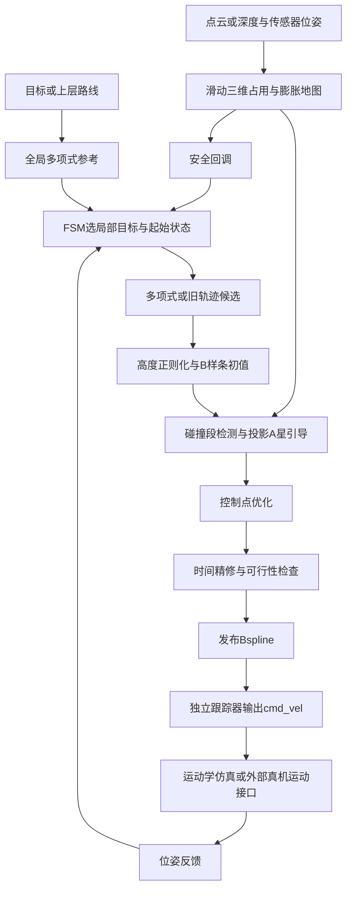
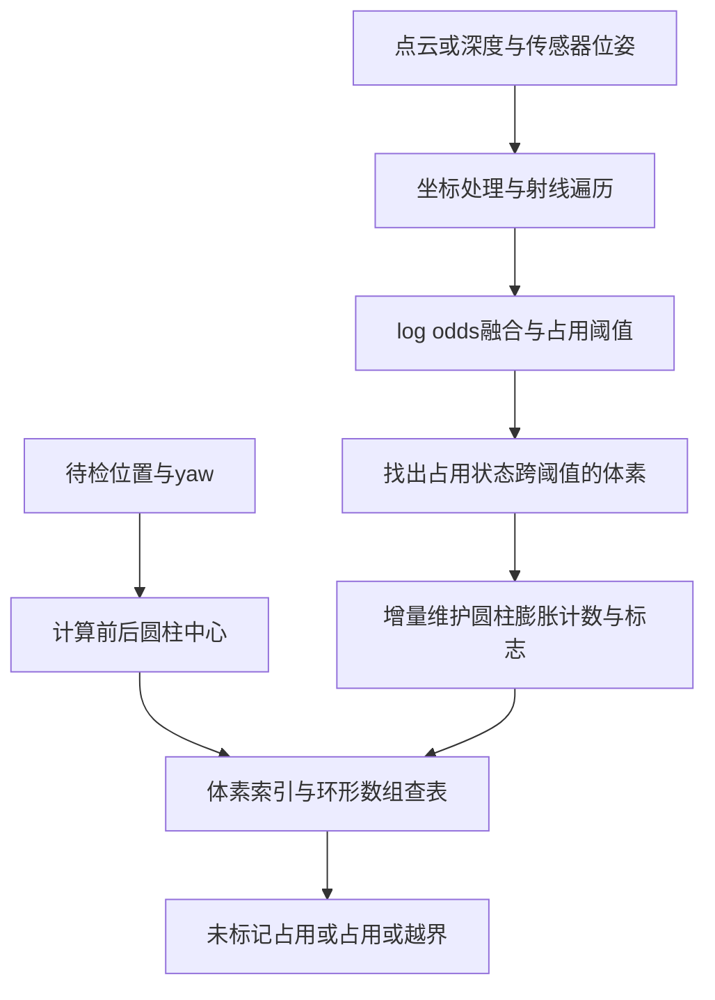
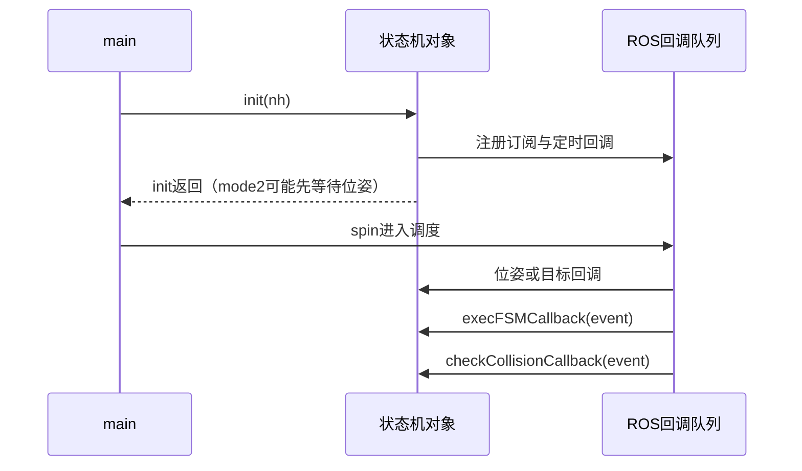
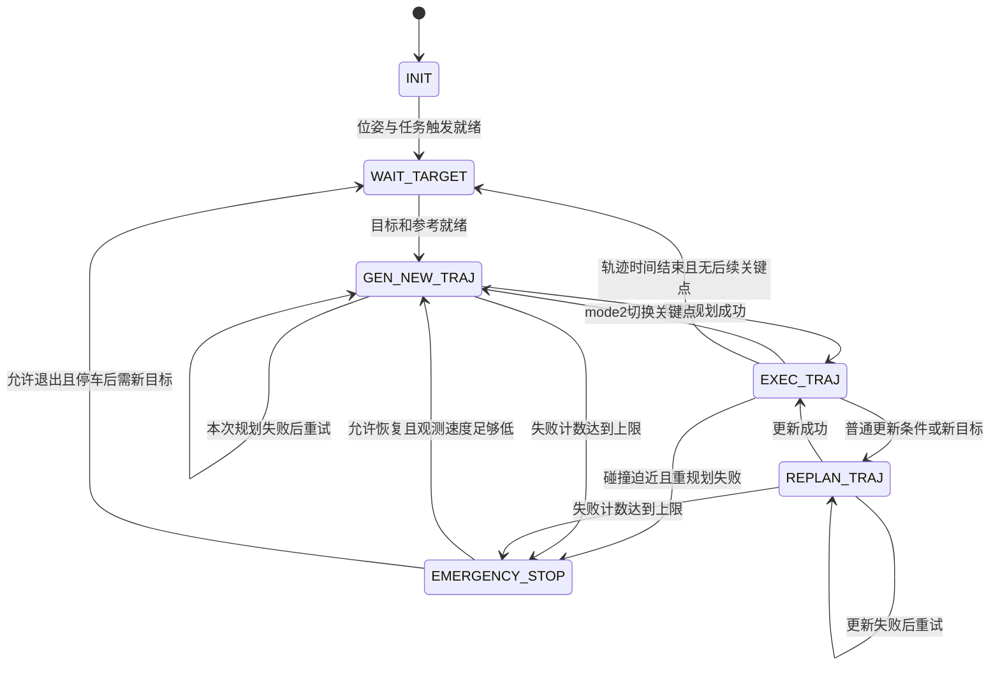
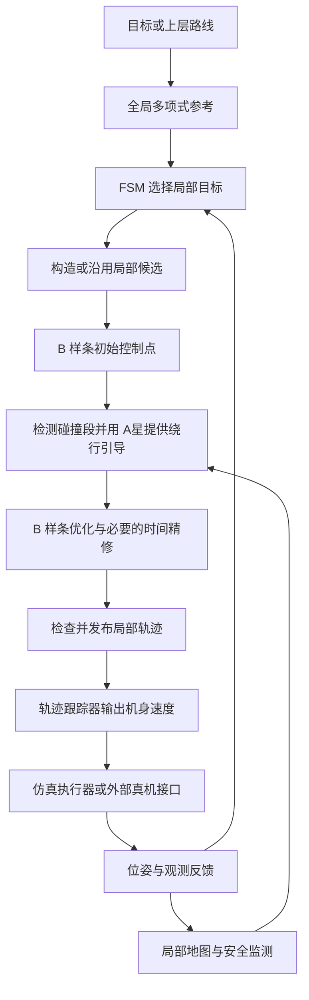

# 算法原理与面试问题

本手册覆盖当前 ROS1 main 的任务输入、参考生成、局部地图、几何碰撞、A* 引导、B 样条优化、时间分配、跟踪及异常处理。依据本地代码和仓库内论文核对；**论文方法、当前实现、可提出的改进分开描述**。这不是全局最优、连续安全或四足动力学验证的证明。

## A00-复习入口

时间紧时按以下顺序复习，不再从每一行源码读起：

1. 先复述 [项目口述与架构](#a01-项目口述与架构)，画出输入到执行的链路。
2. 掌握 [局部规划完整流程](#a02-局部规划完整流程)、[目标函数与梯度](#a03-目标函数与梯度)、[求解与时间分配](#a04-求解与时间分配)。
3. 用 [问题库](#a08-深入问题库) 自测，答不出来再跳到对应原理或源码。
4. 最后检查 [论文与源码差异](#a06-论文与源码差异)、[工程失败场景](#a07-工程失败场景)，避免把已有功能讲大。

详细阅读入口：

- [多项式参考、分段最小jerk与随机初值](#a10-多项式参考与局部初始化的详细原理)
- [标准A星、投影搜索、碰撞引导与理论条件](#a11-a星搜索的详细原理与本项目适配)
- [B样条基函数、求值、求导、拟合与优化](#a12-b样条从表示到优化的详细原理)
- [为什么选择这条链路，以及DWA等方案对比](#a13-为什么采用这条链路而不是dwa等方案)
- [25道算法选型追问与口述答案](#a14-算法选型的面试追问与口述答案)
- [碰撞检测全过程、复杂度与效率验证](#a15-碰撞检测方法与效率分析)

A02 是流程速记；需要详细讲解或白板推导时，直接进入 A10–A12。问“为何不用 DWA/TEB/MPC”等选型题，先读 A13 再用 A14 自测。

原来的逐行问答、算例和文件清单保留在 [逐段查阅附录](#逐段查阅附录)。C++ 知识统一见 [另一份手册](C++相关知识.md)，不再拆分 Markdown。

| 必须记住 | 容易答错的说法 |
|---|---|
| 这是路线/目标引导的局部轨迹规划器 | 已经实现任意环境下全局必达 |
| 多项式生成连续参考，A* 提供局部绕行引导，B 样条是执行轨迹表示 | 三者是互相替代的三套导航算法 |
| 当前优化位置控制点，yaw 由切向诱导，Z 更新受限制 | 完整自由优化 XYZ、yaw、足端和动力学 |
| 三次 B 样条普通内部节点处 C² | jerk 也必然连续，控制点就是采样点 |
| 导数控制点公式是解析导数的系数变换 | 用两次里程计采样差分估计速度 |
| 固定三维池，XY 八邻域加高度投影 | 100 万个节点全部按 26 邻域搜索 |
| 默认规划普通回调由单线程 spin 执行 | 两个 Timer 就是两个算法线程 |
| 默认跟踪器是前馈与 P 反馈，仿真是平面运动学 | MPC、四足接触动力学或底层关节控制已经复现 |

## A01-项目口述与架构

### 三十秒口述

我复现和分析的是 SCAN-Planner，一个面向四足机器人、由路线或目标引导的局部轨迹规划项目。它维护有限范围的三维占用地图，用与 yaw 相关的双圆柱近似检查机身碰撞；局部初始化先约束高度趋势，发生碰撞时用投影 A* 构造绕行引导，再优化三次 B 样条的平滑、碰撞和运动可行性代价。状态机负责重规划和异常流程，轨迹交给独立跟踪器转成机身速度。我的个人改动与复现结果按实际提交、日志说明，不把原论文贡献说成自己原创。

### 两分钟展开的顺序

讲问题：点/球近似难兼顾长机身转向与窄通道，平面地图缺少头顶/多高度几何，自由三维绕障又可能产生不适合地面机器人的竖直绕行。讲设计：三维局部占用、双圆柱 yaw 查询、参考高度约束、投影 A*、B 样条优化、滚动重规划。讲边界：不优化足端与接触动力学，不保证任意参考都可修复，也不等同于完整全局路线系统。



这是功能链，省略了失败返回和备用重试；不是节点的固定执行顺序。

| 层 | 入口与作用 |
|---|---|
| 启动 | run.launch → advanced_param.xml + simulator.xml；RViz 单独启动 |
| 生命周期 | scan_planner_node.cpp 构造 FSM、init、启动等待、spin |
| 任务调度 | scan_replan_fsm.cpp：目标、位姿、执行/安全回调、模式与状态 |
| 规划组织 | planner_manager.cpp：参考、候选、优化、时间精修、结果缓存 |
| 表示/求解 | polynomial_traj.cpp、uniform_bspline.cpp、bspline_optimizer.cpp、lbfgs.hpp |
| 环境 | grid_map.cpp/h、raycast.cpp/h、dyn_a_star.cpp/h |
| 执行 | closed_loop_controller.cpp；仿真 go2_kinematic_sim.cpp；显示 gait/URDF |

### 仿真观测从哪里来

默认 mockamap 构造全局障碍点云场景，CPU pcl_render_node 根据机身状态、传感器安装方向、距离/视场等生成局部观测及传感器位姿。规划器用这些观测融合自己的局部 GridMap，不等于直接获得模拟器保存的全部环境。PCD 分支替换环境点云来源，深度分支还需内参反投影、筛选与图像/位姿配对。RViz 是显示端，不是用来向环境发射测量的传感器引擎。

默认仿真场景范围与规划窗口不同：场景约 40×40×5 m，GridMap 为 10×10×5 m；从传感器看到什么到进入规划地图还有筛选/射线/概率融合。模拟的点云和运动学反馈可验证接口与规划流程，不能代表真实测量噪声、接触动力学和全部时序误差已覆盖。

### 三种任务入口与六种状态

mode 1：RViz 单目标；mode 2：配置/录制关键点逐点导航；mode 3：外部 Path 提供路线，筛选点并保留最终点后构建参考。mode 3 的路线不是本局部规划器从零搜索得到。

INIT 等位姿与触发 → WAIT_TARGET 等参考就绪 → GEN_NEW_TRAJ → EXEC_TRAJ；执行中更新可进入 REPLAN_TRAJ，成功再执行。mode 2 切点、部分急停恢复也会用 GEN_NEW_TRAJ，不能只凭“有没有旧轨迹”区分两种规划状态。EMERGENCY_STOP 发布停止参考，并按低速、fail_safe、停止原因选择恢复或等新目标。

exec 回调目标周期 0.01 s，安全回调 0.05 s；它们不是两条独立算法线程。changeFSMExecState 更新状态/计数/日志，不会立即重新进入 switch。TRIG/FSM/SAFETY 是来源标签。安全回调也可直接尝试规划，不是所有规划动作都先经过 REPLAN_TRAJ 状态。

## A02-局部规划完整流程

### 从参考选局部目标

getLocalTarget 先采样全局参考，找距离当前起始位置较近的参考参数，再沿参考累计空间距离到 planning_horizon，当前默认 3.5 m；剩余不足则用终点。它不是简单往机身前方投一个 3.5 m 的点。

候选目标占用时，代码沿参考在目标附近向前/向后尝试空闲点；找不到时当前仅警告，不能讲成已强制拒绝。接近最终目标、距离小于 v_max²/(2a_max) 时设置零局部目标速度，否则取参考速度并限幅。这是借用刹车距离尺度的策略，不是完整动力学制动求解。

### 全局多项式参考的原理

单段每轴五次：x(t)=Σ₀⁵cᵢtⁱ，已知正段时长 T 与首尾 p/v/a 共六项条件，写成 M(T)c=b，用 QR 求系数。XYZ 分别求；系数的单位随幂次变化，不是六个位置点。零首尾 v/a 时 x=L(10u³−15u⁴+6u⁵)，u=t/T。

多段固定路线位置与全程首尾导数，内部连接点 v/a 为自由量，共享到相邻段保证相应连续性。当前 minSnapTraj 的 Q 实际惩罚三阶 jerk 平方积分，不是四阶 snap：

$$J=c^TQc,\quad Ac=C_td,\quad R=C_t^TA^{-T}QA^{-1}C_t,$$
$$d=[d_f;d_p],\quad d_p=-R_{pp}^{-1}R_{pf}d_f.$$

M 是单段边界映射；A/Ct/R 是多段求解的另一套矩阵，不要因变量同名混用。固定时间、非退化映射是推导前提；工程上通常应考虑分解求解而非反复显式求逆。段时间先按距离/速度估计并加长首尾；单段会被首尾各乘一次 2，即原时间的 4 倍。

**参考生成器没有障碍搜索。** 起终点连线上插点不是发现绕障关键点；光滑参考仍可穿墙。全局 A* 与曲线生成可以串联，不能用“多项式更平滑”证明不该做全局搜索。

### 候选、随机性与沿用旧轨迹

reboundReplan 的实际顺序：

1. 首次、调用方要求或强制重建时，从起始 p/v/a 到局部目标构造多项式候选；否则采样旧轨迹剩余部分，必要时接一段到新目标。
2. 随机标志为真时扰动中间经过点，改变候选形状；不随机改变机器人当前位置或导航终点。连续失败计数影响扰动尺度。
3. 多项式分支逐渐减小采样时间间隔，满足采样点间距与至少七点的要求；旧轨迹分支按近似弧长重采样，过长时转强制多项式。
4. applyLinearZReference 重设各点高度，再拟合初始 B 样条控制点。

初始时间公式借用速度/加速度尺度，是启发式；短距离项 sqrt(d/a) 不等于标准静止到静止三角速度运动的总时间 2sqrt(d/a)。不能把这里称为严格最短时间规划，后面仍需检查和时间调整。

### 高度正则化与抑制Z更新

先按候选点的 XY 累计折线长度 lᵢ 计算 αᵢ=lᵢ/L，再令 zᵢ=z_s+αᵢ(z_g−z_s)；水平总长退化时按序号比例，空/单点分别处理。它保持 XY 候选形状，让高度沿路径进度平稳变化；不识别楼梯，也不独立发现地形高度。

两个优化组合函数均将梯度 Z 行清零，鼓励在 XY 绕障。它相当于沿限制的更新子空间优化，不能说在完整 XYZ 上使用了未经修改的全梯度。三维表示/碰撞查询也不等于自由三维运动规划；上层参考高度不正确时，这个限制可能让问题无解。

### B样条表示、初始化与导数

N 个控制点、次数 p=3、节点 U，P(t)=ΣQᵢNᵢ,p(t)。完整节点数 N+p+1，有效参数域 [u_p,u_N]；初始均匀间隔 h 时 T=(N−p)h。三维是矩阵行数，三次是次数，N 是列数。

三次在简单内部节点处 C²，位置/速度/加速度连续；jerk 可跳变。每普通区间最多四个控制点参与，便于局部求值。一般控制点不是必经点，曲线位于局部控制点凸包不代表控制点折线无碰撞就足够安全。

导数系数是解析恒等式：
$$D_i=\frac{p(Q_{i+1}-Q_i)}{u_{i+p+1}-u_{i+1}},$$
均匀时为相邻控制点差/h；这是对基函数求导后重排系数，不是采样位置的有限差分近似。getDerivative 用它建立 p−1 次样条并去掉首尾节点；evaluateDeBoorT(t) 才返回某时刻的向量值。

parameterizeToBspline 的位置行权重为 (1,4,1)/6，另有首尾 v/a 行。K 个位置样本形成 K+4 个方程、K+2 个未知控制点/轴，QR 求最小二乘，**不能声称所有过采样位置与导数条件始终被精确满足**。固定首尾三控制点保留的是拟合后的边界状态；每条样条内部 C²，也不能自动推出新旧轨迹切换处严格 C²。

### 局部地图、双圆柱与A星

三维体素 log-odds 占用通过 raycasting 融合；固定环形窗口通过世界索引取模复用。重叠区域不搬移，退出区域撤销占用/膨胀贡献再清理，新区域未知。大位移直接整窗重置。当前 clear_mask 仍为窗口大小，不能说整个滑动 O(1)。

原始占用跨阈值时增减膨胀覆盖计数；两个障碍共同覆盖一格时计数为 2，删一个仍是 1，不能直接清零。未知、空闲、膨胀未占用与越界是不同概念。地图不维护完整 ESDF，也不预测动态障碍速度。

双圆柱中心 c_f/r=p±d(cosψ,sinψ,0)，半径和上下厚度转入障碍膨胀，查询两个中心。默认 r=0.25 m、d=0.18 m，上下膨胀各 0.1 m；尺寸是配置的碰撞近似，不是自动测量真实机身。yaw 由轨迹/控制点局部方向诱导，不作为独立控制变量；roll/pitch、足端、扫掠及接触动力学未完整建模。

局部 A* 使用仓库内实现，f=g+h，固定 100³ 节点池、每轮中点定位；默认步长 0.05 m，名义每轴约 5 m。它只枚举 XY 八邻域，Z 按起终点连线的 XY 投影比例插值，不是 26 邻域三维搜索，更不是因池有三维索引就有时间/yaw 搜索状态。方向诱导 yaw 用于占用筛选，0.2 s 搜索预算和轮次复用属于工程机制。

## A03-目标函数与梯度

### 优化变量和总体目标

优化器固定首尾各 p 个控制点，打包中间 N−2p 个点的 XYZ，代码维度为 3(N−6)，随后抑制 Z 更新；不是优化每个时刻的速度指令，也不优化所有节点时间。Rebound 目标：

$$J=\lambda_sJ_s+\lambda_cJ_c+\lambda_fJ_f.$$

默认权重为平滑 1、碰撞初始 1、可行性 0.1；碰撞重启可增大 λc。不同代价项量纲/时间缩放不同，不能只比较权重裸数值就说“谁重要十倍”。

### ESDF-free引导与碰撞代价

initControlPoints 先采样控制点折线的碰撞区段，A* 搜索 in/out 间的绕行路径。再用局部切向法平面与引导路径求交，从安全引导朝控制点方向探查占用边界，生成障碍基点 aᵢⱼ 与推离单位方向 vᵢⱼ；邻近点可传播相应约束。这不是直接把所有控制点拉到 A* 路径，也不是预先计算全地图欧氏距离场。

$$d_{ij}=(Q_i-a_{ij})^Tv_{ij},\quad e_{ij}=s_f-d_{ij},\quad J_c=\sum_{ij}\rho(e_{ij}).$$

当前 s_f=0.2 m，是这个投影代价的期望余量，不等同于膨胀半径。分段函数为：

$$\rho(e)=\begin{cases}0&e\le0\\e^3&0<e<s_f\\3s_fe^2-3s_f^2e+s_f^3&e\ge s_f.\end{cases}$$

它在连接处具有相应平滑性；投影距离有方向与局部几何意义，不能称为“到所有障碍的真实最短距离”。固定本轮 a/v 时：
$$\nabla_{Q_i}J_c=-\sum_j\rho'(e_{ij})v_{ij}.$$

负梯度方向把点推向增大安全投影距离的一侧。手算：s_f=.2、a=0、v=(1,0)、Q=(.1,0)，则 e=.1、ρ=.001、梯度=(-.03,0)，沿负梯度走会增加 X 距离。二值占用只用于发现碰撞和生成约束，不直接对 0/1 查询求导；约束可在优化中懒更新/触发重启，因此目标关系会变化，不能保证全局最优。

yaw 的控制点中心差是局部方向的估计，不等同在某个时刻对位置样条精确求导；不要把它与式 (1) 的精确导数系数变换混为一谈。这里的梯度也是固定基点/方向下的光滑代理梯度，并未对二值双圆柱碰撞指示或所有 yaw 依赖完整求链式导数。

### 平滑代价与梯度

令 rᵢ=Qᵢ₊₃−3Qᵢ₊₂+3Qᵢ₊₁−Qᵢ，代码 Js=Σ||rᵢ||²。对这四点的局部梯度贡献依次为 2rᵢ×[-1,3,-3,1]，一个点参与多项，需要累加。

真实均匀样条 jerk 控制点是 rᵢ/h³，代码省略了时间因子，故其代价不是物理 jerk 平方和的相同数值。固定 h 时可将常数缩放吸收到权重，但改变 h 后不能仍把两个数值混用。最小化该项不保证 jerk 跨节点连续。

### 可行性软惩罚

默认分支按各轴分量惩罚越限：vᵢ=(Qᵢ₊₁−Qᵢ)/h、aᵢ=(Qᵢ₊₂−2Qᵢ₊₁+Qᵢ)/h²，概括为：

$$J_f=\sum_{i,j}h^{-2}[\max(|v_{ij}|-v_m,0)]^2+\sum_{i,j}[\max(|a_{ij}|-a_m,0)]^2.$$

速度项还乘 h^-2；实际解析梯度对超限正/负区间分别处理。它与论文式 (13) 的向量范数写法不同。各轴不超限也不自动等于向量范数不超限；软惩罚更不等于硬约束。manager/max_jerk 当前读入但未作为硬 jerk 检查使用。

### Refine为什么换一项

Refine 组合平滑、参考贴合、可行性，而不是继续原 Rebound 碰撞项。令 xᵢ=(Qᵢ₋₁+4Qᵢ+Qᵢ₊₁)/6−参考点，v 为局部单位切向，其贴合项约为 (xᵀv)²/25+||x×v||²：横向偏移惩罚更强，允许一定沿程调整。然后仍做几何复检；不能因求解器结束就省略碰撞检查。退化参考方向还需注意归一化有效性。

## A04-求解与时间分配

### L-BFGS怎样工作

它是有限内存拟牛顿法：不直接存完整 n×n Hessian，而记录最近若干次位移 sₖ=xₖ₊₁−xₖ 和梯度差 yₖ=gₖ₊₁−gₖ，通过两循环递推构造近似逆 Hessian 与梯度的乘积，得到下降方向 d≈−Hₖg，再线搜索选择步长。

可口述两循环：从 q=g 开始，逆序减去 αᵢyᵢ，其中 αᵢ=ρᵢsᵢᵀq、ρᵢ=1/(yᵢᵀsᵢ)；初始尺度作用后，正序用 sᵢ(αᵢ−βᵢ) 修正，βᵢ=ρᵢyᵢᵀr；最终取负方向。内存与 m×n 成正比，而完整 BFGS 通常与 n² 成正比；曲率条件、线搜索与数值稳定仍有前提。

当前 lbfgs.hpp 调用 More–Thuente 线搜索。Armijo 限制目标充分下降，Wolfe 类曲率条件帮助避免不合适步长/支持拟牛顿更新，不能说“每步固定学习率”。Rebound 设置 mem_size=16、max_iterations=200、g_epsilon=.01；Refine 梯度阈值 .001。算法非凸、会换约束，未提供全局最优保证。

新碰撞可触发停止并构造新的 rebound 约束；结果仍碰撞时可加倍碰撞权重重启，存在有限重启与预算。部分返回码如达到迭代上限也会进入后续检查，并非等同严格收敛。

### 三种动态限值必须区分

| 位置 | 当前检查 | 解释 |
|---|---|---|
| 优化代价 | 各轴速度/加速度超限的软罚 | 有限权重可能仍留下违反 |
| UniformBspline::checkFeasibility | 导数控制点各轴，名义限值×(1+相对容差)+小量 | 利用导数样条凸包思路的保守分量检查，用于决定是否调时 |
| Manager::checkDynamicFeasibility | 轨迹离散采样的向量范数，名义限值+加性容差 | 与上面的相对容差不同；有限采样不是连续时间证明 |

当前默认 v_m=.75 m/s、a_m=.5 m/s²；相对容差 .5，对应分量阈值约 1.125/.75；最终加性容差均为 1，对应范数阈值 1.75 m/s、1.5 m/s²。不能说最终检查严格限制在 .75/.5。实际控制器又有自己的速度限幅，三层机制不是一个数。

### 为什么拉长时间有帮助

对保持相同形状的理想均匀时间缩放 r，速度/加速度/jerk 分别按 1/r、1/r²、1/r³ 缩放，因此可估 r=max(速度比例,sqrt(加速度比例))。这解释策略，不等于源码每个节点都按 r 完整等比缩放。

当前 lengthenTime 只调整选定中部节点和后续节点；reparamBspline 读取实际新时长，按 Nc−3 个段重算 dt，重采样位置并用原首尾导数重新拟合控制点，再 Refine。重新拟合和固定原导数会影响形状/状态，因此还需复检，不能讲成“只改时钟，空间轨迹绝对不变”。

### 碰撞检查的实际范围

Rebound 和 Refine 当前对优化轨迹采样检查近端约前 2/3，采样步长由端点距离等估计；端点重合、极短路径等需留意退化。FSM 安全回调按 .01 s 采样：当前进度未到 2/3 时只检到该界，否则检查剩余后段。当前不等于完整连续时域、任意跟踪误差下的无碰撞证明。

## A05-跟踪执行与实时性

默认闭环控制器接收控制点/knots/order，重建位置样条和导数样条；接收新轨迹时 exec_time 重置为 0，**不直接按消息 start_time 采样**。世界系平面速度为：

$$v_{world}=v_{ref}+K_p(p_{ref}-p_{odom}),\qquad v_{body}=R_z(\psi_{odom})^Tv_{world}.$$

先限平面范数，再限机身 X/Y 分量；yaw 参考取前视位置方向，退化时用参考速度，再退化保持当前 yaw。ω=clip(Kψ·wrap(ψ_ref−ψ_odom))。当前 Kp=.8、Kψ=1.5、前视 .8 s、max_vx=.75、max_vy=.35 m/s、max_vyaw=1 rad/s。

朝向误差超过 .8 rad 时只原地转向、冻结控制器轨迹进度，并发布冻结标志。FSM 用 start_time+=dt 抵消 now 增长，使 now−start_time 不随此转向推进；ROS 时钟不停止、控制点不改变。dt 是相邻函数调用间隔，未冻结也刷新基准；异常步长被过滤，不能把 last_freeze_update_time 当上次冻结结束时刻。

这不是 MPC：当前跟踪器没有滚动优化未来控制序列、预测机身动力学及接触约束；它是前馈加反馈。腿部步态节点只用于显示；默认 go2_kinematic_sim 积分 XY/yaw、固定 Z，不计算接触、摩擦或碰撞反力。真机开关切输入/标定并停模拟源，仍需外部定位、传感器驱动和机身速度运动接口。

普通 spin 下规划与安全回调串行，Timer 是周期任务不是独立线程，也无自动安全优先级。其他节点进程可独立运行，CPU 感知中另有 OpenMP；不能把“规划回调单线程”扩大为“整个系统没有多线程”。

## A06-论文与源码差异

完整 15 式逐项位置见 [公式对照](../paper_formula_code_map.md)。这里只记面试中会影响结论的差异：

| 点 | 论文/理论 | 当前实现与回答边界 |
|---|---|---|
| 双圆柱 | 结合高度/可跨越台阶设置上下余量 | 当前读配置，不自动估地形可通行性；上下余量与反射几何需核对 |
| 三维规划 | 三维占用与高度趋势下绕障 | 位置表示三维，A* 高度受约束，优化 Z 梯度清零，不是自由飞行规划 |
| 平滑式 (12) | jerk 控制点平方 | 代码使用未乘 h^-3 的三阶差分 |
| 可行性式 (13) | 范数表述 | 默认代码逐轴软罚、速度项另乘时间因子，最终再范数采样 |
| 多项式函数名 | minSnapTraj | Q 实际积分 jerk，不是 snap |
| 概率融合 | log-odds 证据 | 当前每轮按缓存 hit/miss 多数选一次更新，不是所有重复点无限独立累加 |
| 死胡同恢复 V-C | 一格宽虚拟自由层用于假设搜索，取实际地图边界回退目标，最终轨迹只在真实地图内生成 | 当前已核查主链未找到这一完整流程；不能用“目标沿参考后退”冒充它，也不能因未找到就断言所有版本都没有 |
| 真机/仿真 | 论文含 Go2、Mid-360、长程与楼梯实验 | 当前默认启动链是运动学反馈与点云模拟；不能声称自己已复现论文全部实验 |

论文对比包括 EGO-2D/3D、CMU、ART，报告 SR、CR、SPL。SPL 常用形式为平均 Sᵢ·lᵢ/max(pᵢ,lᵢ)，同时考虑成功和绕行；具体参考最短路径和试验定义要按论文/评测协议核对，不能仅靠“路径更短”证明更好。论文的统计和真机长程数据属于作者报告，不是个人复现测量。

## A07-工程失败场景

### 高频异常的当前行为与改进

| 场景 | 当前代码 | 可提出的工程改进，不能说成已实现 |
|---|---|---|
| 全局目标落障碍 | 沿全局参考从终点向前序时刻找空闲候选，默认采样最大间隔 .05 s；找到则截短有效参考 | 增加目标邻域/可达性搜索与最大调整容差，明确是否允许替代目标 |
| 所有回退点不通过 | 返回 false；mode 1 入口失败日志不等于自动安全停车，目标/参考也未完整事务回滚 | 先验证候选再提交任务状态；失败保持旧任务或安排安全停止并上报 |
| 目标在地图外 | 某处 final_occ<=0 放行 -1，别处非零又当风险，接口语义不一致 | 显式枚举 Unknown/Free/Occupied/OutOfMap 并统一策略 |
| 局部目标不可用 | 参考前后找点，失败仅警告的路径仍存在 | 失败应有明确返回与恢复，避免把坏目标继续当成功 |
| A* 无路径/超时/出池 | 返回初始化/搜索错误，随后依赖调用方处理 | 区分地图不足、容量不足、拓扑错误、预算不足，不无限加大池 |
| 规划失败过多 | 计数触发 EMERGENCY_STOP，停车后可能需新目标 | 设计分级恢复、退避、重试预算与上层路线重规划 |
| 急停 | 常值控制点生成静止参考，不是完整受限制动轨迹 | 根据实速、摩擦、延迟和限加速度构造制动；硬件急停独立设计 |
| 定位/传感器断流 | have_odom 等主要代表曾收到，不构成全链超时健康检查 | 校验时间戳、数据年龄、坐标系、有限数值、异常跳变并触发保护 |
| 人/移动障碍 | 地图随观测更新，能反映变化 | 若需预测，增加带时间状态的障碍轨迹与动态碰撞模型 |
| 大角度转向 | 冻结进度并只转向 | 补充真实旋转扫掠碰撞、跟踪偏差及机体姿态检查 |

### 源码审查时可以深入指出的点

以下是读码观察或条件风险，不是宣称已在当前默认运行中全部触发；本轮没有修改这些算法：

- priority_queue 保存节点指针后，直接降低节点 fScore 并不会自动修复堆序。应设计 decrease-key、重入队/跳过旧条目等机制；再谈 A* 最优性还需启发式、闭集重开和预算条件。
- 投影邻居的 Z 可跨多个索引，原来的三维对角距离启发式是否仍是新邻接图代价的下界，也需要重新论证，不能只因它来自标准 A* 模板就认定可采纳。
- `constexpr double inf = 1 >> 20` 实际为 0；不能被变量名误导。许多路径又重写分数，实际影响需按读取路径核查。
- AStar 析构删除叶子 GridNode，但多级指针数组本身的 delete[] 配对需另核对；智能指针不会补齐被管理类内部遗漏的清理。
- raycast 轮次是 int，去重标记是 char，超过 char 表示范围后可能与完整轮次比较失配；应统一代际类型或处理回绕。
- 深度点缓冲按 640×480 初始化，深度写入不像 lidar 分支那样动态扩展；切更大图像需先验证容量。
- parameterizeToBspline 的过定方程是最小二乘，不能默认严格满足全部首尾条件；跨轨迹拼接也需要实测边界误差。
- Refine 的 iter_count 初始 0、递增后循环条件 `<=0`，当前并非多轮贴合权重重试；不要被 do-while 和 lambda4 加倍误导。
- getMeanVel() 非 void 却缺 return；当前检索未见调用，不能等同主链必然失败，但不应当作可靠接口。
- setKnot 不改 interval_，改完节点后不能靠旧 interval_ 判断真实时长；setUniformBspline/空构造的有效条件也需检查。

### 怎么验证而不是只说理论

固定随机种子与多场景，多次重复；分别测 SR/CR、路程、到点误差、最小间隙、重规划次数、p50/p95/p99 延时、峰值内存、控制/安全回调调度延迟，以及按名义限值和容差限值分别统计的超限。区分规划曲线碰撞与真实跟踪机体碰撞。

消融可做：单圆/双圆、忽略/考虑 yaw、允许/抑制 Z 更新、无/有 A* 引导、全图/滑窗、不同分辨率与池尺寸。应控制地图、目标、起点、速度配置及硬件，避免用一次成功或运行时间均值证明普遍有效。默认运动学仿真不足以验证腿部动力学；真实实验需再考虑定位/执行延迟和外部运动接口。

## A08-深入问题库

回答模板：先给结论，再说机制/公式和源码，最后说明条件/失败出口。下表是可能追问，不冒充全部真实面试原题。

| 问题 | 应答关键 |
|---|---|
| 1 A* 是库还是自己改的？ | 仓库内实现；说清 XY 投影、yaw 查询、池/轮次/预算；原项目适配与个人贡献分开 |
| 2 为什么不用 A* 做全局？ | 可以做；当前分层与覆盖范围不同，不用平滑性当成禁止全局 A* 的理由 |
| 3 多项式怎样生成？ | 单段六边界方程，多段固定/自由导数和平滑积分；不查询障碍 |
| 4 全局参考穿墙怎么办？ | 局部尝试偏离绕行，但拓扑错误可能无解；需要上层路线更新，不保证任意修复 |
| 5 为什么三次 B 样条？ | 简单节点 C²、四点局部支撑和配套实现；jerk 不保证连续 |
| 6 控制点和 knots 是什么？ | 空间系数与参数节点共同定义曲线，不一一对应到达时间 |
| 7 求导为何像差分？ | 对基函数解析求导后合并系数，差的是控制点，不是采样位置近似 |
| 8 控制点安全能保证曲线安全吗？ | 不能；凸包整体安全才有对应充分性，点/折线采样不等于整个凸包 |
| 9 如何从采样点变控制点？ | 三次权重与首尾导数拼矩阵，QR 最小二乘，注意过定与边界误差 |
| 10 为什么首尾固定三点？ | 当前均匀三次边界 p/v/a 由相应三点决定；固定不等于拟合前要求被精确满足 |
| 11 为何优化不显式搜索 yaw？ | 从切向诱导减少变量，代价是独立原地旋转/侧移与几何扫掠需另处理 |
| 12 双圆柱为什么优于单圆？ | 近似长机身且 yaw 相关，宽度半径单圆可能转向不安全、长度半径又保守；仍只是近似 |
| 13 点云在哪个坐标系？ | cloud_is_world 决定是否变换，雷达位姿提供原点/方向，外参只应用一次 |
| 14 世界系点云为什么还要传感器位姿？ | 已知端点不等于已知射线原点；清空沿途和滑窗仍需要它 |
| 15 上下膨胀是否机身高度？ | 是配置的障碍扩展/查询近似，需结合参考点和反射关系；不自动识别可跨台阶 |
| 16 体素分辨率减半怎样？ | 固定三维范围格数约八倍，内存/更新成本增加，不提高传感器本身精度 |
| 17 滑窗如何避免整体搬移？ | 世界索引取模，重叠保留，退出清理后复用，必须撤销膨胀贡献 |
| 18 滑动更新 O(1) 吗？ | 地址查询可常数规模，当前整窗掩码等不是整体 O(1) |
| 19 窗口移很远怎么办？ | 任轴达到对应窗口格数整窗重置；不等同上游定位异常处理 |
| 20 未知能否直接当空闲？ | 看状态和调用方；膨胀零不是已知空闲，越界 -1 还存在不一致处理 |
| 21 为什么 log-odds？ | 便于累加观测证据和截断，当前每轮多数证据一次更新，不能无条件独立假设 |
| 22 射线为什么清空沿途？ | 自由空间证据与表面命中分开；超量程端点不当真实障碍 |
| 23 为什么膨胀要计数？ | 多障碍重叠覆盖，撤销一个仍需保留其他贡献 |
| 24 100³ 怎么又八邻域？ | 总存储容量与每次扩展规则不同，候选经筛选入队还可能少于八 |
| 25 起终点是搜索盒两个角吗？ | 不是；固定池以两点中点作参考，步长决定尺度，端点可能越池失败 |
| 26 A* 最优性如何保证？ | 需图/代价、启发式条件、正确开放/关闭集更新等；当前倍率、可变堆键与预算不能直接保证 |
| 27 为什么不是 Hybrid A*？ | 没有独立 yaw 状态和非完整运动原语，只用扩展方向估计检查 yaw |
| 28 A* 路径怎么进入优化？ | 交点/边界基点与推离方向，形成平滑投影碰撞代价，不是直接执行路径 |
| 29 不建 ESDF 怎么有梯度？ | 对局部 a/v 投影距离及分段惩罚求导；二值占用只做检测/构造约束 |
| 30 为什么用 L-BFGS？ | 中等规模平滑代价有解析梯度，有限内存拟牛顿；非凸、依赖初值，不保证全局最优 |
| 31 怎么验证梯度？ | 固定 a/v 与参考，沿自由 XY 变量做中心有限差分对比；别把主动约束更新或固定 Z 混入同一测试 |
| 32 权重越大越安全吗？ | 有限软罚不是硬安全，权重过大影响条件数/收敛，仍需检查与失败处理 |
| 33 随机初值为何有用？ | 改变进入局部优化的候选形状，帮助跳出相似失败；有限尝试不保证可达 |
| 34 Z 梯度清零是否有代价？ | 避免地面机器人竖直绕障，限制可达解空间，错误高度参考可能无解 |
| 35 重新分配时间是否一定更安全？ | 降 v/a 尺度有帮助，重新拟合与精修可能改形状，必须再检查 |
| 36 限值到底在哪？ | 软罚、相对容差分量检查、加性容差范数采样、控制器限幅是不同层 |
| 37 为什么不是 MPC？ | 当前优化轨迹 CP，跟踪器没有预测动力学/滚动控制序列求解 |
| 38 规划与安全是两个线程吗？ | 默认同队列单线程，耗时会相互阻塞，safety 名称无抢占优先级 |
| 39 定时器 100 Hz 是否每次重规划？ | 仅周期检查，根据状态/距离/风险才规划，实际频率受耗时影响 |
| 40 为什么冻结要后移 start_time？ | 保持 now−start 不变；控制器另冻结 exec_time，ROS 时钟不停止 |
| 41 执行完是否等于真实到点？ | FSM 某结束分支按局部时间；真实误差需反馈和控制器判定，不能混同 |
| 42 目标在障碍内后退一个点仍不行？ | 沿参考继续尝试全部离散候选；全部失败返回，需明确任务/停车/上层处理 |
| 43 地图变了为什么还碰撞？ | 观测/定位/更新/求解/通信/跟踪都有延迟，有限采样与近似机体也有误差 |
| 44 能爬楼就优化了足端吗？ | 没有；高度参考/碰撞近似与底层接触支持能力必须分开 |
| 45 Nav2 与这里差别？ | Nav2 也有局部 rolling costmap；比较 2D 主代价图/三维占用、分层和接口，不以是否全图简单划分 |
| 46 论文死胡同回退是什么？ | 虚拟边界层只用于假设搜索，选真实边界目标再真实图内生成；当前未定位完整实现 |
| 47 模型在 RViz 走就说明动力学有效？ | 不说明；当前 XY/yaw 积分，腿动画不计算接触力 |
| 48 你做了什么？ | 根据自己的提交、运行日志、算例和复现范围回答，不能把 fork 算法说成自己原创 |
| 49 怎么改进？ | 先按证据选问题：堆更新、状态事务、边界语义、超时健康、连续碰撞/跟踪余量、上层路线，不空喊换算法 |
| 50 怎么证明改进有效？ | 控制变量、多次统计、消融、真实误差/延迟指标；修复测试覆盖对应触发条件 |

## A09-源码与公式导航

| 要找的机制 | 文件与函数 |
|---|---|
| 状态、模式、目标调整、局部目标 | scan_replan_fsm.cpp：init、目标回调、getLocalTarget、execFSMCallback、checkCollisionCallback |
| 参考/候选/调时/结果 | planner_manager.cpp：planGlobalTraj*、reboundReplan、reparamBspline、checkDynamicFeasibility |
| 多项式矩阵 | polynomial_traj.cpp：one_segment_traj_gen、minSnapTraj |
| B 样条 | uniform_bspline.cpp：setUniformBspline、parameterizeToBspline、getDerivative、evaluateDeBoor、lengthenTime |
| 碰撞引导、代价、梯度、求解 | bspline_optimizer.cpp：initControlPoints、calc*Cost、combineCost*、rebound_optimize、refine_optimize |
| 局部 A* | dyn_a_star.cpp/h：AstarSearch、坐标映射、checkOccupancy |
| 地图 | grid_map.cpp/h：updateSlidingMap、raycastProcess、applyOccupancyUpdate、getInflateOccupancy |
| 控制 | closed_loop_controller.cpp：bsplineCallback、cmdCallback、estimateDesiredYaw |

文件精确链接见下方原有章节与 [逐式源码对照](../paper_formula_code_map.md)。公式 (1) 导数、(2) yaw、(3)–(5) 双圆柱、(6) 总代价、(7)–(8) 高度、(9)–(11) 碰撞项、(12) 平滑、(13) 可行性、(14)–(15) 投影 A*。读不清符号时按这个分组查，不再从 main 重新逐行找。

本轮新增的综合总结只修改笔记和教学示例，没有替换规划、控制或安全算法；源码审查点与建议改进都不代表已修复或部署。

本轮公式验证：固定障碍基点/方向、时间间隔和参考切向，对碰撞分段函数、平滑项、默认逐轴可行性项、参考贴合项做中心差分算例，解析梯度最大误差小于 1e-5。该验证针对手册中的固定条件公式，不是完整优化器动态刷新约束的端到端梯度测试，也不包含真实 ROS 时延/碰撞统计。此前样条求导、连续性和多项式算例的运行记录保留在附录。

## A10-多项式参考与局部初始化的详细原理

### 先分清路径与轨迹

路径回答“从空间哪里经过”，例如几何曲线 γ(s) 或一串路线点；轨迹还回答“什么时候在哪里、以什么速度/加速度运动”，例如 p(t)。给路径配时间、平滑和限速是额外工作。

本项目的“全局多项式”更准确叫**面向当前任务/路线的时间参考**：它不执行整张障碍图的路线搜索。名称里的 global 不能当作已完成全局可通行规划的证明。

### 输入到输出逐项对应

| 项目 | 单目标参考 planGlobalTraj | 多路线点参考 planGlobalTrajWaypoints |
|---|---|---|
| 输入位置 | 起点与目标 | 起点与外部/配置的经过点 |
| 输入导数 | 全程首尾速度、加速度 | 同左，内部导数可优化 |
| 几何预处理 | 过长线段线性插点，固定尺度 4 m | 尺度与总长相关，下限 4 m |
| 时间 | 每段长度/名义速度，首尾段加长 | 同类启发规则 |
| 求解 | 两点时单段，否则分段 | 两点时单段，否则分段 |
| 输出 | 系数、段时间组成的 PolynomialTraj，保存进 global_data_ | 同左 |
| 不提供 | 全局障碍搜索、任意环境必达性 | 上层路线本身的拓扑正确性证明 |

若只有一段，首段与末段是同一项，所以连续乘两次 2。时间必须为正，重复点、极小段、无效名义速度等需要校验；当前函数不能被当成完整输入验证器。

### 为什么每轴选五次

设 x(t)=c₀+c₁t+c₂t²+c₃t³+c₄t⁴+c₅t⁵。首尾各规定位置、速度、加速度，共六项独立线性条件，所以用六个系数求解：

$$
\begin{bmatrix}
1&0&0&0&0&0\\
0&1&0&0&0&0\\
0&0&2&0&0&0\\
1&T&T^2&T^3&T^4&T^5\\
0&1&2T&3T^2&4T^3&5T^4\\
0&0&2&6T&12T^2&20T^3
\end{bmatrix}c=
\begin{bmatrix}x_s&v_s&a_s&x_g&v_g&a_g\end{bmatrix}^{T}.
$$

源码 one_segment_traj_gen 按降幂 c₅…c₀ 排列，所以其矩阵列顺序与上式相反；不是公式相互矛盾。Y/Z 使用同一时间矩阵，各自求一组系数。QR 解线性系统，不是在随机猜系数，也不是对点云运行 A*。

### 手算位置、速度与时间的影响

首尾速度/加速度为零，从 0 到 L 的解为：

$$x(t)=L(10u^3-15u^4+6u^5),\quad u=t/T,$$
$$v(t)=\frac{L}{T}(30u^2-60u^3+30u^4),$$
$$a(t)=\frac{L}{T^2}(60u-180u^2+120u^3).$$

L=2 m、T=2 s 时，中点位置 1 m、速度 1.875 m/s、加速度 0。满足六项边界不代表整段满足指定速度/加速度上限。例如当前名义速度 .75 m/s，这个教学例子的中间速度就超过它。

此零导数特例还有：max|v|=1.875L/T，max|a|=(10/√3)L/T²。因此若 L=2、v_max=.75、a_max=.5，至少要按两类条件取足够的 T；速度条件给 T≥5 s。这个结论只针对上述特例，不拿它替代任意非零首尾状态的动态检查。

### 分段时优化什么

每个中间经过点的位置给定，但经过速度/加速度可以未知；相邻段共享该组导数。把它们留为自由变量，能避免强迫机器人在每个路线点都停下。

以 S 段、每轴六个系数为例，代码按 6S 个逐段端点状态组织映射 A；Ct 将固定与自由边界量映射到相邻段。固定项数 2S+4，含相邻段重复记录的连接位置；自由项数 2S−2，来自 S−1 个内部点的 v/a。

$$J=\sum_k\int_0^{T_k}[x_k'''(t)]^2dt=c^TQc,$$
$$Q_{ij}^{(k)}=\frac{i(i-1)(i-2)j(j-1)(j-2)}{i+j-5}T_k^{i+j-5},\quad i,j\ge3.$$

Q 来自求三阶导数、平方并积分；低于三次的相应项为零。因此当前 minSnapTraj 名字虽含 snap，实际是 jerk。位置/速度/加速度的连续性由共享边界构造保证；不是一个函数名自动赋予的性质。

$$c=A^{-1}C_t[d_f;d_p],\quad R=C_t^TA^{-T}QA^{-1}C_t,$$
$$J=d_f^TR_{ff}d_f+2d_f^TR_{fp}d_p+d_p^TR_{pp}d_p.$$

固定 d_f，对 d_p 求梯度并令零：R_pp d_p=−R_pf d_f。理论上可逆等条件成立时得到闭式关系；工程实现显式 inverse 的数值稳定性、退化时间和分解求解选择仍需审查。

### 参考多项式与局部候选不是同一个对象

| 名称 | 所在位置 | 作用 |
|---|---|---|
| global_data_.global_traj_ | 全局参考缓存 | 表达当前任务方向与前视目标 |
| reboundReplan 中局部 gl_traj | 一次局部规划过程 | 连接本次起始状态到局部目标，采样后拟合初始 B 样条 |

两者可能都用五次多项式，但局部 gl_traj 并非“再次发布整条全局轨迹”。全局参考可能被重复刷新，局部初始化也可能沿用旧轨迹，不是每次都重做同一段多项式。

### flag_random_poly_init究竟随机什么

GEN_NEW_TRAJ 中，连续请求该状态的首次计数为 1，先不随机；失败后再次请求同状态，后续尝试允许随机候选。传入 callReboundReplan(true,flag_random_poly_init)，其中 true 要求使用多项式候选。

Manager 中真正重建初值的条件是首次/flag_polyInit/强制标志任一成立；随机标志只在多项式分支决定常规单段还是插入随机中间点。

设起终点差向量为 d，水平侧向 n_h 由 d 与 Z 轴叉积归一化，另一个垂直于 d/n_h 的方向为 n_v；中间点形如：

$$M=(S+G)/2+\xi_1\|d\|\,0.8\eta(k)n_h+\xi_2\|d\|\,0.4\eta(k)n_v,$$
$$\xi_1,\xi_2\in[-0.5,0.5],\quad\eta(k)=-0.978/(k+0.989)+0.989.$$

k 是连续失败计数，失败增多后允许更大扰动。然后以 S/M/G 生成分段多项式；不是随机移动当前机器人，也不是修改最终导航目标，更不是建立一棵 RRT 树。

它的用途是改变优化入口、碰撞分段或引导条件，减少在相似初值下反复失败；**不保证跳出所有局部极小，也不保证随机候选安全**。退化叉积需留意；随后 applyLinearZReference 又重设采样 Z，不能认为随机竖直偏移将原样保留。

### 沿用旧轨迹与两种状态的区别

mode 3 的 planFromCurrentTraj 取旧轨迹当前 p/v/a，依次尝试：旧轨迹候选、常规多项式候选、随机多项式候选，前一种失败才继续。若 have_new_target_ 等条件要求重建，首个 false 也不代表一定沿用旧轨迹。

mode 1/2 的重规划先用当前观测位置与衔接导数刷新参考，再尝试常规/随机多项式。GEN_NEW_TRAJ、REPLAN_TRAJ 都复用 B 样条局部规划器，是准备状态/候选的调用路径不同，不是分别执行多项式算法和 A* 算法。

### 为什么不能把它当作全局避障

没有障碍数据进入上述六项边界方程或 jerk 代价，解出来只表示这些条件下的光滑参考。面对墙体，插在起终点连线上的中间点仍可能全部在墙内。路线需要在墙的哪侧通过，应由路线搜索、关键点或上层任务提供，不能由“系数已求出”推出安全可达。

源码：[planner_manager.cpp](../../src/planner/plan_manage/src/planner_manager.cpp) 的 planGlobalTraj* 与 reboundReplan、[polynomial_traj.cpp](../../src/planner/traj_utils/src/polynomial_traj.cpp)、[scan_replan_fsm.cpp](../../src/planner/plan_manage/src/scan_replan_fsm.cpp) 的 GEN_NEW_TRAJ/planFromCurrentTraj。

## A11-A星搜索的详细原理与本项目适配

### 标准A星在解决什么

给定图、起点 S、目标 G、非负边代价，逐步搜索低代价路线。节点保存 g（已知起点到本节点的最好代价）、h（估计到目标代价）、f=g+h，以及前驱。不是给出起终点就一定存在路，也不是“看到障碍向左绕”的固定规则。

```text
起点g=0，加入OPEN
重复：取OPEN中优先级最高的当前节点
      若达到目标：沿前驱回溯
      否则枚举邻居，过滤不可用边/节点
      计算 tentative_g = current.g + edge_cost
      若新发现或代价改善：更新分数/前驱，并正确维护OPEN
失败：OPEN耗尽、容量/预算不足等
```

OPEN 是待探索前沿，不是最终路径；CLOSED 表示按当前策略已扩展的节点。只有知道一个目标的坐标，并不能跳过邻居生成、碰撞检查和父节点回溯。

### h为什么重要，最优性有哪些条件

h=0 时可退化为一致代价搜索/Dijkstra 思路；合适的 h 可以减少无关扩展。可采纳 h 不高估真实剩余最优代价；一致性还约束 h(n)≤c(n,n')+h(n')。图搜索若不重开关闭节点，通常要求相应的一致性；允许正确重开时，可采用更一般的条件。还需图/代价、队列实现等满足算法假设，不能只说“用了 A* 所以最短”。[Berkeley CS188 启发式搜索](https://inst.eecs.berkeley.edu/~cs188/textbook/search/informed.html)

栅格可用欧氏/曼哈顿/对角距离等启发，但必须与允许的邻接和代价匹配。例如允许斜移时，随意用曼哈顿距离可能高估。换了高度投影/跨格 Z 邻接之后，也要重新论证启发式，不是原模板自动继续保证最优。

在合适二叉堆实现下，常见图搜索复杂度以 (V+E)logV 量级讨论，实际还受图表示、重开/重复条目、启发式质量与碰撞查询成本影响；固定节点池提前分配的内存也不能算成只按最终访问数分配。

### 本项目的搜索图如何构造

| 要素 | 当前事实 |
|---|---|
| 使用时机 | 初始控制点折线检测到碰撞段时，在该段 in/out 附近找引导 |
| 状态存储 | 三维整数索引、g/f、前驱、集合状态、轮次；无独立速度、时间或 yaw 维度 |
| 池 | 100×100×100 个节点，中心索引 (50,50,50) |
| 世界位置 | 每次 center=(S+G)/2，Index2Coord=center+(index−CENTER_IDX)r |
| 尺度 | 默认 r=.05 m，每轴名义约 5 m；端点不是盒子两个角 |
| 候选 | dx/dy 各 -1/0/1，除自己后八组；Z 另行投影 |
| 边代价 | sqrt(dx²+dy²+dz²)，在索引步长尺度上累计 |
| 占用 | 用扩展方向 yaw，查询三维双圆柱膨胀占用；非零拒绝 |
| 终止 | 找到目标、OPEN耗尽、初始化失败或 .2 s 时间预算等 |

八邻域说的是“一个节点的下一批候选”，100³ 说总容量。坐标变换和池边界是工作空间限制，GridMap 自己的窗口是另一张障碍存储，不必同样尺寸。

### 投影高度与自由三维搜索有什么不同

令输入端点经量化/占用处理后为 S、G，XY 候选为 X：

$$\beta=\operatorname{clip}_{[0,1]}\frac{(X-S_{xy})^T(G_{xy}-S_{xy})}{\|G_{xy}-S_{xy}\|^2},$$
$$z(X)=z_s+\beta(z_g-z_s).$$

例如 S=(0,0,0)、G=(4,0,2)、X=(2,3)，β=.5、Z=1；向侧面绕行并不会因累计路程增加而继续加高。它与 Manager 按 XY 弧长重设候选 Z 是两个不同步骤。

此法减少无必要竖直绕行，使引导与地面运动参考一致；代价是限制可达解空间，真实路线若需要不符合该高度关系就可能失败。不能描述成完整 26 邻域三维 A*、Hybrid A*，或因为名字 dyn_a_star 就说它预测动态障碍。

### A星路径如何变成碰撞优化引导

1. 检测初始控制点折线的碰撞入口/出口。
2. A* 返回一条离散安全引导路径。
3. 在碰撞段的控制点附近，以局部切向为法线的平面与引导路径求交。
4. 从交点朝原控制点方向探查占用边界，建立基点 a 与推离方向 v，必要时向邻近点传播。
5. 用 d=(Q−a)·v 和平滑惩罚产生可供优化的梯度，再迭代控制点。

所以“用了 A* 避障”的准确含义是：它帮助选择局部绕行方向并建立优化约束，不是 A* 折线就是执行轨迹。地图可以提供二值碰撞查询而不维护 ESDF；A* 引导配合代理距离，使后面的优化有方向可走。

### 这份实现可以和不可以承诺什么

可以解释 XY/高度规则、方向相关检测、池复用、预算、引导到代价的转换；这些是原项目已有适配。不能承诺标准 A* 的全部理论结论已经自动继承：启发倍率 1.0001、直接修改堆内节点键、限制邻接与预算都需单独分析。节点点位通过也不等于每条边或整个转向扫掠连续安全。

失败原因可能是确实不可达、参考高度不允许、目标不在图内、池太小、地图未知/越界策略、计算预算或实现问题，不能一律归为“障碍太密”。增大 100³ 的尺寸不是所有失败的通用修复。

源码：[dyn_a_star.cpp](../../src/planner/path_searching/src/dyn_a_star.cpp)、[dyn_a_star.h](../../src/planner/path_searching/include/path_searching/dyn_a_star.h)、[bspline_optimizer.cpp](../../src/planner/bspline_opt/src/bspline_optimizer.cpp) 的 initControlPoints。当前源码审查点与改善方案见 A07，不在本次文档任务中更改搜索逻辑。

## A12-B样条从表示到优化的详细原理

### 为什么用分段基函数表示

把曲线写成 p(t)=ΣQᵢNᵢ,p(t)，控制点 Q 决定空间系数，次数和 knots 决定基函数。相比不断提高一条全局多项式的次数，分段低次表示可通过增加控制点获得局部自由度，不必把每次局部修改耦合到整条高次多项式；但不代表不会过冲或自动无碰撞。

对节点 U，零次基函数在相应非空区间内取 1、其他为 0，高次按递推组合：

$$N_{i,0}(t)=\begin{cases}1&u_i\le t<u_{i+1}\\0&其他\end{cases},$$
$$N_{i,p}(t)=\frac{t-u_i}{u_{i+p}-u_i}N_{i,p-1}(t)
+\frac{u_{i+p+1}-t}{u_{i+p+1}-u_{i+1}}N_{i+1,p-1}(t).$$

重复节点相应零分母项按基函数定义处理，最终端点还需相应边界/单侧约定；不能把这段数学定义不加检查就替换现有 de Boor 实现。

### 三次的一段可以明确写出来

对均匀节点，取局部归一化参数 s∈[0,1]：

$$p(s)=b_0(s)Q_i+b_1(s)Q_{i+1}+b_2(s)Q_{i+2}+b_3(s)Q_{i+3},$$
$$b_0=(1-s)^3/6,\quad b_1=(3s^3-6s^2+4)/6,$$
$$b_2=(-3s^3+3s^2+3s+1)/6,\quad b_3=s^3/6.$$

它说明：一段曲线最多由四点影响，权重随时间变化；在整数节点位置有一项为零，所以源码 (1,4,1)/6 的三点权重与“四点局部支撑”不矛盾。

控制点一般不是经过点，例如段起点由三个点加权得到，而不是直接取 Q_i。若所有控制点一样，曲线位置保持不变，可形成常值停止参考；这仍不等于真实机器人已完成受限动力学制动。

### 次数、knots与连续性

N 控制点、次数 p 时完整 knots 数为 N+p+1，有效参数域 [u_p,u_N]。当前均匀构造有 T=(N−p)h；u_ 有边界延拓节点，不能用完整向量首尾差当执行时长。

简单内部节点处连续性为 C^(p−1)，三次 C²，四次才可保证相应 C³；增加内部节点重数会降低连续性。均匀不是保证 C² 的唯一条件，关键还在次数、节点重数与合法表示。

### de_Boor求值在做什么

它不是求未知控制点，而是控制点/knots 已知时计算一个时间点的值：定位 t 所在节点区间，取相应 p+1 个控制点，再按节点比例逐层线性组合，直到剩一个向量。当前代码两层 r/i 循环共约 p(p+1)/2 次局部组合，固定空间维度下局部递推按 p² 规模计算；但当前查找节点区间先顺序扫描，最坏还受控制点数影响，见 A15。

evaluateDeBoorT(t) 先加 u_p，把相对执行时间映射到节点参数。对位置对象求值返回位置，对速度对象求值才返回速度，不会因为函数名一样自动知道你想要哪种物理量。

### 导数是解析系数变换

$$D_i=\frac{p(Q_{i+1}-Q_i)}{u_{i+p+1}-u_{i+1}}.$$

用这些 D、次数 p−1、去掉首尾节点的向量建立导数样条。这是对基函数解析求导后重排系数，h 不需要趋零；均匀时差分形式 D=(Qᵢ₊₁−Qᵢ)/h 不代表位置采样差分近似。对比算例见附录 [精确求导与差分](#为什么像差分却是精确求导)。

### 采样点怎样变成初始控制点

当前 parameterizeToBspline 用 K 个位置样本与四项首尾导数条件，建立每轴 K+4 行、K+2 列的线性系统：

$$\hat p_j=(Q_j+4Q_{j+1}+Q_{j+2})/6,$$
$$v_s=(Q_2-Q_0)/(2h),\qquad a_s=(Q_0-2Q_1+Q_2)/h^2,$$

终点使用对应末尾三点。把所有行堆成 A c=b，分别对 XYZ 使用带列主元 QR 求最小二乘，再把三轴解组合成 3×(K+2) 控制点矩阵。

K+4 个条件多于 K+2 个未知量，因此不能只看到 solve 就说所有边界与样本严格经过。若要求严格边界，可以设计约束最小二乘或消去固定边界自由度，但那是改善方案，不是当前已经这样做。

### 控制点怎样优化与保持边界

固定首尾各三个控制点，优化中间点；三次均匀起点 p/v/a 由前三点决定，固定它们就保留了已拟合出的边界状态。打包内点 XYZ 后用 L-BFGS 更新，组合梯度的 Z 行清零，因此真正更新被限制在水平分量。

代价是 A03 的平滑/碰撞/可行性，碰撞代理来自 A* 构造的 a/v；Refine 把碰撞项换成参考贴合。求解器完成后仍有几何/动态检查；当前近端采样、软约束、控制近似的边界见 A04/A07。

### 为什么要重分配时间后重新拟合

固定形状的整体时间拉长可降低速度/加速度，但若原起终点速度非零，简单缩放也会改变这些导数。当前先变更部分 knots，再按新有效时长重采样，并带原导数要求重新拟合；所以不能既说“重新拟合了”又承诺所有点与几何绝对不变。

重新求解的输出仍是样条控制点/knots，不是控制电机的扭矩。控制器再按时间求 p/v，结合反馈输出机身速度；这层分工与 DWA 直接选择速度有重要区别。

源码：[uniform_bspline.cpp](../../src/planner/bspline_opt/src/uniform_bspline.cpp)、[bspline_optimizer.cpp](../../src/planner/bspline_opt/src/bspline_optimizer.cpp)、[planner_manager.cpp](../../src/planner/plan_manage/src/planner_manager.cpp)。完整碰撞/平滑梯度与 L-BFGS 步骤在 A03/A04，原有节点向量算例保留在附录。

## A13-为什么采用这条链路而不是DWA等方案

### 先比较同一层次的问题

| 方法 | 常见直接决策对象 | 输出/用途 |
|---|---|---|
| 几何 A*/Dijkstra | 图上的节点与边 | 几何路线/绕行引导 |
| 多项式参考生成 | 给定位置、导数、时长下的曲线系数 | 连续参考，不自动选择绕障拓扑 |
| 本项目 A*+B样条 | 先找引导，再优化连续曲线控制点 | 可按时间求值的局部轨迹，再交跟踪器 |
| DWA/DWB | 短时可达的候选速度及其预测运动 | 评价后输出当前机身速度指令 |
| TEB | 离散位姿与时间间隔等 | 局部时间化轨迹优化与执行指令 |
| MPC/MPPI | 预测模型下的一段控制/状态序列 | 取当前控制执行，随后滚动求解 |
| 基础几何 RRT/RRT* | 采样连接的搜索树/图 | 可行或逐步改善的几何路线，常需后处理/时间参数化 |

因此“为什么用 A* 避障不用 DWA”不能只回答 A* 更好。**公平的系统比较是本项目的引导搜索＋轨迹优化＋跟踪，与 DWA/DWB 等局部规划控制链路。** A* 与 B 样条本来就合作，不是二选一；全局 A* 也可以在上层与任一种局部方法合作。

### DWA的核心原理

经典 DWA 在平移/转向速度空间中选命令。用常见平面模型说明：ẋ=v cosθ、ẏ=v sinθ、θ̇=ω；给候选 (v,ω) 预测短时运动，再评价目标趋近、间隙和速度等。核心筛选为：

$$V_r=V_s\cap V_d\cap V_a,$$
$$V_d=[v_c-a_v\Delta_c,v_c+a_v\Delta_c]\times[\omega_c-a_\omega\Delta_c,\omega_c+a_\omega\Delta_c].$$

V_s 是速度限制，V_d 是本控制时间内按加速度可达的窗口，V_a 要满足相应制动/碰撞可接受条件。用一维停止距离表示其中一个条件，可写 v²/(2a_brake)≤d_clear，实际还需安全余量、延迟和模型假设。动态窗口、预测时域和轨迹积分步长是三个不同参数，不能混用。[Fox等的DWA原论文](https://publications.ri.cmu.edu/storage/publications/pub_files/pub1/fox_dieter_1997_1/fox_dieter_1997_1.pdf)

“动态窗口”的动态主要指受当前速度和加速度约束的可达速度集合，不等于必然预测了移动障碍未来轨迹。实际实现可有全向速度、不同运动生成器与更多评价项，不能将一个简化模型当成所有变体。

### DWA的数值小例子

假设 v_c=.5 m/s、a_v=.5 m/s²、Δ_c=.1 s，则本轮平移候选范围为 [.45,.55] m/s。若某候选方向有效间隙 .3 m、制动减速度 .5 m/s²：

| 候选v | 理想停止距离v²/(2a) | 仅按该一维条件 |
|---|---|---|
| .45 | .2025 m | 通过 |
| .50 | .25 m | 通过 |
| .55 | .3025 m | 不通过 |

这只是窗口/制动筛选教学例，不包含转向、执行延迟与完整碰撞体积，不能用来宣称真实机器人安全。筛选后还需预测与评分，再执行选中命令，并在下一控制周期根据新状态重复计算。

### DWB与经典DWA是否完全一样

Nav2 官方将 DWB 描述为使用 DWA 思路的控制器，提供速度采样、运动生成器与 critics。它可配置 vy 采样，且有 ObstacleFootprintCritic 等足迹检测接口；不能说 DWA/DWB 只能检查圆心或完全不支持非圆/全向机器人。[Nav2 DWB官方说明](https://docs.nav2.org/rolling/configuration_and_development/configuration_guide/controller_plugins/dwb_controller/)

本项目与常用二维主代价图链路的差异，应落在三维净空信息、姿态相关机身近似、参考高度和轨迹表示。若给 DWA 另接三维查询、足迹/高度模型和适配评价，它也可以继续扩展；那是另外一套需实现和验证的方案，不是算法名字决定绝对不可行。

### 本项目选择A星引导与样条优化的合理性

| 需求 | 当前链路怎样回应 | 仍然存在的代价/局限 |
|---|---|---|
| 有路线/关键点，需要连续时间参考 | 多项式准备方向/边界，B样条输出 p/v/a | 参考错误可能无解，拟合/拼接需检查 |
| 希望有绕障方向而不只是局部梯度乱推 | A* 在有限图上寻找引导，再建立 rebound 约束 | 池、投影面和预算限制了可达候选 |
| 不维护整张 ESDF | 用二值占用检测＋a/v 代理距离提供梯度 | 代理是局部的，会懒更新，不是全局最短距离 |
| 保持地面参考高度，主要横向避障 | 先正则化 Z，再抑制 Z 梯度 | 失去自由竖直绕行解，依赖参考高度可靠 |
| 长机身/头顶障碍 | 三维占用＋诱导 yaw 双圆柱查询 | 机体近似、转向扫掠与足端仍有限 |
| 高分辨率局部更新 | 滑动固定体素窗，增量膨胀 | 移出信息丢失，复杂度和数据延迟仍需管理 |

这些是从论文目标和源码结构可解释的设计适配，**不是与 DWA 做过公平实测后已证明全面更优**。当前论文基线包含 EGO、CMU、ART，未见 DWA/DWB 对照，不能编造成功率、耗时或稳定性胜负。

### DWA也有值得肯定的优点

它不依赖本项目这种解析碰撞梯度，能将加速度可达范围纳入候选生成，直接评价可执行短时动作；成熟实现还能组合不同足迹、路径、目标及振荡评价。平面移动、已有可靠全局路线、局部反应要求为主时，DWA/DWB 可能是合理基线或工程选择。

采样密度、预测时域、碰撞检测成本与评分权重决定实际行为。提高采样可增加候选，也会增加开销；本项目同样受初值、非凸优化、搜索容量与延时影响。不能用“DWA 一定振荡”“A*一定不陷局部问题”作绝对结论。

### 为什么不改TEB

TEB 将时间信息加入局部轨迹表示，围绕执行时间、障碍分离和运动约束优化，部分实现还处理不同拓扑候选。[TEB维护者仓库](https://github.com/rst-tu-dortmund/teb_local_planner)

它与本项目都可做局部优化，但参数化、误差项和地图/机体接口不同。标准平面部署不会自动复用当前三维双圆柱查询和参考高度约束；反过来，本项目也没有 TEB 的所有现成约束/候选机制。选择应比较任务、模型、地图表示、求解预算和实现成本，不回答“TEB是老算法所以不用”。

### 为什么不是MPC，能否换MPC或MPPI

典型有限时域控制问题可写成：
$$\min_{u_0,\ldots,u_{H-1}}\sum_{k=0}^{H-1}\ell(x_k,u_k,x_k^{ref})+\ell_f(x_H),\quad x_{k+1}=f(x_k,u_k),$$
并加入状态、输入等约束。模型既可以运动学也可以动力学；滚动优化后执行当前控制，再根据反馈更新。MPPI 是其中一种采样控制序列更新方法，而不是“所有 MPC 都必须求 Hessian”的例子。[Nav2 MPPI官方说明](https://docs.nav2.org/jazzy/configuration_and_development/configuration_guide/controller_plugins/mppi_controller/configuring_mppic/)

本项目规划变量是样条控制点，默认执行器用速度前馈与 P 反馈，没有在该控制节点优化整段控制序列。因此“有目标函数、会重规划”不足以将它叫成 MPC。可以把 MPC 用作轨迹跟踪器，或另设计一体化预测局部规划；需匹配模型、约束、代价、地图、时域和实时预算，不能只换一个名字或开关。

### 为什么不只用RRT或势场

基础几何 RRT 能探索连续空间，RRT* 在相应假设下讨论渐近最优，不等于有限计算时间内已找到最优路线；输出还可能需要时间与光滑处理。是否优于固定栅格搜索，取决于维度、碰撞检测、空间尺度和采样/连接策略。[Karaman与Frazzoli原始研究](https://arxiv.org/abs/1105.1186)

人工势场可用目标吸引/障碍排斥作局部反应，但存在局部极小等问题。A* 引导能提供有限图中的绕行候选，不能保证随后非凸优化完全没有局部极小。随机初值和有限重试只是增加机会，不是完备性证明。

### 能否将它们组合，比较什么才公平

可以组合，例如全局 A* → 本项目 mode 3，或者 B 样条参考 → MPC 跟踪。若直接让 DWA 接管局部速度，可能偏离原规划参考，需要协调轨迹进度、冻结与安全预测；不能让多个无协调控制器同时向同一个 cmd_vel 下发不同命令。

若把当前 ROS1 项目换接 Nav2 DWB/MPPI，还涉及 ROS2 框架和接口适配；算法原理可比较，不意味着插件文件可以原样放进当前 launch 就工作。

公平实验至少保持相同地图/观测、机身碰撞模型、速度/加速度限制、目标/路线、计算硬件、试验数量及时间预算。比较 SR/CR、路径/时间效率、最小间隙、跟踪误差和 p95/p99延时；将“二值三维机身查询”和“只查二维点圆”混在一起，不能把差别都归因于搜索算法。

复杂度也不能用“池有100万节点，DWA只有几十速度”直接判断：A* 池分配与实际扩展数不同，优化又有额外开销；DWA 候选数还要乘预测步数和碰撞/critic 成本。当前没有这两条链路的实测，就回答设计取舍与验证计划，不编造谁必然更快。

## A14-算法选型的面试追问与口述答案

| 追问 | 口述要点 |
|---|---|
| 1 为什么用 A* 避障不用 DWA？ | 当前比较的是引导搜索＋B样条优化与速度采样链；任务关注三维净空/高度/连续参考。DWA能避障，需同模型实验才能谈优劣 |
| 2 是自己改写 A* 了吗？ | 核心 f=g+h 不变，项目适配邻域/高度/碰撞/容量；原实现与个人提交分开 |
| 3 为什么不用 A* 做全局？ | 可以做，但当前模块处理路线引导局部任务，局部地图/搜索池不是完整全局图；可把全局搜索放上层 |
| 4 DWA是否只能差速或圆形机器人？ | 不能一概说，DWB可配置横向采样与足迹critic；三维机身需另配相应模型与查询 |
| 5 DWA的dynamic是什么意思？ | 主要指当前速度/加速度下的短时可达速度窗口，不等于必有运动障碍预测 |
| 6 动态窗口和预测时间一样吗？ | 不一样，前者限定本控制周期可达命令，后者决定候选向前预测多远，积分步长又是第三个量 |
| 7 DWA考虑加速度是否就能保证四足稳定？ | 它的模型约束与机身/接触稳定是不同层；本项目也未完整优化足端动力学 |
| 8 为什么多项式叫全局规划却不避障？ | 它是任务时间参考，global缓存命名不等于做了全局障碍路线搜索 |
| 9 单段为何选五次？ | 给定时间，首尾p/v/a共六个条件，每轴六系数，线性求解 |
| 10 多项式时间随便给可以吗？ | 不可以；边界满足不表示中段限速/限加速度，需合理时间和动态检查 |
| 11 minSnap到底在优化几阶？ | 当前Q从三阶导数平方积分构造，是jerk；不照函数名背snap |
| 12 局部已经有全局参考为何还生成多项式？ | 一个是任务方向参考，一个是本次局部优化候选，输入范围与用途不同 |
| 13 随机化是随机系数还是位置？ | 主要扰动经过中间点改变候选形状，首尾状态仍固定，随后重新求多项式并优化检查 |
| 14 A*已经绕开为何仍会优化失败？ | 引导仅局部、约束代理、初始条件/高度限制/动态要求都可能冲突，非凸求解不保证成功 |
| 15 三次是否比五次始终好？ | 三次C²与较小局部规模适合当前设计；高阶连续性有需求时可联动改，但没有普遍优越性 |
| 16 为什么四个控制点参与，节点拟合只写三点？ | 普通区间最多四个权重；恰在节点有一项为零，对应(1,4,1)/6 |
| 17 solve是否表示严格经过所有点？ | 当前是过定最小二乘，需要查看残差与硬约束；不是“调用solve就全部精确” |
| 18 只改order=5可以吗？ | 不行，参数化、边界范围、构造、消息和检查都要一致 |
| 19 Bspline本身就是避障算法吗？ | 它是轨迹表示；安全来自地图、代价、约束/检查与执行，而非名字 |
| 20 为什么不用 TEB？ | 也是合理候选，但模型/参数化/三维查询集成不同，需要任务与预算比较，不能只说新旧 |
| 21 为什么不用 MPC？ | 可选跟踪或一体化局部方案；当前控制不是MPC，改接要定义模型/控制序列/约束/求解预算 |
| 22 为什么不用 RRT*？ | 它在合适假设下渐近最优，有限预算和后处理仍需考虑，不能把理论属性当实时胜负 |
| 23 能否 DWA 与 Bspline 同时控制？ | 必须明确命令仲裁、偏离参考后的进度与安全预测，不能两套无协调输出 |
| 24 如何证明你选得合理？ | 同环境同机体同约束多次对照与消融，报告安全/成功/效率/延时；当前没有DWA对比就如实说 |
| 25 U型障碍局部方法失败怎么办？ | 承认有限前视与拓扑局限，增加上层路线/拓扑重规划或明确恢复，不能宣称随机重试必然解决 |

可直接口述的主答：这个项目不是用 A* 路径直接驱动机器人，而是用投影 A* 为三维机身约束下的局部轨迹优化提供绕行引导，再输出连续 B 样条交给跟踪器。DWA 是合理的速度空间采样方案；采用当前链路是与路线参考、三维净空和高度趋势等需求配套的设计。没有相同条件下的实验，不能声称它在所有四足导航任务上优于 DWA。

验证记录（2026-11-10）：直接编译调用项目的 UniformBspline 与 PolynomialTraj，检查三次均匀基函数在五个局部参数处与 de Boor 求值一致、权重和为 1，以及 L=2 m、T=5 s 五次曲线的峰值速度 .75 m/s 和峰值加速度约 .46188 m/s²。另核对上述 DWA 窗口/停止距离与随机扰动幅度的算术例子。后两项是教学计算，不是运行 DWA 控制器或完成两条链路的性能对照。编译中已有 getMeanVel() 缺少 return 的警告仍在附录记录，本次未修改该函数。


## A15-碰撞检测方法与效率分析

### 面试先给出完整答案

本项目不是每检查一个轨迹点，就把机器狗网格模型与全部点云逐一求交。它先将观测融合为三维概率占用体素，再把圆柱尺寸转换为障碍膨胀层；给定位置和 yaw，查询前后两个圆柱中心所在体素。A*、初始化、优化复检和执行安全检查复用该接口。效率上采用预计算膨胀偏移、占用阈值变化时的增量计数、固定滑动窗口和短路查询，把频繁姿态检测转为少量数组访问；代价是提前维护地图和膨胀层的时间、内存，以及离散化和近似模型带来的边界。**这说明设计考虑了效率，不等于已测出整机实时性能或连续安全保证。**

### 0-先沿源码看一次具体查询

先抓住一句话：**圆柱半径已经用于把障碍附近的格子提前标成 1；检测时，只看圆柱中心落入的格子是不是 1。** 不能只查原始障碍格，否则中心没碰到障碍时，圆柱外缘仍可能碰到。

下面按一次执行安全检查展开，其他 A* / 优化检查也会进入同一个查询函数：

```text
scan_replan_fsm.cpp::checkCollisionCallback()
  ├─ evaluateDeBoorT(t)                  算待检轨迹位置 pos
  ├─ estimateYawFromSegment(pos,next)    算待检朝向
  └─ grid_map.h::getInflateOccupancy(pos,yaw)
       ├─ front = pos + d * heading
       ├─ rear  = pos - d * heading
       ├─ getInflateOccupancyFromBuffer(front, 膨胀数组)
       │    ├─ isInMap(front)             地图外返回 -1
       │    ├─ posToIndex(front,id)       米制坐标 -> 三维格子编号
       │    ├─ toAddress(id)              格子编号 -> 一维数组下标
       │    └─ return buffer[下标]        读先前存好的 0/1
       └─ front为0才以同样方法查rear
```

**对应代码一：调用处**，见 [scan_replan_fsm.cpp](../../src/planner/plan_manage/src/scan_replan_fsm.cpp) 的 checkCollisionCallback：

```cpp
if (map->getInflateOccupancy(pos, estimateYawFromSegment(pos, pos_next)))
```

pos 是这次轨迹采样位置；第二项是方向角。返回 0 时不进入此分支，返回 1 或 −1 时进入风险处理。它不是询问“机身原点是不是障碍点”，而是询问“在这个位置和朝向放置近似机身，是否命中膨胀层或越界”。

**对应代码二：前后各查一格**，见 [grid_map.h](../../src/planner/plan_env/include/plan_env/grid_map.h) 的 getInflateOccupancy 与 getInflateOccupancyFromBuffer：

```cpp
int front_occ = getInflateOccupancyFromBuffer(front, md_.occupancy_buffer_inflate_);
if (front_occ != 0) return front_occ;
return getInflateOccupancyFromBuffer(rear, md_.occupancy_buffer_inflate_);
```

下一层的核心就是：

```cpp
posToIndex(pos, id);
return int(buffer[toAddress(id)]);
```

它没有在这里遍历圆柱内部，也没有在这里寻找最近障碍。posToIndex 按每轴 floor(pos×resolution_inv) 得到全局格子编号；toAddress 将三轴编号取模映射到环形缓冲，再按 x_local×Ny×Nz+y_local×Nz+z_local 展平。先检查窗口范围，是为了避免把窗口外位置误当成复用槽位内的数据。

**手算一个碰撞例子**：假设这些位置都在当前窗口中，分辨率 .05 m、d=.18 m、半径 .25 m，机身位置 p=(1.04,2.02,.42)、yaw=0。

| 对象 | 世界坐标 | floor(坐标/.05) 得到的格子 |
|---|---|---|
| 前圆柱中心 front | (1.22,2.02,.42) | (24,40,8) |
| 后圆柱中心 rear | (.86,2.02,.42) | (17,40,8) |
| 已被地图判为占用的障碍点 | (1.42,2.02,.42) | (28,40,8) |

障碍与前中心相距 .20 m，小于圆柱半径 .25 m，且高度相同，因此这个例子应判为前圆柱碰撞。代码如何体现？

1. **先前地图更新时**，源障碍格 (28,40,8) 使用偏移 (−4,0,0)，覆盖到前中心格 (24,40,8)。这个偏移的水平距离为 4×.05=.20 m，属于膨胀模板。
2. updateInflationLayer 把该格的覆盖计数增加，并写膨胀标志 1。它是在处理障碍更新时完成的，不必等机器人真的走到这里。
3. **现在检测时**，front 转成 (24,40,8)。默认数组尺寸 200×200×100，在本例非负且小于各轴容量的索引下，无须改变取模值；展平下标为 24×200×100+40×100+8=484008。
4. 读取 occupancy_buffer_inflate_[484008] 得到 1，函数立即返回 1；这一轮无需再检查 rear，调用处进入风险处理。

若 front 为 0，才继续查 rear；两个中心都为 0，整体才返回 0。这个手算例子展示当前离散实现的路径，不能外推成任意几何的连续安全证明。

**对应代码三：这个 1 是谁提前写入的？** 见 [grid_map.cpp](../../src/planner/plan_env/src/grid_map.cpp)：

```text
applyOccupancyUpdate(源障碍格, 新log_odds)
  └─ 占用状态从false变true时 updateInflation(id,+1)
       └─ updateInflationLayer(...)
            inf_id = id + offset;                  遍历膨胀模板
            cnt_buffer[addr] += delta;             增减覆盖计数
            flag_buffer[addr] = cnt_buffer[addr]>0 ? 1 : 0;
```

这里 flag_buffer 就是随后查询的 occupancy_buffer_inflate_。因此，把**写入膨胀标志**和**读取中心所在格的标志**连起来，就能理解为什么查两个中心能代表双圆柱近似的碰撞检测。原理与离散边界继续见下文。

### 1-从传感器到碰撞结论的五步



| 环节 | 函数/文件 | 实际做什么 |
|---|---|---|
| 观测准备 | GridMap::cloudCallback / depthPoseCallback / projectDepthImage | 世界系点或经外参转换的点；深度还要反投影，传感器位置用于射线原点 |
| 证据融合 | GridMap::raycastProcess | 合法障碍端点增加 hit 证据，沿射线路径增加 miss 证据；截断射线端点不冒充真实障碍 |
| 占用判断 | GridMap::applyOccupancyUpdate | 写 log-odds，以 L>L_occ 判断源体素是否占用；跨阈值才增删膨胀贡献 |
| 膨胀维护 | rebuildInflationOffsets / updateInflationLayer | 预计算圆柱邻域偏移；对新/旧占用源增/减每个被覆盖格的计数 |
| 姿态查询 | getInflateOccupancy(pos,yaw) | 两个中心查同一膨胀层；前中心非零就短路返回 |

概率融合不是“见一个点就永远标障碍”。当前一轮先统计每格 hit/miss，用多数方向选一次 log-odds 增量，再截断到上下界。端点/沿途标记还会减少重复射线处理。它能利用新证据更新环境，但没有为移动障碍建立速度和未来轨迹预测。

### 2-为什么膨胀后只需要检查两个中心

设原始障碍集合为 O，单个机器人圆柱相对其中心的形状为 C。圆柱中心 c 与障碍相交可写为：

$$(c+C)\cap O\ne\varnothing\quad\Longleftrightarrow\quad c\in O\oplus(-C).$$

⊕ 是 Minkowski 和：把障碍与反向机器人形状相加，得到“中心不允许进入的区域”。对水平对称圆盘，反射不改变半径；提前把障碍在 XY 扩大 r，在线便可查圆心。垂直厚度也可类似处理。这是用地图更新和存储换取高频查询效率，不是把机器狗的物理体积删掉了。

本项目以两个世界竖直圆柱近似机身：

$$h=(\cos\psi,\sin\psi,0),\quad c_f=p+dh,\quad c_r=p-dh,$$
$$\mathrm{collision}(p,\psi)=B(c_f)\lor B(c_r)\qquad\text{（仅对地图内二值结果）}.$$

B 是圆柱尺寸已计入的膨胀层。任一圆柱碰到障碍即整体碰撞。圆柱本身绕竖直轴旋转后形状不变，但两个中心的位置会随 yaw 改变，因此同一机身位置、不同 yaw 可以得到不同结果。

默认 r=.25 m、d=.18 m，水平近似总长 2(r+d)=.86 m、宽 2r=.50 m；它不是 .86×.50 的实心矩形，圆柱并集侧面仍有形状差异。不能将其等价于真实机器人外形，或说完整 URDF 网格参与了碰撞。

例：p=(0,0,z)，yaw=0 时中心在 (±.18,0,z)，yaw=π/2 时中心在 (0,±.18,z)。这是**前后中心平移后查表**，不是将整张膨胀地图为每个 yaw 重新旋转/重建，也不是预存大量朝向层。

### 3-膨胀层到底如何构建

rebuildInflationOffsets 按地图分辨率 r_v 生成整数偏移集合 K：XY 偏移欧氏长度严格小于圆柱半径，Z 偏移从 −ceil(z_down/r_v) 到 +ceil(z_up/r_v)，包含两端。每个占用源 o 把 o+K 标记为膨胀占用。

这里必须区分两种方向：代码的 z_up/z_down 描述**障碍向上/下扩张**。若把圆柱相对中心解释为向上 h_up、向下 h_down，严格配置空间构造应向上扩 h_down、向下扩 h_up，即使用反射后的形状。当前默认上下都是 .1 m，反射后相同；若改成不对称值，必须核对物理尺寸、Marker 显示与膨胀方向的一致性，不能只凭变量名认定已经严格等价。

离散层也只是近似：XY 使用严格小于半径、位置落格与体素中心离散化，没有因此自动得到覆盖真实几何的保守包络证明。实际安全裕量要考虑分辨率、机体近似、定位/控制误差；不能认为参数名叫 inflation 就必然足够保守。

默认分辨率 .05 m、半径 .25 m、上下 .1 m，按当前循环得到 69 个水平偏移、5 层高度，共 **345 个偏移**。这是一个占用源在全邻域落入窗口时最多维护的离散模板规模，不是每次姿态查询要读 345 格，也不是全部地图只有 345 格。

### 4-为什么需要覆盖计数，而不是只存一个布尔值

两个源障碍 A、B 的膨胀可能覆盖同一个格：先加 A，计数 1；再加 B，计数 2；A 清除时减为 1，该格仍要占用；B 也清除才变 0。若删 A 就直接写 false，会错误挖空 B 的安全区域。

代码用 occupancy_buffer_inflate_cnt_ 保存计数，occupancy_buffer_inflate_ 保存 count>0 的查询标志。只有原始 log-odds 占用状态跨阈值才调用 updateInflation；同一格在占用阈值以上继续增加置信度，不会反复对邻域加一。移出滑动窗口时也要撤销源贡献并清理复用槽位。

### 5-返回0、1、−1分别能说明什么

| 返回 | 可以说明 | 不能直接推出 |
|---|---|---|
| 0 | 查询的两个中心均在窗口中，且未标记膨胀占用 | 已观测为自由空间；真实整机和整段运动绝对安全 |
| 1 | 已命中膨胀占用 | 真实接触已经发生；这只是预测/几何近似检测 |
| −1 | 某个被查询中心越出地图 | 一定是障碍或一定可走；调用者需要统一策略 |

A*、优化复检和 FSM 安全回调通常将非零视作不可用。adjustGlobalTargetIfOccupied 的终点快速判断却用 final_occ<=0 放行，因而也接纳 −1；这不是“全项目一致的保守越界策略”。另外，膨胀标志初始为 0，未知不自动作为障碍。面试讨论安全性时必须主动区分未知/空闲/越界，改进可增加显式状态并统一调用约定。

### 6-同一个检测接口在哪里使用

| 场景 | 被检查的对象与朝向 | 用途和边界 |
|---|---|---|
| 全局目标调整 | 多项式参考终点，必要时按约 .05 s 的间隔向参考起点方向回退 | 找可用替代终点，不是重新搜索整条无碰撞参考 |
| 初始化分段 | 初始控制点折线上的插值点，yaw 由该折线段估计 | 发现碰撞入口/出口，准备 A*；主要近端部分，不等于检查了真实样条全段 |
| A* 邻居筛选 | 投影后的候选节点，yaw 由扩展方向估计 | 判断候选姿态；没有独立 yaw 状态，未证明整条连接边/转向扫掠均安全 |
| Rebound 约束更新 | 控制点及探查点，yaw 由局部方向估计 | 生成/刷新 a、v，碰撞代理代价见 A03 |
| Rebound / Refine 结果复检 | 真实位置 B 样条离散求值、相邻采样估朝向 | 当前主要近端前 2/3，不能说求解成功就全程通过 |
| 执行安全回调 | 当前局部轨迹，.01 s 一次采样 | 当前进度未到 2/3 时检到该界，否则检剩余段；碰撞后尝试规划，失败再决定急停/重规划 |

这几项并非一项检查的重复日志。控制点折线与 B 样条曲线通常不重合，优化又会改变控制点，因此初始化检查不能替代优化后复检，复检也不能替代新地图到来后的执行期检查。

碰撞函数 B 的 0/1 不光滑，优化器不直接对它求导。A* 引导和边界探查生成基点 a、方向 v，用 d=(Q−a)·v 构造光滑代理损失；固定这一轮 a/v 后算梯度，再结合新碰撞刷新。布尔检测回答“是否撞”，代理代价回答“往哪边改、改多少”，两者职责不同。

### 7-为什么离散检查不等于连续碰撞检测

定时安全任务目标周期是 .05 s，任务内部轨迹采样步长是 .01 s；前者影响多久重新检查，后者影响一次检查的密度，两者都不是严格执行保证。默认单线程 spin 中还可能排队等待规划/显示任务。

优化复检的步长约为 T/(D/r_v)，D 是起终点直线距离，不是真实曲线弧长。曲线迂回时用 D 估计会低估所需样本数；D 很小或为零时步长还可能异常增大/退化。因此源码注释里“经过每个格子”的意图不构成数学保证。

仅对离散时刻做模型查询可能漏掉两次采样之间的位置变化、机身转向或细小几何。对前后圆柱中心，有一个保守运动尺度：

$$\|\Delta c\|\le\|\Delta p\|+d|\Delta\psi|,$$
$$\|\dot c\|\le\|\dot p\|+d|\dot\psi|.$$

因此不能只用平移速度选择步长：机器人原地转向时，前后圆柱中心仍在移动。例如假设平移上界 .75 m/s、转速上界 1 rad/s、d=.18 m，.01 s 内中心位移上界约 .0093 m。这个数小于 .05 m 体素边长仍不证明不漏检，因为离障碍边界可能任意近，且状态/地图存在误差；这些上界也不能从实际配置名自动推定始终成立。

改进方向是按平移与转向共同自适应细分，或利用保守距离界、区间/凸包包围、扫掠体连续检测。它们需要正确的几何和裕量证明。B 样条局部凸包能作保守筛选，但“双圆柱中心依赖 yaw”的非线性关系还要处理，不能直接拿位置控制点凸包就宣称整机已连续安全。

### 8-效率具体体现在哪里

| 已有设计 | 为什么省开销 | 付出的成本/限制 |
|---|---|---|
| 障碍膨胀、中心查表 | 姿态查询无需逐点云/逐机体体素求交 | 占用变化要维护膨胀层，模型与半径受限 |
| 两中心及短路返回 | 单姿态最多两次中心查询，前中心非零提前结束 | 机身只是双圆柱近似 |
| 预计算偏移 | 变化时复用整数邻域，避免重复生成几何模板 | 模型参数变化需重建并维护一致性 |
| 阈值变化才更新膨胀 | 置信度变化而占用不变时不重做邻域增减 | 大量同时翻转仍可能昂贵 |
| 计数维护 | 支持源障碍删除，无需每次全图重算 | 额外 int 数组、增减访问 |
| 固定滑动体素窗 | 轨迹越长不意味着局部数组持续增长，重叠区免搬移 | 移出信息丢失；清理/临时掩码仍有成本 |
| 射线去重与观测筛选 | 重复端点/路径不总是完整重遍历，深度可跳像素 | 不是消除了所有射线开销，降低采样还可能丢细障碍 |
| 局部引导、近端复检 | 避免每次对整条远程路线密集搜索和检查 | 范围外/未来部分依赖后续重规划，安全声明必须限定 |

地图查询是直接数组索引，不是在规划碰撞接口里对所有点云运行 KD-tree 最近邻。模拟感知中存在空间索引，不等于这个接口也使用同一种结构。二值数组也不保存每个自由位置到最近障碍的准确距离/梯度。

### 9-怎样表达时间复杂度才准确

定义 N 为窗口体素数，K 为膨胀偏移数，M 为本轮占用状态翻转的源体素数，P 为观测端点数，U 为待融合不同体素数，S 为被检轨迹姿态数。

| 操作 | 可解释的规模 | 说明 |
|---|---|---|
| 一次姿态查询 | O(1)，固定两个圆柱 | 常数次 sin/cos、坐标转换、边界/环形索引和数组读；若改为 B 个圆柱则 O(B) |
| 对 S 个已给定姿态查图 | O(S)，圆柱数固定 | 从轨迹生成姿态还要另计样条求值与朝向计算；当前三次单次求值局部组合规模固定，但现有定位节点区间的循环还受控制点数影响 |
| 原始射线遍历 | 与 Σ端点(射线长度/r_v) 同阶的访问规模 | 三维栅格步进常数与方向相关，去重可减少实际访问；不是严格对每条射线都固定长度 |
| 融合与膨胀 | O(U+MK)，不含射线/滑窗 | 一个占用源跨阈值最多遍历 K 偏移；M 可远小于 P，也可能很大 |
| 局部滑动 | 有 O(N) 掩码初始化，另计退出区域及其膨胀撤销 | 重叠数据不搬移，不代表整个函数 O(1) |
| 大位移重置 | O(N) | 多个数组清空 |
| 显示占用/膨胀地图 | 有订阅者时各扫描 O(N)，另计点云构建/发布 | visCallback 调用二者；没有相应订阅者时相应函数早退 |

若用最直接的“每个待检姿态遍历 P 个原始障碍点”作示意，规模会到 O(SP)；本设计把姿态查询降为固定次数查表，但预处理/更新成本必须算入总链路。KD-tree、BVH、ESDF 等替代方案有不同查询、更新、内存和几何能力，不能只拿最差的暴力方法对比就宣布普遍最优。

特别留意 evaluateDeBoor 的**局部递推**与**查找区间**是两件事：源码先从 p 开始顺序定位节点区间，未采用二分或单调采样游标。A12 中 p² 描述的是局部组合，整次调用最坏还需加节点区间定位开销。固定 p=3 不意味着全部求值流程与控制点数无关。

### 10-默认参数下的内存和分辨率账本

10×10×5 m、r_v=.05 m，N=200×200×100=4,000,000。按常见平台 double=8、int=4、short=2、char=1 字节，七个主缓冲合计每格 19 字节：

- 占用 double：8；膨胀标志 char：1；覆盖计数 int：4。
- hit/miss 总次数与 hit 次数两个 short：4；两类射线轮次标记 char：2。

主数组约 **76 MB（约72.5 MiB）**，不是整进程内存。还要加投影点、待融合队列、滑窗临时掩码/退出地址、A* 节点池、优化器、消息/显示点云及分配开销；其中 A* 池是另一份存储。

尺寸不变、分辨率从 .05 降到 .025 m，N 理论约增 8 倍，主数组约 608 MB；固定物理圆柱的 K 也约按 r_v^-3 增长，边界取整会使实际比例不同。每条物理长度固定的射线访问数约翻倍。如果同一物理体积中大量源体素都翻转，M 还会增长，膨胀更新不能只按“查询仍 O(1)”估算。

增大圆柱半径主要增加 K 和障碍保守范围，不会让一次两中心查表变成遍历大圆柱；缩短窗口降低内存和扫描负担，也可能丢掉需要提前绕行的信息。这些都是安全、质量和实时性的取舍。

### 11-现在能说已测了什么，不能说什么

已有优化/管理器阶段耗时输出，但 GridMap::updateOccupancyCallback 里的融合计时与 show_occ_time 打印代码当前被注释；仅配置 show_occ_time=true 不会自动得到完整融合统计。A* 有 .2 s 搜索退出预算，也不是整条局部规划的 .2 s 硬实时上限。

当前材料没有给出该机器上“占用更新、膨胀、每次检测、显示、回调排队”的完整对照测量，因此不能回答“已经证明每轮低于50 ms”或捏造百万次查询耗时。20 Hz 安全 Timer 只表明目标触发周期，不证明回调能准时开始或结束。

若补实验，建议同一 bag/种子场景、相同模型/限值和编译优化级别下，分层统计：

| 要测的内容 | 建议记录 |
|---|---|
| 地图 | 输入 P、射线步数、U、M、K；滑动/融合/膨胀各自 wall time |
| 姿态检测 | 调用次数、0/1/−1 比例、单独检测段总耗时；减少逐调用计时对廉价函数的干扰 |
| 优化/搜索 | A* 实际扩展数、重试次数、约束数、迭代数、复检 S 与总规划耗时 |
| 执行时序 | 消息年龄、回调排队/开始延迟、安全任务耗时、从新障碍观测到重规划/停止输出的端到端时延 |
| 系统 | CPU、峰值 RSS、显示订阅开关、p50/p95/p99/最大延时、超周期比例 |
| 安全与质量 | 独立更细/连续几何复核、漏检/误报、成功率、最小间隙、轨迹与跟踪质量 |

计算耗时宜用 std::chrono::steady_clock 等单调时钟，避免 /clock 暂停/回跳影响结果；传感器数据时间仍单独按消息时间戳分析。用实测速度、延迟与制动能力评估探测距离是否足够，不能把 emergency_time 配置直接等价为已保证的刹停时间。

优先级可从测量后决定：无须改算法时先降低显示频率/负担；再考虑复用滑窗掩码、样条单调采样游标/导数求值、融合和查询缓存；确需多线程时设计一致地图快照、版本与同步，不能让查询读到一半更新的膨胀计数。任何加速都应同时检查漏检率与端到端时延，而不是只看平均 FPS。

### 12-面试深入追问

| 追问 | 回答要点 |
|---|---|
| 为什么膨胀后查中心就能碰撞判断？ | 配置空间 O⊕(−C)；几何转换后查询参考点，离散近似需另论 |
| 是球体、质点还是精确机体？ | 当前两个竖直圆柱并集，体积通过膨胀进入查询；并非真实全身网格 |
| yaw 改变需要重建地图吗？ | 圆柱绕Z形状不变，仅改变两中心；不用每朝向重建层 |
| 为什么不查所有圆柱内的格？ | 将形状遍历移到膨胀维护，查询固定两个中心，成本从查询移到更新/存储 |
| 地图变动时会不会重新膨胀全图？ | 占用阈值翻转时增量加/减模板，重叠用计数；大位移重置另算 |
| 未知和越界都安全处理了吗？ | 没有全链统一保证；0不代表已知自由，−1依调用者，指出当前例外 |
| 控制点都不撞是否就安全？ | 否，控制点与实际样条不同，还要检查样条及机体扫掠 |
| .01秒采样会漏吗？ | 可能；平移、转向、曲率、边界距离、地图分辨率和时延都影响 |
| 查询 O(1) 是不是整条避障 O(1)？ | 否，射线/更新MK/搜索/优化/采样S/显示N分别计入 |
| 哪个可能是真瓶颈？ | 需要profile；密集占用翻转、射线、重试、整窗显示和回调阻塞均可能 |
| 可以直接放安全线程解决吗？ | 还需一致地图/轨迹快照、锁粒度和预算；线程名不保证优先级或硬实时 |
| 比 ESDF 快多少？ | 当前没有匹配条件实测；ESDF有距离/梯度能力，需同任务更新/查询/内存对比 |

源码入口：[grid_map.cpp](../../src/planner/plan_env/src/grid_map.cpp) 的 raycastProcess、applyOccupancyUpdate、rebuildInflationOffsets、updateInflationLayer、updateSlidingMap、publishMap*；[grid_map.h](../../src/planner/plan_env/include/plan_env/grid_map.h) 的 getInflateOccupancy*；[bspline_optimizer.cpp](../../src/planner/bspline_opt/src/bspline_optimizer.cpp) 的 initControlPoints、rebound_optimize、refine_optimize；[scan_replan_fsm.cpp](../../src/planner/plan_manage/src/scan_replan_fsm.cpp) 的 checkCollisionCallback。代价梯度见 [A03](#a03-目标函数与梯度)，与其他方法对比见 [A13](#a13-为什么采用这条链路而不是dwa等方案)。

本节核验（2026-11-11）：重新对照上述源码及默认 XML，复算 69×5=345 个膨胀偏移、七个主缓冲每体素19字节和76 MB总量，以及转向/平移中心位移的教学算例。这是静态实现核查与数值估算，没有启动仿真或声称完成性能基准测试；本次只修改文档。


## 逐段查阅附录

以下保留此前的逐段解释、已核对算例、阅读历史和文件覆盖清单。附录用于查证，冲刺复习以上面的完整链路和问题库为主；“待读/待复述”仍表示个人掌握尚未确认，不是主手册缺少该模块。


### 启动树与阅读路线

从 ROS1 默认命令 `roslaunch scan_planner run.launch` 开始。树表示启动和调用的关联；不同节点并行运行，排列顺序不是全系统的执行顺序。默认参数为 `is_real_world=false`、`controller_mode=closed_loop`、`sensor_type=lidar`、`navi_mode=1`。

#### 主线与分支

```text
roslaunch scan_planner run.launch
├─ run.launch：选择模式、位姿/传感器接口和执行节点
│  ├─ advanced_param.xml：私有参数、remap、scan_planner_node
│  │  └─ scan_planner_node.cpp::main()
│  │     └─ SCANReplanFSM::init()
│  │        ├─ 创建显示与 SCANPlannerManager
│  │        │  └─ initPlanModules()
│  │        │     ├─ GridMap::initMap()
│  │        │     ├─ BsplineOptimizer::setParam()/setEnvironment()
│  │        │     └─ AStar::initGridMap()
│  │        ├─ 注册执行定时器与安全定时器
│  │        └─ 按 mode 1/2/3 接入目标或路线
│  │
│  │  事件到达后，回调推进以下过程（不是 init() 一次性顺序执行）：
│  │  目标/路线 → 全局多项式参考 → 选局部目标
│  │    → 局部候选采样 → B 样条初始控制点
│  │    → 碰撞段 A* 引导 → B 样条代价与梯度优化
│  │    → 必要时调整时间并重新拟合/优化 → 检查 → 发布 Bspline
│  │  点云/位姿 → 滑动局部占用地图 → 膨胀与双圆柱查询
│  │  执行/安全回调 → 继续执行、重规划、急停或结束
│  ├─ simulator.xml：环境点云 + 模拟感知 + 里程计显示
│  ├─ closed_loop_controller：轨迹与反馈 → /cmd_vel
│  ├─ go2_kinematic_sim：/cmd_vel → 平面位姿（仅仿真）
│  └─ robot_state_publisher + go2_gait_publisher：模型与腿部动画
└─ roslaunch scan_planner rviz.launch：单独运行的显示入口
```

#### 逐节阅读安排

“有旧注释”表示可以利用原来的解释，不等于本轮已经复习、推导或掌握。文件全部覆盖情况另见 [覆盖清单](#源码覆盖清单)。下表只列模块的关键入口，配套头文件和构建配置也要一起核查。

| 节次 | 主要文件/函数 | 要带走的结论 | 重点追问 |
|---|---|---|---|
| 01 | `run.launch`、`advanced_param.xml`、`rviz.launch`、`scan_planner_node.cpp`、`plan_manage/CMakeLists.txt` | launch 启动什么进程；入口如何保持对象和回调存活 | 节点名、参数命名空间、编译/链接、RAII、阻塞 |
| 02 | `scan_replan_fsm.h/.cpp::init()` | 成员初值、对象所有权、参数流、注册的回调 | 引用、智能指针、构造与初始化、成员函数指针 |
| 03 | FSM 的三个目标入口、全局参考、`adjustGlobalTargetIfOccupied()` | 目标如何变成任务，失败后当前代码做什么 | mode 差异、空容器、占用/越界、回滚 |
| 04 | `execFSMCallback()`、安全回调、冻结反馈 | 六种状态和各触发条件，重试/停止的时间关系 | enum、pair、状态不变量、实时性、超时 |
| 05 | `planner_manager.h/.cpp`、`plan_container.hpp` | 初始候选、优化、精修、检查、结果保存的组织 | 多项式初值与最终轨迹区别、随机策略、引用输出 |
| 06 | `polynomial_traj.h/.cpp` | 单段边界方程、多段代价和自由导数求解 | 六项约束、矩阵维度、最小 jerk 与函数名、奇异情况 |
| 07 | `uniform_bspline.h/.cpp` | 参数化、控制点、节点、导数、de Boor、时间伸缩 | 局部支撑、凸包、导数控制点、重参数化 |
| 08 | `grid_map.h/.cpp`、`raycast.h/.cpp` | 点云融合、概率、射线、环形滑动窗口、膨胀 | 未知/空闲/越界、内存、外参、上下膨胀、双圆柱 |
| 09 | `dyn_a_star.h/.cpp` | 投影搜索面、邻域、代价、启发式、节点池 | 最优性条件、不可达、队列键更新、复杂度 |
| 10 | `bspline_optimizer.h/.cpp`、`lbfgs.hpp`、`gradient_descent_optimizer.h/.cpp` | 引导约束、各代价/梯度、L-BFGS 和备用路径 | 是否全局最优、解析梯度、软约束、失败与复检 |
| 11 | `planning_visualization.h/.cpp`、自定义 `.msg`、`closed_loop_controller.cpp` | 结果如何序列化、显示与跟踪 | 消息类型、队列、速度前馈、P 反馈、冻结和时钟 |
| 12 | `go2_kinematic_sim.cpp`、`open_loop_controller.cpp`、`go2_gait_publisher.cpp` | 执行模型与显示的能力边界 | 运动学/动力学、坐标变换、反馈、仿真与真机 |
| 13 | `mockamap.cpp`、`maps.cpp`、地图工具头文件及 `map_publisher.cpp` | 环境点云怎样构造、发布、从 PCD 读取 | 随机种子、全局环境与规划地图的区别 |
| 14 | `pointcloud_render_node.cpp`、ikd-Tree、FOV_Checker；条件分支 `opengl_render_node.cpp` | 合成观测、传感器位姿、视场与 GPU 分支 | 时间戳、坐标系、树结构、视场筛选 |
| 15 | odom_visualization、pose_utils、waypoint_generator、URDF/资源配置 | 显示与工具依赖，哪些当前启动、哪些不启动 | TF、里程计、关节动画、辅助节点 |
| 16 | `tools/keypoint_recorder.py`、其他 launch、GPU/第三方配套源码和构建配置 | 补齐条件路径与依赖覆盖 | 文件读写、接口契约、依赖版本、哪些代码实际被链接 |

#### 如何做到覆盖完整，又不混淆执行顺序

先沿主线追到直接被调用的函数；一旦遇到新概念，记下调用作用和输入输出，再决定是否展开定义。算法公式必须展开到足以推导和手算，第三方实现也在清单登记，按依赖顺序后置阅读。

不是 `src` 下每个文件都在默认启动中执行。例如 OpenGL 只在相应构建/运行开关启用后参与，其他工具节点可能根本未启动。覆盖清单记录“这个文件是否核查过”，启动树记录“运行时如何关联”，两者不能互相代替。

每节以四件事检验理解：画出数据流、解释一处关键分支、完成一个小算例/代码修改、回答一个失败场景。没有达到的保持待复述，不凭阅读天数判断掌握程度。

### 启动命令与节点入口

#### 这一节读什么

顺序为 `run.launch` → `advanced_param.xml` → CMake 中的可执行目标 → `scan_planner_node.cpp::main()`。暂不展开轨迹优化公式；先弄清谁运行算法、何时运行、对象为什么还在。

源码入口（路径相对本笔记）：

- [run.launch](../../src/planner/plan_manage/launch/run.launch)
- [advanced_param.xml](../../src/planner/plan_manage/launch/advanced_param.xml)
- [CMakeLists.txt](../../src/planner/plan_manage/CMakeLists.txt)
- [scan_planner_node.cpp](../../src/planner/plan_manage/src/scan_planner_node.cpp)
- [scan_replan_fsm.h](../../src/planner/plan_manage/include/plan_manage/scan_replan_fsm.h)
- [scan_replan_fsm.cpp](../../src/planner/plan_manage/src/scan_replan_fsm.cpp)

注意：上面的链接需保留仓库目录结构；实际代码位于仓库根目录的 `src/planner/…`。

#### 1. 一条命令到底启动了什么

```bash
# 在 ros1_ws 工作空间根目录；仅展示复现入口，不会由笔记自动执行。
source devel/setup.bash
roslaunch scan_planner run.launch
```

`scan_planner` 是 ROS 包名，不是仓库目录名。`run.launch` 是启动配置，不是 C++ 主函数。它包含 `advanced_param.xml` 和 `simulator.xml`，还直接启动控制器与模型显示相关节点。

`advanced_param.xml` 中：

```xml
<node pkg="scan_planner" name="scan_planner_node"
      type="scan_planner_node" output="screen" clear_params="true">
```

| 属性 | 这里的含义 | 容易混淆的点 |
|---|---|---|
| `pkg` | 从哪个 ROS 包找程序 | 不是文件系统中的 SCAN-Planner 仓库名 |
| `type` | 要运行的可执行文件名 | 不是类名，也不是 `.cpp` 文件名 |
| `name` | 运行时节点名 | 可以通过启动配置覆盖程序中的默认节点名 |
| `clear_params` | 清理该节点私有参数空间后加载配置 | 不会清空整个 ROS 参数服务器 |

默认运行链有 8 个应用节点。各可执行程序有自己的入口和进程；额外手动启动的 RViz 也有自己的入口。`scan_planner_node.cpp` 是**规划节点**的入口，不是一个统管所有进程的 C++ 主函数。

#### 2. 头文件不负责把实现“带进来运行”

CMake 中的关键片段为：

```cmake
add_executable(scan_planner_node
  src/scan_planner_node.cpp
  src/scan_replan_fsm.cpp
  src/planner_manager.cpp)
target_link_libraries(scan_planner_node ${catkin_LIBRARIES})
add_dependencies(scan_planner_node ${${PROJECT_NAME}_EXPORTED_TARGETS})
```

先分别编译源文件，再链接为一个可执行文件；`plan_env`、`path_searching`、`bspline_opt`、`traj_utils` 等依赖由本包声明并通过 catkin 提供链接项。消息生成目标的依赖保证生成接口先准备好。

`#include <plan_manage/scan_replan_fsm.h>` 使编译器看到类定义。创建一个具体类对象通常需要完整类型，编译器才能确定布局并检查成员访问。函数实现主要在 `.cpp`；只有声明而没链接到实现，可能在链接阶段报未定义引用。

追问：为什么不直接 `#include "scan_replan_fsm.cpp"`？本项目已将它作为独立源文件编译；再包含其实现容易形成重复定义，也破坏正常的编译单元分工。

#### 3. 按执行顺序读 main

```cpp
int main(int argc, char **argv)
{
  ros::init(argc, argv, "scan_planner_node");
  ros::NodeHandle nh("~");
  SCANReplanFSM scan_replan;
  scan_replan.init(nh);
  ros::Duration(1.0).sleep();
  ros::spin();
  return 0;
}
```

| 语句 | 实际作用 | 没有做的事 |
|---|---|---|
| `ros::init(...)` | 初始化 roscpp 状态，处理 ROS 命令行参数和名称重映射 | 不会自动初始化项目状态机 |
| `NodeHandle nh("~")` | 提供节点私有命名空间下的参数和通信操作入口 | 不会自动读取所有 XML 参数 |
| `SCANReplanFSM scan_replan` | 构造一个自动存储期的状态机对象 | 不等于已执行项目的 `init()` |
| `scan_replan.init(nh)` | 设置状态/参数、建立模块、注册接口；mode 2 还有等待位姿等特殊流程 | 不等于执行完一整次导航 |
| `Duration(...).sleep()` | 初始化后额外等待一次 1 s ROS 时间 | 不补齐 1 s 控制周期，普通单线程情形下不代替 spinner 处理回调 |
| `ros::spin()` | 阻塞并调度当前回调队列，关闭时返回 | 不等于循环直接调用某个规划函数 |

`argc` 包含程序名这一项；`argv` 是指向字符指针的指针。此处形参 `char **argv` 与 `char *argv[]` 等价；`argv[i]` 指向第 i 项的 C 字符串。这不意味着任意场景下二维数组都等于二级指针。

#### 4. 私有参数如何对应上

XML 的规划节点内部写入相对参数 `fsm/navi_mode`。默认节点名为 `/scan_planner_node`，所以完整键为：

```text
/scan_planner_node/fsm/navi_mode
```

私有句柄 `nh("~")` 读取 `nh.param("fsm/navi_mode", navi_mode_, -1)`，访问的就是该键。最后的 `-1` 是读取失败时的回退，既不是正常模式，也不会自动产生“无效模式退出”的校验。

名称 remap 只改变接口名称解析，不会自动变换点云坐标、转换消息类型或修改物理单位。

#### 5. 为何 init 完了还会继续规划

`init()` 注册了定时器与订阅。回调系统保存将来要调用的函数和对应对象；消息或定时事件准备就绪后，由回调处理入口执行函数。



默认 `ros::spin()` 在一个线程中处理该队列的回调；0.01 s 执行定时器和 0.05 s 安全定时器，不代表各自有一个独立执行线程。某个回调执行优化很久，其他普通回调会等待。mode 2 的初始化等待循环调用 `spinOnce()`，要单独留意这处初始化期间也处理回调的路径。

追问：改成多线程就一定解决了吗？不一定。还需审查共享地图、状态、轨迹及求解器的同步与一致性，不能只替换 spinner 就宣称安全。

#### 6. this 为什么仍然有效

`scan_replan` 是 `main()` 的局部对象，离开其作用域才销毁。`spin()` 阻塞期间尚未离开该作用域，因此注册时传入的 `this` 仍指向同一个状态机对象。

这不是 `this` 自动延长了生命周期。若对象先销毁而回调仍保存其地址，访问就可能悬空。正常退出时局部对象按构造的逆序销毁；本例状态机先于前面声明的 `nh` 销毁，成员也各自执行析构。

延伸：[生命周期与引用](C++相关知识.md#对象生命周期与引用)、[成员函数回调](C++相关知识.md#成员函数回调与this)。

#### 第一组面试问题

**问：算法为什么不直接写在 main 的 while 里？**

这里采用 ROS 事件驱动：目标、位姿、传感器和定时事件更新状态，再由 FSM 判断是否规划。`main` 管理对象与 ROS 生命周期；具体规划由管理器及算法库承担。也能设计其他循环结构，但要处理通信调度、触发条件和资源生命周期。

**问：控制器是不是和优化器在一个进程里？**

默认 launch 中 `closed_loop_controller` 是单独的节点可执行程序，通过 `Bspline` 消息接收轨迹。FSM、Manager 以及链接的地图/优化库位于规划节点进程内，不需要通过话题才能互相调用成员函数。

**问：定时器 100 Hz 是否保证轨迹 100 Hz 重规划？**

不保证。这是目标触发周期；回调调度与耗时影响实际响应，FSM 还会判断状态和重规划条件。控制输出频率与求解新轨迹的频率也不是同一件事。

#### 本节检查

- [ ] 自己画出“进程之间的话题”和“进程内函数调用”的区别。
- [ ] 给节点换一个名字，口头预测私有参数键如何变化。
- [ ] 能解释“注册回调后函数返回，对象为什么仍存在”。
- [ ] 不看笔记回答上面三个问题，再指出一个当前实现的局限。

下一节：`SCANReplanFSM::init()`，依次整理初始状态、参数、模块所有权和回调注册。此处先停在入口关系，不把后面的算法视为已经讲完。

### 状态机基本原理与项目调度

#### 从选中的这一行开始

```cpp
SCANReplanFSM scan_replan;
```

`SCANReplanFSM` 是本项目定义的状态机类，`scan_replan` 是 main 创建的对象。它不是 ROS 自动提供的导航算法，也不是这一行已经启动了完整导航。随后 init(nh) 设置初始状态与成员、建立模块并注册回调，spin 等调度入口再执行这些回调。

类声明在 [scan_replan_fsm.h](../../src/planner/plan_manage/include/plan_manage/scan_replan_fsm.h)，主要实现位于 [scan_replan_fsm.cpp](../../src/planner/plan_manage/src/scan_replan_fsm.cpp)。C++ 的对象/构造语法见 [对象生命周期与引用](C++相关知识.md#对象生命周期与引用)。

#### 状态机到底是什么

状态机把一个持续运行的流程拆成有限个阶段，保存当前阶段，再根据事件和条件决定执行什么动作、是否切换到下一阶段。例如导航不能在没有位姿、没有目标时直接调用规划，也不能在正常执行和急停时采用同一套处理。

| 组成 | 含义 | 本项目对应 |
|---|---|---|
| 状态集合 | 系统允许处于哪些阶段 | INIT 等六个枚举状态 |
| 当前状态 | 当前正在处理哪个阶段 | exec_state_ 成员 |
| 事件/输入 | 有什么新情况发生 | 定时器触发、目标到达、位姿更新、安全检查 |
| 条件 | 现在是否允许迁移 | have_odom_、have_target_、距离、时间、规划成败等 |
| 动作 | 这个阶段做什么 | 准备起始状态、调用规划、检查进度、发布停止轨迹 |
| 状态迁移 | 条件满足后进入什么阶段 | changeFSMExecState(new_state, label) |

可以写成 $S_{next}=\delta(S_{current},E,X)$：当前状态 S、事件 E 和保存的数据 X 共同决定下一步。这里除了枚举还有目标标志、轨迹时间、失败计数等扩展数据，不应理解成“只有一个整数，其他信息都没有”。

实现可以用 switch-case、状态表或状态类等方式。switch 只是分支语法；形成状态机的关键是**跨调用保存状态，并有明确的动作和迁移规则**，不是出现了 switch 就自动有一套合理导航逻辑。

#### 本项目的六个状态

| 状态 | 当前主要工作 | 典型后继 |
|---|---|---|
| INIT | 等至少一份位姿和任务触发；单有位姿不够 | 条件满足转 WAIT_TARGET |
| WAIT_TARGET | 等目标/全局参考准备好 | 转 GEN_NEW_TRAJ；无目标就继续等 |
| GEN_NEW_TRAJ | 准备起始状态，调用局部规划，连续重试时可换随机初值 | 成功转 EXEC_TRAJ；失败继续本状态并累计失败 |
| REPLAN_TRAJ | 用当前观测/旧轨迹准备衔接，更新局部轨迹 | 成功转 EXEC_TRAJ；失败留在本状态并累计失败 |
| EXEC_TRAJ | 监视轨迹进度，判断普通重规划、关键点切换或结束 | REPLAN_TRAJ、GEN_NEW_TRAJ 或 WAIT_TARGET 等 |
| EMERGENCY_STOP | 首次进入时发布停止轨迹，再根据低速、fail_safe 和停止原因决定后续 | 允许恢复时转 GEN_NEW_TRAJ，需新目标时转 WAIT_TARGET，否则保持 |

INIT 与 WAIT_TARGET 的区别：前者是启动时的输入就绪门槛；后者是正常流程中的任务等待阶段。当前实现 INIT 也会等任务触发，因此第一次点目标前可能一直显示 INIT，不能仅凭这个名字判断程序异常。

GEN_NEW_TRAJ 与 REPLAN_TRAJ 都调用同一套局部规划系统，只是准备起始状态/候选的调用路径不同。GEN_NEW_TRAJ 不严格等于“从来没有旧轨迹”：mode 2 切点、急停恢复也可能用它；mode 1 执行中收到新目标则会请求 REPLAN_TRAJ。

#### 典型迁移图



图是典型分支概览，未画出全部安全回调跨状态请求、同状态迁移和失败细节。结束分支目前按局部轨迹时间判断，不能将图中的“结束”当作严格验证真实机器人已到达目标；mode 2 另有基于实际距离的提前切点路径。

#### 谁驱动这个对象运行

1. main 构造 scan_replan，调用 init(nh)。初始化把 exec_state_ 设为 INIT，而不是对象声明自动完成全部配置。
2. init 注册目标/位姿等订阅，执行定时器目标周期 0.01 s，安全定时器目标周期 0.05 s。
3. 位姿回调更新观测与 have_odom_ 等数据；目标入口设置触发、生成全局参考并更新目标标志。
4. execFSMCallback() 按最新 exec_state_ 进入对应 switch 分支，决定调用什么动作和提出什么迁移。
5. checkCollisionCallback() 另行检查前方轨迹风险，可以直接尝试重规划，失败后安排重规划状态或急停。

默认 spin 在同一回调线程调度普通队列；两项定时器不是两个自动并行的导航线程。执行优化太久会影响其他回调响应；多线程化则需另外审查状态、地图和轨迹的共享访问。

#### 换状态不等于立即执行新阶段

```cpp
changeFSMExecState(REPLAN_TRAJ, "FSM");
```

主要是更新 exec_state_、连续状态请求计数并打印日志。它不会递归执行 REPLAN_TRAJ 的 case，也不会立刻重新选择当前 switch 的分支；通常等之后一次执行回调进入对应状态再处理规划。

字符串 FSM/TRIG/SAFETY 是人工传入的日志来源标签，不是另外的状态，也不是 trigger_ 布尔成员。安全回调本身还能直接调用 planFromCurrentTraj()，因此“发生重规划动作”也不总要求先切到 REPLAN_TRAJ。

#### 状态机与算法、控制器怎么分工

| 模块 | 负责的问题 |
|---|---|
| FSM | 何时准备任务、何时规划/重规划、何时停止或等待 |
| Manager 与算法库 | 如何构造参考、搜索绕行引导、优化 B 样条并检查 |
| closed_loop_controller | 已有局部轨迹如何变成机身速度指令 |
| 真机运动接口或运动学仿真 | 如何执行速度并反馈位姿 |

因此 EXEC_TRAJ 主要监视执行阶段，不是在这个 case 里直接控制四条腿。状态机本身也不会因为用了 switch，就自然具备避障或安全保证。

#### 最小代码例子

下面只保留等待、规划、执行三个阶段，省略 ROS、真实规划器、INIT、重规划与安全恢复，展示“状态跨调用保留、每次 tick 只走当前分支”。plan_ok/finished 是教学输入，不代表真实项目已有这些同名接口。

```cpp
#include <iostream>

class MiniFSM {
public:
  enum class State { WAIT_TARGET, PLAN, EXECUTE };
  void onGoal() { have_target_ = true; }
  void tick(bool plan_ok, bool finished) {
    switch (state_) {
      case State::WAIT_TARGET:
        if (have_target_) state_ = State::PLAN;
        break;
      case State::PLAN:
        if (plan_ok) state_ = State::EXECUTE;
        break;
      case State::EXECUTE:
        if (finished) {
          have_target_ = false;
          state_ = State::WAIT_TARGET;
        }
        break;
    }
  }
  void print() const {
    const char *names[] = {"WAIT_TARGET", "PLAN", "EXECUTE"};
    std::cout << names[static_cast<int>(state_)] << '\n';
  }
private:
  State state_ = State::WAIT_TARGET;
  bool have_target_ = false;
};

int main() {
  MiniFSM fsm;
  fsm.print();
  fsm.onGoal();
  fsm.tick(false, false); fsm.print();
  fsm.tick(true, false);  fsm.print();
  fsm.tick(false, false); fsm.print();
  fsm.tick(false, true);  fsm.print();
}
```

预期输出依次是 WAIT_TARGET → PLAN → EXECUTE → EXECUTE → WAIT_TARGET。收到目标后并非一个 tick 自动跑完所有阶段；规划失败则继续留在 PLAN。该例已独立编译运行，不用于证明真实 FSM 的所有迁移正确。

#### 面试回答和自测

**30 秒回答：** 项目采用有限状态和扩展数据组织导航任务，exec_state_ 保存当前阶段，ROS 回调更新位姿、任务和安全信息。执行定时回调用 switch 选择生成轨迹、重规划、执行监视或急停恢复等动作，具体算法委托管理器，轨迹执行由独立控制节点负责。状态迁移函数主要更新状态和日志，不等于立即执行下一阶段。

- 为什么不在每次回调中直接规划？需等待有效输入并区分阶段，避免无目标、重复求解以及停止/恢复逻辑混乱。
- 多个 bool 能否替代枚举？可以表达信息，但容易形成矛盾组合；枚举明确互斥的任务阶段，标志保存阶段之外的条件。二者都要维护一致性。
- 状态机能否保证安全？不能单独保证。需核对输入新鲜度、碰撞检测范围、回调延迟、错误出口和真实执行能力。
- 如何验证？可用可控的输入/规划结果覆盖迁移、失败重试和恢复，再做 ROS 联调；正常路径跑通不等于所有异常路径已覆盖。
- 自己画一次首次任务、途中重规划、失败急停的时间线，并逐个指出状态、条件、动作和数据更新方。

#### 冻结时为什么要求起始时间非近零

当前 updateLocalTrajTimeFreeze() 中：

```cpp
if (go2_execution_frozen_ && info->start_time_.toSec() > 1e-5)
  info->start_time_ += ros::Duration(dt);
```

这不是“轨迹开始后等待 0.00001 s 才允许冻结”，而是同时要求：控制器已要求冻结，并且保存的起始时间基准不是默认的零或极近零值。

##### 两种时间必须分开

| 量 | 含义 | 轨迹刚在ROS时刻100 s保存时 |
|---|---|---|
| start_time_ | 可补偿的 ROS 时间基准，初始记录本条局部轨迹保存时的时刻 | 100 s |
| now | 当前 ROS 时刻 | 100 s |
| t_cur=now-start_time_ | 从这条轨迹起点计时的相对进度 | 0 s |

“轨迹从 0 秒开始执行”通常指相对时间 t_cur=0，并不是绝对 ROS 时间戳 start_time_=0。系统时钟模式下，ROS 时间戳通常是很大的 epoch 秒数；这里用 100 s 只为方便举例。

##### 零初值和非零值从哪里来

LocalTrajData 的 start_time_ 是 ros::Time 对象，其默认构造将 sec/nsec 设为 0。这不代表结构体内所有普通数值字段也自动归零。

成功保存局部轨迹时，Manager::updateTrajInfo(position_traj,time_now) 执行 `local_data_.start_time_ = time_now`；正常规划传入 ros::Time::now()。因此当前冻结函数读到的值可以已由前面其他函数设置，不需要在该判断之前再局部赋一次值。

| 保存的时间基准 | 本条件如何处理 |
|---|---|
| 0 | 不补偿；按当前约定视为时间尚未就绪 |
| 0.000001 s | 不补偿；仍小于门槛 |
| 100 s | 通过时间门槛；仍需冻结标志为 true |

若没有这道门槛，尚无轨迹却先遇到冻结标志时，给默认 start_time_=0 加 dt，反而会把未设置值变成看似已设置的非零基准。1e-5 在这里是很小的时间门槛，不是运动学参数、冻结持续时间或控制周期；源码未给出必须取这个数值的物理论证。

##### 为何通过后还要增加start_time

例如冻结前 now=100.2、start=100，进度为 0.2 s。再过 dt=0.01 s，now=100.21，同时 start 后移到 100.01，差值仍为 0.2 s。冻结的是差值，不是 ROS 时钟；如果 start 一直保持 100，进度就会继续增加。

##### 这只是当前实现的简易门槛

start_time>1e-5 只检查一个时间值，不能完整证明控制点、时长、轨迹编号有效，也不判断 now 已经超过 start_time。仿真时间可能为零或尚未推进，当前零值约定也有局限；若需要更明确的状态，可另设计轨迹就绪标志/完整校验，但本轮不改变实现。

源码：[plan_container.hpp](../../src/planner/plan_manage/include/plan_manage/plan_container.hpp) 的 LocalTrajData、[planner_manager.cpp](../../src/planner/plan_manage/src/planner_manager.cpp) 的 updateTrajInfo、[scan_replan_fsm.cpp](../../src/planner/plan_manage/src/scan_replan_fsm.cpp) 的 updateLocalTrajTimeFreeze。

### 重规划距离阈值

#### 启动树中的位置

`run.launch` → `advanced_param.xml` → 规划节点私有参数 → `SCANReplanFSM::init()` 读取 → `execFSMCallback()` 的 EXEC_TRAJ 分支使用。

配置为：

```xml
<param name="fsm/thresh_replan" value="1.0" type="double"/>
```

它是距离阈值，单位 **m**。默认节点名下完整键为 `/scan_planner_node/fsm/thresh_replan`，读入成员 `replan_thresh_`；读取失败时的源码回退为 -1.0，与正常配置 1.0 分开理解。

#### 比较哪两个点

```cpp
else if ((info->start_pos_ - pos).norm() < replan_thresh_)
  return;
else
  changeFSMExecState(REPLAN_TRAJ, "FSM");
```

| 量 | 实际含义 |
|---|---|
| `info->start_pos_` | 当前保存的局部 B 样条在 t=0 的位置；成功保存新轨迹时更新 |
| `pos` | 当前轨迹进度 t_cur 对应的计划位置，由 evaluateDeBoorT 求得 |
| `norm()` | 两个三维点之差的欧氏长度，即直线距离 |
| `replan_thresh_` | 当前配置的 1.0 m |

公式为 $d=\|p_{\rm plan}(t_{cur})-p_{\rm start}\|_2$。这里没有直接使用真实里程计位置，也没有计算沿曲线已经走过的累计弧长。

#### 一个简单例子

当前局部轨迹起点 S=(0,0,0)：

| 当前计划位置 | 距 S 的直线距离 | 此距离分支的处理 |
|---|---|---|
| (0.6,0,0) | 0.6 m | 不足 1.0，暂不常规重规划 |
| (1.0,0,0) | 1.0 m | `< 1.0` 不成立，可以进入后面的重规划分支 |
| (0.6,0.8,0) | 1.0 m | 同样达到距离阈值，与只比较 X 位移不同 |

表中进入重规划还以**前面的结束/关键点切换/近终点等分支未提前返回**为前提。前面的 `thresh_no_replan=0.1 m` 判断距最终目标是否太近，不是与这个阈值比较同一个距离。

新轨迹成功保存后，Manager::updateTrajInfo() 更新 start_pos_ 为新轨迹起点。于是常规重规划围绕当前局部轨迹滚动触发，而不是始终相对整次导航的最初起点计算。

#### 为什么需要它

已有轨迹刚开始执行、计划位置还靠近起点时，先继续用当前结果，抑制过早反复求解。计划位置离起点足够远且任务仍在继续时，再安排更新后续轨迹。

阈值调小通常更早允许常规更新，可能增加计算负担；调大通常推迟常规更新。它不保证固定时间周期，也不意味着每移动恰好 1 m 就必定重规划。

#### 面试追问

**问：还没走到 1 m，发现障碍怎么办？**

独立的 checkCollisionCallback() 可因碰撞风险尝试重规划或安排急停，不受这一个普通执行分支的距离门槛直接约束。

**问：真实机器人没有移动，计划时间仍在走，会怎样？**

这里按计划位置判断，可能与真实位置不同。项目另有原地转向冻结反馈补偿轨迹进度，但不能据此说已经覆盖所有跟踪停滞或定位异常。

**问：绕一圈回到起点附近，是否就达到阈值？**

不一定。累计路程可以很长，但到起点的直线距离仍可能小于阈值。这是当前判断方式的边界。

源码：[advanced_param.xml](../../src/planner/plan_manage/launch/advanced_param.xml)、[scan_replan_fsm.cpp](../../src/planner/plan_manage/src/scan_replan_fsm.cpp) 的 init/EXEC_TRAJ、[planner_manager.cpp](../../src/planner/plan_manage/src/planner_manager.cpp) 的 updateTrajInfo。

### 体素与地图分辨率

#### 体素是不是栅格

是。这里体素（voxel）是三维空间中的栅格单元。二维栅格是平面上的小方格，三维体素是空间中的小方块；本项目用等边小立方体划分局部地图。

`grid_map/resolution=0.05` 表示每格边长为 0.05 m，即 5 cm，三边均取这个长度；它不是整张地图的尺寸，也不是体素体积。

#### 每格里面保存什么

体素表示一个空间区域，程序为它维护占用证据/概率的 log-odds、膨胀标记及相关计数。占用、空闲和未知的区分要看具体缓冲及更新逻辑，并非只画一个方块就完成建图。

激光点云是连续坐标点集合；体素地图把观测归入离散空间单元并融合。一个体素可以落入多个观测点，体素也可以尚未观测，不能把“一个点”和“一个体素”当成同一个对象。

#### 项目怎样把点分配到格子

GridMap::posToIndex() 当前使用世界坐标直接计算全局体素索引：

$$
i_x=\lfloor x/r\rfloor,\quad i_y=\lfloor y/r\rfloor,\quad i_z=\lfloor z/r\rfloor.
$$

r=0.05 m 时，位置 (0.12,0.07,0.26) 对应索引 (2,1,5)。这个格子的区间是 X 的 [0.10,0.15)、Y 的 [0.05,0.10)、Z 的 [0.25,0.30)，中心为 (0.125,0.075,0.275)。区间表示为理想数学划分，实际计算还存在浮点边界误差。

```cpp
// 仅展示单轴转换，单位 m；floor 来自 <cmath>。
const double resolution = 0.05;
const int id = static_cast<int>(std::floor(0.12 / resolution)); // 2
const double center = (id + 0.5) * resolution;               // 0.125 m
```

负坐标也要向下取整，例如 x=-0.01 m 时索引为 -1；不能用朝零截断代替 floor。本例的全局索引之后还会按滑动窗口规则映射为数组地址，它不是数组下标必须非负这一概念。

#### 地图尺寸与内存

当前窗口 10×10×5 m，格数为：

$$
N=(10/0.05)(10/0.05)(5/0.05)=200\times200\times100=4{,}000{,}000.
$$

若每格只存一个 8 字节 double，这一项就需要约 32 MB（十进制）；项目还有多个缓冲，实际内存大于这一项。固定窗口下边长从 0.05 m 变成 0.025 m，三个方向格数都加倍，总格数变为 8 倍。

#### 面试追问

**问：分辨率越小是否越好？**

较小边长能表达更细的障碍几何，离散误差通常更小；但三维格数随边长倒数的三次方增长，内存、融合和相关搜索负担增加。传感器噪声、定位误差和安全余量也会限制实际收益；不能用地图细分代替测量精度。

**问：每个体素都是障碍物吗？**

不是。它是空间的一个单元；是否占用由观测与融合结果决定。没有观测到与已经确认空闲也不是同一个状态。

源码：[advanced_param.xml](../../src/planner/plan_manage/launch/advanced_param.xml)、[grid_map.h](../../src/planner/plan_env/include/plan_env/grid_map.h) 的 posToIndex/indexToPos、[grid_map.cpp](../../src/planner/plan_env/src/grid_map.cpp) 的 initMap。

### 滑动局部地图的原理与面试重点

#### 这个文件负责什么

[grid_map.cpp](../../src/planner/plan_env/src/grid_map.cpp) 实现规划使用的三维局部占用地图：接收观测和位姿、融合占用证据、移动固定尺寸窗口、维护障碍膨胀和发布调试显示。它不是只画一个随动方框，也不是完成定位、回环和全局地图优化的 SLAM 系统。

当前 fork 已实现这些机制，复述时区分“原项目已有实现”和“自己阅读、验证、修改的内容”。无法保证某位面试官会问到，但它直接支撑碰撞检测、A* 和轨迹安全检查，值得优先掌握。

#### 后面哪些函数值得准备

| 优先级 | 机制 | 主要入口 | 至少能回答什么 |
|---|---|---|---|
| 高 | 滑动窗口与固定内存复用 | updateSlidingMap；头文件 getLocalIndex/toAddress | 为什么移动、何时移动、重叠区域如何保留、退出区域怎么清理 |
| 高 | 概率占用与射线更新 | raycastProcess、setCacheOccupancy；raycast.cpp 的 RayCaster | hit/miss 是什么，怎样更新占用，为什么不能把整条射线都标成障碍 |
| 高 | 障碍膨胀与增量计数 | rebuildInflationOffsets、applyOccupancyUpdate、updateInflationLayer | 为什么膨胀，多个障碍覆盖同一格时如何正确撤销某一个贡献 |
| 高 | 未知/空闲/占用/越界 | 头文件 isUnknown/isKnownFree/getInflateOccupancy 等 | 数据层状态与调用方策略有何区别，0 和 -1 各代表什么 |
| 中 | 传感器坐标和时间关系 | sensorPoseCallback、cloudCallback、depthPoseCallback | 输入点在什么坐标系，外参怎样用，点云是否严格同步位姿 |
| 中 | 回调与缓存更新 | initMap、updateOccupancyCallback | 收到消息是否立即完成所有融合，是否有多帧覆盖/合并的问题 |
| 中 | 大位移、重置与边界 | resetAllMapData、resetCellByAddressForSliding、updateMapBoundaryFromIndex | 定位跳变/窗口完全移出时怎么处理，如何避免旧地图残留 |
| 后置 | RViz 显示与便捷接口 | publishMap/Inflate/Unknown、publishSlidingMapBBox/Frame、getRegion 等 | 显示裁剪是否影响内部占用，显示 TF 与实际窗口是否相同 |

高优先级是阅读安排，不表示其他文件不需要最终覆盖；完整文件清单仍保留在后文。

#### 一条默认激光观测如何走到碰撞查询

```text
传感器位姿消息 → sensorPoseCallback
                 └─ 保存 ray_pos_/ray_q_，尝试滑动窗口
激光点云消息   → cloudCallback
                 └─ 过滤、按需转换到世界系、准备投影点和更新标志
地图更新定时器 → updateOccupancyCallback
                 └─ raycastProcess
                      ├─ 端点/沿途 hit-miss 缓存
                      └─ log-odds 更新 → applyOccupancyUpdate
                                         └─ 跨占用阈值时增减膨胀贡献
规划/搜索/安全检查 → GridMap 占用查询接口
```

这是数据依赖，不是各回调严格交替的时间表。默认更新定时器目标周期 0.05 s，无待融合标志时返回；回调调度和耗时会影响实际更新频率。

depth 分支会先同步接收图像与位姿，再在地图更新时 projectDepthImage，最终同样进入 raycastProcess；细节见 [深度筛选](#深度筛选与超量程射线)。lidar 使用当前保存的最新传感器位姿，并未在这里实现按每个点时间戳严格配准/去畸变；不能把它当作 LIO 前端的替代。

#### 滑动窗口为什么存在

保留机器人附近的精细地图，就可以用固定容量服务在线规划，而不用随着整段旅程增长不断扩大稠密三维数组。当前窗口配置为 10×10×5 m、分辨率 0.05 m，共 400 万体素；仅一份 double 占用缓冲约 32 MB（十进制），实际还要加膨胀、计数等缓冲。

代价是移出窗口的信息不会永久保存在此局部数组中。机器人再次回到旧区域时，需要观测或外部地图重新提供信息；它不是无限容量的全局地图。

这里固定的是体素缓冲的规模，不意味着整个进程内存严格不变。例如 cloudCallback 的投影点 vector 会按观测数量扩展，其他临时缓存也应单独分析。

#### 它究竟怎么滑动

1. 将传入 center（当前调用主要来自传感器 ray_pos_）转换为全局体素索引。
2. 计算与旧中心索引的差 shift_num；三个轴绝对差的最大值不足阈值就不滑动。默认 0.2 m / 0.05 m = 4 格，是按最大轴分量判定，不是欧氏距离或回调次数。
3. 任一轴位移大于等于该轴窗口格数，旧窗口已无相应重叠，直接 resetAllMapData，再更新中心和边界。
4. 普通滑动只收集移出窗口的索引层，用 clear_mask 去重数组地址，避免多个移动轴的交叉区域重复清理。
5. 先撤销移出障碍在保留区域中的膨胀贡献，再将复用单元的占用、膨胀、计数和射线标记重置。
6. 更新窗口中心和边界；进入窗口的新区域先作为未知，等待新观测。

`slidingMapFrameCallback()` 保存机身平移供显示 TF 使用；实际缓存滑动由 updateSlidingMap 及调用时的 center 决定。两者不能只因名字相似就混为一个函数。

#### 为什么不需要整体搬移体素数组

世界体素索引与存储槽位分开。每轴通过取模映射到固定缓冲区，再把三维槽位展开成一维地址：

$$
l_d=((g_d\bmod N_d)+N_d)\bmod N_d,\qquad
addr=l_xN_yN_z+l_yN_z+l_z.
$$

这里 g 是世界体素索引，l 是数组中的局部槽位；实际代码采用取余后判断负数再加 N 的等价处理。不同世界区域可能复用同一槽位，因此必须结合当前窗口边界检查，不能只看地址就认定世界位置。

一维例子，只有 5 个槽位：

```text
旧窗口世界索引：-2  -1   0   1   2
对应存储槽位：   3   4   0   1   2

向右移动两格后： 0   1   2   3   4
对应存储槽位：   0   1   2   3   4
```

重叠的世界格 0/1/2 仍用原来的槽位，无需搬移；旧 -2/-1 的槽位 3/4 清理后给新 3/4 使用。如果只改窗口边界、不清理，原来的障碍会错误地出现在新位置。

下面只验证一维地址复用，不模拟三维膨胀或概率融合；UNKNOWN 是教学标记，不是项目的实际 log-odds 值：

```cpp
#include <array>
#include <iostream>

int slot(int world) {
  int result = world % 5;
  return result < 0 ? result + 5 : result;
}

int main() {
  constexpr int UNKNOWN = -9999;
  std::array<int, 5> buffer{};
  for (int world = -2; world <= 2; ++world)
    buffer[slot(world)] = world; // 为便于观察，旧值暂存为世界索引。
  for (int leaving = -2; leaving <= -1; ++leaving)
    buffer[slot(leaving)] = UNKNOWN;
  for (int world = 0; world <= 4; ++world) {
    const int value = buffer[slot(world)];
    std::cout << "world=" << world << ", slot=" << slot(world)
              << ", value=" << value << '\n';
    if (value != (world <= 2 ? world : UNKNOWN)) return 1;
  }
}
```

输出中世界格 0/1/2 保留原值，新 3/4 为 UNKNOWN；示例已编译运行。实际实现还要执行下面的膨胀贡献清理，不能仅复制这个简化例子替代 GridMap。

#### 占用概率怎样融合

程序保存 $L=\ln(p/(1-p))$。本实现每轮对体素从缓存计数选择一次 hit 或 miss 更新量，再将结果夹到范围内：

$$
L_{new}=\operatorname{clamp}(L_{old}+\Delta L, L_{min},L_{max}).
$$

默认 ΔL_hit≈+1.735、ΔL_miss≈-0.847；L_min≈-1.992、L_max≈3.892；原始占用判定使用 L>1.386。p_hit/p_miss 是配置的更新证据，不是相机检测准确率，也不是互为补数。

从已知空闲下限 L_min 开始，三轮分别是 hit、hit、miss，则 L 约为 -0.258、1.477、0.629：第二轮越过占用阈值，第三轮又降到阈值下。这是按轮次的简化算例，不是同一帧命中两次就必然加两次证据。

代码先由 setCacheOccupancy 统计 hit/总计数并入队。raycastProcess 最后每个缓存体素比较 hit 与 miss 次数，hit≥miss 时选择 hit 更新量，否则选择 miss；同一轮的几何去重标记也会影响计数。不能将其描述为每个重复激光点都无限独立增强置信度。

#### 射线为什么同时产生空闲证据

可信端点提供 hit，沿途体素提供 miss：光线穿过的空间与最终碰到的表面是不同信息。若只把点云端点标成占用、不维护空闲证据，旧障碍消失后也难以逐步清除。

几何遍历由 [raycast.cpp](../../src/planner/plan_env/src/raycast.cpp) 的 RayCaster 完成，用各轴下一个网格面对应的参数比较来逐格推进，属于 DDA 式遍历思路。GridMap 决定怎样将这些遍历结果解释为概率证据；几何遍历本身不定义地图的占用概率。

当前调用从端点向射线原点遍历，端点是否命中另行缓存；不要单凭遍历方向就误判 hit/miss 的物理含义。超量程、地图外点会截断，截断点记 miss，不假装在截断位置检测到了障碍；深度为 0 的处理还需结合前文的观测假设。

#### 为什么膨胀层还要计数

两个占用体素 A、B 可能膨胀到同一个格 C。若 C 只存一个布尔值，A 变空闲时直接清零，就会把 B 仍然需要的膨胀区域误删。

当前用覆盖计数维护：A、B 同时贡献时 count(C)=2；撤销 A 后 count=1、仍占用；再撤销 B 后 count=0、才清除标志。applyOccupancyUpdate 只在原始占用状态跨阈值时增加/撤销一次贡献，不是每次概率变化都重复加一。

滑动时也要撤销移出障碍对保留区域的贡献，且清理自身的计数、标记；这就是 resetCellByAddressForSliding 和 ignore_mask 参与更新的原因。仅把占用概率设回默认值而不处理膨胀层，会造成“幽灵障碍”等不一致风险。

半径、Z 上下偏移以及按 yaw 查询前后中心见 [双圆柱碰撞检测](#双圆柱与碰撞检测)，不要把显示 Marker 当作实际膨胀维护算法。

#### 未知和越界为什么值得追问

新区域的原始占用初值低于 L_min，靠该数值与已观测空闲区分；膨胀层初始为 0，并不等于已经获得空闲观测。窗口外查询通常另返回 -1，需要调用者显式决定策略。

例如 getInflateOccupancy(pos,yaw) 返回 0，只能说明未被膨胀层标成障碍；不能替代 isKnownFree 的观测状态判断。调用方使用 `if (occ)` 会把 -1 视为非零，而用 `occ<=0` 又可能放行越界。检查地图接口和调用方两处，才能说清系统实际策略。

#### 复杂度和能力边界

固定窗口能限制长程运行中地图存储的容量，不等于所有操作 O(1)。地址换算是常数规模；普通滑动仍创建/清零一个窗口大小的 clear_mask，还处理退出层、膨胀邻域与交叉去重；大位移时会清空整张局部缓冲。

当前保存的是概率占用与膨胀标志/计数，未维护完整 ESDF 欧氏距离场。它也没有在这里建立带速度预测的动态障碍模型，不能把“观测不断更新”直接说成“预测了运动障碍未来位置”。

#### 机身位姿与雷达位姿为何分开

问题：run.launch 为什么给 sensor_pose_topic 选择 `/quad_0/lidar_pose`，这个话题是谁发布的，能否直接换成 `/quad_0/body_pose`？

**先回答发布链路。** 默认 closed_loop、非真机、CPU 感知时：

```text
go2_kinematic_sim
    └─ 发布 /quad_0/body_pose（机身 Odometry）
         ├─ FSM 与闭环控制器：规划起点/跟踪反馈
         └─ /pcl_render_node：模拟感知节点
              └─ rcvOdometryCallback → publishSensorPoses → publishLidarPose
                   └─ 发布 /quad_0/lidar_pose（雷达 Odometry）
                        └─ remap 为 GridMap 的 /grid_map/sensor_pose
                             └─ sensorPoseCallback
```

默认发布者是 local_sensing_node 包的 pcl_render_node 可执行文件，运行节点名 `/pcl_render_node`，源码 [pointcloud_render_node.cpp](../../src/simulator/local_sensing/src/pointcloud_render_node.cpp)。话题名由 quadTopic("lidar_pose") 构造，默认前缀 quad_0；不是因为叫 lidar_pose 就表示另外运行了一套雷达里程计算法。仿真位姿是从机身状态与安装模型组合得到的。

use_gpu=true 时会启动另一个 OpenGL 后端，源码 opengl_render_node.cpp，也实现相应雷达位姿输出；不能将本节 CPU 具体计算细节不经核对推广到所有后端。open_loop 模式的机身输入则由 open_loop_controller 提供。

**两种位姿代表不同参考点/轴系。**

| 话题 | 描述谁在世界中的位置与朝向 | 使用目的 |
|---|---|---|
| `/quad_0/body_pose` | 机身参考系 | FSM 的起点、控制器的跟踪反馈；GridMap 还用它更新显示用 sliding_map 平移 |
| `/quad_0/lidar_pose` | 雷达参考系 | 配套激光观测，给建图提供射线原点、传感器方向与滑窗参考 |

机器人前进时两个参考系会一起运动，但雷达安装在机身上，不保证与机身参考原点及轴向重合。用机身位姿替代雷达位姿，需要正确组合安装外参。

设 $T_{WB}$ 把机身坐标变到世界坐标，$T_{BS}$ 把雷达坐标变到机身坐标，则：

$$
T_{WS}=T_{WB}T_{BS},\qquad
R_{WS}=R_{WB}R_{BS},\qquad
p_{WS}=p_{WB}+R_{WB}t_{BS}.
$$

外参平移要随机身朝向旋转，不能总在世界 X 上加一个常数。例如仅作几何手算：雷达相对机身向前 0.2 m、向上 0.1 m，机身在 (1,2,0.25)、yaw=90°，则雷达位置是 (1,2.2,0.35)。这是帮助理解安装偏移的假设例子，不是本仿真的实际平移配置。

**当前默认仿真还有一个重要特例。** publishLidarPose() 实际沿用机身位置，没有添加雷达平移；旋转用机身旋转乘一个绕 Y 轴的 lidar_pitch 旋转，当前参数未被 launch 覆盖时回退为 45°。所以本实现中两个话题的位置相同，方向可以不同，不能套用上述假设例子说雷达实际向前偏移了 0.2 m。

同时 run.launch 对默认仿真设置 cloud_is_world=true，GridMap 不再用传感器姿态旋转观测 XYZ。它仍用传感器位置做射线原点与窗口参考；而当前两种位置恰好相同，因此仅在这条默认建图路径换成 body_pose，可能暂时看不出区别。方向差异不代表当前世界系点云会再被额外旋转 45°。

这并不证明话题可以普遍互换：有实际雷达位置偏移时，射线原点会错；cloud_is_world=false 时，点云从传感器系变换到世界系还依赖正确旋转和平移；depth 反投影也必须匹配相机参考系。

**能否只订阅机身位姿？** 可以设计为“订阅机身位姿，再在本模块乘正确的机身到传感器外参”，最终得到同样的传感器世界位姿。当前仿真已在模拟感知节点计算雷达位姿，GridMap 的 need_extrinsic=false，避免重复处理。仅把话题名改成 body_pose 不会自动完成这次外参转换；真机分支的 `/LIO/odom_imu` 还需结合源码中对应外参的定义核对，不能直接套用机身外参。

**面试追问：世界系点云为什么仍需要雷达位姿？** 世界坐标只告诉你障碍端点在哪里，射线清空还需要知道光线从哪里发出，窗口更新也需要参考位置。将端点与正确传感器原点连起来，才能定义对应的自由空间更新路径。

源码：[run.launch](../../src/planner/plan_manage/launch/run.launch)、[simulator.xml](../../src/planner/plan_manage/launch/simulator.xml)、[advanced_param.xml](../../src/planner/plan_manage/launch/advanced_param.xml) 的 remap/need_extrinsic、[grid_map.cpp](../../src/planner/plan_env/src/grid_map.cpp) 的 sensorPoseCallback/cloudCallback/raycastProcess。

#### 与Nav2地图方案的对比

先区分“地图数据从哪里来”和“规划器维护哪个范围”。**Nav2 也常用局部滚动窗口**，不能将本项目的区别说成“Nav2 保存全部地图，而 SCAN 才使用滑窗”。以下对照 Nav2 官方文档，描述常见 Costmap2D 配置，不把某一套配置泛化成所有部署；核对日期为 2026-11-09。

常见的已建图导航包含三类数据：

| 数据 | 常见来源/范围 | 用途 |
|---|---|---|
| 地图 `/map` | map_server 加载地图文件，或 SLAM 提供当前地图 | 描述已有环境的占用信息，不等于真实世界所有区域都已知 |
| global_costmap | 常见配置以静态层接入 `/map`，并可叠加传感器障碍与膨胀层 | 支持跨地图范围的路线规划；代价图不等于原始地图的简单拷贝 |
| local_costmap | 常见配置为固定宽高、随机器人移动的 rolling_window，融合附近实时观测 | 为局部轨迹评价/控制避障提供附近信息 |

map_server 根据 yaml_filename 加载地图并发布 map 话题；Static Layer 可以接收 map_server、SLAM 或其他来源的地图，常见非滚动配置可与输入地图匹配尺寸。[Nav2 Map Server](https://docs.nav2.org/rolling/configuration_and_development/configuration_guide/core_servers/map_server/configuring_map_server/)、[Nav2 Static Layer](https://docs.nav2.org/rolling/configuration_and_development/configuration_guide/core_servers/costmap_2d/costmap_plugins/static/)

当 rolling_window=true 时，代价地图跟随机器人维持局部视野。因此“整个地图文件被加载”与“局部代价地图是有限窗口”可以同时成立。全局与局部分辨率也可分别配置，并非全局一定粗、局部一定细。[Nav2 Costmap2D](https://docs.nav2.org/rolling/configuration_and_development/configuration_guide/core_servers/costmap_2d/)

```text
已有地图文件或 SLAM → /map → 静态层等 → global_costmap → 全局路线
实时传感器观测 ─────────────→ 障碍层等（可叠加到全局/局部）
实时传感器观测 → 局部滚动 costmap → 控制器的轨迹评价与避障
```

Nav2 也支持一边 SLAM 一边导航，或者采用不同的代价图范围配置；不要求所有任务都先加载一张完整的离线地图。官方建图示例以 SLAM Toolbox 提供地图和变换，配置全局与局部两张代价图。[Nav2 Mapping and Localization](https://docs.nav2.org/rolling/configuration_and_development/first_time_robot_setup_guide/sensors/mapping_localization/)

**对本项目真正需要比较的是以下层次：**

| 对比点 | 当前 SCAN-Planner 的 GridMap | 常用 Nav2 Costmap2D 链路 |
|---|---|---|
| 主要表示 | XYZ 三维体素，保存 log-odds、膨胀标记/计数 | XY 二维主代价图，分层合成环境与通行代价 |
| 局部有限范围 | 固定体素窗口随传感器参考移动，退出地址清理后复用 | 局部代价地图通常也设置固定宽高和 rolling_window |
| 三维观测 | 在三维体素中更新，并为带 Z/yaw 的双圆柱查询提供数据 | 可使用深度/点云和 Voxel Layer，再按规则压到二维主代价图 |
| 长距离任务信息 | FSM 的路线/多项式参考；不等于已搜索好的全局占用代价图 | 常见架构由全局代价图和规划器提供路线，再交给局部控制 |
| 范围和定位 | 此 GridMap 本身不完成全局 SLAM/定位 | Nav2 与外部地图/定位/SLAM 配合，是更完整的导航框架 |

Nav2 的 Voxel Layer 内部确有三维环境模型和三维射线处理，因此不能说“Nav2 不支持三维传感器”。官方说明该层会将三维模型压到二维，用于 Costmap2D 的规划与控制；这与直接在三维占用缓冲中进行本项目的几何查询不同。[Nav2 Voxel Layer](https://docs.nav2.org/rolling/configuration_and_development/configuration_guide/core_servers/costmap_2d/costmap_plugins/voxel/)

**为什么本项目特别强调限制体素规模？** 以同样 0.05 m 分辨率为例：100×100 m 的二维范围有 2000×2000=400 万格；若还要以 0.05 m 分辨率表示 5 m 高度，就再乘 100 层，得到 4 亿体素。这是几何数量算例，不是 Nav2 固定内存开销或实际配置。三维稠密存储增长很快，局部窗口使当前 GridMap 可以用有限体素数保留附近细节。

滑动窗口不负责提高传感器精度，也不自动改变分辨率；它让固定分辨率的存储重点始终跟随当前位置。全局点云、SLAM 数据和其他模块内存仍可能单独存在，不能把“GridMap 缓冲固定”说成“整个系统只保存这几米的数据”。

另外，当前选中的 `tf_broadcaster_.reset(new tf::TransformBroadcaster)` 只是创建坐标变换广播器，用于后续显示 TF；真正决定体素窗口范围与地址清理的是 updateSlidingMap，不是广播器。

**面试可以这样回答：** 本项目和 Nav2 的局部滚动代价图都有维持有限邻域的思想。当前 GridMap 特点在三维体素占用、膨胀维护及面向双圆柱碰撞查询的使用方式；Nav2 常见架构同时使用全局代价地图与局部滚动代价地图。比较时应明确表示维度、输入来源、规划分工和具体配置，不能仅以“是否加载全图”区分。

#### 面试问题与建议阅读顺序

| 追问 | 回答中应指出的证据 |
|---|---|
| 为什么用滑动窗口，不建一张无限大的稠密地图？ | 局部高分辨率和有界容量；代价是移出信息不永久保存 |
| 窗口移动是不是把整个数组拷贝一遍？ | 世界索引取模；重叠格槽位不变，退出区域清理后复用 |
| 窗口移很远、定位跳变时怎么办？ | 任一轴位移达到窗口轴向格数触发整窗重置；这不替代上游定位异常检测 |
| 为什么撤销障碍时不能直接清空所有膨胀邻居？ | 多源覆盖计数，避免误删其他障碍贡献 |
| 观察到一个点，为什么不立即永久判为障碍？ | 概率融合、噪声、后续纠正；当前按轮次缓存证据并截断 |
| 未知就是空闲吗？ | 数据状态不同；膨胀 0 与已知空闲不同，需逐调用方核查 |
| 传感器位姿和机身位姿是否相同？ | 地图滑动/射线使用传感器参考，机身位姿用于其他任务；外参不能重复或遗漏 |
| 滑动更新复杂度是什么？ | 当前含 O(N) 掩码初始化及退出区域/膨胀处理，不能宣称整体严格 O(1) |

推荐下一步：先读 initMap 剩余的缓冲/回调注册，弄清谁调用谁；再读 updateSlidingMap 与头文件索引函数，手算一维复用；随后读 raycastProcess 与概率更新；最后展开膨胀计数与双圆柱查询。publish* 显示部分可在理解主线后补齐，不必一开始逐行背日志或 Marker 字段。

本节是源码核对后的机制笔记和追问入口，不表示已经验证完整滑窗实现、所有边界情形和真实环境安全性；细节仍需结合实际代码逐函数复述。

### 深度筛选与超量程射线

#### 启动树与启用条件

`run.launch sensor_type:=depth` → `advanced_param.xml` → GridMap::initMap() 的 depth 分支 → 深度图/位姿同步 → depthPoseCallback() → 地图更新回调中的 projectDepthImage() → raycastProcess()。

默认 `sensor_type=lidar` 不走深度图反投影，但激光点云也会进入后面的射线融合。以下是深度图的处理规则，不能原样当作激光点云筛选规则。

#### 三种长度和一个像素宽度

| 参数 | 当前值 | 含义 |
|---|---|---|
| grid_map/resolution | 0.05 m | 地图每个体素的边长，决定空间划分多细 |
| depth_filter_mindist | 0.3 m | 深度测量筛选下限；太近的非零深度跳过 |
| depth_filter_maxdist | 3.0 m | 深度测量作为障碍候选的上限；更远值不直接作障碍端点 |
| max_ray_length | 5.0 m | 地图融合射线的欧氏长度上限；还会受地图边界截断 |
| depth_filter_margin | 1 px | 深度图边缘不参与采样的厚度，属于图像坐标 |

0.05 和 0.3 虽然都以米计量，但并非两项相互矛盾的最小测距。测到深度 2 m 的物体，仍可以把它写进边长 0.05 m 的地图格子。

#### 有效障碍深度是什么

这里是“程序接受这项深度作为障碍端点候选的范围”，不是物体的厚度，也不是相机厂商保证的全部有效量程。对于非零测量，当前 Z 深度在 0.3 至 3.0 m（包含两端）时进入正常反投影。

代码使用相机针孔关系：

$$
X=(u-c_x)Z/f_x,\qquad Y=(v-c_y)Z/f_y,\qquad Z=depth.
$$

因此这里的 depth 是光轴 Z 方向深度，射线实际长度是 $\sqrt{X^2+Y^2+Z^2}$；偏离图像主点时两者不一定相等。反投影还要经传感器位姿转换到世界坐标，再检查地图范围和射线长度。

#### 各种深度的实际处理

以下示例使用已经换算成米的 Z；原始整数深度通常通过 raw/k_depth_scaling_factor 换算。

| 输入 | projectDepthImage() | 后续作用 |
|---|---|---|
| raw=0 | Z 临时改为 5.1 m | 生成超量程方向；截断后提供未命中/空闲证据 |
| Z=0.2 m，非零 | continue 跳过该像素 | 不由这个像素生成射线，不是把近处地图清空 |
| Z=0.3 m | 保留原深度 | 作为障碍候选，后续仍检查地图/射线限制 |
| Z=2.0 m | 保留原深度 | 同上 |
| Z=3.0 m | 保留原深度 | 上界使用 >，所以恰好 3.0 不被改成超量程 |
| Z=4.2 m | Z 临时改为 5.1 m | 不把 4.2 m 的像素值直接记为真实障碍命中 |

这段分支的简化 C++ 逻辑为：

```cpp
if (raw_depth == 0)
  depth = max_ray_length + 0.1;
else if (depth < depth_filter_mindist)
  continue;
else if (depth > depth_filter_maxdist)
  depth = max_ray_length + 0.1;
// 剩下的像素再反投影。continue 处于项目实际的像素遍历循环中。
```

#### 什么是射线，为什么还需要超量程

射线在这里是相机光心沿某个像素方向延伸的几何线段，程序用它遍历穿过的体素，不是额外发射一束物理激光。

对于可信的 2 m 障碍观测，可以给端点增加命中证据、给沿途体素增加未命中证据，以区分“物体表面”和“光线经过的空间”。证据经过概率融合，不是一次观测就把所有格子永久判为空闲。

没有保留障碍端点时，代码用 Z=5.1 m 的人工远点表达这个像素方向；raycastProcess() 再按 5 m 欧氏长度和地图边界截断，截断点记为 miss，不假装那里确实有个障碍。

“3 m 后不作为可信障碍端点”和“最多用到 5 m 的射线自由空间更新”是当前实现选取的两个策略，不是一个量程参数。尤其 raw=0 也可能由无效测量等原因产生，不能推出前方没有障碍。这里应如实说明是实现假设，接真实设备时应核对相机编码和无效值策略，而不是把它说成几何定理。

#### 四周的 1 px 边缘是什么

图像按行 v、列 u 编号。640×480 图像列索引为 0..639、行索引为 0..479；margin=1 时排除第 0/479 行和第 0/639 列。

```text
########   #：不采用的图像边框
#......#   .：允许继续筛选、采样的内部像素
#......#
########
```

循环候选范围为 u=1..638、v=1..478，还要叠加 skip_pixel=2。实际从 u=1、v=1 起每次加 2，因此不保证访问候选范围里的每一个像素或最末一行/列。margin 是裁边，skip_pixel 是内部降采样，两个参数不同。

排除边缘常用于避开图像边界数据质量或投影边界的问题，但当前代码只是固定裁掉指定像素，不会自动检测哪些边缘像素真的有噪声。

#### 面试追问

- 为什么不能把深度范围阈值与地图分辨率比较成同一个最小量？回答时分别说测量接受范围与空间离散尺度。
- 深度为 0 是否就说明没有障碍？不能；指出当前代码选择了超量程 miss 策略及其假设。
- 为何超过 3 m 还可能更新到 5 m？两者分别控制障碍端点筛选与射线更新上限，当前实现做了不同处理。
- 裁掉一圈像素是否等于将地图缩小一圈？不是；它限制深度图采样区域，地图尺寸由其他参数决定。

源码：[advanced_param.xml](../../src/planner/plan_manage/launch/advanced_param.xml)、[grid_map.cpp](../../src/planner/plan_env/src/grid_map.cpp) 的 initMap/projectDepthImage/raycastProcess。

### 系统框架与规划分层

#### 一条任务经过什么



这张图是功能关系，省略了具体失败返回、备用尝试和 FSM 状态分支，不能当成每次调用都必经所有框的顺序程序。

#### 30 秒项目回答

项目把上层路线/目标转成连续全局参考，再沿参考选择局部目标。局部规划使用 B 样条表示，碰撞段的 A* 路径提供绕障引导，优化平滑、碰撞和运动可行性代价，必要时再调整时间并检查。轨迹经独立控制节点转成机身速度，位姿和局部观测反馈用于跟踪、重规划和安全判断。

#### 三种“轨迹”别混用

| 数据 | 生成位置 | 用途 | 是否直接执行 |
|---|---|---|---|
| 全局多项式参考 | Manager `planGlobalTraj*()` | 提供远程任务的参考进度和局部目标 | 不是默认控制器接收的最终局部结果 |
| 局部初始候选 | `reboundReplan()` 的初始化分支 | 给数值优化提供起始形状与边界导数 | 还需优化与检查 |
| 局部 B 样条结果 | Manager + BsplineOptimizer | 在有限前视内给出可按时间采样的运动参考 | 成功后封装 Bspline 发布给跟踪器 |

#### 常见追问

**问：有全局参考后为什么还要局部规划？**

参考生成器没有执行基于障碍地图的全局绕行搜索，参考可能穿障。局部观测还会更新，机器人也存在运动约束与跟踪误差，需要结合当前状态和地图优化可执行的局部路段。

**问：重规划是否又换了一种算法？**

重规划描述“重新求后续轨迹”的时机，可以继续使用同一套 B 样条优化。`GEN_NEW_TRAJ` 和 `REPLAN_TRAJ` 的起始状态/候选使用方式不同，并不等于第一次用多项式执行、后面改成 A* 执行。

**问：目标函数像 MPC，所以这是 MPC 吗？**

都可以使用优化目标和滚动更新，但不能仅凭这一点等同。这里规划主要优化 B 样条控制点，默认跟踪器采用速度前馈与位置/朝向反馈。判断 MPC 还需明确预测模型、预测状态与控制序列、约束及滚动求解执行机制。

**问：用了双圆柱，仿真是否有四足动力学？**

双圆柱是碰撞几何近似。默认执行器只积分平面位置与 yaw，腿部动画不求解接触力和电机动力学。几何模型、运动学执行和真实四足底层控制是不同层次。

**问：成功发布一条轨迹能否保证后面绝不碰撞？**

不能。地图、定位、离散采样、跟踪误差、计算延迟和新观测都会影响。必须说明当前检查在哪些离散点、什么范围和什么模型下通过，不能把软代价或有限采样等同于连续时间的严格安全证明。

#### 源码证据

- [scan_replan_fsm.cpp](../../src/planner/plan_manage/src/scan_replan_fsm.cpp)：目标入口、`getLocalTarget()`、`callReboundReplan()`、安全回调。
- [planner_manager.cpp](../../src/planner/plan_manage/src/planner_manager.cpp)：参考生成、局部候选、优化组织和检查。
- [bspline_optimizer.cpp](../../src/planner/bspline_opt/src/bspline_optimizer.cpp)：`initControlPoints()`、`combineCostRebound()`、`rebound_optimize()`。
- [closed_loop_controller.cpp](../../src/planner/plan_manage/src/closed_loop_controller.cpp)：轨迹采样与速度反馈。
- [go2_kinematic_sim.cpp](../../src/planner/plan_manage/src/go2_kinematic_sim.cpp)：平面运动积分。

### B样条表示与成员变量

#### 当前先理解表示，不展开方程求解

当前位置是 [uniform_bspline.h](../../src/planner/bspline_opt/include/bspline_opt/uniform_bspline.h) 的成员定义。现在先回答“一个样条对象保存了哪些数据、这些数据如何共同定义轨迹”，暂不推导控制点拟合方程、QR 求解、de Boor 递推或优化梯度。

可以把 B 样条先理解成：**用一组空间控制数据与一组参数区间，组织出连续的分段多项式曲线**。本项目把参数用作时间，所以这条曲线可以表示运动参考。

#### 基本组成：控制点、次数、节点

| 组成 | 数学表示 | 当前成员 | 要先记住的作用 |
|---|---|---|---|
| 控制点 | Q₀…Qₙ | control_points_ | 提供空间控制数据，一列一个点；一般不是必须经过的采样点 |
| 次数 | p | p_ | 每段最高多项式次数，本项目位置轨迹用 3 |
| 节点向量 | u₀…uₘ | u_ | 非递减的标量参数序列，划分基函数起作用的区间；本项目单位 s |
| 初始均匀间隔 | h 或 Δt | interval_ | 构造默认均匀节点时的相邻节点间隔，单位 s |

若只写一个描述关系的式子，可以记为：

$$
P(u)=\sum_{i=0}^{n}N_{i,p}(u)Q_i.
$$

这里 P(u) 是参数 u 对应的空间位置，Qᵢ 是控制点，Nᵢ,ₚ 是由次数和节点向量确定的权重函数。当前只理解“不同时间下，邻近控制点按不同权重组合成曲线”，不展开权重的递推计算，也不求未知控制点。

普通三次区间最多有四个相邻控制点的基函数参与，这体现局部支撑；不是全部控制点在每个时刻都同样影响曲线。控制点连成的折线便于观察，但那条折线不是最终的 B 样条曲线。

#### control_points_的行和列各代表什么

```text
control_points_ = [ Q0 Q1 ... Qn ]

                 ┌ x0  x1 ... xn ┐
                 │ y0  y1 ... yn │
                 └ z0  z1 ... zn ┘
```

项目位置样条通常有 3 行，是每个控制点的 XYZ；列数 N=n+1，是控制点数量。这两个数与次数 p 是不同概念：三行不是因为三次，增加控制点也不会自动提高次数。

同一个 UniformBspline 类还用于导数样条，因此字段可以存速度或加速度控制点，单位也相应变化；当前读位置样条时先按 XYZ 理解，导数公式以后另读。

#### 为什么n和m都要加一才是数量

代码采用从 0 开始的编号：

```text
控制点：Q0, Q1, ..., Qn  → 总数 n+1
节点：  u0, u1, ..., um  → 总数 m+1
```

n 是最后一个控制点的编号，m 是最后一个节点的编号，不是它们的数量。本实现满足：

$$
m=n+p+1,\qquad
\#knots=m+1=(n+1)+p+1=N+p+1.
$$

对应初始化代码：

```cpp
n_ = points.cols() - 1;
m_ = n_ + p_ + 1;
u_ = Eigen::VectorXd::Zero(m_ + 1);
```

例如六个控制点、三次样条：N=6、n=5、p=3、m=9，完整节点向量有 10 项。不能把 m=9 读成“轨迹有 9 秒”或“只有 9 个节点”。

#### 参数u与执行时间t的关系

u_ 是成员向量，u 是某次求值时传入的一个标量，名字相近但不是同一层数据。getTimeSpan() 取有效区间：

$$
u\in[u_p,u_{m-p}]=[u_p,u_N],\qquad
T=u_{m-p}-u_p.
$$

evaluateDeBoorT(t) 则把“从轨迹起点计时的 t”换成样条参数：

$$
u=t+u_p,\qquad t\in[0,T].
$$

当前默认均匀构造中 uₚ=0，所以两者数值相同；若 setKnot 换成起点不为 0 的参数向量，就要保留这次偏移。它们都不是绝对 ROS 时钟时间，消息里的 start_time 是另外的字段。

#### interval_不是回调周期，也不是完整节点向量

初次均匀构造时，相邻节点都相隔 interval_。在 N 个控制点、次数 p、正均匀间隔 h 的当前构造下，有效段数为 N-p，时长为 (N-p)h。例如 N=6、p=3、h=0.2 s，对应三个有效区间、总时长 0.6 s。

这不等于 ROS 定时器每 0.2 s 才处理一次；控制器仍可每 0.01 s 在区间内部采样。节点间隔描述轨迹，回调周期描述程序调度。

setKnot() 直接替换 u_，不会同步重写 interval_。重分配时间或接收消息后，实际节点分布可能不再是初始等间隔；有效时间和导数计算应以实际节点向量为准，不能只凭 interval_ 推断。

#### 当前这几个成员的对照小例子

| 成员 | 六控制点、三次、初始间隔0.2 s时 |
|---|---|
| control_points_ | 3×6，每列保存一个空间控制点 |
| p_ | 3，样条次数 |
| n_ | 5，控制点最后编号 |
| m_ | 9，完整节点最后编号 |
| u_ | 10 项，包含有效区间两侧的边界节点 |
| interval_ | 0.2 s，初始均匀间隔 |
| 有效参数区间 | u₃=0 至 u₆=0.6 s |
| 相对执行时间 | t=0 至 0.6 s |

完整 knots 数列及边界延拓含义见下面同一章节的节点向量说明。先把这张表和头文件一一对应，暂不计算某时刻的具体坐标，也不求这些控制点怎样拟合出来。

已直接构造项目 UniformBspline 核对：控制点矩阵为 3×6，节点数为 10，有效区间为 0..0.6 s。随后仅将完整节点向量乘 2 并 setKnot，实际时长变为 1.2 s，getInterval 仍返回初始 0.2 s，验证了名义间隔与实际节点向量需分开理解。验证没有调用控制点拟合或优化求解。

#### 本阶段先能回答的面试问题

- 控制点是不是轨迹上的必经点？一般不是，它们参与基函数加权组合。
- p=3、三维坐标、三个控制点是一回事吗？不是，分别是次数、空间维度与数量。
- 为什么 knots 比控制点多？完整节点数按 N+p+1 组织，包含定义边界附近基函数所需的部分。
- 总时长为什么不是最后一个 knot？有效范围是 uₚ 至 uₘ₋ₚ，要取两者之差。
- 只有控制点能否完整表达当前发送的轨迹？还需要次数和实际节点向量等约定。
- 这里只声明成员就有有效轨迹了吗？没有；有参构造或 setUniformBspline 等才会填入这些关系，无参空构造不能被当作全部数值已初始化。

后续再读：控制点已知时如何求值 → 怎样求导 → 已知采样/首尾状态时怎样拟合控制点 → 怎样优化与检查。本阶段不越过这些步骤直接推导线性系统。

#### knots节点向量与控制点

knots 是 B 样条的**节点向量**：一串非递减的标量参数值。本项目将参数用作时间，单位秒。它描述各段基函数在什么参数区间起作用，以及不同控制点如何随参数参与曲线计算；不是三维坐标，也不是 A* 搜索节点。

| 消息数据 | 形式 | 在重建中负责什么 |
|---|---|---|
| pos_pts 控制点 | 一串 XYZ 点 | 提供曲线的空间控制数据，通常不是必经点 |
| knots 节点向量 | 一串时间参数值 | 决定基函数分段与作用范围，和控制点共同定义曲线及其时间参数化 |
| order | 次数，当前为 3 | 决定基函数次数与相关计算规则 |
| start_time | ROS 时间戳 | 规划端记录的轨迹起点时刻；当前闭环控制器另维护接收后的 exec_time |

因此不能把 knots 解释成“每个控制点各自的到达时间”。两者不一一对应，而且样条一般不经过所有控制点。

##### 按当前实现计算一个小例子

设有 6 个控制点，次数 p=3，初始均匀节点间隔 h=0.2 s。setUniformBspline() 生成的完整 knots 为：

```text
[-0.6, -0.4, -0.2, 0, 0.2, 0.4, 0.6, 0.8, 1.0, 1.2]
```

完整节点数为控制点数 N+p+1，即 6+3+1=10。当前有效区间取 u[p] 至 u[N]，即 0 至 0.6 s，分为三个区间：

```text
0 ───── 0.2 ───── 0.4 ───── 0.6 s
   第1段      第2段      第3段
```

负值和 0.6 s 之后的节点是定义边界附近基函数所需的延拓，不表示机器人要在负时间开始执行，也不表示整条轨迹要运行到 1.2 s。getTimeSpan()/getTimeSum() 决定实际有效区间与时长。

这个 0.2 s 也不是定时回调周期。控制器可以每 0.01 s 计算一次轨迹状态，例如在 t=0.13 s 时仍能用样条求得位置/速度，并不需要等到下一个 knot 才输出指令。

##### 为什么控制器需要knots

规划端把 getControlPoint()、getKnot() 和次数写入 Bspline 消息。closed_loop_controller::bsplineCallback() 先以控制点和消息次数构造样条，再 setKnot(knots) 覆盖临时默认节点向量，才能按发送端的参数分布计算轨迹和导数。

只发送控制点、不约定实际节点序列，不能完整还原本项目发送的同一条带时间轨迹。固定控制点/次数、将整套节点时间等比例拉长时，可保持几何路径而放慢运动；任意非均匀修改节点则可能连曲线形状也改变，不能将 knots 说成只影响速度。

源码：[Bspline.msg](../../src/planner/plan_manage/msg/Bspline.msg)、[uniform_bspline.cpp](../../src/planner/bspline_opt/src/uniform_bspline.cpp) 的 setUniformBspline/getTimeSpan、[scan_replan_fsm.cpp](../../src/planner/plan_manage/src/scan_replan_fsm.cpp) 的轨迹消息封装、[closed_loop_controller.cpp](../../src/planner/plan_manage/src/closed_loop_controller.cpp) 的 bsplineCallback。

### B样条求导与导数控制点

#### 选中的ctp不是函数

在 uniform_bspline.cpp 中，`Eigen::MatrixXd ctp(...)` 声明一个局部矩阵变量，可按“控制点矩阵”的名字理解；它实际保存的是**导数曲线的控制点**。这里括号给 Eigen 矩阵指定行列大小，不是在调用一个名为 ctp 的项目函数。

| 接口/变量 | 实际做什么 | 得到什么 |
|---|---|---|
| getDerivativeControlPoints() | 根据当前控制点、次数和节点向量计算导数控制点 | 一个 Eigen::MatrixXd 矩阵 |
| ctp | 保存上一步计算结果的局部变量 | 每列一个导数控制向量 |
| getDerivative() | 用 ctp、低一次的次数、对应节点向量构造导数样条 | 一个新的 UniformBspline 对象 |
| evaluateDeBoorT(t) | 对某个已存在样条在给定时间求值 | 那个时刻的向量状态 |

当前对象表示位置时，求一次导数得到速度样条；对速度样条再求导得到加速度样条。函数不依赖当前 ROS 时刻，也不是重新做一次路径规划或控制点拟合。

#### getDerivativeControlPoints的计算关系

对合法的 p≥1 样条，设原控制点为 Qᵢ，节点向量为 u，导数控制点 Dᵢ 为：

$$
D_i=\frac{p(Q_{i+1}-Q_i)}{u_{i+p+1}-u_{i+1}},\qquad i=0,\ldots,N-2.
$$

对应源码：

```cpp
ctp.col(i) =
    p_ * (control_points_.col(i + 1) - control_points_.col(i))
    / (u_(i + p_ + 1) - u_(i + 1));
```

它取相邻两控制点之差，再用次数和节点时间跨度缩放。合法节点数据还需保证这里的分母有效；当前代码没有因为变量叫控制点就自动检查所有退化输入。

若节点均匀、间隔为 h，分母有 p 个间隔，即 ph，因此简化成：

$$
D_i=(Q_{i+1}-Q_i)/h.
$$

比如某两个相邻位置控制点差为 (1,0,0) m，h=0.2 s，则对应导数控制向量是 (5,0,0) m/s。注意这不是说机器人在那个原控制点处的实际速度必然是 5 m/s：控制点通常不是曲线必经点，导数控制点也不是速度采样列表。

#### 为什么像差分却是精确求导

这个质疑来自看到 `(Q[i+1]-Q[i])/h`，它确实有相邻差分的代数形式。但**用了减法不等于一定在近似求导**，必须看相减的数据是什么、结果又如何使用。

| 对比 | 轨迹采样位置的前向差分 | 本函数的导数控制点公式 |
|---|---|---|
| 相减对象 | 曲线上 P(t+ε) 和 P(t) 两个采样位置 | 控制点 Qᵢ₊₁ 和 Qᵢ，通常不是曲线采样位置 |
| 分母 | 数值近似的采样步长 ε | 由已知样条的节点向量和次数确定的跨度 |
| 得到什么 | 对某个时刻导数/某段平均速度的数值估计 | 导数曲线的精确控制系数，尚不是某时刻的速度值 |
| 是否靠步长趋零得到导数 | 对一般曲线，需要 ε→0 才趋于瞬时导数 | 不需要；合法节点下按恒等式成立 |

普通前向差分是：

$$
\frac{P(t+\varepsilon)-P(t)}{\varepsilon}
\approx P'(t).
$$

而 B 样条的表示为：

$$
P(t)=\sum_i Q_iN_{i,p}(t).
$$

Qᵢ 是相对 t 固定的系数，对已知基函数解析求导：

$$
N'_{i,p}(t)=
\frac{p}{u_{i+p}-u_i}N_{i,p-1}(t)
-\frac{p}{u_{i+p+1}-u_{i+1}}N_{i+1,p-1}(t).
$$

将该式代入 P'(t)，把同一个低次基函数前的系数合并，就得到：

$$
P'(t)=\sum_{i=0}^{N-2}D_i\widetilde N_{i,p-1}(t),\qquad
D_i=\frac{p(Q_{i+1}-Q_i)}{u_{i+p+1}-u_{i+1}}.
$$

这里的低次基函数按去掉首尾节点后的向量编号，记为 Ñ，以免将它与原节点向量下的下标混淆。差分来自解析求导后的**系数合并**，并非通过两次位置采样估计斜率。有效节点与分母条件沿用当前接口的合法输入假设，重复节点等一般情形还需遵循基函数定义。

均匀节点中分母恰好为 p×h，于是 Dᵢ 简化为控制点差/h。这里 h 是定义这条样条的节点间隔，不需要将 h 逐渐缩小；改变 h 还会改变轨迹的时间参数化，不能把它误认为只是提高数值求导精度的采样步长。

解析公式可对照 [B样条基函数导数](https://web.mit.edu/hyperbook/Patrikalakis-Maekawa-Cho/node16.html) 和 [导数曲线的控制点表示](https://web.mit.edu/hyperbook/Patrikalakis-Maekawa-Cho/node17.html)。资料使用阶 k，本项目使用次数 p=k-1；两种符号不要直接混用。

#### 用同一条曲线对比精确导数和采样差分

取单轴三次均匀样条控制点 [0,0,0,1,1]，节点间隔固定为 1 s。其第一个有效区间 t∈[0,1] 的位置是：

$$
x(t)=t^3/6,\qquad x'(t)=t^2/2.
$$

在 t=0.5 s：

- 项目先算导数控制点，再对导数样条求值，得到 x'(0.5)=0.125 m/s，与上式一致。
- 若改用 ε=0.1 s 的前向差分，`(x(0.6)-x(0.5))/0.1≈0.151667 m/s`，与瞬时速度有差异。
- ε=0.01 s 时前向差分约为 0.127517 m/s，才逐渐靠近 0.125；项目解析公式不需要这一步极限近似。

该例已用项目实际 UniformBspline 构造、求导和求值核对。这里“精确”指对给定样条表示在数学上成立，不代表浮点计算零误差，也不代表规划参考速度必然等于真实机器人测得的速度。

#### 行列数和次数怎样变化

原位置样条控制点矩阵为 3×N，ctp 就是 3×(N-1)：每一对相邻列形成一列导数控制点，空间维度仍然是 3。

getDerivative() 用它建立次数 p-1 的新样条，并从原节点向量去掉首尾各一项。有效参数区间对应保留，不是丢弃起点或终点附近的运动；原样条保持不变。

```text
位置样条：三次、N 个控制点（m）
    ↓ getDerivative()
速度样条：二次、N-1 个控制点（m/s）
    ↓ getDerivative()
加速度样条：一次、N-2 个控制点（m/s²）
```

这里讲的是三次位置样条的连续求导，不是从 noisy 里程计采样做数值差分。导数数据来自已知样条表示，后续才按时间 evaluateDeBoorT 求具体速度/加速度。

#### 一个分清控制向量和速度值的例子

设单轴位置控制点为 [0,1,3,6,10,15] m，其他两轴为 0，次数 3、均匀间隔 h=1 s。导数控制点的 X 分量为 [1,2,3,4,5] m/s，矩阵大小为 3×5。

项目速度样条在 t=0 的值为 1.5 m/s，并不等于第一个导数控制点 1 m/s。该例通过实际 UniformBspline::getDerivative()/getControlPoint()/evaluateDeBoorT 验证，说明“计算控制点”和“按时间求值”是两步。

本次补充了基函数求导与系数重排的关键关系，尚不进入控制点拟合或优化方程求解。论文式 (1) 的更完整对照见 [原有公式文档](../paper_formula_code_map.md#eq-1)。源码：[uniform_bspline.cpp](../../src/planner/bspline_opt/src/uniform_bspline.cpp) 的两个求导接口。

### 为什么采用三次B样条

#### 先明确这个3表示什么

`nh.param("optimization/order", order_, 3)` 读取本项目按次数 p 使用的参数，默认 p=3；不是 XYZ 三个维度，也不是只有三个控制点。有些数学教材把 degree+1 称为 order，即三次对应四阶；本代码的变量名 order 实际传递的是 degree，不要混用术语。

三次 B 样条由多段最高三次的多项式组成，靠控制点和节点序列衔接。它不是整条轨迹只有一个三次多项式，也不要求经过每一个控制点。

#### 为什么三次是合理的选择

对具有简单内部节点的 B 样条，次数 p 对应 C^(p-1) 的节点连续性；重复内部节点会降低相应连续性。这里位置是时间的函数，所以一阶导数是速度，二阶导数是加速度。

| 次数 | 普通内部节点处的保证 | 运动上如何理解 |
|---|---|---|
| 一次 | C⁰ | 位置连续，速度可能跳变 |
| 二次 | C¹ | 位置、速度连续，加速度可能跳变 |
| 三次 | C² | 位置、速度、加速度连续 |
| 四次 | C³ | 还可保持 jerk 连续 |
| 五次 | C⁴ | 更高一阶导数也连续 |

因此三次是标准简单节点 B 样条中，能保证加速度跨节点连续的最低次数。相比低次轨迹，它更适合生成平顺的机身运动参考；这只是在数学表示上消除相应跳变，并不意味着机器人动力学与跟踪误差已经全部满足。

连续性条件可对照 [MIT Hyperbook 的 B-spline 曲线性质](https://web.mit.edu/hyperbook/Patrikalakis-Maekawa-Cho/node17.html)。该资料用 k 表示阶、节点重数表示连续性；换到本项目次数 p，简单节点的结论就是 C^(p-1)。

#### 为什么不直接用更高次

B 样条具有局部支撑，三次的一个普通节点区间由 4 个相邻控制点影响，五次则由 6 个影响。当前 de Boor 求值的局部点数与递推层数都随次数增加，局部修改涉及的支持范围也变大；不能因此直接断言某次完整求解必然慢多少，实际还受控制点数量、目标函数与迭代次数影响。

三次在连续加速度与较小局部计算规模之间给出了合理折中。源码没有证明“3 是所有机器人任务的唯一最优选择”，这里是在解释其工程合理性。若任务确实要求跨节点连续 jerk，可以考虑更高次或其他轨迹表示，同时核对控制接口和整个初始化/优化流程。

局部支撑与基函数性质见 [MIT Hyperbook 的 B-spline 定义](https://web.mit.edu/hyperbook/Patrikalakis-Maekawa-Cho/node16.html)；本项目的 de Boor 实现也可直接看到每次取 p+1 个点，再进行 p 层递推。

#### 三次不等于jerk也连续

三次位置多项式求三次导数后，每段 jerk 是常量，但相邻段的常量可以不同。当前 calcSmoothnessCost 使用控制点三阶差分平方，能惩罚 jerk 相关的不平滑程度，却不自动把三次样条变成 C³ 连续。

均匀时间间隔 h 下，某段 jerk 对应：

$$
J_i=\frac{Q_{i+3}-3Q_{i+2}+3Q_{i+1}-Q_i}{h^3}.
$$

源码平滑代价使用分子差分，省略 h^-3 的物理缩放；详见原有论文式 (12) 对照。不要回答成“三次保证 jerk 连续、保证无碰撞或所有运动限值均满足”。

#### 一个节点处的手算例子

取单轴控制点 Q=[0,0,0,1,1]，均匀间隔 h=1 s。第一段由前四个控制点影响，位置是 x₀(u)=u³/6；第二段的位置为 x₁(u)=(-2u³+3u²+3u+1)/6，其中每段局部归一化时间 u∈[0,1]。

在连接处，第一段 u=1，第二段 u=0：

| 量 | 左段末端 | 右段起点 |
|---|---|---|
| 位置 | 1/6 m | 1/6 m |
| 速度 | 0.5 m/s | 0.5 m/s |
| 加速度 | 1 m/s² | 1 m/s² |
| jerk | 1 m/s³ | -2 m/s³ |

前三项接得上，但 jerk 不相等。这只是展示节点连续性的局部例子，不是完整的导航任务或已限速的轨迹。

本轮已直接编译调用项目 UniformBspline 和连续三次 getDerivative：连接处位置为 1/6、速度为 0.5、加速度为 1；节点两侧小邻域的前三项一致趋近，而 jerk 左侧为 1、右侧为 -2，与手算一致。该算例不替代整套 ROS 规划/控制验证。

#### 为什么固定首尾各三个控制点

在当前三次均匀初始表示中，起点位置、速度、加速度可由前三个控制点给出：

$$
p(0)=\frac{Q_0+4Q_1+Q_2}{6},\quad
v(0)=\frac{Q_2-Q_0}{2h},\quad
a(0)=\frac{Q_0-2Q_1+Q_2}{h^2}.
$$

首尾各三个控制点固定，可保留对应边界状态，优化中间控制点。Rebound 与 Refine 当前都使用 start_id=order_、end_id=控制点数-order_ 的变量区间；order_ 在这里直接影响固定边界范围。

这些首尾权重对应当前均匀节点构造，不随意推广到任意非均匀节点或重复端点节点。一般情形应使用完整的节点跨度导数公式。

#### 为什么只改optimization/order不能变成五次

| 位置 | 当前源码事实 |
|---|---|
| BsplineOptimizer::setParam | 默认读取 order_=3；参与优化范围和边界处理 |
| UniformBspline::parameterizeToBspline | 用三次公式 (1,4,1)/6 及其首尾导数关系拟合初值 |
| Manager 的位置样条构造与精修 | 多处明确传入次数 3 |
| 优化器结果碰撞检查 | 用 UniformBspline(...,3,...) 构造待检查样条 |
| FSM 的 Bspline 消息 | order 字段明确写为 3 |
| 默认控制器 | 按消息中的 order 重建样条并求导 |

因此要真正切换次数，需联动参数化、边界约束、构造、代价/检查以及消息接口的一致性。当前参数不是一键切换整个系统次数的开关。本轮只解释并补注释，不修改算法。

#### 与全局五次多项式是否矛盾

不矛盾。单段全局参考生成器给定首尾位置、速度、加速度共六项条件，每轴求一个五次多项式的六个系数。局部 B 样条则由多个控制点与多段曲线共同构成，利用整体控制点设置边界状态，再优化中间部分；不能把整条局部轨迹当成只有四个系数的单段三次多项式。

#### 面试简答

当前项目用三次 B 样条，在简单内部节点处保证位置、速度和加速度连续；每段只受四个相邻控制点影响，便于局部优化和实时求值，是平滑性与计算规模之间的工程折中。它不保证 jerk 连续或自动安全；更高次可以提高连续性，但须按任务需要并同步修改整套三次配套实现。

源码：[bspline_optimizer.cpp](../../src/planner/bspline_opt/src/bspline_optimizer.cpp) 的 setParam/calcSmoothnessCost/rebound_optimize/refine_optimize、[uniform_bspline.cpp](../../src/planner/bspline_opt/src/uniform_bspline.cpp) 的 setUniformBspline/parameterizeToBspline/getDerivative、[planner_manager.cpp](../../src/planner/plan_manage/src/planner_manager.cpp)、[scan_replan_fsm.cpp](../../src/planner/plan_manage/src/scan_replan_fsm.cpp)、[closed_loop_controller.cpp](../../src/planner/plan_manage/src/closed_loop_controller.cpp)。

### A星实现与改造

#### 原题与直接回答

原题：项目中直接调用的 A* 算法库还是做了自己的改造？

当前仓库包含并编译了 `path_searching/dyn_a_star.cpp` 的 AStar 实现，不是调用一个现成 ROS 全局规划插件。核心仍是 A* 的 `f=g+h`、开放集扩展和父节点回溯；它为本项目的高度参考、方向相关碰撞和局部求解容量做了适配。**这是当前 fork 已有实现，不应说成自己从零开发。** 未与某个上游版本逐行比较前，也不声称所有改动都由本论文作者首次提出。

#### 这道题的口述回答与继续追问

可以先回答：我复现的项目使用仓库内的 C++ AStar 实现，搜索框架还是 f=g+h。当前实现不是直接拿一个通用全局规划插件来用，而是面向局部碰撞段提供绕行引导：只扩展 XY 八邻域，高度按参考关系计算；根据扩展方向估计 yaw，再查询双圆柱膨胀占用。工程上还有固定节点池、轮次复用和单次搜索时间预算。最终执行轨迹由后面的三次 B 样条优化生成，不直接执行 A* 输出折线。

随后按追问分别指向证据：邻域看 AstarSearch 的 dx/dy 循环和 Z 插值 lambda；碰撞看 neighbor_yaw、checkOccupancy 与 GridMap；复用看 initGridMap、rounds_；用途看 initControlPoints 对 in/out 的调用。不要把所有内容都只概括成“改了启发式”。

“项目已有针对性适配”与“我自己做了这些改造”必须分开。当前是 fork 项目的阅读/复现，介绍个人工作时说明自己实际完成的复现、分析、验证或代码提交；如果没有亲自改搜索策略，就不要用“我提出了这套 A*”来回答。节点池、预算等属于工程机制，不直接等于新的 A* 算法或严格最优性证明。

#### 从启动树怎么追到它

`run.launch` → `advanced_param.xml` → `scan_planner_node` → FSM → Manager 的 `initPlanModules()` 创建 AStar 并注入 GridMap → `reboundReplan()` → `BsplineOptimizer::initControlPoints()` → `AstarSearch()`。

相关文件：[dyn_a_star.h](../../src/planner/path_searching/include/path_searching/dyn_a_star.h)、[dyn_a_star.cpp](../../src/planner/path_searching/src/dyn_a_star.cpp)、[bspline_optimizer.cpp](../../src/planner/bspline_opt/src/bspline_optimizer.cpp)。

#### 代码中能指出的具体适配

| 适配 | 当前实现 | 意义与局限 |
|---|---|---|
| 搜索用途 | 对候选控制点折线检测出的碰撞段寻找绕行路径 | 路径用于生成推离方向/障碍基点等引导，不是整条任务的最终控制轨迹 |
| 邻域 | 只枚举 dx、dy ∈ {-1,0,1}，排除 (0,0) | 是 XY 八邻域；没有自由枚举 dz |
| 高度 | `interpolateZIndexOnSearchPlane()` 由 XY 投影进度计算 Z 索引 | 搜索受起终点高度关系限制，不能自由爬升绕过障碍 |
| 碰撞 | 按扩展方向算 yaw，然后查询 `getInflateOccupancy(pos,yaw)` | 检查双圆柱近似；状态没有独立 yaw 维度 |
| 内存复用 | 100×100×100 节点池，`rounds_` 标识本轮数据 | 不必每轮清空所有节点；搜索容量仍有边界 |
| 搜索中心 | 每次移到碰撞段起终点中点附近，步长由调用方给定 | 节点池不是整张滑动占用地图；两种索引别混淆 |
| 时间限制 | 使用 ROS 时钟计时，超过 0.2 s 返回失败 | 是局部求解预算，不是完整性保证；仿真时钟语义也需留意 |
| 启发式 | 对角距离乘 1.0001 的倍率 | 不宜直接宣称严格最优；需核查启发式和整个实现条件 |

#### 一百万节点池的空间范围怎样确定

Manager 调用 `initGridMap(grid_map_, Eigen::Vector3i(100,100,100))`，确实分配一个按三轴索引组织的节点池，总共 100×100×100=100 万个 GridNode。实际代码通过多层指针分别分配节点，不是说所有 GridNode 都位于一整块连续的三维数值数组中。

但起点、终点**不是池子的两个边界角点**。节点池容量先固定，每次搜索再设置：

```cpp
step_size_ = step_size;
center_ = (start_pt + end_pt) / 2;
```

Index2Coord 的换算为：

$$
p_{world}=center+(i-CENTER\_IDX)\,r,
\qquad CENTER\_IDX=(50,50,50),\quad i_d\in\{0,\ldots,99\}.
$$

r 是本次搜索步长，当前调用方传入地图分辨率，默认 0.05 m。它表示一个以本次输入端点中点为参考、每轴固定 100 个节点的立方网格，不是按端点距离动态裁出一个盒子。

可以先看二维俯视示意（三维还另有相同索引范围的 Z 轴）：

```text
固定大小搜索网格的外缘
┌─────────────────────────┐
│                         │
│    S ──── C ──── G      │  C=(S+G)/2
│         可向侧面绕行     │  S/G 是内部搜索端点
│                         │
└─────────────────────────┘
```

示意只用于表达“中点定位、固定容量”，不代表端点总是沿 X 方向排列，也不代表它们必定能落进池中。

| 项目 | 当前默认值/规则 |
|---|---|
| 三轴节点数量 | 各 100，总计 100 万 |
| 节点池中心索引 | (50,50,50) |
| 搜索步长 | 调用方传入 GridMap 分辨率，默认 0.05 m |
| 名义每轴尺度 | 100×0.05≈5 m |
| 按 Index2Coord 算出的节点坐标范围 | 各轴相对 center 为 -2.50 m 至 +2.45 m；首末节点相隔 4.95 m |
| 实际候选邻居边界 | 扩展循环要求各轴索引为 1..98，排除了外缘候选层 |
| 其他约束 | 还要通过当前 GridMap 范围与占用查询，以及高度投影等搜索规则 |

因此“约 5×5×5 m 搜索尺度”是名义描述，不能说所有 100 个节点之间有 100 个间隔，也不保证外缘每个节点都能被正常扩展。起终点转换的边界校验与扩展邻居的边界检查不完全相同，具体可达性还要看实际分支。

一维坐标例子：输入 S_x=0、G_x=2 m，中点 C_x=1 m。池索引 0、50、99 分别映射到 -1.5、1.0、3.45 m；搜索可以在两点之外留出绕行空间，不是只允许在 x∈[0,2] 内搜索。端点先量化/按占用调整，坐标转换也存在离散取整，不能把连续输入点与最终搜索格点完全等同。

#### 三维存储不等于自由三维搜索

当前扩展循环只遍历 dx、dy 的八邻域，Z 由 interpolateZIndexOnSearchPlane 计算，没有独立遍历 dz。因此实际在参考高度关系限定的候选集合中搜索，不会把这 100 万节点全都自由扩展，更不能描述成任意 26 邻域三维 A*。

##### 节点池与八邻域不是同一个数量

节点池回答“总共有多少节点存储位置可以使用”；邻域规则回答“当前取出一个节点后，下一步生成哪些候选”。前者是容量，后者是搜索图的连接规则，两者没有必须相等的要求。

这里说的是“邻域”，表示一组候选邻居；**不是一个邻域对应一个节点，而是八邻域中有八个候选邻居节点**。从 XY 俯视当前节点 O：

```text
(-1,+1)   (0,+1)   (+1,+1)
(-1, 0)      O     (+1, 0)
(-1,-1)   (0,-1)   (+1,-1)
```

括号是相对当前节点的 (dx,dy) 偏移，不是世界米制坐标。循环各取 -1/0/+1，共 3×3=9 种，去掉 (0,0) 的自己，剩 8 个方向。每个方向计算一个候选的 (x,y,z)，再通过该三维索引取节点池中的一个 GridNode。

Z 是按新 XY 位置重新计算的，未必仅与当前 Z 相差一个格；上图只表达 XY 候选规则，不画成一个自由三维立方体的八个角点。若是标准自由三维 26 邻域，才会另外枚举 dz∈{-1,0,1}，得到 3×3×3-1=26 个候选，本代码没有这层循环。

| 数量 | 当前含义 |
|---|---|
| 100×100×100 | 可复用搜索节点池的总容量 100 万 |
| 8 | 从一个当前节点出发，按 XY 规则枚举的候选邻居数 |
| 实际入开放集的个数 | 还要过滤池边界、关闭集、占用，并判断是否新发现/有更优路径，不保证每轮正好 8 个 |
| 整次搜索访问多少节点 | 取决于路线、障碍、失败/超时等，既不固定为 8，也不必遍历完 100 万 |

搜索会从开放集取出一个当前节点，生成它的候选，随后继续取出其他节点再扩展。像“棋盘有多少格”和“棋子从一格允许向哪些方向走”是两类问题：大棋盘不代表一步要把所有格子当作邻居。

#### 这里的起终点来自哪里

当前 BsplineOptimizer::initControlPoints() 先在初始控制点折线上检测碰撞段，再取碰撞段附近的 in/out 作为 AstarSearch 输入。它们通常不是整个导航任务的起终点，也不必等于整条局部轨迹的两端。

center 用输入的这对端点先计算；ConvertToIndexAndAdjustStartEndPoints 随后可调整不可用端点索引，代码不会因此重新计算 center。

节点池与 GridMap 的 200×200×100 占用窗口也要区分：GridMap 保存障碍数据；A* 节点池保存 g/f 分数、前驱、状态和轮次等搜索工作数据，两者通过世界坐标查询连接。共享地图指针不意味着二者必须同样大小。

#### 为什么节点池可以复用

每次 AstarSearch 增加 rounds_，节点上的 rounds 用来判断其是否属于当前搜索。池和 GridNode 提前创建，后续多次搜索重设中心与有效状态，减少反复分配；并不表示旧一轮的前驱和分数可以不分轮次直接沿用。

固定容量的限制是：端点太远可能在初始化索引时越界；合适绕行路径可能需要离开池子，或当前高度关系不允许，从而搜索失败。增加池尺寸可以改变容量与内存开销，但不能自动解决地图范围、超时、参考高度和所有可达性问题。

#### 高度投影怎么手算

起终点为 $S=(0,0,0)$、$G=(4,0,2)$，候选 XY 点为 $P=(2,3)$。

$$
\beta=\operatorname{clamp}\left(
\frac{(P-S_{xy})^\top(G_{xy}-S_{xy})}{\|G_{xy}-S_{xy}\|^2},0,1\right),
\qquad z=z_s+\beta(z_g-z_s).
$$

点积为 8，分母为 16，因此 β=0.5、z=1 m。P 虽然向侧面绕了 3 m，高度仍按在起终点 XY 连线上的投影分配，而不是按绕行后的累计路程。这与 Manager 给候选采样点设置 Z 时的“累计水平弧长比例”是两个不同公式。

执行 [07_astar_projection.cpp](示例/07_astar_projection.cpp)。该示例只演示投影高度计算，不冒充完整 A*。

#### 面试深入追问

**问：为什么不是普通三维 A*？**

代码虽然有三维节点索引和池，但扩展的自由度只有 XY，高度由参考关系决定。看状态转移比看数组维数或文件名更可靠；`dyn_a_star` 也不表示搜索状态含时间。

**问：是否是带完整朝向状态的 Hybrid A*？**

不是。这里 yaw 从候选扩展方向估计，节点没有独立 yaw 维度。不同进入方向可能到达相同位置但具有不同碰撞/转向可行性，当前实现没有完整保留这种历史，也不做非完整车辆运动原语搜索。

**问：是否保证最短路径和连续安全？**

不能直接保证。除启发式倍率、超时和节点池边界外，当前代码在开放集中降低节点评分时直接改节点内容，没有显式执行 priority_queue 的 decrease-key 或重新组织堆；这是需要审查的实现风险。邻居点的离散占用通过也不等于整条边及转向扫掠体积都安全，后续仍需轨迹优化和检查。

**问：搜索终点在障碍内怎样调整？**

`ConvertToIndexAndAdjustStartEndPoints()` 沿起终点方向把起点往后、终点往前尝试移动，直到空闲或超出边界失败。注意它与 FSM 中“沿全局参考向前序时刻回退任务终点”的函数不同，不能混为一个策略。

这里记录当前行为与审查点，不在复习时顺手修改搜索逻辑。

### 双圆柱与碰撞检测

#### 原题与 30 秒回答

原题：怎么做碰撞检测的？

先把观测融合成局部体素占用地图，再用圆柱形偏移维护障碍膨胀层。将机器人近似成前后两个圆柱；检查某个机身位置和 yaw 时，算出两个中心并查询膨胀层，任一中心被占用就认为该姿态发生几何碰撞。优化器和执行安全回调都使用这类查询；最终判断还受到离散地图、采样、坐标标定和跟踪误差影响。

#### 1. 为什么查询中心就能考虑半径

对于一个水平圆形截面，直接检查“圆与障碍是否相交”可以转换成“圆心是否进入按相同半径扩张的障碍区域”。相当于把机器人尺寸提前编码到地图里，查询时不再遍历所有机身体积点。

在连续几何中通常用配置空间/Minkowski 和解释。对非对称形体，严格形式需要使用反射后的机器人形状；本代码实际使用离散的圆柱偏移，不能不加条件地把任意上下不对称膨胀都说成与机身实体完全等价。

#### 2. 两个中心怎么算

位置 $p=(x,y,z)$、朝向 ψ、中心偏移 d：

$$
h=(\cos\psi,\sin\psi,0),\quad
c_f=p+dh,\quad c_r=p-dh.
$$

`GridMap::getInflateOccupancy(pos,yaw)` 按以上公式查询。默认半径 r=0.25 m、偏移 d=0.18 m；两个中心相距 0.36 m，不能把 d 当成中心间距。

例如 yaw=0 时中心在机身前后 X 方向，yaw=π/2 时转到 Y 方向。同一机身位置换个朝向，碰撞结果可能不同。这也说明当前模型不是完全没有尺寸的质点。

执行 [06_double_cylinder.cpp](示例/06_double_cylinder.cpp)：一个位于 (0.4,0) 的点障碍，yaw=0 时距前圆心 0.22 m，落入 r=0.25 m 范围；yaw=π/2 时距两个圆心均约 0.439 m，平面几何检查通过。示例不模拟体素离散或竖直厚度。

#### 3. 地图如何膨胀

[grid_map.cpp](../../src/planner/plan_env/src/grid_map.cpp) 的 `rebuildInflationOffsets()`：XY 的离散偏移按半径筛选；Z 偏移从负的 down 到正的 up，步数按地图分辨率向上取整。代码的 XY 判定使用 `< radius`，边界与连续模型还存在离散近似。

这两个 Z 参数在这里定义的是**障碍向上下标记的偏移范围**，不能直接读成真实机身总高度。当前默认两者相同；非对称时还应核对反射关系、地图坐标及参考点位置。显示 Marker 也不构成实际碰撞检测的实现。

地图更新会维护膨胀体素的占用/计数；碰撞接口主要读取已有缓冲，而不是每次查询都重新膨胀全部障碍。

#### 4. 谁在检查什么

| 环节 | 检查对象 | 作用 |
|---|---|---|
| 优化器 `initControlPoints()` | 初始控制点之间的采样折线 | 找出碰撞段，再调用 A* 生成绕行引导 |
| A* 扩展 | 候选邻居位置与扩展方向诱导的 yaw | 筛掉当前离散姿态不可用的候选 |
| 优化及结果检查路径 | 当前候选/优化轨迹的相关采样 | 发现残留碰撞并决定重试或失败；需继续细读各出口 |
| FSM `checkCollisionCallback()` | 当前已保存局部 B 样条的前方时间采样 | 发现风险后尝试重规划，必要时转急停 |

安全回调目标周期为 0.05 s，内部采样时间步为 0.01 s，这是两件事。当前执行进度尚在前 2/3 时只检查到该分界；后段的检查范围应按源码条件理解，不能说每次都完整检查整条轨迹。

#### 5. 返回值和局限必须会讲

`getInflateOccupancy(pos,yaw)` 在地图内通常返回 0/1，越界另返回 -1。它先查询前中心，非零提前返回，再查询后中心。调用方把非零当碰撞，和个别地方用 `<=0` 放行，其语义不同。

0 表示“未在膨胀层标为占用”，不能仅凭这个接口就证明该区域已经充分观测为空闲。未知区策略必须查看地图更新和调用方，而不是自行补成“未知一律当障碍”。

该模型未完整表示腿部步态扫掠和足端接触，也没有独立检查所有 roll/pitch 姿态；离散时间点通过不能保证连续轨迹、转向过程及真实跟踪中的整个机体都安全。可以提出增加与速度/误差关联的余量、对边/扫掠体积做更严格检查等改进，但当前代码没有自动完成所有这些工作。

源码：[grid_map.h](../../src/planner/plan_env/include/plan_env/grid_map.h)、[bspline_optimizer.cpp](../../src/planner/bspline_opt/src/bspline_optimizer.cpp)、[scan_replan_fsm.cpp](../../src/planner/plan_manage/src/scan_replan_fsm.cpp)。论文对应式 (3)～(5)。

### 全局搜索与多项式参考

#### 原题与直接回答

原题：为什么不直接用 A* 做全局规划，而用多项式生成参考轨迹？

这里要先说明两者解决的问题不同。**全局搜索选择从障碍哪一侧绕过去的路线；当前多项式生成器将已有路线点或起终点边界状态转成连续的时间参考，它没有替代地图搜索的能力。** 本项目重点是路线引导的局部规划：以参考选择局部目标，再根据局部地图优化避障轨迹。A* 在当前链路中主要服务局部碰撞段的绕行引导。

不能回答“多项式比 A* 更先进，所以不用 A*”，也不能回答“生成全局参考就已完成全局避障”。

#### 这道题的口述回答与问题边界

可以回答：A* 当然能够做全局路线搜索，本项目主要处理已有路线/目标引导下的局部规划。路线或关键点提供任务走向，多项式负责构造连续的时间参考，FSM 从中取局部目标；候选碰撞段再用局部 A* 提供绕行引导，最终优化出局部 B 样条。本项目的局部占用窗口和固定搜索池只覆盖有限邻域，不能直接把远距离任务终点交给这份局部 A*，就当成已经完成全局规划。

这道题要与“为什么不直接跟踪 A* 折线”分开：

| 问题 | 应回答的重点 |
|---|---|
| 为何当前架构没有用 A* 搜索整条全局路线？ | 任务分层与输入来源、地图覆盖范围、当前实现定位；没有证明必须不用全局 A* |
| 为何不把当前 A* 结果直接当可执行轨迹？ | 普通离散路径不自带时间参数、连续导数和运动约束，需要后续轨迹生成/优化 |

不能仅用“普通 A* 路径有折角”证明不该做全局 A*：完全可以先 A* 搜索，再平滑和分配时间。也不能说 A* 必须依赖一张完全已知的稠密三维全局图；它本质是图搜索，可作用于不同图表示和未知空间策略。这里受限的是当前局部数据与搜索器配置，不是 A* 在数学上不能做长距离规划。

如果面试官追问“没有全局搜索会不会卡住”，要承认 mode 1 的直达参考可能具有错误绕行方向，局部规划不能保证修复所有 U 型/死胡同等复杂拓扑。mode 2/3 的关键点或路线部分承担上层走向信息，但仍需核查可通行性。任务需要全局绕行时，可以新增上层 A* 或其他路线搜索，通过匹配坐标系、高度和接口的 `/initial_path` 进入 mode 3；这属于可提出的接入方案，不是本仓库已经自动完成的功能。

#### 1. 两种问题放在一起比较

| 问题 | 地图搜索 A* | 当前多项式参考生成 |
|---|---|---|
| 输入 | 图/网格、障碍、起终点、边代价 | 起终点/关键点、首尾导数、段时长 |
| 求什么 | 满足图连接和占用条件的离散路线 | 满足边界/连接条件的曲线系数 |
| 是否选择绕行拓扑 | 可以在搜索图覆盖范围内选择 | 不主动查询地图并选择绕行路线 |
| 输出是否自带光滑时间运动 | 普通网格 A* 不自带 | 给出可求位置/速度/加速度的时间曲线 |
| 是否天然满足真实机器人全部约束 | 否，还要检查运动模型与执行 | 否，还要处理碰撞、限速、限加速度和跟踪 |

全局 A* 与多项式并不互斥：有完整地图时可先搜索路线，再平滑、分配时间并局部优化。但本仓库 `planGlobalTraj*()` 没有执行前面这一步地图搜索。

#### 2. 当前代码如何取得参考路线

| 模式 | 参考来源 | 需要承认的边界 |
|---|---|---|
| mode 1 | RViz 单目标，当前状态到终点生成参考 | 长距离时在线段上插点；没有据障碍寻找整条绕行路线 |
| mode 2 | 文件中的关键点，按活动关键点逐段导航 | 路线选择的一部分由录制/配置的关键点提供 |
| mode 3 | 外部 `/initial_path` 的路线点 | 上层路线是外部输入；本项目过滤/转换后生成多项式参考，并做局部避障 |

尤其是 mode 3，不要把上层提供的路线当作本局部规划器自己搜索出来的成果。mode 1 的参考也可能穿过障碍，由局部规划尝试处理；这不构成任意复杂环境中长距离必达的保证。

#### 3. 为什么这种分层对当前任务有意义

已有路线能够传递远程任务的方向和经过区域，局部规划只需关注当前观测与有限前视。连续参考便于选择局部目标、设置参考速度和衔接后续运动。滑动地图限制了本节点维护的观测范围，也不等于它已经拥有长距离完整全局地图。

这些是从当前接口和处理方式可以解释的设计作用。不能泛化成“A* 计算一定太慢”——耗时取决于地图大小、分辨率、搜索空间、启发式和实现；如果任务需要长距离拓扑绕行，合理的上层全局搜索仍然重要。

#### 4. 面试官继续追问怎么办

**问：一个 U 型障碍挡住直达参考，局部规划就一定能出来吗？**

不一定。有限前视和局部优化可能选不到需要先远离目标的路线。要明确上层路线是否已经绕开 U 型区域；若没有，可能需要更大的拓扑搜索、路线更新或上层重规划。不能仅因论文提到死胡同处理，就断言当前启动链完整实现所有恢复策略。

**问：那我要加一个全局 A*，放在哪里？**

可以作为上层模块，依据适合机器人通行性的全局地图搜索路线，转换为 `/initial_path` 或相应关键点输入，再沿 mode 3 进入本局部链路。还需匹配坐标系、机身高度参考、路线点密度、时间戳及不可达处理。当前局部 A* 的固定池和投影高度假设不能不加修改就当作任意长距离全局规划器。

**问：全局参考穿障，局部优化为什么还可能有效？**

参考提供进度方向，局部轨迹允许偏离；碰撞段的 A* 引导和碰撞代价促使控制点绕障。但若引导失败、局部目标不可达或参考的拓扑根本错误，就可能失败，不能保证优化总能修复所有参考。

#### 源码定位

- [planner_manager.cpp](../../src/planner/plan_manage/src/planner_manager.cpp)：`planGlobalTraj()` 的线性插点与给定时间；`planGlobalTrajWaypoints()` 对路线点生成参考。
- [scan_replan_fsm.cpp](../../src/planner/plan_manage/src/scan_replan_fsm.cpp)：三种模式入口及 `getLocalTarget()`。
- [bspline_optimizer.cpp](../../src/planner/bspline_opt/src/bspline_optimizer.cpp)：`initControlPoints()` 里对碰撞段调用 A*。

下一步读 [多项式的数学原理](#多项式参考的数学原理)，把“参考生成”从口头描述落实到方程。

### 多项式参考的数学原理

#### 原题与 30 秒回答

原题：多项式生成全局参考轨迹的原理是什么？

本项目每个坐标轴用五次多项式。单段给定正时长及起终点的位置、速度、加速度，共六个线性约束，解出六个系数；XYZ 分别求解。多段固定路线点和首尾导数，连接点速度/加速度作为自由变量，在保证相应连续性的同时最小化三阶导数平方积分，再恢复各段系数。虽然函数叫 `minSnapTraj`，当前 Q 的实际构造对应最小 jerk。整个参考生成器不执行障碍搜索。

#### 1. 单轴、单段先写出来

以 x 轴为例，段内时间 $t\in[0,T]$：

$$
x(t)=c_0+c_1t+c_2t^2+c_3t^3+c_4t^4+c_5t^5,
$$
$$
\dot x(t)=c_1+2c_2t+3c_3t^2+4c_4t^3+5c_5t^4,
$$
$$
\ddot x(t)=2c_2+6c_3t+12c_4t^2+20c_5t^3.
$$

六个边界值为 $x(0),\dot x(0),\ddot x(0),x(T),\dot x(T),\ddot x(T)$。五次的六个系数恰好能承载这六项独立条件；不需要用“多项式很光滑”代替这一说明。

将系数按升幂排列成 $c=[c_0,\ldots,c_5]^\top$：

$$
\begin{bmatrix}
1&0&0&0&0&0\\
0&1&0&0&0&0\\
0&0&2&0&0&0\\
1&T&T^2&T^3&T^4&T^5\\
0&1&2T&3T^2&4T^3&5T^4\\
0&0&2&6T&12T^2&20T^3
\end{bmatrix}c=
\begin{bmatrix}x_0&v_0&a_0&x_T&v_T&a_T\end{bmatrix}^{\top}.
$$

`one_segment_traj_gen()` 用的是**降幂**系数排列 `[c5,c4,c3,c2,c1,c0]`，所以源码矩阵的列顺序与上式相反，数学含义一样。源码分别填 Bx/By/Bz，调用 Eigen 的 `colPivHouseholderQr().solve(...)` 求解。六个系数不是六个位置点，单位分别随阶次变化为 m/s^k。

#### 2. 一个能手算的零导数例子

起点 0 m、终点 L m、首尾速度和加速度均为 0，令 $u=t/T$，由六个方程得到：

$$
x(t)=L(10u^3-15u^4+6u^5).
$$

取 L=2 m、T=2 s：系数升幂为 `[0,0,0,2.5,-1.875,0.375]`；t=1 s 时位置为 1 m，速度为 1.875 m/s，加速度为 0。起终点的速度、加速度都为 0。

运行 [05_quintic.cpp](示例/05_quintic.cpp)，检查边界与中点，再把 T 改成 4 s 观察速度变小。该例是特定零导数条件的闭式公式；项目的通用求解器还能接收非零起终点导数，不能把这个特例当成所有轨迹的固定系数。

同一几何形状按时间拉长 r 倍，速度按 1/r、加速度按 1/r²、jerk 按 1/r³ 缩放；这解释了时间分配为何影响可执行性。但边界速度等也重新约束时，重新拟合后的曲线不一定只是简单时间缩放。

#### 3. 多段时未知量多在哪里

两段 P0→P1→P2，每段每轴六个系数，因此每轴共 12 个系数；保存到 `poly_coeff` 时每行存该段 XYZ 的 18 个系数。这两个数对应不同统计范围。

位置已给定，P1 处经过速度/加速度不必事先猜死。相邻段共享同一组 P1 的速度与加速度，保证相应连续性。这两个量由平滑目标求出，而非简单固定成 0 导致每个中间点都停一下。

对于 m 段，每轴代码的固定量数为 $2m+4$，自由量数为 $2m-2$。固定部分的内部位置在相邻两段端点表示中各存一次，因此不能仅按不同空间点个数理解这个计数。

#### 4. Q 和 R 从哪里来

当前代价为：

$$
J=\sum_k\int_0^{T_k}[x_k'''(t)]^2\,dt=P^\top QP.
$$

升幂的单段系数中，i、j≥3 时：

$$
Q_{ij}=\frac{i(i-1)(i-2)j(j-1)(j-2)}{i+j-5}T^{i+j-5},
$$

其余相应项为 0。原因是三阶导数基函数相乘得到 $t^{i+j-6}$，积分后得到 $T^{i+j-5}/(i+j-5)$。四阶 snap 应从四阶导数出发，不能照函数名念成最小 snap。

源码 A 将各段升幂系数 P 映射到完整端点状态；Ct 将独立边界量 $d=[d_f;d_p]$ 展开到完整端点。因此：

$$
AP=C_t d,\quad P=A^{-1}C_t d,
$$
$$
J=d^\top R d,\qquad R=C_t^\top A^{-\top}QA^{-1}C_t.
$$

将 R 按固定量 f / 自由量 p 分块，固定 $d_f$，对 $d_p$ 求导并令其为零：

$$
\frac{\partial J}{\partial d_p}=2R_{pf}d_f+2R_{pp}d_p=0,
\qquad d_p=-R_{pp}^{-1}R_{pf}d_f.
$$

源码利用对称性以 `Rfp.transpose()` 对应 Rpf，再恢复系数。以上求逆/唯一解需要有效正时长和相应矩阵可逆等条件；实际实现显式使用 inverse，不能因此推断所有退化输入都已经检查。

#### 5. 全局参考的时长如何取

Manager 的 `planGlobalTraj()` 先沿起终点连线按 4 m 尺度插中间点，段时间初值为距离/名义速度，再分别加长首段和末段。**若只有一段，同一时间项会被先后乘两次 2，实际为原来的 4 倍。** 多路线点版本的插点尺度还与总长相关，应分别看函数。

这不是最短时间优化，也不是速度/加速度严格可行性的证明。零距离可能造成零时长，重复点、无效速度或极小段长也都需要留意，不能只说“有矩阵求解所以一定成功”。

#### 6. 为什么解出曲线还不是避障完成

单段矩阵只包含时间和边界状态，多段代价只约束给定路线点及导数平滑，没有障碍位置这一输入。即使整条参考连续、首尾条件满足，也可能穿过墙，仍需后续局部地图、A* 引导、B 样条优化与检查。

源码：[polynomial_traj.cpp](../../src/planner/traj_utils/src/polynomial_traj.cpp)、[polynomial_traj.h](../../src/planner/traj_utils/include/traj_utils/polynomial_traj.h)、[planner_manager.cpp](../../src/planner/plan_manage/src/planner_manager.cpp)。

#### 本轮实际核对与源码疑点

除运行独立公式示例，还直接编译调用了项目生成器：单段在 0、0.5、1、1.5、2 s 的位置与上述闭式公式一致，中点速度为 1.875 m/s；两段输入 P0=(0,0,0)、P1=(1,0.5,0)、P2=(2,0,0)，每段 1 s，路线点、零首尾导数和连接处 v/a 连续性检查通过。这些是具体算例验证，不证明任意退化输入都正确。

编译还报告了已有头文件 `getMeanVel()` 只计算局部 mean_vel、没有 return 的警告。这与本次验证的生成函数不同；当前仓库检索仅见定义，不能因此说当前主链已经因它失败，也不能把缺 return 的函数当成可靠接口。后续若修复，需同时核对 length/time_sum 的初始化和零时长条件。本轮只记录问题，没有修改其执行逻辑。

#### 自测

- [ ] 从六项边界条件重新写出矩阵，指出源码降幂列顺序。
- [ ] 用 L=2、T=2 算出中点 p/v/a，并写出各系数单位。
- [ ] 从 jerk 的平方积分推导出一个 Q 元素。
- [ ] 说明固定量、自由量与连续性，独立推导 $d_p$ 的公式。
- [ ] 回答“改变终点、段时长、障碍地图，哪些会影响这个生成器的结果”。

### 算法追问索引

这里区分真实面试题与后续练习题。已有提纲不代表已完成源码逐行阅读；具体推导与失败路径沿启动树继续补。

#### 2026-11-09 的四道原题

| 原题 | 对应笔记 | 源码主入口 |
|---|---|---|
| 项目中直接调用的 A* 算法库还是做了自己的改造？ | [A* 实现与改造](#A星实现与改造) | `dyn_a_star.cpp::AstarSearch()` |
| 怎么做碰撞检测？ | [双圆柱与碰撞检测](#双圆柱与碰撞检测) | `grid_map.h::getInflateOccupancy(pos,yaw)` |
| 为什么不直接用 A* 做全局规划，而用多项式生成参考轨迹？ | [全局搜索与多项式参考](#全局搜索与多项式参考) | `planner_manager.cpp::planGlobalTraj*()` |
| 多项式生成全局参考轨迹的原理是什么？ | [多项式参考的数学原理](#多项式参考的数学原理) | `polynomial_traj.cpp::one_segment_traj_gen()/minSnapTraj()` |

这些实现来自当前 fork 代码。回答时说明自己的阅读、验证或修改内容，不把原仓库已有算法说成自己原创实现。

#### 后续逐节推导的问题

| 模块 | 基础问题 | 深入追问/验证 | 当前材料 |
|---|---|---|---|
| 系统与 FSM | 全局参考、局部轨迹和控制器如何分工？ | 状态机何时允许规划；安全回调是否也直接规划？ | [规划分层](#系统框架与规划分层) |
| 多项式 | 每轴为什么六个系数？ | 固定/自由导数、Q/R 推导、时间为零和条件数 | 已有数学笔记，待逐矩阵复述 |
| B 样条 | 控制点、节点、次数如何对应？ | 导数控制点、局部支撑、凸包、时间伸缩对 v/a/jerk 的影响 | [三次选择原理](#为什么采用三次b样条)已整理，待逐函数推导 |
| A* | f=g+h、开放集/关闭集如何更新？ | 投影邻域、启发式条件、队列键更新、无路径/超时 | 已有改造笔记，待完整搜索手推 |
| 地图 | 概率占用与射线清空怎么做？ | log-odds、未知区、滑动窗口地址复用、膨胀增量计数 | [机制笔记与追问](#滑动局部地图的原理与面试重点)已整理，待逐函数复述 |
| 几何碰撞 | 双圆柱为什么需要 yaw？ | 非对称 Z 膨胀、离散误差、转角扫掠与未知区策略 | 已有几何笔记，待地图更新细读 |
| 优化 | 代价函数各项和变量是什么？ | 碰撞项解析梯度、L-BFGS、局部极小、随机初始化 | 对照原有论文式 (6)、(9)～(13)，待独立推导 |
| 时间与可行性 | 为什么优化后还需重分配时间？ | 重参数化、软惩罚和采样复检、容差与物理单位 | 待结合 reparamBspline 推导 |
| 执行 | 轨迹怎样转成 /cmd_vel？ | 前馈/P 反馈、机身坐标、冻结、跟踪误差和延迟 | 待逐函数复述 |
| 工程边界 | 终点占用、定位断流、路径不可达怎么办？ | 当前实现真实失败出口与可提出的改进是否分开？ | 各笔记分别记录，不假定已有完整容错 |

论文式号与源码的详细映射见 [原有对照文档](../paper_formula_code_map.md)。建议对每道题按“直接回答 → 原理 → 源码证据 → 例子 → 局限/改进”组织，不仅背一句算法名。

### 阅读进度与面试复盘

#### 历史阅读断点

2026-11-10 已切换为综合面试复习：先看 [复习入口](#a00-复习入口) 和 [深入问题库](#a08-深入问题库)，不再把逐行读完作为当前前提。下方的原始问答、验证记录和未勾选覆盖清单是历史查阅材料，保留内容不等于个人已掌握或本轮重新跑过全部仿真。最近逐段问题包括 static、冻结时间、B 样条表示与解析求导。

相关笔记：[启动命令与节点入口](#启动命令与节点入口)。后继文件为 `scan_replan_fsm.h` 和 `scan_replan_fsm.cpp::init()`。

节点入口回顾：进入 spin 后具体去哪个文件？已记录 [本节点实际调用的回调和源文件](C++相关知识.md#进入spin后本节点调用哪些函数)。后续优先读 init 的注册关系，再读 execFSMCallback 的分支，不把阅读顺序当作回调必然执行顺序。

此前实际阅读已到 mode 2 的 `preset_waypoints_.resize(waypoint_num_)`，相关解释见 [vector动态数组与resize](C++相关知识.md#vector动态数组与resize)：先创建指定数量的点对象，再读取各点坐标；不表示 mode 2 之后的代码已读完。

#### 整理情况与掌握情况分开

| 内容 | 材料状态 | 自己的复述/练习 |
|---|---|---|
| 启动树、文件覆盖清单 | 已建立 | 待核对运行关系 |
| 第一节启动命令与节点入口 | 已整理并补源码提示 | 待复述 |
| C++ 对象生命周期与引用 | 已整理，例子待自己运行和修改 | 待复述 |
| C++ 智能指针与所有权 | 已整理，例子待自己运行和修改 | 待复述 |
| C++ lambda 与捕获 | 已整理，例子待自己运行和修改 | 待复述 |
| C++ 成员函数回调与 this | 已整理，例子待自己运行和修改 | 待复述 |
| GridMap 滑窗、占用融合与膨胀维护 | 已整理源码入口、机制和手算例子 | 待逐函数阅读与复述 |
| 算法追问索引、规划分层与今日四道原题 | 已整理回答、源码定位、手算和局限 | 待复述；矩阵、地图和搜索实现仍需后续逐函数细读 |
| 其余源码和第三方依赖 | 已登记入口/覆盖项 | 待逐节阅读，不标记为完成 |

#### 2026-11-09 面试复盘

已收到以下四道算法原题，另补充面试涉及智能指针这一主题；智能指针的具体追问原话尚未提供。笔记中展开的练习题不冒充面试官已逐项问过；当时的回答还未提供，因此不推测错误回答或卡住的具体原因。

| 原题或关键词 | 当时如何回答 | 卡住的原因 | 对应文件/函数 | 修正后的回答与追问 | 复述日期 |
|---|---|---|---|---|---|
| A* 是库调用还是改造？ | 待补充 | 待自己复盘 | AStar::AstarSearch() | [本地实现、投影高度、方向占用与边界](#A星实现与改造) | 待复述 |
| 怎么做碰撞检测？ | 待补充 | 待自己复盘 | GridMap::getInflateOccupancy(pos,yaw) | [双圆柱、膨胀与离散检查](#双圆柱与碰撞检测) | 待复述 |
| 为什么不用 A* 做全局规划，而用多项式参考？ | 待补充 | 待自己复盘 | Manager::planGlobalTraj*() | [搜索与参考的不同职责](#全局搜索与多项式参考) | 待复述 |
| 多项式生成参考的原理？ | 待补充 | 待自己复盘 | PolynomialTraj 的两个生成函数 | [单段六项边界、多段最小 jerk](#多项式参考的数学原理) | 待复述 |
| 智能指针（具体追问待补充） | 待补充 | 待自己复盘 | FSM 的两个 Ptr 成员及各自别名定义 | [项目所有权与面试追问](C++相关知识.md#智能指针与所有权) | 待复述 |

#### 第一节复述题

- [ ] 从启动命令说到可执行文件，解释为什么每个节点可以各有 `main()`。
- [ ] 解释 `#include`、编译、链接分别解决什么问题。
- [ ] 解释 `NodeHandle("~")` 如何读到 `fsm/navi_mode`。
- [ ] 解释 `init()` 注册定时器与执行回调的区别。
- [ ] 解释 `scan_replan` 的生命周期，`this` 在回调绑定里指向谁。
- [ ] 解释单线程回调下耗时规划对安全检查的影响。

#### 本轮材料验证（2026-11-09）

- 七个独立示例均以 C++14、`-Wall -Wextra -Wpedantic -Werror` 编译并运行通过；输出与示例说明一致。
- 直接编译调用项目的 PolynomialTraj 生成器，核对单段五次手算例，以及两段路线点、首尾导数和连接处速度/加速度连续性，通过。
- 笔记相对链接与 YAML 属性、源码链接定位已检查；本轮工程源码仅增加注释，不改变可执行语句。
- 没有据此宣称整套 ROS 仿真、所有算法失败路径或全部文件已经复习完成。

直接编译项目多项式源码时还发现已有的 `getMeanVel()` 非 void 函数缺少 return 的警告；当前检查未调用它，仓库检索只见定义。已在数学笔记记录，后续按源码树阅读该接口时再讨论修复，不在本轮注释任务中改执行逻辑。

#### 每次学习结束时追加

```markdown
### YYYY-MM-DD
- 本次文件/函数：
- 用自己的话解释其作用：
- 算例/示例输出：
- 仍然无法回答的追问：
- 下次从哪条语句继续：
```

### 源码覆盖清单

范围：当前 Git 已跟踪的 `src/`、`tools/` 下 C/C++/Python 源码、头文件和内联实现，launch/XML/YAML/消息/URDF/xacro/RViz、着色器、CMake 配置。图片、网格、预编译库、压缩包和普通说明文档不计入源码阅读完成数；它们的用途在依赖或资源笔记另记。笔记目录中的教学示例见 [示例目录](C++相关知识.md#独立示例运行方法)。

这是文件核查清单，不是自动推断出的调用图。分组顺序沿主线模块及仿真依赖展开，组内按路径排序。未勾选表示本轮待逐文件核查；即使已有旧注释或当前章节引用，也不会自动勾选。完成时应关联具体函数笔记和自己的复述结果。

快照日期：2026-11-09。共 **487 个文件**，其中包括第三方内联/头文件。后续新增/删除工程文件时同步本节清单，不把本快照当成永久不变的数量。

返回：[启动树与阅读路线](#启动树与阅读路线)。

#### src/planner/plan_manage（19 个）

启动入口、FSM、管理器、消息、控制器、机身仿真及构建配置。

- [ ] [src/planner/plan_manage/CMakeLists.txt](../../src/planner/plan_manage/CMakeLists.txt)
- [ ] [src/planner/plan_manage/include/plan_manage/plan_container.hpp](../../src/planner/plan_manage/include/plan_manage/plan_container.hpp)
- [ ] [src/planner/plan_manage/include/plan_manage/planner_manager.h](../../src/planner/plan_manage/include/plan_manage/planner_manager.h)
- [ ] [src/planner/plan_manage/include/plan_manage/scan_replan_fsm.h](../../src/planner/plan_manage/include/plan_manage/scan_replan_fsm.h)
- [ ] [src/planner/plan_manage/launch/advanced_param.xml](../../src/planner/plan_manage/launch/advanced_param.xml)
- [ ] [src/planner/plan_manage/launch/default.rviz](../../src/planner/plan_manage/launch/default.rviz)
- [ ] [src/planner/plan_manage/launch/run.launch](../../src/planner/plan_manage/launch/run.launch)
- [ ] [src/planner/plan_manage/launch/rviz.launch](../../src/planner/plan_manage/launch/rviz.launch)
- [ ] [src/planner/plan_manage/launch/simulator.xml](../../src/planner/plan_manage/launch/simulator.xml)
- [ ] [src/planner/plan_manage/msg/Bspline.msg](../../src/planner/plan_manage/msg/Bspline.msg)
- [ ] [src/planner/plan_manage/msg/DataDisp.msg](../../src/planner/plan_manage/msg/DataDisp.msg)
- [ ] [src/planner/plan_manage/package.xml](../../src/planner/plan_manage/package.xml)
- [ ] [src/planner/plan_manage/src/closed_loop_controller.cpp](../../src/planner/plan_manage/src/closed_loop_controller.cpp)
- [ ] [src/planner/plan_manage/src/go2_gait_publisher.cpp](../../src/planner/plan_manage/src/go2_gait_publisher.cpp)
- [ ] [src/planner/plan_manage/src/go2_kinematic_sim.cpp](../../src/planner/plan_manage/src/go2_kinematic_sim.cpp)
- [ ] [src/planner/plan_manage/src/open_loop_controller.cpp](../../src/planner/plan_manage/src/open_loop_controller.cpp)
- [ ] [src/planner/plan_manage/src/planner_manager.cpp](../../src/planner/plan_manage/src/planner_manager.cpp)
- [ ] [src/planner/plan_manage/src/scan_planner_node.cpp](../../src/planner/plan_manage/src/scan_planner_node.cpp)
- [ ] [src/planner/plan_manage/src/scan_replan_fsm.cpp](../../src/planner/plan_manage/src/scan_replan_fsm.cpp)

#### src/planner/traj_utils（6 个）

多项式与可视化。

- [ ] [src/planner/traj_utils/CMakeLists.txt](../../src/planner/traj_utils/CMakeLists.txt)
- [ ] [src/planner/traj_utils/include/traj_utils/planning_visualization.h](../../src/planner/traj_utils/include/traj_utils/planning_visualization.h)
- [ ] [src/planner/traj_utils/include/traj_utils/polynomial_traj.h](../../src/planner/traj_utils/include/traj_utils/polynomial_traj.h)
- [ ] [src/planner/traj_utils/package.xml](../../src/planner/traj_utils/package.xml)
- [ ] [src/planner/traj_utils/src/planning_visualization.cpp](../../src/planner/traj_utils/src/planning_visualization.cpp)
- [ ] [src/planner/traj_utils/src/polynomial_traj.cpp](../../src/planner/traj_utils/src/polynomial_traj.cpp)

#### src/planner/bspline_opt（9 个）

B 样条、代价优化器和求解器配套实现。

- [ ] [src/planner/bspline_opt/CMakeLists.txt](../../src/planner/bspline_opt/CMakeLists.txt)
- [ ] [src/planner/bspline_opt/include/bspline_opt/bspline_optimizer.h](../../src/planner/bspline_opt/include/bspline_opt/bspline_optimizer.h)
- [ ] [src/planner/bspline_opt/include/bspline_opt/gradient_descent_optimizer.h](../../src/planner/bspline_opt/include/bspline_opt/gradient_descent_optimizer.h)
- [ ] [src/planner/bspline_opt/include/bspline_opt/lbfgs.hpp](../../src/planner/bspline_opt/include/bspline_opt/lbfgs.hpp)
- [ ] [src/planner/bspline_opt/include/bspline_opt/uniform_bspline.h](../../src/planner/bspline_opt/include/bspline_opt/uniform_bspline.h)
- [ ] [src/planner/bspline_opt/package.xml](../../src/planner/bspline_opt/package.xml)
- [ ] [src/planner/bspline_opt/src/bspline_optimizer.cpp](../../src/planner/bspline_opt/src/bspline_optimizer.cpp)
- [ ] [src/planner/bspline_opt/src/gradient_descent_optimizer.cpp](../../src/planner/bspline_opt/src/gradient_descent_optimizer.cpp)
- [ ] [src/planner/bspline_opt/src/uniform_bspline.cpp](../../src/planner/bspline_opt/src/uniform_bspline.cpp)

#### src/planner/plan_env（6 个）

占用地图、膨胀、滑动窗口及射线。

- [ ] [src/planner/plan_env/CMakeLists.txt](../../src/planner/plan_env/CMakeLists.txt)
- [ ] [src/planner/plan_env/include/plan_env/grid_map.h](../../src/planner/plan_env/include/plan_env/grid_map.h)
- [ ] [src/planner/plan_env/include/plan_env/raycast.h](../../src/planner/plan_env/include/plan_env/raycast.h)
- [ ] [src/planner/plan_env/package.xml](../../src/planner/plan_env/package.xml)
- [ ] [src/planner/plan_env/src/grid_map.cpp](../../src/planner/plan_env/src/grid_map.cpp)
- [ ] [src/planner/plan_env/src/raycast.cpp](../../src/planner/plan_env/src/raycast.cpp)

#### src/planner/path_searching（4 个）

局部 A*。

- [ ] [src/planner/path_searching/CMakeLists.txt](../../src/planner/path_searching/CMakeLists.txt)
- [ ] [src/planner/path_searching/include/path_searching/dyn_a_star.h](../../src/planner/path_searching/include/path_searching/dyn_a_star.h)
- [ ] [src/planner/path_searching/package.xml](../../src/planner/path_searching/package.xml)
- [ ] [src/planner/path_searching/src/dyn_a_star.cpp](../../src/planner/path_searching/src/dyn_a_star.cpp)

#### src/simulator/mockamap（14 个）

按启动树核查节点、工具、模型或依赖职责。

- [ ] [src/simulator/mockamap/CMakeLists.txt](../../src/simulator/mockamap/CMakeLists.txt)
- [ ] [src/simulator/mockamap/config/rviz.rviz](../../src/simulator/mockamap/config/rviz.rviz)
- [ ] [src/simulator/mockamap/include/maps.hpp](../../src/simulator/mockamap/include/maps.hpp)
- [ ] [src/simulator/mockamap/include/perlinnoise.hpp](../../src/simulator/mockamap/include/perlinnoise.hpp)
- [ ] [src/simulator/mockamap/launch/maze2d.launch](../../src/simulator/mockamap/launch/maze2d.launch)
- [ ] [src/simulator/mockamap/launch/maze3d.launch](../../src/simulator/mockamap/launch/maze3d.launch)
- [ ] [src/simulator/mockamap/launch/mockamap.launch](../../src/simulator/mockamap/launch/mockamap.launch)
- [ ] [src/simulator/mockamap/launch/perlin3d.launch](../../src/simulator/mockamap/launch/perlin3d.launch)
- [ ] [src/simulator/mockamap/launch/post2d.launch](../../src/simulator/mockamap/launch/post2d.launch)
- [ ] [src/simulator/mockamap/package.xml](../../src/simulator/mockamap/package.xml)
- [ ] [src/simulator/mockamap/src/ces_randommap.cpp](../../src/simulator/mockamap/src/ces_randommap.cpp)
- [ ] [src/simulator/mockamap/src/maps.cpp](../../src/simulator/mockamap/src/maps.cpp)
- [ ] [src/simulator/mockamap/src/mockamap.cpp](../../src/simulator/mockamap/src/mockamap.cpp)
- [ ] [src/simulator/mockamap/src/perlinnoise.cpp](../../src/simulator/mockamap/src/perlinnoise.cpp)

#### src/simulator/map_generator（3 个）

按启动树核查节点、工具、模型或依赖职责。

- [ ] [src/simulator/map_generator/CMakeLists.txt](../../src/simulator/map_generator/CMakeLists.txt)
- [ ] [src/simulator/map_generator/package.xml](../../src/simulator/map_generator/package.xml)
- [ ] [src/simulator/map_generator/src/map_publisher.cpp](../../src/simulator/map_generator/src/map_publisher.cpp)

#### src/simulator/local_sensing（400 个）

默认 CPU 感知、条件 GPU 分支及随仓库保存的图形/数学依赖。此处文件多，后置逐文件核查；列入清单不代表全被默认节点编译或执行。

- [ ] [src/simulator/local_sensing/CMakeLists.txt](../../src/simulator/local_sensing/CMakeLists.txt)
- [ ] [src/simulator/local_sensing/include/360camera.vs](../../src/simulator/local_sensing/include/360camera.vs)
- [ ] [src/simulator/local_sensing/include/FOV_Checker/FOV_Checker.cpp](../../src/simulator/local_sensing/include/FOV_Checker/FOV_Checker.cpp)
- [ ] [src/simulator/local_sensing/include/FOV_Checker/FOV_Checker.h](../../src/simulator/local_sensing/include/FOV_Checker/FOV_Checker.h)
- [ ] [src/simulator/local_sensing/include/GL/glew.h](../../src/simulator/local_sensing/include/GL/glew.h)
- [ ] [src/simulator/local_sensing/include/GL/glxew.h](../../src/simulator/local_sensing/include/GL/glxew.h)
- [ ] [src/simulator/local_sensing/include/GL/wglew.h](../../src/simulator/local_sensing/include/GL/wglew.h)
- [ ] [src/simulator/local_sensing/include/camera.fs](../../src/simulator/local_sensing/include/camera.fs)
- [ ] [src/simulator/local_sensing/include/camera.vs](../../src/simulator/local_sensing/include/camera.vs)
- [ ] [src/simulator/local_sensing/include/filesystem.h](../../src/simulator/local_sensing/include/filesystem.h)
- [ ] [src/simulator/local_sensing/include/glad/glad.h](../../src/simulator/local_sensing/include/glad/glad.h)
- [ ] [src/simulator/local_sensing/include/glad.c](../../src/simulator/local_sensing/include/glad.c)
- [ ] [src/simulator/local_sensing/include/glm/CMakeLists.txt](../../src/simulator/local_sensing/include/glm/CMakeLists.txt)
- [ ] [src/simulator/local_sensing/include/glm/common.hpp](../../src/simulator/local_sensing/include/glm/common.hpp)
- [ ] [src/simulator/local_sensing/include/glm/detail/_features.hpp](../../src/simulator/local_sensing/include/glm/detail/_features.hpp)
- [ ] [src/simulator/local_sensing/include/glm/detail/_fixes.hpp](../../src/simulator/local_sensing/include/glm/detail/_fixes.hpp)
- [ ] [src/simulator/local_sensing/include/glm/detail/_noise.hpp](../../src/simulator/local_sensing/include/glm/detail/_noise.hpp)
- [ ] [src/simulator/local_sensing/include/glm/detail/_swizzle.hpp](../../src/simulator/local_sensing/include/glm/detail/_swizzle.hpp)
- [ ] [src/simulator/local_sensing/include/glm/detail/_swizzle_func.hpp](../../src/simulator/local_sensing/include/glm/detail/_swizzle_func.hpp)
- [ ] [src/simulator/local_sensing/include/glm/detail/_vectorize.hpp](../../src/simulator/local_sensing/include/glm/detail/_vectorize.hpp)
- [ ] [src/simulator/local_sensing/include/glm/detail/compute_common.hpp](../../src/simulator/local_sensing/include/glm/detail/compute_common.hpp)
- [ ] [src/simulator/local_sensing/include/glm/detail/compute_vector_relational.hpp](../../src/simulator/local_sensing/include/glm/detail/compute_vector_relational.hpp)
- [ ] [src/simulator/local_sensing/include/glm/detail/func_common.inl](../../src/simulator/local_sensing/include/glm/detail/func_common.inl)
- [ ] [src/simulator/local_sensing/include/glm/detail/func_common_simd.inl](../../src/simulator/local_sensing/include/glm/detail/func_common_simd.inl)
- [ ] [src/simulator/local_sensing/include/glm/detail/func_exponential.inl](../../src/simulator/local_sensing/include/glm/detail/func_exponential.inl)
- [ ] [src/simulator/local_sensing/include/glm/detail/func_exponential_simd.inl](../../src/simulator/local_sensing/include/glm/detail/func_exponential_simd.inl)
- [ ] [src/simulator/local_sensing/include/glm/detail/func_geometric.inl](../../src/simulator/local_sensing/include/glm/detail/func_geometric.inl)
- [ ] [src/simulator/local_sensing/include/glm/detail/func_geometric_simd.inl](../../src/simulator/local_sensing/include/glm/detail/func_geometric_simd.inl)
- [ ] [src/simulator/local_sensing/include/glm/detail/func_integer.inl](../../src/simulator/local_sensing/include/glm/detail/func_integer.inl)
- [ ] [src/simulator/local_sensing/include/glm/detail/func_integer_simd.inl](../../src/simulator/local_sensing/include/glm/detail/func_integer_simd.inl)
- [ ] [src/simulator/local_sensing/include/glm/detail/func_matrix.inl](../../src/simulator/local_sensing/include/glm/detail/func_matrix.inl)
- [ ] [src/simulator/local_sensing/include/glm/detail/func_matrix_simd.inl](../../src/simulator/local_sensing/include/glm/detail/func_matrix_simd.inl)
- [ ] [src/simulator/local_sensing/include/glm/detail/func_packing.inl](../../src/simulator/local_sensing/include/glm/detail/func_packing.inl)
- [ ] [src/simulator/local_sensing/include/glm/detail/func_packing_simd.inl](../../src/simulator/local_sensing/include/glm/detail/func_packing_simd.inl)
- [ ] [src/simulator/local_sensing/include/glm/detail/func_trigonometric.inl](../../src/simulator/local_sensing/include/glm/detail/func_trigonometric.inl)
- [ ] [src/simulator/local_sensing/include/glm/detail/func_trigonometric_simd.inl](../../src/simulator/local_sensing/include/glm/detail/func_trigonometric_simd.inl)
- [ ] [src/simulator/local_sensing/include/glm/detail/func_vector_relational.inl](../../src/simulator/local_sensing/include/glm/detail/func_vector_relational.inl)
- [ ] [src/simulator/local_sensing/include/glm/detail/func_vector_relational_simd.inl](../../src/simulator/local_sensing/include/glm/detail/func_vector_relational_simd.inl)
- [ ] [src/simulator/local_sensing/include/glm/detail/glm.cpp](../../src/simulator/local_sensing/include/glm/detail/glm.cpp)
- [ ] [src/simulator/local_sensing/include/glm/detail/qualifier.hpp](../../src/simulator/local_sensing/include/glm/detail/qualifier.hpp)
- [ ] [src/simulator/local_sensing/include/glm/detail/setup.hpp](../../src/simulator/local_sensing/include/glm/detail/setup.hpp)
- [ ] [src/simulator/local_sensing/include/glm/detail/type_float.hpp](../../src/simulator/local_sensing/include/glm/detail/type_float.hpp)
- [ ] [src/simulator/local_sensing/include/glm/detail/type_half.hpp](../../src/simulator/local_sensing/include/glm/detail/type_half.hpp)
- [ ] [src/simulator/local_sensing/include/glm/detail/type_half.inl](../../src/simulator/local_sensing/include/glm/detail/type_half.inl)
- [ ] [src/simulator/local_sensing/include/glm/detail/type_mat2x2.hpp](../../src/simulator/local_sensing/include/glm/detail/type_mat2x2.hpp)
- [ ] [src/simulator/local_sensing/include/glm/detail/type_mat2x2.inl](../../src/simulator/local_sensing/include/glm/detail/type_mat2x2.inl)
- [ ] [src/simulator/local_sensing/include/glm/detail/type_mat2x3.hpp](../../src/simulator/local_sensing/include/glm/detail/type_mat2x3.hpp)
- [ ] [src/simulator/local_sensing/include/glm/detail/type_mat2x3.inl](../../src/simulator/local_sensing/include/glm/detail/type_mat2x3.inl)
- [ ] [src/simulator/local_sensing/include/glm/detail/type_mat2x4.hpp](../../src/simulator/local_sensing/include/glm/detail/type_mat2x4.hpp)
- [ ] [src/simulator/local_sensing/include/glm/detail/type_mat2x4.inl](../../src/simulator/local_sensing/include/glm/detail/type_mat2x4.inl)
- [ ] [src/simulator/local_sensing/include/glm/detail/type_mat3x2.hpp](../../src/simulator/local_sensing/include/glm/detail/type_mat3x2.hpp)
- [ ] [src/simulator/local_sensing/include/glm/detail/type_mat3x2.inl](../../src/simulator/local_sensing/include/glm/detail/type_mat3x2.inl)
- [ ] [src/simulator/local_sensing/include/glm/detail/type_mat3x3.hpp](../../src/simulator/local_sensing/include/glm/detail/type_mat3x3.hpp)
- [ ] [src/simulator/local_sensing/include/glm/detail/type_mat3x3.inl](../../src/simulator/local_sensing/include/glm/detail/type_mat3x3.inl)
- [ ] [src/simulator/local_sensing/include/glm/detail/type_mat3x4.hpp](../../src/simulator/local_sensing/include/glm/detail/type_mat3x4.hpp)
- [ ] [src/simulator/local_sensing/include/glm/detail/type_mat3x4.inl](../../src/simulator/local_sensing/include/glm/detail/type_mat3x4.inl)
- [ ] [src/simulator/local_sensing/include/glm/detail/type_mat4x2.hpp](../../src/simulator/local_sensing/include/glm/detail/type_mat4x2.hpp)
- [ ] [src/simulator/local_sensing/include/glm/detail/type_mat4x2.inl](../../src/simulator/local_sensing/include/glm/detail/type_mat4x2.inl)
- [ ] [src/simulator/local_sensing/include/glm/detail/type_mat4x3.hpp](../../src/simulator/local_sensing/include/glm/detail/type_mat4x3.hpp)
- [ ] [src/simulator/local_sensing/include/glm/detail/type_mat4x3.inl](../../src/simulator/local_sensing/include/glm/detail/type_mat4x3.inl)
- [ ] [src/simulator/local_sensing/include/glm/detail/type_mat4x4.hpp](../../src/simulator/local_sensing/include/glm/detail/type_mat4x4.hpp)
- [ ] [src/simulator/local_sensing/include/glm/detail/type_mat4x4.inl](../../src/simulator/local_sensing/include/glm/detail/type_mat4x4.inl)
- [ ] [src/simulator/local_sensing/include/glm/detail/type_mat4x4_simd.inl](../../src/simulator/local_sensing/include/glm/detail/type_mat4x4_simd.inl)
- [ ] [src/simulator/local_sensing/include/glm/detail/type_quat.hpp](../../src/simulator/local_sensing/include/glm/detail/type_quat.hpp)
- [ ] [src/simulator/local_sensing/include/glm/detail/type_quat.inl](../../src/simulator/local_sensing/include/glm/detail/type_quat.inl)
- [ ] [src/simulator/local_sensing/include/glm/detail/type_quat_simd.inl](../../src/simulator/local_sensing/include/glm/detail/type_quat_simd.inl)
- [ ] [src/simulator/local_sensing/include/glm/detail/type_vec1.hpp](../../src/simulator/local_sensing/include/glm/detail/type_vec1.hpp)
- [ ] [src/simulator/local_sensing/include/glm/detail/type_vec1.inl](../../src/simulator/local_sensing/include/glm/detail/type_vec1.inl)
- [ ] [src/simulator/local_sensing/include/glm/detail/type_vec2.hpp](../../src/simulator/local_sensing/include/glm/detail/type_vec2.hpp)
- [ ] [src/simulator/local_sensing/include/glm/detail/type_vec2.inl](../../src/simulator/local_sensing/include/glm/detail/type_vec2.inl)
- [ ] [src/simulator/local_sensing/include/glm/detail/type_vec3.hpp](../../src/simulator/local_sensing/include/glm/detail/type_vec3.hpp)
- [ ] [src/simulator/local_sensing/include/glm/detail/type_vec3.inl](../../src/simulator/local_sensing/include/glm/detail/type_vec3.inl)
- [ ] [src/simulator/local_sensing/include/glm/detail/type_vec4.hpp](../../src/simulator/local_sensing/include/glm/detail/type_vec4.hpp)
- [ ] [src/simulator/local_sensing/include/glm/detail/type_vec4.inl](../../src/simulator/local_sensing/include/glm/detail/type_vec4.inl)
- [ ] [src/simulator/local_sensing/include/glm/detail/type_vec4_simd.inl](../../src/simulator/local_sensing/include/glm/detail/type_vec4_simd.inl)
- [ ] [src/simulator/local_sensing/include/glm/exponential.hpp](../../src/simulator/local_sensing/include/glm/exponential.hpp)
- [ ] [src/simulator/local_sensing/include/glm/ext/matrix_clip_space.hpp](../../src/simulator/local_sensing/include/glm/ext/matrix_clip_space.hpp)
- [ ] [src/simulator/local_sensing/include/glm/ext/matrix_clip_space.inl](../../src/simulator/local_sensing/include/glm/ext/matrix_clip_space.inl)
- [ ] [src/simulator/local_sensing/include/glm/ext/matrix_double2x2.hpp](../../src/simulator/local_sensing/include/glm/ext/matrix_double2x2.hpp)
- [ ] [src/simulator/local_sensing/include/glm/ext/matrix_double2x2_precision.hpp](../../src/simulator/local_sensing/include/glm/ext/matrix_double2x2_precision.hpp)
- [ ] [src/simulator/local_sensing/include/glm/ext/matrix_double2x3.hpp](../../src/simulator/local_sensing/include/glm/ext/matrix_double2x3.hpp)
- [ ] [src/simulator/local_sensing/include/glm/ext/matrix_double2x3_precision.hpp](../../src/simulator/local_sensing/include/glm/ext/matrix_double2x3_precision.hpp)
- [ ] [src/simulator/local_sensing/include/glm/ext/matrix_double2x4.hpp](../../src/simulator/local_sensing/include/glm/ext/matrix_double2x4.hpp)
- [ ] [src/simulator/local_sensing/include/glm/ext/matrix_double2x4_precision.hpp](../../src/simulator/local_sensing/include/glm/ext/matrix_double2x4_precision.hpp)
- [ ] [src/simulator/local_sensing/include/glm/ext/matrix_double3x2.hpp](../../src/simulator/local_sensing/include/glm/ext/matrix_double3x2.hpp)
- [ ] [src/simulator/local_sensing/include/glm/ext/matrix_double3x2_precision.hpp](../../src/simulator/local_sensing/include/glm/ext/matrix_double3x2_precision.hpp)
- [ ] [src/simulator/local_sensing/include/glm/ext/matrix_double3x3.hpp](../../src/simulator/local_sensing/include/glm/ext/matrix_double3x3.hpp)
- [ ] [src/simulator/local_sensing/include/glm/ext/matrix_double3x3_precision.hpp](../../src/simulator/local_sensing/include/glm/ext/matrix_double3x3_precision.hpp)
- [ ] [src/simulator/local_sensing/include/glm/ext/matrix_double3x4.hpp](../../src/simulator/local_sensing/include/glm/ext/matrix_double3x4.hpp)
- [ ] [src/simulator/local_sensing/include/glm/ext/matrix_double3x4_precision.hpp](../../src/simulator/local_sensing/include/glm/ext/matrix_double3x4_precision.hpp)
- [ ] [src/simulator/local_sensing/include/glm/ext/matrix_double4x2.hpp](../../src/simulator/local_sensing/include/glm/ext/matrix_double4x2.hpp)
- [ ] [src/simulator/local_sensing/include/glm/ext/matrix_double4x2_precision.hpp](../../src/simulator/local_sensing/include/glm/ext/matrix_double4x2_precision.hpp)
- [ ] [src/simulator/local_sensing/include/glm/ext/matrix_double4x3.hpp](../../src/simulator/local_sensing/include/glm/ext/matrix_double4x3.hpp)
- [ ] [src/simulator/local_sensing/include/glm/ext/matrix_double4x3_precision.hpp](../../src/simulator/local_sensing/include/glm/ext/matrix_double4x3_precision.hpp)
- [ ] [src/simulator/local_sensing/include/glm/ext/matrix_double4x4.hpp](../../src/simulator/local_sensing/include/glm/ext/matrix_double4x4.hpp)
- [ ] [src/simulator/local_sensing/include/glm/ext/matrix_double4x4_precision.hpp](../../src/simulator/local_sensing/include/glm/ext/matrix_double4x4_precision.hpp)
- [ ] [src/simulator/local_sensing/include/glm/ext/matrix_float2x2.hpp](../../src/simulator/local_sensing/include/glm/ext/matrix_float2x2.hpp)
- [ ] [src/simulator/local_sensing/include/glm/ext/matrix_float2x2_precision.hpp](../../src/simulator/local_sensing/include/glm/ext/matrix_float2x2_precision.hpp)
- [ ] [src/simulator/local_sensing/include/glm/ext/matrix_float2x3.hpp](../../src/simulator/local_sensing/include/glm/ext/matrix_float2x3.hpp)
- [ ] [src/simulator/local_sensing/include/glm/ext/matrix_float2x3_precision.hpp](../../src/simulator/local_sensing/include/glm/ext/matrix_float2x3_precision.hpp)
- [ ] [src/simulator/local_sensing/include/glm/ext/matrix_float2x4.hpp](../../src/simulator/local_sensing/include/glm/ext/matrix_float2x4.hpp)
- [ ] [src/simulator/local_sensing/include/glm/ext/matrix_float2x4_precision.hpp](../../src/simulator/local_sensing/include/glm/ext/matrix_float2x4_precision.hpp)
- [ ] [src/simulator/local_sensing/include/glm/ext/matrix_float3x2.hpp](../../src/simulator/local_sensing/include/glm/ext/matrix_float3x2.hpp)
- [ ] [src/simulator/local_sensing/include/glm/ext/matrix_float3x2_precision.hpp](../../src/simulator/local_sensing/include/glm/ext/matrix_float3x2_precision.hpp)
- [ ] [src/simulator/local_sensing/include/glm/ext/matrix_float3x3.hpp](../../src/simulator/local_sensing/include/glm/ext/matrix_float3x3.hpp)
- [ ] [src/simulator/local_sensing/include/glm/ext/matrix_float3x3_precision.hpp](../../src/simulator/local_sensing/include/glm/ext/matrix_float3x3_precision.hpp)
- [ ] [src/simulator/local_sensing/include/glm/ext/matrix_float3x4.hpp](../../src/simulator/local_sensing/include/glm/ext/matrix_float3x4.hpp)
- [ ] [src/simulator/local_sensing/include/glm/ext/matrix_float3x4_precision.hpp](../../src/simulator/local_sensing/include/glm/ext/matrix_float3x4_precision.hpp)
- [ ] [src/simulator/local_sensing/include/glm/ext/matrix_float4x2.hpp](../../src/simulator/local_sensing/include/glm/ext/matrix_float4x2.hpp)
- [ ] [src/simulator/local_sensing/include/glm/ext/matrix_float4x2_precision.hpp](../../src/simulator/local_sensing/include/glm/ext/matrix_float4x2_precision.hpp)
- [ ] [src/simulator/local_sensing/include/glm/ext/matrix_float4x3.hpp](../../src/simulator/local_sensing/include/glm/ext/matrix_float4x3.hpp)
- [ ] [src/simulator/local_sensing/include/glm/ext/matrix_float4x3_precision.hpp](../../src/simulator/local_sensing/include/glm/ext/matrix_float4x3_precision.hpp)
- [ ] [src/simulator/local_sensing/include/glm/ext/matrix_float4x4.hpp](../../src/simulator/local_sensing/include/glm/ext/matrix_float4x4.hpp)
- [ ] [src/simulator/local_sensing/include/glm/ext/matrix_float4x4_precision.hpp](../../src/simulator/local_sensing/include/glm/ext/matrix_float4x4_precision.hpp)
- [ ] [src/simulator/local_sensing/include/glm/ext/matrix_projection.hpp](../../src/simulator/local_sensing/include/glm/ext/matrix_projection.hpp)
- [ ] [src/simulator/local_sensing/include/glm/ext/matrix_projection.inl](../../src/simulator/local_sensing/include/glm/ext/matrix_projection.inl)
- [ ] [src/simulator/local_sensing/include/glm/ext/matrix_relational.hpp](../../src/simulator/local_sensing/include/glm/ext/matrix_relational.hpp)
- [ ] [src/simulator/local_sensing/include/glm/ext/matrix_relational.inl](../../src/simulator/local_sensing/include/glm/ext/matrix_relational.inl)
- [ ] [src/simulator/local_sensing/include/glm/ext/matrix_transform.hpp](../../src/simulator/local_sensing/include/glm/ext/matrix_transform.hpp)
- [ ] [src/simulator/local_sensing/include/glm/ext/matrix_transform.inl](../../src/simulator/local_sensing/include/glm/ext/matrix_transform.inl)
- [ ] [src/simulator/local_sensing/include/glm/ext/quaternion_common.hpp](../../src/simulator/local_sensing/include/glm/ext/quaternion_common.hpp)
- [ ] [src/simulator/local_sensing/include/glm/ext/quaternion_common.inl](../../src/simulator/local_sensing/include/glm/ext/quaternion_common.inl)
- [ ] [src/simulator/local_sensing/include/glm/ext/quaternion_common_simd.inl](../../src/simulator/local_sensing/include/glm/ext/quaternion_common_simd.inl)
- [ ] [src/simulator/local_sensing/include/glm/ext/quaternion_double.hpp](../../src/simulator/local_sensing/include/glm/ext/quaternion_double.hpp)
- [ ] [src/simulator/local_sensing/include/glm/ext/quaternion_double_precision.hpp](../../src/simulator/local_sensing/include/glm/ext/quaternion_double_precision.hpp)
- [ ] [src/simulator/local_sensing/include/glm/ext/quaternion_exponential.hpp](../../src/simulator/local_sensing/include/glm/ext/quaternion_exponential.hpp)
- [ ] [src/simulator/local_sensing/include/glm/ext/quaternion_exponential.inl](../../src/simulator/local_sensing/include/glm/ext/quaternion_exponential.inl)
- [ ] [src/simulator/local_sensing/include/glm/ext/quaternion_float.hpp](../../src/simulator/local_sensing/include/glm/ext/quaternion_float.hpp)
- [ ] [src/simulator/local_sensing/include/glm/ext/quaternion_float_precision.hpp](../../src/simulator/local_sensing/include/glm/ext/quaternion_float_precision.hpp)
- [ ] [src/simulator/local_sensing/include/glm/ext/quaternion_geometric.hpp](../../src/simulator/local_sensing/include/glm/ext/quaternion_geometric.hpp)
- [ ] [src/simulator/local_sensing/include/glm/ext/quaternion_geometric.inl](../../src/simulator/local_sensing/include/glm/ext/quaternion_geometric.inl)
- [ ] [src/simulator/local_sensing/include/glm/ext/quaternion_relational.hpp](../../src/simulator/local_sensing/include/glm/ext/quaternion_relational.hpp)
- [ ] [src/simulator/local_sensing/include/glm/ext/quaternion_relational.inl](../../src/simulator/local_sensing/include/glm/ext/quaternion_relational.inl)
- [ ] [src/simulator/local_sensing/include/glm/ext/quaternion_transform.hpp](../../src/simulator/local_sensing/include/glm/ext/quaternion_transform.hpp)
- [ ] [src/simulator/local_sensing/include/glm/ext/quaternion_transform.inl](../../src/simulator/local_sensing/include/glm/ext/quaternion_transform.inl)
- [ ] [src/simulator/local_sensing/include/glm/ext/quaternion_trigonometric.hpp](../../src/simulator/local_sensing/include/glm/ext/quaternion_trigonometric.hpp)
- [ ] [src/simulator/local_sensing/include/glm/ext/quaternion_trigonometric.inl](../../src/simulator/local_sensing/include/glm/ext/quaternion_trigonometric.inl)
- [ ] [src/simulator/local_sensing/include/glm/ext/scalar_common.hpp](../../src/simulator/local_sensing/include/glm/ext/scalar_common.hpp)
- [ ] [src/simulator/local_sensing/include/glm/ext/scalar_common.inl](../../src/simulator/local_sensing/include/glm/ext/scalar_common.inl)
- [ ] [src/simulator/local_sensing/include/glm/ext/scalar_constants.hpp](../../src/simulator/local_sensing/include/glm/ext/scalar_constants.hpp)
- [ ] [src/simulator/local_sensing/include/glm/ext/scalar_constants.inl](../../src/simulator/local_sensing/include/glm/ext/scalar_constants.inl)
- [ ] [src/simulator/local_sensing/include/glm/ext/scalar_int_sized.hpp](../../src/simulator/local_sensing/include/glm/ext/scalar_int_sized.hpp)
- [ ] [src/simulator/local_sensing/include/glm/ext/scalar_relational.hpp](../../src/simulator/local_sensing/include/glm/ext/scalar_relational.hpp)
- [ ] [src/simulator/local_sensing/include/glm/ext/scalar_relational.inl](../../src/simulator/local_sensing/include/glm/ext/scalar_relational.inl)
- [ ] [src/simulator/local_sensing/include/glm/ext/scalar_uint_sized.hpp](../../src/simulator/local_sensing/include/glm/ext/scalar_uint_sized.hpp)
- [ ] [src/simulator/local_sensing/include/glm/ext/scalar_ulp.hpp](../../src/simulator/local_sensing/include/glm/ext/scalar_ulp.hpp)
- [ ] [src/simulator/local_sensing/include/glm/ext/scalar_ulp.inl](../../src/simulator/local_sensing/include/glm/ext/scalar_ulp.inl)
- [ ] [src/simulator/local_sensing/include/glm/ext/vector_bool1.hpp](../../src/simulator/local_sensing/include/glm/ext/vector_bool1.hpp)
- [ ] [src/simulator/local_sensing/include/glm/ext/vector_bool1_precision.hpp](../../src/simulator/local_sensing/include/glm/ext/vector_bool1_precision.hpp)
- [ ] [src/simulator/local_sensing/include/glm/ext/vector_bool2.hpp](../../src/simulator/local_sensing/include/glm/ext/vector_bool2.hpp)
- [ ] [src/simulator/local_sensing/include/glm/ext/vector_bool2_precision.hpp](../../src/simulator/local_sensing/include/glm/ext/vector_bool2_precision.hpp)
- [ ] [src/simulator/local_sensing/include/glm/ext/vector_bool3.hpp](../../src/simulator/local_sensing/include/glm/ext/vector_bool3.hpp)
- [ ] [src/simulator/local_sensing/include/glm/ext/vector_bool3_precision.hpp](../../src/simulator/local_sensing/include/glm/ext/vector_bool3_precision.hpp)
- [ ] [src/simulator/local_sensing/include/glm/ext/vector_bool4.hpp](../../src/simulator/local_sensing/include/glm/ext/vector_bool4.hpp)
- [ ] [src/simulator/local_sensing/include/glm/ext/vector_bool4_precision.hpp](../../src/simulator/local_sensing/include/glm/ext/vector_bool4_precision.hpp)
- [ ] [src/simulator/local_sensing/include/glm/ext/vector_common.hpp](../../src/simulator/local_sensing/include/glm/ext/vector_common.hpp)
- [ ] [src/simulator/local_sensing/include/glm/ext/vector_common.inl](../../src/simulator/local_sensing/include/glm/ext/vector_common.inl)
- [ ] [src/simulator/local_sensing/include/glm/ext/vector_double1.hpp](../../src/simulator/local_sensing/include/glm/ext/vector_double1.hpp)
- [ ] [src/simulator/local_sensing/include/glm/ext/vector_double1_precision.hpp](../../src/simulator/local_sensing/include/glm/ext/vector_double1_precision.hpp)
- [ ] [src/simulator/local_sensing/include/glm/ext/vector_double2.hpp](../../src/simulator/local_sensing/include/glm/ext/vector_double2.hpp)
- [ ] [src/simulator/local_sensing/include/glm/ext/vector_double2_precision.hpp](../../src/simulator/local_sensing/include/glm/ext/vector_double2_precision.hpp)
- [ ] [src/simulator/local_sensing/include/glm/ext/vector_double3.hpp](../../src/simulator/local_sensing/include/glm/ext/vector_double3.hpp)
- [ ] [src/simulator/local_sensing/include/glm/ext/vector_double3_precision.hpp](../../src/simulator/local_sensing/include/glm/ext/vector_double3_precision.hpp)
- [ ] [src/simulator/local_sensing/include/glm/ext/vector_double4.hpp](../../src/simulator/local_sensing/include/glm/ext/vector_double4.hpp)
- [ ] [src/simulator/local_sensing/include/glm/ext/vector_double4_precision.hpp](../../src/simulator/local_sensing/include/glm/ext/vector_double4_precision.hpp)
- [ ] [src/simulator/local_sensing/include/glm/ext/vector_float1.hpp](../../src/simulator/local_sensing/include/glm/ext/vector_float1.hpp)
- [ ] [src/simulator/local_sensing/include/glm/ext/vector_float1_precision.hpp](../../src/simulator/local_sensing/include/glm/ext/vector_float1_precision.hpp)
- [ ] [src/simulator/local_sensing/include/glm/ext/vector_float2.hpp](../../src/simulator/local_sensing/include/glm/ext/vector_float2.hpp)
- [ ] [src/simulator/local_sensing/include/glm/ext/vector_float2_precision.hpp](../../src/simulator/local_sensing/include/glm/ext/vector_float2_precision.hpp)
- [ ] [src/simulator/local_sensing/include/glm/ext/vector_float3.hpp](../../src/simulator/local_sensing/include/glm/ext/vector_float3.hpp)
- [ ] [src/simulator/local_sensing/include/glm/ext/vector_float3_precision.hpp](../../src/simulator/local_sensing/include/glm/ext/vector_float3_precision.hpp)
- [ ] [src/simulator/local_sensing/include/glm/ext/vector_float4.hpp](../../src/simulator/local_sensing/include/glm/ext/vector_float4.hpp)
- [ ] [src/simulator/local_sensing/include/glm/ext/vector_float4_precision.hpp](../../src/simulator/local_sensing/include/glm/ext/vector_float4_precision.hpp)
- [ ] [src/simulator/local_sensing/include/glm/ext/vector_int1.hpp](../../src/simulator/local_sensing/include/glm/ext/vector_int1.hpp)
- [ ] [src/simulator/local_sensing/include/glm/ext/vector_int1_precision.hpp](../../src/simulator/local_sensing/include/glm/ext/vector_int1_precision.hpp)
- [ ] [src/simulator/local_sensing/include/glm/ext/vector_int2.hpp](../../src/simulator/local_sensing/include/glm/ext/vector_int2.hpp)
- [ ] [src/simulator/local_sensing/include/glm/ext/vector_int2_precision.hpp](../../src/simulator/local_sensing/include/glm/ext/vector_int2_precision.hpp)
- [ ] [src/simulator/local_sensing/include/glm/ext/vector_int3.hpp](../../src/simulator/local_sensing/include/glm/ext/vector_int3.hpp)
- [ ] [src/simulator/local_sensing/include/glm/ext/vector_int3_precision.hpp](../../src/simulator/local_sensing/include/glm/ext/vector_int3_precision.hpp)
- [ ] [src/simulator/local_sensing/include/glm/ext/vector_int4.hpp](../../src/simulator/local_sensing/include/glm/ext/vector_int4.hpp)
- [ ] [src/simulator/local_sensing/include/glm/ext/vector_int4_precision.hpp](../../src/simulator/local_sensing/include/glm/ext/vector_int4_precision.hpp)
- [ ] [src/simulator/local_sensing/include/glm/ext/vector_relational.hpp](../../src/simulator/local_sensing/include/glm/ext/vector_relational.hpp)
- [ ] [src/simulator/local_sensing/include/glm/ext/vector_relational.inl](../../src/simulator/local_sensing/include/glm/ext/vector_relational.inl)
- [ ] [src/simulator/local_sensing/include/glm/ext/vector_uint1.hpp](../../src/simulator/local_sensing/include/glm/ext/vector_uint1.hpp)
- [ ] [src/simulator/local_sensing/include/glm/ext/vector_uint1_precision.hpp](../../src/simulator/local_sensing/include/glm/ext/vector_uint1_precision.hpp)
- [ ] [src/simulator/local_sensing/include/glm/ext/vector_uint2.hpp](../../src/simulator/local_sensing/include/glm/ext/vector_uint2.hpp)
- [ ] [src/simulator/local_sensing/include/glm/ext/vector_uint2_precision.hpp](../../src/simulator/local_sensing/include/glm/ext/vector_uint2_precision.hpp)
- [ ] [src/simulator/local_sensing/include/glm/ext/vector_uint3.hpp](../../src/simulator/local_sensing/include/glm/ext/vector_uint3.hpp)
- [ ] [src/simulator/local_sensing/include/glm/ext/vector_uint3_precision.hpp](../../src/simulator/local_sensing/include/glm/ext/vector_uint3_precision.hpp)
- [ ] [src/simulator/local_sensing/include/glm/ext/vector_uint4.hpp](../../src/simulator/local_sensing/include/glm/ext/vector_uint4.hpp)
- [ ] [src/simulator/local_sensing/include/glm/ext/vector_uint4_precision.hpp](../../src/simulator/local_sensing/include/glm/ext/vector_uint4_precision.hpp)
- [ ] [src/simulator/local_sensing/include/glm/ext/vector_ulp.hpp](../../src/simulator/local_sensing/include/glm/ext/vector_ulp.hpp)
- [ ] [src/simulator/local_sensing/include/glm/ext/vector_ulp.inl](../../src/simulator/local_sensing/include/glm/ext/vector_ulp.inl)
- [ ] [src/simulator/local_sensing/include/glm/ext.hpp](../../src/simulator/local_sensing/include/glm/ext.hpp)
- [ ] [src/simulator/local_sensing/include/glm/fwd.hpp](../../src/simulator/local_sensing/include/glm/fwd.hpp)
- [ ] [src/simulator/local_sensing/include/glm/geometric.hpp](../../src/simulator/local_sensing/include/glm/geometric.hpp)
- [ ] [src/simulator/local_sensing/include/glm/glm.hpp](../../src/simulator/local_sensing/include/glm/glm.hpp)
- [ ] [src/simulator/local_sensing/include/glm/gtc/bitfield.hpp](../../src/simulator/local_sensing/include/glm/gtc/bitfield.hpp)
- [ ] [src/simulator/local_sensing/include/glm/gtc/bitfield.inl](../../src/simulator/local_sensing/include/glm/gtc/bitfield.inl)
- [ ] [src/simulator/local_sensing/include/glm/gtc/color_space.hpp](../../src/simulator/local_sensing/include/glm/gtc/color_space.hpp)
- [ ] [src/simulator/local_sensing/include/glm/gtc/color_space.inl](../../src/simulator/local_sensing/include/glm/gtc/color_space.inl)
- [ ] [src/simulator/local_sensing/include/glm/gtc/constants.hpp](../../src/simulator/local_sensing/include/glm/gtc/constants.hpp)
- [ ] [src/simulator/local_sensing/include/glm/gtc/constants.inl](../../src/simulator/local_sensing/include/glm/gtc/constants.inl)
- [ ] [src/simulator/local_sensing/include/glm/gtc/epsilon.hpp](../../src/simulator/local_sensing/include/glm/gtc/epsilon.hpp)
- [ ] [src/simulator/local_sensing/include/glm/gtc/epsilon.inl](../../src/simulator/local_sensing/include/glm/gtc/epsilon.inl)
- [ ] [src/simulator/local_sensing/include/glm/gtc/integer.hpp](../../src/simulator/local_sensing/include/glm/gtc/integer.hpp)
- [ ] [src/simulator/local_sensing/include/glm/gtc/integer.inl](../../src/simulator/local_sensing/include/glm/gtc/integer.inl)
- [ ] [src/simulator/local_sensing/include/glm/gtc/matrix_access.hpp](../../src/simulator/local_sensing/include/glm/gtc/matrix_access.hpp)
- [ ] [src/simulator/local_sensing/include/glm/gtc/matrix_access.inl](../../src/simulator/local_sensing/include/glm/gtc/matrix_access.inl)
- [ ] [src/simulator/local_sensing/include/glm/gtc/matrix_integer.hpp](../../src/simulator/local_sensing/include/glm/gtc/matrix_integer.hpp)
- [ ] [src/simulator/local_sensing/include/glm/gtc/matrix_inverse.hpp](../../src/simulator/local_sensing/include/glm/gtc/matrix_inverse.hpp)
- [ ] [src/simulator/local_sensing/include/glm/gtc/matrix_inverse.inl](../../src/simulator/local_sensing/include/glm/gtc/matrix_inverse.inl)
- [ ] [src/simulator/local_sensing/include/glm/gtc/matrix_transform.hpp](../../src/simulator/local_sensing/include/glm/gtc/matrix_transform.hpp)
- [ ] [src/simulator/local_sensing/include/glm/gtc/matrix_transform.inl](../../src/simulator/local_sensing/include/glm/gtc/matrix_transform.inl)
- [ ] [src/simulator/local_sensing/include/glm/gtc/noise.hpp](../../src/simulator/local_sensing/include/glm/gtc/noise.hpp)
- [ ] [src/simulator/local_sensing/include/glm/gtc/noise.inl](../../src/simulator/local_sensing/include/glm/gtc/noise.inl)
- [ ] [src/simulator/local_sensing/include/glm/gtc/packing.hpp](../../src/simulator/local_sensing/include/glm/gtc/packing.hpp)
- [ ] [src/simulator/local_sensing/include/glm/gtc/packing.inl](../../src/simulator/local_sensing/include/glm/gtc/packing.inl)
- [ ] [src/simulator/local_sensing/include/glm/gtc/quaternion.hpp](../../src/simulator/local_sensing/include/glm/gtc/quaternion.hpp)
- [ ] [src/simulator/local_sensing/include/glm/gtc/quaternion.inl](../../src/simulator/local_sensing/include/glm/gtc/quaternion.inl)
- [ ] [src/simulator/local_sensing/include/glm/gtc/quaternion_simd.inl](../../src/simulator/local_sensing/include/glm/gtc/quaternion_simd.inl)
- [ ] [src/simulator/local_sensing/include/glm/gtc/random.hpp](../../src/simulator/local_sensing/include/glm/gtc/random.hpp)
- [ ] [src/simulator/local_sensing/include/glm/gtc/random.inl](../../src/simulator/local_sensing/include/glm/gtc/random.inl)
- [ ] [src/simulator/local_sensing/include/glm/gtc/reciprocal.hpp](../../src/simulator/local_sensing/include/glm/gtc/reciprocal.hpp)
- [ ] [src/simulator/local_sensing/include/glm/gtc/reciprocal.inl](../../src/simulator/local_sensing/include/glm/gtc/reciprocal.inl)
- [ ] [src/simulator/local_sensing/include/glm/gtc/round.hpp](../../src/simulator/local_sensing/include/glm/gtc/round.hpp)
- [ ] [src/simulator/local_sensing/include/glm/gtc/round.inl](../../src/simulator/local_sensing/include/glm/gtc/round.inl)
- [ ] [src/simulator/local_sensing/include/glm/gtc/type_aligned.hpp](../../src/simulator/local_sensing/include/glm/gtc/type_aligned.hpp)
- [ ] [src/simulator/local_sensing/include/glm/gtc/type_precision.hpp](../../src/simulator/local_sensing/include/glm/gtc/type_precision.hpp)
- [ ] [src/simulator/local_sensing/include/glm/gtc/type_precision.inl](../../src/simulator/local_sensing/include/glm/gtc/type_precision.inl)
- [ ] [src/simulator/local_sensing/include/glm/gtc/type_ptr.hpp](../../src/simulator/local_sensing/include/glm/gtc/type_ptr.hpp)
- [ ] [src/simulator/local_sensing/include/glm/gtc/type_ptr.inl](../../src/simulator/local_sensing/include/glm/gtc/type_ptr.inl)
- [ ] [src/simulator/local_sensing/include/glm/gtc/ulp.hpp](../../src/simulator/local_sensing/include/glm/gtc/ulp.hpp)
- [ ] [src/simulator/local_sensing/include/glm/gtc/ulp.inl](../../src/simulator/local_sensing/include/glm/gtc/ulp.inl)
- [ ] [src/simulator/local_sensing/include/glm/gtc/vec1.hpp](../../src/simulator/local_sensing/include/glm/gtc/vec1.hpp)
- [ ] [src/simulator/local_sensing/include/glm/gtx/associated_min_max.hpp](../../src/simulator/local_sensing/include/glm/gtx/associated_min_max.hpp)
- [ ] [src/simulator/local_sensing/include/glm/gtx/associated_min_max.inl](../../src/simulator/local_sensing/include/glm/gtx/associated_min_max.inl)
- [ ] [src/simulator/local_sensing/include/glm/gtx/bit.hpp](../../src/simulator/local_sensing/include/glm/gtx/bit.hpp)
- [ ] [src/simulator/local_sensing/include/glm/gtx/bit.inl](../../src/simulator/local_sensing/include/glm/gtx/bit.inl)
- [ ] [src/simulator/local_sensing/include/glm/gtx/closest_point.hpp](../../src/simulator/local_sensing/include/glm/gtx/closest_point.hpp)
- [ ] [src/simulator/local_sensing/include/glm/gtx/closest_point.inl](../../src/simulator/local_sensing/include/glm/gtx/closest_point.inl)
- [ ] [src/simulator/local_sensing/include/glm/gtx/color_encoding.hpp](../../src/simulator/local_sensing/include/glm/gtx/color_encoding.hpp)
- [ ] [src/simulator/local_sensing/include/glm/gtx/color_encoding.inl](../../src/simulator/local_sensing/include/glm/gtx/color_encoding.inl)
- [ ] [src/simulator/local_sensing/include/glm/gtx/color_space.hpp](../../src/simulator/local_sensing/include/glm/gtx/color_space.hpp)
- [ ] [src/simulator/local_sensing/include/glm/gtx/color_space.inl](../../src/simulator/local_sensing/include/glm/gtx/color_space.inl)
- [ ] [src/simulator/local_sensing/include/glm/gtx/color_space_YCoCg.hpp](../../src/simulator/local_sensing/include/glm/gtx/color_space_YCoCg.hpp)
- [ ] [src/simulator/local_sensing/include/glm/gtx/color_space_YCoCg.inl](../../src/simulator/local_sensing/include/glm/gtx/color_space_YCoCg.inl)
- [ ] [src/simulator/local_sensing/include/glm/gtx/common.hpp](../../src/simulator/local_sensing/include/glm/gtx/common.hpp)
- [ ] [src/simulator/local_sensing/include/glm/gtx/common.inl](../../src/simulator/local_sensing/include/glm/gtx/common.inl)
- [ ] [src/simulator/local_sensing/include/glm/gtx/compatibility.hpp](../../src/simulator/local_sensing/include/glm/gtx/compatibility.hpp)
- [ ] [src/simulator/local_sensing/include/glm/gtx/compatibility.inl](../../src/simulator/local_sensing/include/glm/gtx/compatibility.inl)
- [ ] [src/simulator/local_sensing/include/glm/gtx/component_wise.hpp](../../src/simulator/local_sensing/include/glm/gtx/component_wise.hpp)
- [ ] [src/simulator/local_sensing/include/glm/gtx/component_wise.inl](../../src/simulator/local_sensing/include/glm/gtx/component_wise.inl)
- [ ] [src/simulator/local_sensing/include/glm/gtx/dual_quaternion.hpp](../../src/simulator/local_sensing/include/glm/gtx/dual_quaternion.hpp)
- [ ] [src/simulator/local_sensing/include/glm/gtx/dual_quaternion.inl](../../src/simulator/local_sensing/include/glm/gtx/dual_quaternion.inl)
- [ ] [src/simulator/local_sensing/include/glm/gtx/easing.hpp](../../src/simulator/local_sensing/include/glm/gtx/easing.hpp)
- [ ] [src/simulator/local_sensing/include/glm/gtx/easing.inl](../../src/simulator/local_sensing/include/glm/gtx/easing.inl)
- [ ] [src/simulator/local_sensing/include/glm/gtx/euler_angles.hpp](../../src/simulator/local_sensing/include/glm/gtx/euler_angles.hpp)
- [ ] [src/simulator/local_sensing/include/glm/gtx/euler_angles.inl](../../src/simulator/local_sensing/include/glm/gtx/euler_angles.inl)
- [ ] [src/simulator/local_sensing/include/glm/gtx/extend.hpp](../../src/simulator/local_sensing/include/glm/gtx/extend.hpp)
- [ ] [src/simulator/local_sensing/include/glm/gtx/extend.inl](../../src/simulator/local_sensing/include/glm/gtx/extend.inl)
- [ ] [src/simulator/local_sensing/include/glm/gtx/extended_min_max.hpp](../../src/simulator/local_sensing/include/glm/gtx/extended_min_max.hpp)
- [ ] [src/simulator/local_sensing/include/glm/gtx/extended_min_max.inl](../../src/simulator/local_sensing/include/glm/gtx/extended_min_max.inl)
- [ ] [src/simulator/local_sensing/include/glm/gtx/exterior_product.hpp](../../src/simulator/local_sensing/include/glm/gtx/exterior_product.hpp)
- [ ] [src/simulator/local_sensing/include/glm/gtx/exterior_product.inl](../../src/simulator/local_sensing/include/glm/gtx/exterior_product.inl)
- [ ] [src/simulator/local_sensing/include/glm/gtx/fast_exponential.hpp](../../src/simulator/local_sensing/include/glm/gtx/fast_exponential.hpp)
- [ ] [src/simulator/local_sensing/include/glm/gtx/fast_exponential.inl](../../src/simulator/local_sensing/include/glm/gtx/fast_exponential.inl)
- [ ] [src/simulator/local_sensing/include/glm/gtx/fast_square_root.hpp](../../src/simulator/local_sensing/include/glm/gtx/fast_square_root.hpp)
- [ ] [src/simulator/local_sensing/include/glm/gtx/fast_square_root.inl](../../src/simulator/local_sensing/include/glm/gtx/fast_square_root.inl)
- [ ] [src/simulator/local_sensing/include/glm/gtx/fast_trigonometry.hpp](../../src/simulator/local_sensing/include/glm/gtx/fast_trigonometry.hpp)
- [ ] [src/simulator/local_sensing/include/glm/gtx/fast_trigonometry.inl](../../src/simulator/local_sensing/include/glm/gtx/fast_trigonometry.inl)
- [ ] [src/simulator/local_sensing/include/glm/gtx/float_notmalize.inl](../../src/simulator/local_sensing/include/glm/gtx/float_notmalize.inl)
- [ ] [src/simulator/local_sensing/include/glm/gtx/functions.hpp](../../src/simulator/local_sensing/include/glm/gtx/functions.hpp)
- [ ] [src/simulator/local_sensing/include/glm/gtx/functions.inl](../../src/simulator/local_sensing/include/glm/gtx/functions.inl)
- [ ] [src/simulator/local_sensing/include/glm/gtx/gradient_paint.hpp](../../src/simulator/local_sensing/include/glm/gtx/gradient_paint.hpp)
- [ ] [src/simulator/local_sensing/include/glm/gtx/gradient_paint.inl](../../src/simulator/local_sensing/include/glm/gtx/gradient_paint.inl)
- [ ] [src/simulator/local_sensing/include/glm/gtx/handed_coordinate_space.hpp](../../src/simulator/local_sensing/include/glm/gtx/handed_coordinate_space.hpp)
- [ ] [src/simulator/local_sensing/include/glm/gtx/handed_coordinate_space.inl](../../src/simulator/local_sensing/include/glm/gtx/handed_coordinate_space.inl)
- [ ] [src/simulator/local_sensing/include/glm/gtx/hash.hpp](../../src/simulator/local_sensing/include/glm/gtx/hash.hpp)
- [ ] [src/simulator/local_sensing/include/glm/gtx/hash.inl](../../src/simulator/local_sensing/include/glm/gtx/hash.inl)
- [ ] [src/simulator/local_sensing/include/glm/gtx/integer.hpp](../../src/simulator/local_sensing/include/glm/gtx/integer.hpp)
- [ ] [src/simulator/local_sensing/include/glm/gtx/integer.inl](../../src/simulator/local_sensing/include/glm/gtx/integer.inl)
- [ ] [src/simulator/local_sensing/include/glm/gtx/intersect.hpp](../../src/simulator/local_sensing/include/glm/gtx/intersect.hpp)
- [ ] [src/simulator/local_sensing/include/glm/gtx/intersect.inl](../../src/simulator/local_sensing/include/glm/gtx/intersect.inl)
- [ ] [src/simulator/local_sensing/include/glm/gtx/io.hpp](../../src/simulator/local_sensing/include/glm/gtx/io.hpp)
- [ ] [src/simulator/local_sensing/include/glm/gtx/io.inl](../../src/simulator/local_sensing/include/glm/gtx/io.inl)
- [ ] [src/simulator/local_sensing/include/glm/gtx/log_base.hpp](../../src/simulator/local_sensing/include/glm/gtx/log_base.hpp)
- [ ] [src/simulator/local_sensing/include/glm/gtx/log_base.inl](../../src/simulator/local_sensing/include/glm/gtx/log_base.inl)
- [ ] [src/simulator/local_sensing/include/glm/gtx/matrix_cross_product.hpp](../../src/simulator/local_sensing/include/glm/gtx/matrix_cross_product.hpp)
- [ ] [src/simulator/local_sensing/include/glm/gtx/matrix_cross_product.inl](../../src/simulator/local_sensing/include/glm/gtx/matrix_cross_product.inl)
- [ ] [src/simulator/local_sensing/include/glm/gtx/matrix_decompose.hpp](../../src/simulator/local_sensing/include/glm/gtx/matrix_decompose.hpp)
- [ ] [src/simulator/local_sensing/include/glm/gtx/matrix_decompose.inl](../../src/simulator/local_sensing/include/glm/gtx/matrix_decompose.inl)
- [ ] [src/simulator/local_sensing/include/glm/gtx/matrix_factorisation.hpp](../../src/simulator/local_sensing/include/glm/gtx/matrix_factorisation.hpp)
- [ ] [src/simulator/local_sensing/include/glm/gtx/matrix_factorisation.inl](../../src/simulator/local_sensing/include/glm/gtx/matrix_factorisation.inl)
- [ ] [src/simulator/local_sensing/include/glm/gtx/matrix_interpolation.hpp](../../src/simulator/local_sensing/include/glm/gtx/matrix_interpolation.hpp)
- [ ] [src/simulator/local_sensing/include/glm/gtx/matrix_interpolation.inl](../../src/simulator/local_sensing/include/glm/gtx/matrix_interpolation.inl)
- [ ] [src/simulator/local_sensing/include/glm/gtx/matrix_major_storage.hpp](../../src/simulator/local_sensing/include/glm/gtx/matrix_major_storage.hpp)
- [ ] [src/simulator/local_sensing/include/glm/gtx/matrix_major_storage.inl](../../src/simulator/local_sensing/include/glm/gtx/matrix_major_storage.inl)
- [ ] [src/simulator/local_sensing/include/glm/gtx/matrix_operation.hpp](../../src/simulator/local_sensing/include/glm/gtx/matrix_operation.hpp)
- [ ] [src/simulator/local_sensing/include/glm/gtx/matrix_operation.inl](../../src/simulator/local_sensing/include/glm/gtx/matrix_operation.inl)
- [ ] [src/simulator/local_sensing/include/glm/gtx/matrix_query.hpp](../../src/simulator/local_sensing/include/glm/gtx/matrix_query.hpp)
- [ ] [src/simulator/local_sensing/include/glm/gtx/matrix_query.inl](../../src/simulator/local_sensing/include/glm/gtx/matrix_query.inl)
- [ ] [src/simulator/local_sensing/include/glm/gtx/matrix_transform_2d.hpp](../../src/simulator/local_sensing/include/glm/gtx/matrix_transform_2d.hpp)
- [ ] [src/simulator/local_sensing/include/glm/gtx/matrix_transform_2d.inl](../../src/simulator/local_sensing/include/glm/gtx/matrix_transform_2d.inl)
- [ ] [src/simulator/local_sensing/include/glm/gtx/mixed_product.hpp](../../src/simulator/local_sensing/include/glm/gtx/mixed_product.hpp)
- [ ] [src/simulator/local_sensing/include/glm/gtx/mixed_product.inl](../../src/simulator/local_sensing/include/glm/gtx/mixed_product.inl)
- [ ] [src/simulator/local_sensing/include/glm/gtx/norm.hpp](../../src/simulator/local_sensing/include/glm/gtx/norm.hpp)
- [ ] [src/simulator/local_sensing/include/glm/gtx/norm.inl](../../src/simulator/local_sensing/include/glm/gtx/norm.inl)
- [ ] [src/simulator/local_sensing/include/glm/gtx/normal.hpp](../../src/simulator/local_sensing/include/glm/gtx/normal.hpp)
- [ ] [src/simulator/local_sensing/include/glm/gtx/normal.inl](../../src/simulator/local_sensing/include/glm/gtx/normal.inl)
- [ ] [src/simulator/local_sensing/include/glm/gtx/normalize_dot.hpp](../../src/simulator/local_sensing/include/glm/gtx/normalize_dot.hpp)
- [ ] [src/simulator/local_sensing/include/glm/gtx/normalize_dot.inl](../../src/simulator/local_sensing/include/glm/gtx/normalize_dot.inl)
- [ ] [src/simulator/local_sensing/include/glm/gtx/number_precision.hpp](../../src/simulator/local_sensing/include/glm/gtx/number_precision.hpp)
- [ ] [src/simulator/local_sensing/include/glm/gtx/number_precision.inl](../../src/simulator/local_sensing/include/glm/gtx/number_precision.inl)
- [ ] [src/simulator/local_sensing/include/glm/gtx/optimum_pow.hpp](../../src/simulator/local_sensing/include/glm/gtx/optimum_pow.hpp)
- [ ] [src/simulator/local_sensing/include/glm/gtx/optimum_pow.inl](../../src/simulator/local_sensing/include/glm/gtx/optimum_pow.inl)
- [ ] [src/simulator/local_sensing/include/glm/gtx/orthonormalize.hpp](../../src/simulator/local_sensing/include/glm/gtx/orthonormalize.hpp)
- [ ] [src/simulator/local_sensing/include/glm/gtx/orthonormalize.inl](../../src/simulator/local_sensing/include/glm/gtx/orthonormalize.inl)
- [ ] [src/simulator/local_sensing/include/glm/gtx/perpendicular.hpp](../../src/simulator/local_sensing/include/glm/gtx/perpendicular.hpp)
- [ ] [src/simulator/local_sensing/include/glm/gtx/perpendicular.inl](../../src/simulator/local_sensing/include/glm/gtx/perpendicular.inl)
- [ ] [src/simulator/local_sensing/include/glm/gtx/polar_coordinates.hpp](../../src/simulator/local_sensing/include/glm/gtx/polar_coordinates.hpp)
- [ ] [src/simulator/local_sensing/include/glm/gtx/polar_coordinates.inl](../../src/simulator/local_sensing/include/glm/gtx/polar_coordinates.inl)
- [ ] [src/simulator/local_sensing/include/glm/gtx/projection.hpp](../../src/simulator/local_sensing/include/glm/gtx/projection.hpp)
- [ ] [src/simulator/local_sensing/include/glm/gtx/projection.inl](../../src/simulator/local_sensing/include/glm/gtx/projection.inl)
- [ ] [src/simulator/local_sensing/include/glm/gtx/quaternion.hpp](../../src/simulator/local_sensing/include/glm/gtx/quaternion.hpp)
- [ ] [src/simulator/local_sensing/include/glm/gtx/quaternion.inl](../../src/simulator/local_sensing/include/glm/gtx/quaternion.inl)
- [ ] [src/simulator/local_sensing/include/glm/gtx/range.hpp](../../src/simulator/local_sensing/include/glm/gtx/range.hpp)
- [ ] [src/simulator/local_sensing/include/glm/gtx/raw_data.hpp](../../src/simulator/local_sensing/include/glm/gtx/raw_data.hpp)
- [ ] [src/simulator/local_sensing/include/glm/gtx/raw_data.inl](../../src/simulator/local_sensing/include/glm/gtx/raw_data.inl)
- [ ] [src/simulator/local_sensing/include/glm/gtx/rotate_normalized_axis.hpp](../../src/simulator/local_sensing/include/glm/gtx/rotate_normalized_axis.hpp)
- [ ] [src/simulator/local_sensing/include/glm/gtx/rotate_normalized_axis.inl](../../src/simulator/local_sensing/include/glm/gtx/rotate_normalized_axis.inl)
- [ ] [src/simulator/local_sensing/include/glm/gtx/rotate_vector.hpp](../../src/simulator/local_sensing/include/glm/gtx/rotate_vector.hpp)
- [ ] [src/simulator/local_sensing/include/glm/gtx/rotate_vector.inl](../../src/simulator/local_sensing/include/glm/gtx/rotate_vector.inl)
- [ ] [src/simulator/local_sensing/include/glm/gtx/scalar_multiplication.hpp](../../src/simulator/local_sensing/include/glm/gtx/scalar_multiplication.hpp)
- [ ] [src/simulator/local_sensing/include/glm/gtx/scalar_relational.hpp](../../src/simulator/local_sensing/include/glm/gtx/scalar_relational.hpp)
- [ ] [src/simulator/local_sensing/include/glm/gtx/scalar_relational.inl](../../src/simulator/local_sensing/include/glm/gtx/scalar_relational.inl)
- [ ] [src/simulator/local_sensing/include/glm/gtx/spline.hpp](../../src/simulator/local_sensing/include/glm/gtx/spline.hpp)
- [ ] [src/simulator/local_sensing/include/glm/gtx/spline.inl](../../src/simulator/local_sensing/include/glm/gtx/spline.inl)
- [ ] [src/simulator/local_sensing/include/glm/gtx/std_based_type.hpp](../../src/simulator/local_sensing/include/glm/gtx/std_based_type.hpp)
- [ ] [src/simulator/local_sensing/include/glm/gtx/std_based_type.inl](../../src/simulator/local_sensing/include/glm/gtx/std_based_type.inl)
- [ ] [src/simulator/local_sensing/include/glm/gtx/string_cast.hpp](../../src/simulator/local_sensing/include/glm/gtx/string_cast.hpp)
- [ ] [src/simulator/local_sensing/include/glm/gtx/string_cast.inl](../../src/simulator/local_sensing/include/glm/gtx/string_cast.inl)
- [ ] [src/simulator/local_sensing/include/glm/gtx/texture.hpp](../../src/simulator/local_sensing/include/glm/gtx/texture.hpp)
- [ ] [src/simulator/local_sensing/include/glm/gtx/texture.inl](../../src/simulator/local_sensing/include/glm/gtx/texture.inl)
- [ ] [src/simulator/local_sensing/include/glm/gtx/transform.hpp](../../src/simulator/local_sensing/include/glm/gtx/transform.hpp)
- [ ] [src/simulator/local_sensing/include/glm/gtx/transform.inl](../../src/simulator/local_sensing/include/glm/gtx/transform.inl)
- [ ] [src/simulator/local_sensing/include/glm/gtx/transform2.hpp](../../src/simulator/local_sensing/include/glm/gtx/transform2.hpp)
- [ ] [src/simulator/local_sensing/include/glm/gtx/transform2.inl](../../src/simulator/local_sensing/include/glm/gtx/transform2.inl)
- [ ] [src/simulator/local_sensing/include/glm/gtx/type_aligned.hpp](../../src/simulator/local_sensing/include/glm/gtx/type_aligned.hpp)
- [ ] [src/simulator/local_sensing/include/glm/gtx/type_aligned.inl](../../src/simulator/local_sensing/include/glm/gtx/type_aligned.inl)
- [ ] [src/simulator/local_sensing/include/glm/gtx/type_trait.hpp](../../src/simulator/local_sensing/include/glm/gtx/type_trait.hpp)
- [ ] [src/simulator/local_sensing/include/glm/gtx/type_trait.inl](../../src/simulator/local_sensing/include/glm/gtx/type_trait.inl)
- [ ] [src/simulator/local_sensing/include/glm/gtx/vec_swizzle.hpp](../../src/simulator/local_sensing/include/glm/gtx/vec_swizzle.hpp)
- [ ] [src/simulator/local_sensing/include/glm/gtx/vector_angle.hpp](../../src/simulator/local_sensing/include/glm/gtx/vector_angle.hpp)
- [ ] [src/simulator/local_sensing/include/glm/gtx/vector_angle.inl](../../src/simulator/local_sensing/include/glm/gtx/vector_angle.inl)
- [ ] [src/simulator/local_sensing/include/glm/gtx/vector_query.hpp](../../src/simulator/local_sensing/include/glm/gtx/vector_query.hpp)
- [ ] [src/simulator/local_sensing/include/glm/gtx/vector_query.inl](../../src/simulator/local_sensing/include/glm/gtx/vector_query.inl)
- [ ] [src/simulator/local_sensing/include/glm/gtx/wrap.hpp](../../src/simulator/local_sensing/include/glm/gtx/wrap.hpp)
- [ ] [src/simulator/local_sensing/include/glm/gtx/wrap.inl](../../src/simulator/local_sensing/include/glm/gtx/wrap.inl)
- [ ] [src/simulator/local_sensing/include/glm/integer.hpp](../../src/simulator/local_sensing/include/glm/integer.hpp)
- [ ] [src/simulator/local_sensing/include/glm/mat2x2.hpp](../../src/simulator/local_sensing/include/glm/mat2x2.hpp)
- [ ] [src/simulator/local_sensing/include/glm/mat2x3.hpp](../../src/simulator/local_sensing/include/glm/mat2x3.hpp)
- [ ] [src/simulator/local_sensing/include/glm/mat2x4.hpp](../../src/simulator/local_sensing/include/glm/mat2x4.hpp)
- [ ] [src/simulator/local_sensing/include/glm/mat3x2.hpp](../../src/simulator/local_sensing/include/glm/mat3x2.hpp)
- [ ] [src/simulator/local_sensing/include/glm/mat3x3.hpp](../../src/simulator/local_sensing/include/glm/mat3x3.hpp)
- [ ] [src/simulator/local_sensing/include/glm/mat3x4.hpp](../../src/simulator/local_sensing/include/glm/mat3x4.hpp)
- [ ] [src/simulator/local_sensing/include/glm/mat4x2.hpp](../../src/simulator/local_sensing/include/glm/mat4x2.hpp)
- [ ] [src/simulator/local_sensing/include/glm/mat4x3.hpp](../../src/simulator/local_sensing/include/glm/mat4x3.hpp)
- [ ] [src/simulator/local_sensing/include/glm/mat4x4.hpp](../../src/simulator/local_sensing/include/glm/mat4x4.hpp)
- [ ] [src/simulator/local_sensing/include/glm/matrix.hpp](../../src/simulator/local_sensing/include/glm/matrix.hpp)
- [ ] [src/simulator/local_sensing/include/glm/packing.hpp](../../src/simulator/local_sensing/include/glm/packing.hpp)
- [ ] [src/simulator/local_sensing/include/glm/simd/common.h](../../src/simulator/local_sensing/include/glm/simd/common.h)
- [ ] [src/simulator/local_sensing/include/glm/simd/exponential.h](../../src/simulator/local_sensing/include/glm/simd/exponential.h)
- [ ] [src/simulator/local_sensing/include/glm/simd/geometric.h](../../src/simulator/local_sensing/include/glm/simd/geometric.h)
- [ ] [src/simulator/local_sensing/include/glm/simd/integer.h](../../src/simulator/local_sensing/include/glm/simd/integer.h)
- [ ] [src/simulator/local_sensing/include/glm/simd/matrix.h](../../src/simulator/local_sensing/include/glm/simd/matrix.h)
- [ ] [src/simulator/local_sensing/include/glm/simd/packing.h](../../src/simulator/local_sensing/include/glm/simd/packing.h)
- [ ] [src/simulator/local_sensing/include/glm/simd/platform.h](../../src/simulator/local_sensing/include/glm/simd/platform.h)
- [ ] [src/simulator/local_sensing/include/glm/simd/trigonometric.h](../../src/simulator/local_sensing/include/glm/simd/trigonometric.h)
- [ ] [src/simulator/local_sensing/include/glm/simd/vector_relational.h](../../src/simulator/local_sensing/include/glm/simd/vector_relational.h)
- [ ] [src/simulator/local_sensing/include/glm/trigonometric.hpp](../../src/simulator/local_sensing/include/glm/trigonometric.hpp)
- [ ] [src/simulator/local_sensing/include/glm/vec2.hpp](../../src/simulator/local_sensing/include/glm/vec2.hpp)
- [ ] [src/simulator/local_sensing/include/glm/vec3.hpp](../../src/simulator/local_sensing/include/glm/vec3.hpp)
- [ ] [src/simulator/local_sensing/include/glm/vec4.hpp](../../src/simulator/local_sensing/include/glm/vec4.hpp)
- [ ] [src/simulator/local_sensing/include/glm/vector_relational.hpp](../../src/simulator/local_sensing/include/glm/vector_relational.hpp)
- [ ] [src/simulator/local_sensing/include/ikd-Tree/ikd_Tree.cpp](../../src/simulator/local_sensing/include/ikd-Tree/ikd_Tree.cpp)
- [ ] [src/simulator/local_sensing/include/ikd-Tree/ikd_Tree.h](../../src/simulator/local_sensing/include/ikd-Tree/ikd_Tree.h)
- [ ] [src/simulator/local_sensing/include/opengl_sim.hpp](../../src/simulator/local_sensing/include/opengl_sim.hpp)
- [ ] [src/simulator/local_sensing/include/shader_m.h](../../src/simulator/local_sensing/include/shader_m.h)
- [ ] [src/simulator/local_sensing/include/tools_kd_hash.hpp](../../src/simulator/local_sensing/include/tools_kd_hash.hpp)
- [ ] [src/simulator/local_sensing/package.xml](../../src/simulator/local_sensing/package.xml)
- [ ] [src/simulator/local_sensing/params/camera.yaml](../../src/simulator/local_sensing/params/camera.yaml)
- [ ] [src/simulator/local_sensing/src/opengl_render_node.cpp](../../src/simulator/local_sensing/src/opengl_render_node.cpp)
- [ ] [src/simulator/local_sensing/src/pointcloud_render_node.cpp](../../src/simulator/local_sensing/src/pointcloud_render_node.cpp)
- [ ] [src/simulator/local_sensing/third_party/glfw/usr/include/GLFW/glfw3.h](../../src/simulator/local_sensing/third_party/glfw/usr/include/GLFW/glfw3.h)
- [ ] [src/simulator/local_sensing/third_party/glfw/usr/include/GLFW/glfw3native.h](../../src/simulator/local_sensing/third_party/glfw/usr/include/GLFW/glfw3native.h)
- [ ] [src/simulator/local_sensing/third_party/glfw/usr/lib/x86_64-linux-gnu/cmake/glfw3/glfw3Config.cmake](../../src/simulator/local_sensing/third_party/glfw/usr/lib/x86_64-linux-gnu/cmake/glfw3/glfw3Config.cmake)
- [ ] [src/simulator/local_sensing/third_party/glfw/usr/lib/x86_64-linux-gnu/cmake/glfw3/glfw3ConfigVersion.cmake](../../src/simulator/local_sensing/third_party/glfw/usr/lib/x86_64-linux-gnu/cmake/glfw3/glfw3ConfigVersion.cmake)
- [ ] [src/simulator/local_sensing/third_party/glfw/usr/lib/x86_64-linux-gnu/cmake/glfw3/glfw3Targets-none.cmake](../../src/simulator/local_sensing/third_party/glfw/usr/lib/x86_64-linux-gnu/cmake/glfw3/glfw3Targets-none.cmake)
- [ ] [src/simulator/local_sensing/third_party/glfw/usr/lib/x86_64-linux-gnu/cmake/glfw3/glfw3Targets.cmake](../../src/simulator/local_sensing/third_party/glfw/usr/lib/x86_64-linux-gnu/cmake/glfw3/glfw3Targets.cmake)

#### src/simulator/Utils/odom_visualization（3 个）

按启动树核查节点、工具、模型或依赖职责。

- [ ] [src/simulator/Utils/odom_visualization/CMakeLists.txt](../../src/simulator/Utils/odom_visualization/CMakeLists.txt)
- [ ] [src/simulator/Utils/odom_visualization/package.xml](../../src/simulator/Utils/odom_visualization/package.xml)
- [ ] [src/simulator/Utils/odom_visualization/src/odom_visualization.cpp](../../src/simulator/Utils/odom_visualization/src/odom_visualization.cpp)

#### src/simulator/Utils/pose_utils（4 个）

按启动树核查节点、工具、模型或依赖职责。

- [ ] [src/simulator/Utils/pose_utils/CMakeLists.txt](../../src/simulator/Utils/pose_utils/CMakeLists.txt)
- [ ] [src/simulator/Utils/pose_utils/include/pose_utils.h](../../src/simulator/Utils/pose_utils/include/pose_utils.h)
- [ ] [src/simulator/Utils/pose_utils/package.xml](../../src/simulator/Utils/pose_utils/package.xml)
- [ ] [src/simulator/Utils/pose_utils/src/pose_utils.cpp](../../src/simulator/Utils/pose_utils/src/pose_utils.cpp)

#### src/simulator/Utils/go2_description（14 个）

按启动树核查节点、工具、模型或依赖职责。

- [ ] [src/simulator/Utils/go2_description/CMakeLists.txt](../../src/simulator/Utils/go2_description/CMakeLists.txt)
- [ ] [src/simulator/Utils/go2_description/config/joint_names_go2_description.yaml](../../src/simulator/Utils/go2_description/config/joint_names_go2_description.yaml)
- [ ] [src/simulator/Utils/go2_description/config/robot_control.yaml](../../src/simulator/Utils/go2_description/config/robot_control.yaml)
- [ ] [src/simulator/Utils/go2_description/launch/check_joint.rviz](../../src/simulator/Utils/go2_description/launch/check_joint.rviz)
- [ ] [src/simulator/Utils/go2_description/launch/gazebo.launch](../../src/simulator/Utils/go2_description/launch/gazebo.launch)
- [ ] [src/simulator/Utils/go2_description/launch/go2_rviz.launch](../../src/simulator/Utils/go2_description/launch/go2_rviz.launch)
- [ ] [src/simulator/Utils/go2_description/package.xml](../../src/simulator/Utils/go2_description/package.xml)
- [ ] [src/simulator/Utils/go2_description/urdf/go2_description.urdf](../../src/simulator/Utils/go2_description/urdf/go2_description.urdf)
- [ ] [src/simulator/Utils/go2_description/xacro/const.xacro](../../src/simulator/Utils/go2_description/xacro/const.xacro)
- [ ] [src/simulator/Utils/go2_description/xacro/gazebo.xacro](../../src/simulator/Utils/go2_description/xacro/gazebo.xacro)
- [ ] [src/simulator/Utils/go2_description/xacro/leg.xacro](../../src/simulator/Utils/go2_description/xacro/leg.xacro)
- [ ] [src/simulator/Utils/go2_description/xacro/materials.xacro](../../src/simulator/Utils/go2_description/xacro/materials.xacro)
- [ ] [src/simulator/Utils/go2_description/xacro/robot.xacro](../../src/simulator/Utils/go2_description/xacro/robot.xacro)
- [ ] [src/simulator/Utils/go2_description/xacro/transmission.xacro](../../src/simulator/Utils/go2_description/xacro/transmission.xacro)

#### src/simulator/Utils/waypoint_generator（3 个）

按启动树核查节点、工具、模型或依赖职责。

- [ ] [src/simulator/Utils/waypoint_generator/CMakeLists.txt](../../src/simulator/Utils/waypoint_generator/CMakeLists.txt)
- [ ] [src/simulator/Utils/waypoint_generator/package.xml](../../src/simulator/Utils/waypoint_generator/package.xml)
- [ ] [src/simulator/Utils/waypoint_generator/src/waypoint_generator.cpp](../../src/simulator/Utils/waypoint_generator/src/waypoint_generator.cpp)

#### tools（2 个）

按启动树核查节点、工具、模型或依赖职责。

- [ ] [tools/cpp_study_basics.cpp](../../tools/cpp_study_basics.cpp)
- [ ] [tools/keypoint_recorder.py](../../tools/keypoint_recorder.py)

### 记录方式与Obsidian使用

后续只维护本文件与 [C++相关知识](C++相关知识.md) 两份 Markdown。算法/参数问题在这里按启动树归入章节；语法、智能指针、lambda 等写入 C++ 文件。每个新增小节依次写清：源码位置与调用关系、要解决的问题、变量和单位、原理/算例、面试追问及当前实现的局限。已有内容直接完善，不重复新建文件。

使用普通 Markdown、YAML 属性、数学公式和 Mermaid，不依赖插件。建议将 SCAN-Planner 根目录作为 Obsidian vault 打开，以保留源码相对链接；只拷贝本目录时，内部两份笔记和示例链接仍可保留，外部源码链接需保留原目录结构。`.cpp` 的打开方式取决于 Obsidian 设置或外部编辑器。

复述时用自己的话说明输入输出，手算或修改一个示例，再回答一个失败场景。每次学习结束，在上面的阅读进度章节更新断点，不把写好材料当成已经掌握。

此前的 [论文公式与代码对照](../paper_formula_code_map.md) 和 [C++学习索引](../cpp_study_guide.md) 保留为旧资料，不再往这些位置拆分本轮问答。
